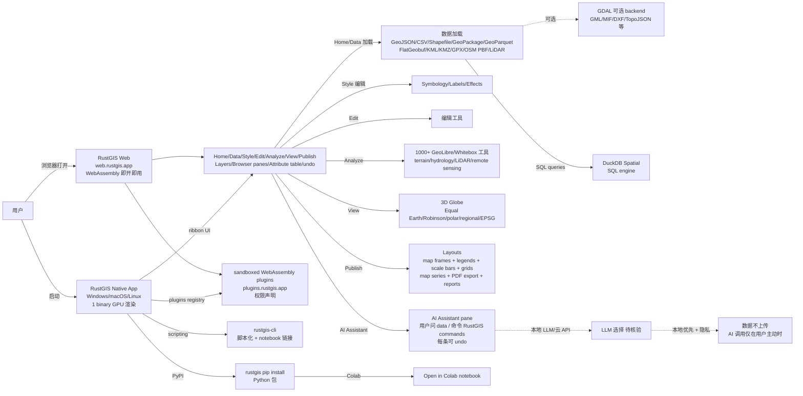

# opengeos/RustGIS

## 一句话定位
RustGIS 是一个 pure-Rust 写的跨平台开源 GIS——Windows/macOS/Linux native 运行 + 编译到 WebAssembly（web.rustgis.app 即开即用）；ribbon UI（Home/Data/Style/Edit/Analyze/View/Publish）+ 1000+ GeoLibre/Whitebox 分析工具 + sandboxed WebAssembly plugins（plugins.rustgis.app）+ AI Assistant 调 RustGIS commands + DuckDB Spatial + GDAL 全格式 + 3D globe + 16 语言 + 完整 Layouts + PyPI + Colab + Apache-2.0。

## 它解决的问题
2026 年 GIS 需求极大，但现有方案要么锁桌面（QGIS C++/Qt）、要么付费（ArcGIS）、要么云端（Google Earth Engine / Mapbox）。RustGIS 直击痛点：（1）**pure-Rust 一个 binary**——无 runtime 安装、GPU 渲染、跨平台；（2）**WebAssembly 浏览器内即开即用**——web.rustgis.app 无需安装；（3）**本地优先 + 隐私**——文件读写在本地，AI Assistant 仅在用户主动调用时接收数据；（4）**Everything is a command**——ribbon 每个按钮是带 id 的命令，rustgis-cli 脚本化；（5）**1000+ 分析工具**——GeoLibre/Whitebox 全工具库；（6）**plugins 沙箱**——sandboxed WebAssembly plugins + 权限声明；（7）**DuckDB Spatial SQL**——SQL queries + DuckDB databases；（8）**GDAL 全格式**——GeoJSON/CSV/Shapefile/GeoPackage/GeoParquet/FlatGeobuf/KML/KMZ/GPX/OSM PBF/LiDAR LAS/LAZ/COPC + PMTiles/MBTiles。解决的是 **「严肃工程化开源 GIS 用户」** 需要「跨平台 + 自包含 + AI Assistant + DuckDB Spatial + 1000+ 分析工具 + GDAL 全格式 + 3D globe + 多语言 + PyPI/Colab」严肃工程化整合问题。

## 为什么值得关注（2026-10-14）
- **Stars:** 771（截至 2026-10-14），4 天 771⭐ ⑂104 fork/star 13.5%，**增长率** 13.5%（fork/star 反映社区参与极高）
- **Forks:** 104，社区参与度极高（GIS 工具类项目天然适合 fork 定制）
- **Size:** 2863 KB（含 pure-Rust binary + WASM + plugins + DuckDB Spatial + GDAL bindings + AI Assistant + 16 语言 + PyPI/Colab）
- **License:** Apache-2.0
- **语言:** Rust
- **活跃度:** created 2026-10-10，pushed_at 2026-10-13，持续高活跃
- **平台:** Windows / macOS / Linux native + WebAssembly（web.rustgis.app）

## 热度来源判断
RustGIS 的热度是 **「开源 GIS 严肃工程化刚需 × pure-Rust 一个 binary × 跨 Windows/macOS/Linux + WASM × 1000+ GeoLibre/Whitebox 分析工具 × sandboxed WebAssembly plugins × AI Assistant pane × DuckDB Spatial × GDAL 全格式 × 3D globe × 16 语言 × 完整 Layouts × PyPI + Colab × Apache-2.0」** 的组合。GIS 用户量极大（地理 / 测绘 / 遥感 / 环境 / 城市规划 / 物流），开源 QGIS C++/Qt 体验差，付费 ArcGIS 成本高，云 GIS 隐私风险。RustGIS 把「pure-Rust + 跨平台 + WASM + plugins + AI Assistant + DuckDB Spatial + GDAL 全格式 + 16 语言 + Apache-2.0」严肃工程化整合，自然爆火。104 fork 是 GIS 工具类项目的网络效应（fork = 二次开发）。热度真实且具「严肃工程化开源 GIS」场景的强需求。

## 关键技术亮点
1. **pure-Rust 一个 binary：** 无 runtime 安装，GPU 渲染，跨平台
2. **WebAssembly 即开即用：** web.rustgis.app 浏览器内打开即用
3. **ribbon UI：** Home / Data / Style / Edit / Analyze / View / Publish + Layers / Browser panes + Attribute table + undo 每改动
4. **AI Assistant pane：** 用户问 data / 命令 RustGIS commands（每条可 undo）
5. **1000+ GeoLibre/Whitebox 分析工具：** terrain / hydrology / LiDAR / remote sensing
6. **sandboxed WebAssembly plugins：** plugins.rustgis.app 插件注册中心 + 权限声明
7. **DuckDB Spatial SQL：** SQL queries + DuckDB databases 集成
8. **GDAL 全格式：** GeoJSON / CSV / Shapefile / GeoPackage / GeoParquet / FlatGeobuf / KML / KMZ / GPX / GML / MIF / OSM PBF / TopoJSON / DXF / LiDAR LAS/LAZ/COPC（in place 大文件）
9. **PMTiles / MBTiles：** web 或 file
10. **3D globe：** Equal Earth / Robinson / polar / regional / 任何 EPSG code
11. **完整 Layouts：** map frames + legends + scale bars + grids + map series + PDF export + reports + presentations
12. **Web basemaps：** XYZ / TMS / WMS tiles + Mapbox Vector Tiles + MapLibre styles + OpenFreeMap
13. **Symbology tables：** graduated colours + colour schemes + effects + labeling + data
14. **Dark mode + Projects (.rgis)：** Start blank / World Atlas sample / open .rgis
15. **rustgis-cli：** Script from CLI + chain in notebooks and models + AI Assistant 调用
16. **PyPI + Colab：** rustgis pip install + Open in Colab notebook
17. **16 语言本地化：** 中文 / 英文 / 日文 / 韩文 / 法文 / 德文 / 西班牙文 / 阿拉伯文 等
18. **Apache-2.0：** 商业使用友好

## 架构师速览

| 决策问题 | 研究判断 | 证据边界 |
|---|---|---|
| 系统边界 | 一个跨平台 native GIS app（Windows/macOS/Linux + 同一 binary）+ 一个 WebAssembly 版 web.rustgis.app（无需安装）+ 一个 sandboxed WebAssembly plugin registry（plugins.rustgis.app）+ 一个 AI Assistant pane（驱动 RustGIS commands）+ 一个 ribbon UI（Home/Data/Style/Edit/Analyze/View/Publish）+ 一个 rustgis-cli 脚本化入口 + 一个 DuckDB Spatial SQL engine + 一个 GDAL 可选数据 backend + 一个 1000+ GeoLibre/Whitebox 分析工具库 + 一个 PyPI 包（rustgis pip install）+ 一个 Colab notebook + 16 语言本地化 | 仅基于 README 「Fast and small + Runs everywhere + Local and private + Everything is a command + Familiar ribbon + Extensible + 1000 GeoLibre and Whitebox tools + sandboxed WebAssembly plugins + AI Assistant pane + rustgis-cli + GeoJSON/CSV/GeoPackage/GeoParquet/Shapefile/FlatGeobuf/KML/KMZ/GPX/WKT out + SQL/DuckDB + PMTiles + MBTiles + Layouts + Dark mode + Projects」+ Apache-2.0 badge 推断；具体 GPU 渲染后端（wgpu/Metal/DirectX/Vulkan 选型）、plugin SDK 完整度、AI Assistant 接入方式（本地模型/云 API）未在档案明示 |
| 主路径 | 用户启动 RustGIS native 或打开 web.rustgis.app → 选 Project（blank / World Atlas sample / open .rgis）→ ribbon 选 Home / Data / Style / Edit / Analyze / View / Publish → 加载数据（GeoJSON/CSV/Shapefile/GeoPackage/GeoParquet/FlatGeobuf/KML/KMZ/GPX/OSM PBF/LiDAR）→ 编辑 symbology / labels / effects → Buffer / Dissolve / Reproject / 等 1000+ 工具分析 → AI Assistant 调 RustGIS commands（每条可 undo）→ 选 Layout → 加 map frame + legend + scale bar + grid → 导出 PDF 或 report / presentation | 主路径为 README 「A tour / Features table / Symbology / AI Assistant / Analysis / Rasters / Globe / Web basemaps / Layouts / Dark mode / Projects」 段落整理；具体 wgpu 渲染 shader、AI Assistant LLM 选择、plugin 沙箱细节未在档案明示 |
| 关键权衡 | 全 Rust 重写 vs 跨平台覆盖（Windows/macOS/Linux + WebAssembly + 不含 mobile）vs 1000+ 工具库 vs AI Assistant vs sandboxed plugins vs GDAL 可选 vs DuckDB Spatial vs Apache-2.0 vs PyPI/Colab vs native binary vs 4 天 771⭐ ⑂104 fork/star 13.5% 增长曲线 vs 社区维护 vs 与 QGIS 生态兼容性 | 权衡来自 README 「Fast and small + Runs everywhere + Local and private + Everything is a command + 1000 GeoLibre and Whitebox tools + sandboxed WebAssembly plugins + AI Assistant + rustgis-cli + 16 languages + Apache-2.0」 |
| 最小 PoC | 装 RustGIS desktop 或开 web.rustgis.app → 加载一个 GeoJSON sample → ribbon 选 Style → Symbology 调 graduated colors + classification → ribbon 选 Analyze → Buffer 300 km around cities → ribbon 选 Layouts → 加 map frame + legend + scale bar → 导出 PDF | PoC 由 README 「Symbology / Analysis / Layouts」 段落整理；具体 plugin 安装、AI Assistant 调用、GDAL format 支持、Colab notebook 完整流程未在档案明示 |
| 证据边界 | 仅核验：仓库存在、stars/forks/description/license/size/language 来自 GitHub API；README 节录自 raw 接口；pure-Rust + WASM + plugins + AI Assistant + DuckDB Spatial + 1000+ GeoLibre/Whitebox + 16 语言 + Apache-2.0 由 README 直接叙述 | 待核验：GPU 渲染后端选型、plugin SDK 完整度、AI Assistant LLM 选择、DuckDB Spatial 集成方式、GDAL format 完整度、与 QGIS 生态兼容性、社区贡献治理 |

## 架构启发
RustGIS 的核心启发是 **「pure-Rust + 跨平台 native + WASM + plugins + AI Assistant + DuckDB Spatial + GDAL 全格式 + 16 语言 + Apache-2.0」严肃工程化整合**。当前开源 GIS 体验差（QGIS C++/Qt 启动慢、依赖多），付费 GIS 成本高（ArcGIS），云 GIS 隐私风险。RustGIS 把「pure-Rust 一个 binary + 跨平台 + 浏览器 WASM + plugins + AI Assistant + DuckDB Spatial + GDAL 全格式 + 3D globe + 16 语言 + Apache-2.0」整合为严肃工程化形态，类似 DuckDB 之于「列存 OLAP + in-process」整合。这指向 **「严肃工程化国产开源 GIS」** 的未来。RustGIS 还展示了 **「Everything is a command」** 的设计哲学——ribbon 每个按钮是带 id 的命令，rustgis-cli 脚本化 + AI Assistant 调用。这与 `HelixDB/helix-foundry`（本地优先公司数据工作台）+ `storytold/figcraft`（Figma 干净房间 Rust 重写）形成完整的「Rust 全栈严肃工程化」方向。

## 架构图（MMD）

> 证据边界：此图只采用本档案已有可核验描述；"待核验"节点不应视为项目实现事实。

## 定位判断
**工具型项目（严肃工程化开源 GIS 整合）。** RustGIS 不仅是 QGIS 替代品，更展示了「pure-Rust + 跨平台 + WASM + plugins + AI Assistant + DuckDB Spatial + GDAL 全格式 + 16 语言 + Apache-2.0」严肃工程化路径。771⭐ + 104 fork/star 13.5% 已显示 GIS 工具需求。但能否持续取决于：（1）mobile 平台覆盖；（2）GPU 渲染后端跨 vendor 兼容性；（3）plugin SDK 完整度；（4）AI Assistant LLM 选择；（5）DuckDB Spatial 集成方式；（6）GDAL format 完整度；（7）与 QGIS / ArcGIS 数据格式兼容；（8）社区贡献治理。定位是「严肃工程化开源 GIS」头部样本，向「严肃工程化国产开源 GIS 平台」演进是合理路径。

## 风险 / 局限 / 泡沫点
- **mobile 平台暂未覆盖：** iOS / Android native app 未在档案明示
- **GPU 渲染后端选型：** wgpu / Metal / DirectX / Vulkan 跨 vendor 兼容性未在档案明示
- **plugin SDK 完整度：** sandboxed WebAssembly plugins 的 SDK 完整度未在档案明示
- **AI Assistant LLM 选择：** 本地模型 vs 云 API 选型与隐私边界未在档案明示
- **DuckDB Spatial 集成方式：** SQL engine 集成的具体实现未在档案明示
- **GDAL format 完整度：** GDAL 安装可选的格式覆盖完整度未在档案明示
- **与 QGIS / ArcGIS 数据格式兼容性：** .qgz / .mxd 等格式兼容性未在档案明示
- **rustgis-cli 脚本化深度：** Scripting 完整度未在档案明示
- **社区贡献治理：** PR 治理 + 文档完整度 + 翻译协作未在档案明示

## 与同类项目的关系
- **vs QGIS:** QGIS C++/Qt 桌面；RustGIS pure-Rust 跨平台 + WASM + 16 语言 + Apache-2.0
- **vs ArcGIS:** ArcGIS 付费；RustGIS Apache-2.0 完全免费
- **vs Google Earth Engine:** GEE 云端 + 隐私风险；RustGIS 本地优先 + 隐私
- **vs Mapbox / MapLibre:** Mapbox 商业 + MapLibre JS 库；RustGIS 是完整 GIS app
- **vs Turf.js:** Turf.js 浏览器内几何库；RustGIS 是完整 GIS app
- **vs DuckDB:** DuckDB 列存 OLAP；RustGIS 是 GIS app 集成 DuckDB Spatial
- **vs GDAL:** GDAL C++ 数据 backend；RustGIS 是 GIS app 可选 GDAL

## 是否值得持续跟踪
**值得跟踪（严肃工程化开源 GIS 整合）。** RustGIS 代表了开源 GIS 从「QGIS C++/Qt 桌面 + ArcGIS 付费 + 云 GIS」到「pure-Rust + 跨平台 + WASM + plugins + AI Assistant + DuckDB Spatial + GDAL 全格式 + 16 语言 + Apache-2.0」严肃工程化路径的演进。无论其本身成败，这一方向是 GIS 的趋势。建议关注：（1）mobile 平台覆盖；（2）GPU 渲染后端选型；（3）plugin SDK 完整度；（4）AI Assistant LLM 选择；（5）DuckDB Spatial 集成方式；（6）GDAL format 完整度；（7）与 QGIS / ArcGIS 数据格式兼容；（8）企业采用（严肃工程化国产 GIS 是否采纳）。对需要「跨平台 + 自包含 + AI Assistant + DuckDB Spatial + 1000+ 分析工具 + GDAL 全格式 + 16 语言 + Apache-2.0」的严肃工程化开源 GIS 用户，这个工具是严肃工程化整合的实用选择，值得直接采用。

## 后续观察点
- 是否演化为独立公司 / 平台（从 GitHub 仓库升级为商业产品）
- mobile 平台覆盖（iOS / Android native app）
- GPU 渲染后端选型（wgpu / Metal / DirectX / Vulkan）
- plugin SDK 完整度
- AI Assistant LLM 选择（本地 vs 云）
- DuckDB Spatial 集成方式
- GDAL format 完整度
- 与 QGIS / ArcGIS 数据格式兼容性
- 企业采用（严肃工程化国产 GIS 是否采纳）
- 社区贡献治理（PR / 文档 / 翻译协作）
- 16 语言本地化覆盖完整度
- PyPI / Colab 集成深度

---
> 数据来源: GitHub Repository API (2026-10-14) + README raw 接口 | Stars: 771 | Forks: 104 | License: Apache-2.0 | 语言: Rust | Size: 2863 KB | 创建: 2026-10-10 | 平台: Windows / macOS / Linux native + WebAssembly