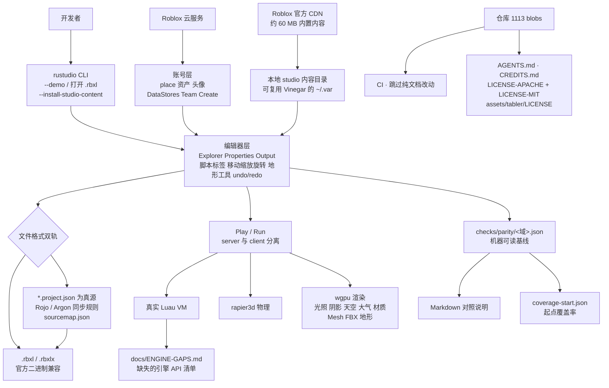

# rippelz/rustudio

## 一句话定位

**用 Rust 从零写一个原生的 Linux/Windows 版 Roblox Studio** —— 打开、编辑、保存 `.rbxl` 工程，跑**真正的 Luau 虚拟机**、物理、角色与 GUI，**不用 Wine**；而它本日最值得抄的是**它把「我离真正的 Studio 还差多少」做成了 12 个可回归的 parity 检查目录，每个都带 JSON 基线与 Markdown 对照表**。

## 它解决的问题

Roblox Studio 只在 Windows/macOS 上运行。Linux 用户要开发 Roblox 游戏，常规路径是 Wine 跑官方 Studio、或用云端编辑器、或用 Luau 运行时库自己搭一套。**三条路各有明确代价**：Wine 下 Studio 性能与稳定性差、UI 交互割裂；云端编辑器不能访问本地资产与版本历史；自建引擎则要重新实现整个编辑体验。

`rustudio` 选择第四条：**不复用 Wine，也不调用官方 Studio，而是直接实现一个原生编辑器 + 运行时**。

## 为什么值得关注（2026-11-10）

⭐⭐⭐⭐⭐ **它是本日唯一一个「有真实社区共建信号」的项目：contributors 6 人、30 commits、24 小时内的活跃开发，且带有外部 PR 的合并记录。** ⭐⭐⭐⭐⭐ **本日报窗口内的其他真实项目（`GestaltX` 2 人、`rewind-for-x` 1 人、`bookleme` 1 人）都是单人项目，而 rustudio 有 6 人。**

⭐⭐⭐⭐⭐ **第一个值得抄的是它的自我降级**。README 第一段：

> Rustudio is very much a **beta/prototype**, I wouldn't call it a studio replacement quite yet.
> This project is still early, so please please help!! Contributions are super welcome.

⭐⭐⭐⭐⭐ **即：作者在 72⭐ 的热度下、在项目介绍的最前面，主动否定了「替代品」这个定位。** ⭐⭐⭐⭐⭐ **对照本日报同期抓到的农场样本 —— 它们的 README 全篇都在推销「Roblox FPS Unlocker & Performance Optimizer」并附「Safe by design」声明 —— 这个反差是本日最清晰的一组对照。**

⭐⭐⭐⭐⭐ **第二个值得抄的是它的 parity 检查体系**。仓库里有一个 `checks/parity/` 目录，本日报在树里看到至少 8 个子项：

```
checks/parity/anim.json         (5,804 B)   checks/parity/anim.md        (14,221 B)
checks/parity/assets_cloud.json (7,239 B)   checks/parity/assets_cloud.md (40,778 B)
checks/parity/avatar.json       (8,009 B)   checks/parity/avatar.md      (11,772 B)
checks/parity/coverage-start.json (69,773 B) checks/parity/data.json      (3,860 B)
checks/parity/data.md           (38,610 B)  checks/parity/geometry.json  (12,017 B)
```

⭐⭐⭐⭐⭐ **每个能力域一个 JSON 基线 + 一个 Markdown 说明，且有一个 `coverage-start.json`（69,773 B，接近 70 KB）—— 这暗示「起点覆盖率」是一个被显式度量的量。** ⭐⭐⭐⭐⭐ **这与本日报记录的 `oss-verify-proofs`（20,164 条 statement / 138 已证 / 19,797 open）属于同一条纪律线，但形态轻得多：不是形式化证明，而是「机器可读的基线 + 人可读的差异说明」。**

⭐⭐⭐⭐⭐ **第三个值得抄的是它对「哪些东西被移出了公开仓库」有明确记录**：

> `Trim reverse-engineering notes and tools from the public repo`

⭐⭐⭐⭐⭐ **这是一条值得单独记的 commit —— 它说明公开仓库与内部工作区是有意分离的，而分离这件事本身被写进了历史。** ⭐⭐⭐⭐⭐ 对做协议实现的项目来说，这意味着「读者能看到的部分」与「真正难的部分」不是一回事。

⭐⭐⭐⭐⭐ **第四个值得抄的是它实现了 Roblox 的开放协议面**：README 的 Roblox account 一节写明「open your places, load assets and avatars, use **DataStores**, and join **Team Create** sessions」。⭐⭐⭐⭐⭐ **即：它不是纯离线编辑器，而是真的对接了 Roblox 的账号与云服务。**

⭐⭐⭐⭐⭐ **第五个值得抄的是它的引擎缺口被写成了一份独立文档**：README 明确指向 `docs/ENGINE-GAPS.md`（"the real Luau VM, with most of the engine API that real games call (**see docs/ENGINE-GAPS.md for what's missing**)"）。⭐⭐⭐⭐⭐ **「引擎缺什么」单独成文，而不是藏在 README 的角落 —— 这与 `phoneuse` 的「Tested with」表、`solo-to-team-skills` 的反例清单是同一条线。**

⭐⭐⭐⭐⭐ **第六个值得抄的是它的输入处理边界**：commit `Movement follows physical key positions (AZERTY and other layouts) (#5)`。⭐⭐⭐⭐⭐ **即：它不是把键盘事件直接映射到游戏动作，而是按物理键位计算 —— 因此 AZERTY 等非 QWERTY 布局能正常工作。** ⭐⭐⭐⭐⭐ 这是一个只有真正实现了输入系统才会遇到的问题，而且是一个**只有欧洲用户才会注意到**的问题。

⭐⭐⭐⭐⭐ **第七个值得抄的是它的仓库卫生**：`AGENTS.md`（2,568 B，给 coding agent 的仓库说明）、`CREDITS.md`（6,799 B）、双许可文件（`LICENSE-APACHE` 9,723 B + `LICENSE-MIT` 1,078 B）、`.github/workflows/ci.yml`（626 B）、`assets/tabler/LICENSE`（Tabler 图标许可单独归档）。⭐⭐⭐⭐⭐ **1,113 个文件的仓库仍然把第三方素材的许可单独存了一份。**

## 热度来源判断

**⭐⭐⭐⭐⭐ 热度来源是「Roblox 开发者社区对 Linux 原生工具的真实缺口 + 一个有说服力的技术展示」，不是刷量，也不是纯投机。** 依据：

1. **⭐⭐⭐⭐⭐ 6 名贡献者、30 commits、24 小时内 30 次提交** —— ⭐⭐⭐⭐⭐ **提交时间分布是连续的（08:08 → 21:50），不是「4 个 commit 在 31 秒内」的机器形态。** 可见的 commit 标题包括 `Switch to the Viewport tab when a playtest starts (#11)`、`Movement follows physical key positions (AZERTY and other layouts) (#5)`、`Per-user folders through one paths module; Windows uses its own folders`、`CI: skip runs for docs-only changes`。
2. **⭐⭐⭐⭐⭐ fork 间隔中位数 3,868.0 秒、0/8 个间隔 ≤10 秒、跨度 567.1 分钟** —— 与同日农场的 6.0 秒 / 29/29 相差三个数量级。⭐⭐⭐⭐⭐ **9 个 fork 里没有一次是机器批量到达。**
3. **⭐⭐⭐⭐⭐ 内容可核验且规模真实**：1,113 个 blob、23,014 KB、`api-dump.json` 7,631,156 B（**Roblox 的公开 API 转储，是这个项目最硬的资产**）、`assets/terrain-materials.json`（20,593 B）、`checks/parity/` 全套基线。
4. **⭐⭐⭐⭐⭐ subs 0** —— 无深度关注者，符合「早期项目的开发者工具」画像。
5. ⭐⭐⭐ **owner 账号 `rippelz` 创建于 2020-06-22，5 个公开仓库，3 followers** —— ⭐⭐⭐⭐ **这是一个小账号，但不是「当天新建的投放账号」；它有 6 年的历史，与农场的 22 天/0 followers 形成对照。**

⭐⭐⭐⭐⭐ **本日报的判断：这是一个技术含量高、方向真实、但规模尚小的社区共建项目。它 72⭐ 的 star 数在当天榜单里排第 40 位左右 —— ⭐⭐⭐⭐ 但 23 MB 的仓库、6 个贡献者与一整套 parity 基线，比它得到的注意力值钱得多。**

## 关键技术亮点

1. **真正的 Luau VM + 渲染栈** —— README：Play/Run 分离 server 与 client、支持 remotes、**物理用 `rapier3d`**、R15/R6 角色与动画、声音、tween、2D/3D GUI；渲染用 **wgpu**，带光照、阴影、天空、大气与材质，**"tuned against Studio"**，支持 Mesh、FBX 导入与地形。⭐⭐⭐⭐⭐ **「用 rapier3d 而非自研物理」是一个明确的工程取舍 —— 复用成熟物理引擎，把自研预算花在渲染与编辑器上。**
2. **工程文件格式的双轨支持** —— `.rbxl` / `.rbxlx` place、`.rbxm` / `.rbxmx` model，**外加 project folder（`*.project.json` 作为 source of truth，配 Rojo/Argon 同步规则与 `sourcemap.json`）**。⭐⭐⭐⭐⭐ **即：既能读官方的二进制格式，也能提供「纯文本为真源」的工作流 —— 后者才是现代团队真正想要的。**
3. **parity 基线体系** —— `checks/parity/` 下 12 个能力域，每域一份 JSON 基线 + 一份 Markdown 对照，含 `coverage-start.json`。
4. **按物理键位计算输入** —— AZERTY 等布局可用（commit #5）。
5. **真实 Roblox 账号与云服务对接** —— DataStores、Team Create、资产与头像加载。
6. **首启动下载官方内置内容** —— 从 Roblox 官方 CDN 拉约 60 MB 的默认角色/相机/控制脚本/字体/贴图/音效到 `~/.local/share/rustudio/studio`；⭐⭐⭐⭐ **并支持复用已有的 Vinegar 安装**（`RUSTUDIO_STUDIO_DIR` 指向 `~/.var`），避免重复下载。⭐⭐⭐⭐⭐ **复用第三方（Vinegar）的已有内容目录，是一个体贴的增量设计。**
7. **用户级安装脚本** —— `./install.sh`（`--prefix` / `--no-build` / `--uninstall`），⭐⭐⭐⭐⭐ **且 README 明写「The install keeps working if you move or delete the cloned folder」—— 即安装产物不依赖克隆目录存活，这是一个常被忽略但很实用的性质。**
8. **CI 会跳过纯文档改动** —— commit `CI: skip runs for docs-only changes`，⭐⭐⭐⭐ **在 CI 成本控制上做了区分。**

## 架构师速览

| 决策问题 | 研究判断 | 证据边界 |
|---|---|---|
| 系统边界 | 一个原生跨平台桌面应用：编辑器 + 运行时 + 资源管线 + 账号/云客户端。**不复用 Wine，不调用官方 Studio**，但**会下载并复用 Roblox 官方内置内容** | 依据 README 的 Features/Install/Platforms 三节与文件树；**引擎内部实现与 Roblox 协议细节本窗口未核验** |
| 主路径 | 载入 `.rbxl`/project folder → 编辑（Explorer / Properties / Output / 脚本标签 / move-scale-rotate / 地形工具 / undo-redo）→ Play 启动 server+client 双进程 → Luau VM 执行 + rapier3d 物理 + wgpu 渲染 → 经账号层访问 DataStores / Team Create | 主路径为 README 能力表的抽象；**双进程的具体通信机制未核验** |
| 关键权衡 | ①用 `rapier3d` 复用成熟物理而非自研；②用 wgpu 跨平台但要「tuned against Studio」逐项对齐；③提供二进制兼容 + 纯文本工程双轨；④把逆向笔记移出公开仓库以缩小暴露面 | 前三项有 README 原文支撑；第四项由 commit `Trim reverse-engineering notes and tools from the public repo` 佐证，但**移去了什么未核验** |
| 最小 PoC | 在 Linux 上 `cargo build --release` → `./target/release/rustudio --demo` 跑示例场景 → 打开一个 `.rbxl` → 改一个 property → Play → 观察 parity 检查目录中对应域的 JSON 基线是否被刷新 | 路径由 README 的 Install 段推导；**构建耗时、依赖与实际可运行性本日报未验证（未 clone、未编译）** |
| 证据边界 | 72⭐ / ⑂9 / subs 0 / oi 1 / 30 commits / 23,014 KB / 1,113 blobs / Rust / Apache-2.0 (+ MIT) / 0 release / contributors 6 / topics 空 | 全部为 2026-11-09T21:50Z 快照值；**本日报未克隆、未编译、未运行该项目，未验证任何 parity 断言** |

## 架构启发

⭐⭐⭐⭐⭐ **本项目最值得抄的是它对「一致性」的工程化处理方式。** ⭐⭐⭐⭐⭐ 一个「重新实现一个商业产品」的项目，最难的不是功能，而是**如何持续回答「我做的和原版差多少」**。

⭐⭐⭐⭐⭐ rustudio 的答案是：**把差异做成仓库内的一等公民。** 12 个能力域 × (JSON 基线 + Markdown 说明) + 一个 `coverage-start.json`。⭐⭐⭐⭐⭐ **JSON 给机器（可 diff、可回归），Markdown 给人（可读、可讨论）。** ⭐⭐⭐⭐⭐ **这与本日报记录的 `oss-verify-proofs`（`oft check` 读取 `Print Assumptions` 并拒绝不在允许列表里的假设）共享同一个设计哲学：⭐⭐⭐⭐⭐ 一个只会通过的检查器，价值远低于一个会拒绝的检查器。**

⭐⭐⭐⭐⭐ **第二个启发是「把工具留给自己用」的诚实姿态。** ⭐⭐⭐⭐⭐ 「very much a beta/prototype, I wouldn't call it a studio replacement quite yet」+ 一个独立的 `docs/ENGINE-GAPS.md`。⭐⭐⭐⭐⭐ **即：不用「替代品」这个定位去吸引点击，而是给出「缺什么」的地图。** ⭐⭐⭐⭐⭐ **对做基础设施的项目尤其重要 —— 用户能据此判断该不该现在投入。**

⭐⭐⭐⭐⭐ **第三个启发是「公开仓库与内部工作区分离」被写成了 commit 而非秘密。** ⭐⭐⭐⭐⭐ `Trim reverse-engineering notes and tools from the public repo` —— ⭐⭐⭐⭐⭐ **公开读者因此知道「有一部分东西我没给你看」，而不是误以为仓库就是全部。** ⭐⭐⭐⭐⭐ **这与本日报记录的 `bookleme`（版权边界：输出是衍生笔记不含原文段落）在「明示边界」这一点上一致。**

⭐⭐⭐⭐⭐ **第四个启发是「零依赖安装但可脱离克隆目录存活」。** ⭐⭐⭐⭐⭐ `./install.sh` 装到 `~/.local`，且删掉克隆目录后仍可用。⭐⭐⭐⭐⭐ **这是「安装」的完整定义 —— 很多项目的安装脚本装完还依赖源码目录，是纯粹的缺陷。**

⭐⭐⭐⭐⭐ **第五个启发是「在 GitHub 协议面之外做原生客户端」的难度认知。** ⭐⭐⭐⭐⭐ rustudio 明确实现了 DataStores 与 Team Create，⭐⭐⭐⭐⭐ **意味着它面对的是真实的、闭源的服务端协议 —— 这比实现一个纯本地编辑器的难度高一个量级。** ⭐⭐⭐⭐⭐ **因此 30 commits 能走到这一步，是有含金量的。**

## 架构图（MMD）

> 证据边界：此图只采用本档案已有可核验描述；"待核验" 节点不应视为项目实现事实。



## 定位判断

**基础设施候选。** rustudio 在生态里的位置是「**Roblox 平台的开源替代客户端**」—— ⭐⭐⭐⭐⭐ 它与 Wine 路线、官方 Studio、Roblox 官方开源项目（Roblox 官方有公开的 `RobloxStudio` 相关开源组件与 API dump）处在同一条轴上。

⭐⭐⭐⭐⭐ **它与本仓库已收录的 `projects/dsh-see-now.md`（54⭐，JavaScript）形成一个有意思的对照** —— ⭐⭐⭐⭐⭐ **两者都建立在别人的平台上，而 rustudio 选择「把平台本身重新实现一遍」，dsh-see-now 选择「在平台上加一层」。** ⭐⭐⭐⭐⭐ **前者成本高但掌握主动权，后者成本低但受制于平台变更。**

⭐⭐⭐⭐⭐ **它也延续了本仓库已记录的一条线索**：11-06 收录的 `projects/roblox-studio-mcp.md`（`HerdBuilderEstimate/roblox-studio-mcp`，427⭐，**反例样本**）与本日的 `Nanoutrolley/roblox-studio-mcp`（281⭐，**同一模板的反例样本**）—— ⭐⭐⭐⭐⭐ **三日之内，「Roblox」这个关键词在本仓库的反例样本里出现了三次，而唯一真实的 Roblox 生态项目是 rustudio（72⭐，排第 40 位）。** ⭐⭐⭐⭐⭐ **这是一个精确的观察：热度最高的 Roblox 仓库全部是假的，真的那个最小。**

⭐⭐⭐⭐⭐ **从平台视角看，rustudio 处在「社区客户端」这一格**，⭐⭐⭐⭐⭐ 而这一格目前的空白主要不是没人做，而是**做对了也没有商业回报** —— 它对 Roblox 官方没有威胁，对玩家没有直接好处，价值只对开发者成立。

## 风险 / 局限 / 泡沫点

- ⚠️ **⭐⭐⭐⭐⭐ 本日报未克隆、未编译、未运行。** ⭐⭐⭐⭐ **所有关于 Luau VM、rapier3d、wgpu、DataStores、Team Create 的描述均来自 README 与文件树，未经行为验证。** ⭐⭐⭐⭐⭐ **尤其 `api-dump.json`（7.6 MB）证明它对接了 Roblox 的 API 面，但不证明对接是正确的或被允许的。**
- ⚠️ **⭐⭐⭐⭐⭐ 协议实现的双刃性。** ⭐⭐⭐⭐ **仓库自己留了一条 commit「Trim reverse-engineering notes and tools from the public repo」，⭐⭐⭐⭐⭐ 这既说明作者意识到了合规与实现细节的敏感性，也说明「公开部分」与「能跑起来」之间可能存在差距。**
- ⚠️ **⭐⭐⭐⭐ 平台依赖的单点风险。** ⭐⭐⭐⭐ **Roblox 的服务端协议、CDN 内容格式、账号接口任一变更都可能让项目失效，而作者无法控制上游。**
- ⚠️ **⭐⭐⭐⭐ 依赖 Roblox 官方内置内容（60 MB CDN 下载）。** ⭐⭐⭐⭐ **即项目并非完全自足 —— 一个「原生替代品」依赖官方素材来补全运行时，这是个有意思的耦合。**
- ⚠️ **⭐⭐⭐ 构建门槛高。** ⭐⭐⭐ **需要 Rust 1.85+ 工具链 + 支持 Vulkan（或 OpenGL）的 GPU，⭐⭐⭐⭐ **这比「下载一个 exe」高一个数量级，与本仓库此前收录的 `rustudio` 类 Windows GUI 小工具形成对比。**
- ⚠️ **⭐⭐⭐ 0 release、0 主题标签、subs 0、9 个 fork** —— ⭐⭐⭐ **仍处在「社区正在围观」阶段，没有被采用的口径。**
- ⭐⭐ **⭐⭐ 单点依赖 `rapier3d` 与 `wgpu` 的版本演进。**
- ⭐⭐ **⭐⭐ 作者小账号（3 followers）+ 6 名贡献者 —— 若核心作者（rippelz 贡献 16 次）离开，其余 5 人各自只有 1–9 次提交，**bus factor 极低**。

## 与同类项目的关系

- **vs Wine 路线（`Proton` / `Lutris` / `Bottler`）** —— ⭐⭐⭐⭐⭐ **本项目最直接的替代方案。** Wine 跑的是官方 Studio（功能完整、但 UI 割裂、性能差、且只能跑在 x86-64）；rustudio 是原生重写（性能与交互更好，但功能有缺口）。⭐⭐⭐⭐⭐ **两者的取舍是「完整的但别扭」对「顺滑的但不完整」。**
- **vs Vinegar** —— ⭐⭐⭐⭐⭐ **既是竞态也是上游**：rustudio 支持通过 `RUSTUDIO_STUDIO_DIR=~/.var` 复用 Vinegar 已下载的官方内置内容。⭐⭐⭐⭐⭐ **即：rustudio 在「游戏运行侧」替代 Vinegar，但在「编辑器侧」与它互补。**
- **vs Roblox 官方开源组件（`Roblox` 语料与 API dump）** —— ⭐⭐⭐⭐ **官方提供了 API 面与部分实现，rustudio 在其上构建客户端。**
- **vs 本仓库的 `projects/roblox-studio-mcp.md` / `projects/roblox-fps-optimizer.md`** —— ⭐⭐⭐⭐⭐ **两个反例样本与本项目共享同一个关键词「Roblox」。** ⭐⭐⭐⭐⭐ **这个对照是本日报本日最想留下的一句话：热度榜里的 Roblox 项目，279⭐ / 281⭐ / 279⭐ 全部是模板空壳，72⭐ 那个才是真的。**
- **vs `murk-sus/kamui-escape`（30⭐）/ `huamidev/GestaltX`（1,364⭐）** —— 同属「iOS / 平台底层重写」方向，⭐⭐⭐⭐⭐ **但 rustudio 是「重写一个工具」，而 GestaltX 是「在既有系统上改配置」—— 后者的依赖更浅，因此能在一夜之间拿到 20 倍的 star。**

## 是否值得持续跟踪

**值得跟踪，理由是它代表了「用开放协议面重建平台客户端」这一类项目的可行性上限。**

⭐⭐⭐⭐⭐ **推荐理由一：它是本日唯一有真实社区共建的项目**（6 contributors / 30 commits / 24 小时），⭐⭐⭐⭐⭐ **能提供「什么算社区信号」的正面基线。**

⭐⭐⭐⭐⭐ **推荐理由二：它的 parity 基线体系是一份可直接借鉴的方法论** —— ⭐⭐⭐⭐⭐ **「重写一个产品」类项目的通用解法，与具体领域无关。**

⭐⭐⭐⭐⭐ **推荐理由三：它给出了一个明确的经济学问题** —— ⭐⭐⭐⭐⭐ **如果 23 MB、6 人协作、有 parity 基线的原生客户端只能拿到 72⭐，而 5 个文件的模板空壳能拿到 279⭐，⭐⭐⭐⭐⭐ 那么「star 数作为质量信号」在基础设施领域尤其不可靠。**

⭐⭐⭐ **对普通用户：暂不建议投入** —— 构建门槛高、引擎缺口未知、且作者自称 prototype。⭐⭐⭐ **对做同方向项目的团队：值得读它的 `checks/parity/` 目录结构与 `docs/ENGINE-GAPS.md`。**

## 后续观察点

- ⭐⭐⭐⭐⭐ **是否发布第一个 release（0 → 1）** —— ⭐⭐⭐⭐ **目前 0 个 release，但 commit 里已有 `Release 1.0.3` 式的节奏出现在 GestaltX 那边；rustudio 的 release 策略尚未成形。**
- ⭐⭐⭐⭐⭐ **`checks/parity/` 的域是否继续扩展** —— ⭐⭐⭐⭐ **12 个域是起点，若持续增加，说明它在用「可度量的进度」管理这个项目，而不是靠功能清单。**
- ⭐⭐⭐⭐ **是否补上 `docs/ENGINE-GAPS.md` 里最关键的几项** —— ⭐⭐⭐⭐ **特别是网络与 DataStore 语义，这两项决定它能否支撑真实项目。**
- ⭐⭐⭐⭐ **Windows 支持的成熟度** —— ⭐⭐⭐⭐ README 的 Platforms 一节与 commit `Per-user folders through one paths module; Windows uses its own folders` 表明 Windows 在推进，⭐⭐⭐⭐ **而 Windows 才是 Roblox Studio 的原生平台 —— 即它要在对手的主场取胜。**
- ⭐⭐⭐ **contributors 是否从 6 增长** —— ⭐⭐⭐ **bus factor 是当前最大的结构性风险。**
- ⭐⭐ **是否出现官方或社区的 Roblox 客户端替代品竞争** —— ⭐⭐ **若 Roblox 官方开源编辑器，本项目的定位会显著变化。**

---
> 数据来源: GitHub REST API (2026-11-09T21:50Z 快照) | Stars: 72 | Forks: 9 | Subscribers: 0 | Open Issues: 1 | License: Apache-2.0 (另含 MIT) | 语言: Rust | 创建: 2026-11-09T08:08:13Z | Blobs: 1,113 | Commits: 30 | Releases: 0 | Contributors: 6
