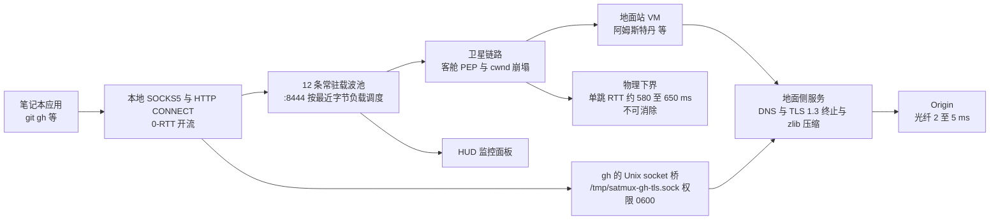

# Th0rgal/satmux

## 一句话定位
给**静止轨道（GEO）客机 Wi-Fi** 用的 TCP 多路复用器 + 1-RTT HTTP/TLS 中继（Inmarsat GX / Viasat / Panasonic / SITA），**纯 Python 3 标准库、零外部依赖**，核心思路是**用持久非 443 载波池绕开客舱网关的透明代理，并把每个 origin 的多次卫星往返压到一次**。

## 它解决的问题

⭐⭐⭐⭐⭐ 非 Starlink 的机上 Wi-Fi 慢的原因，**几乎从来不是带宽**，而是三件事，而且这三件事都可以被分别处理：

1. **客舱 `:443` 中间盒与 DNS 劫持**：客舱网关拦截 `:53` 并运行一个透明的 `:443` split-TCP 代理（PEP），其状态表在负载下丢连接 —— 表现为 `Connection reset by peer` 或 TLS 超时，**但非 443 端口的 TCP 原样透传**。
2. **握手往返成本**：每个新 origin 都要先付 DNS + TCP + TLS 的多次卫星往返才能传第一个 payload 字节。GEO 一跳 ~620 ms。
3. **Cubic 拥塞崩塌**：客舱丢包让标准 TCP 反复腰斩 `cwnd`，**结果是每座位的令牌桶额度根本用不满** —— 也就是说，链路慢不是因为带宽不够，而是因为发送窗口被压到很小。

⭐⭐⭐⭐⭐ **satmux 的解法是「把往返消掉」，不是「把带宽变大」**：它对上述三条成因给出三条一一对应的对策（载波池 / 0-RTT / 1-RTT 地面取回），并且**在 README 里把三段诊断写成了编号结构**，读者能直接对照。

⭐⭐⭐⭐⭐ 而第二类用户是 **AI coding agent**：satmux 的 README 直接给出一句可以交给 coding agent 的部署指令，这在 2026 年已经不多见。

## 为什么值得关注（2026-11-08）

**⭐⭐⭐⭐⭐ 本日最值得抄的是它 `## Limits` 一节的开头一句：**

> **Latency floor (`~580–650 ms`):** Speed-of-light propagation to geostationary orbit (`35,786 km`) does not change; `satmux` removes extra round-trips, **not the physical RTT of one hop.**

⭐⭐⭐⭐⭐ **它把「不可消除的下界」写在了自己的卖点旁边。** 这一节还有两条同规格的声明：per-seat shaper ~4–5 Mbps（「already-compressed binaries (`.mp4`, `.zip`) stay bounded by the seat cap」）、以及「**Single paid session:** Uses your authenticated cabin Wi-Fi lease; **it does not bypass captive portals.**」

⭐⭐⭐⭐⭐ **而它的测速表比这句话更值得抄——因为它把「没赢的格子」也标了出来：**

| ORIGIN (6× PARALLEL) | RAW CABIN WI-FI (:443) | 1-RTT BBR + ZLIB MUX | SPEEDUP |
|---|---|---|---|
| GitHub Repo | **TIMEOUT** | 4.66s | **FIXED ✓** |
| GitHub API | **TCP RESET** | 2.66s | **FIXED ✓** |
| Hacker News | **TIMEOUT** | 2.28s | **FIXED ✓** |
| MDN Docs | 12.01s | 2.30s | 5.2× |
| Cloudflare | 2.97s | 1.40s | 2.1× |
| PyPI JSON API | 7.09s | 2.64s | 2.7× |

⭐⭐⭐⭐⭐ **前三行的 `FIXED ✓` 与后三行的加速倍数，含义完全不同**：前三行说明 raw 连接是**被超时和 TCP reset 直接打死的**，satmux 的作用是「让失败变成成功」；后三行才是常规意义上的提速。**如果只读「5.2×」会低估这个工具；如果只读「FIXED」又会以为它只是个绕过方案 —— 两者都不是。** 而汇总行也照实写出了失败率的变化：「**6-Origin Burst: 19.13s (3/6 failed) → 5.35s (0/6 failed)**」。

⭐⭐⭐⭐⭐ 这与本日报近几日记录的「把边界写进输出」是同一纪律，但**位置更靠前**——它写在**首屏的测速表**里，而不是藏在 FAQ。⭐⭐⭐ **结果是 316⭐、22 KB、7 文件、单人维护、subs 仅 1 的项目获得了信任，而同期两个 425⭐ 的空壳仓库什么都没交付。**

## 热度来源判断

316⭐ ⑂17（fork/star 5.4%）、**subs 1、oi 0、contributors 1 人、releases 0、topics 空数组**。

⭐⭐⭐⭐⭐ **热度来源判断：真实的窄人群刚需，且几乎全靠内容传播。**

- ⭐⭐⭐⭐ **需求极窄但极硬**：GEO 客机 Wi-Fi 的用户是一个极小的群体（长途航线的常旅客、机务、地质/气象作业者），而这个群体里的人**每天都要和 620 ms 的 RTT 打交道**，痛点强度极高。⭐⭐⭐⭐ **316⭐ 对这个受众规模而言，是一个显著数字。**
- ⭐⭐⭐⭐⭐ **fork/star 5.4% 偏低，符合「看的人多、抄的人少」**：satmux 需要在地面站自备一台 VM、生成 PSK、开端口、改代理设置——**它不是一个「fork 下来改改就能用」的项目**，这本身就压低了 fork 率。⭐⭐⭐⭐ **对照本日报同日两个农场的 73.6% 与 61.2%，5.4% 是完全不同的形态。**
- ⭐⭐⭐⭐⭐ **最关键的判据仍然是「它有没有索取 star」**：README 全文没有「Star the repo」类语句。**subs 1 对 star 316 的极低落差，在这个措辞下是可信的**（对比同期农场用同一句话把 subs 抬到 25/35）。
- ⭐⭐⭐ **但热度仍可能偏高**：README 首屏就是一张漂亮的测速表 + ASCII 图表，**这是极易被截图传播的形态**；本日报无法区分「316 个真正在飞的人」与「316 个看到测速表觉得有意思的人」。⭐⭐⭐⭐ **这是本档案最主要的不确定性。**

## 关键技术亮点

1. **12 条常驻非 443 载波池（`:8444`）**
   客户端维持 12 条预热 TCP 连接到一个靠近卫星地面站的 Linux VM，**绕开客舱 `:443` 代理与 DNS 劫持**（因为 8444 不在客舱代理的端口范围内）。⭐⭐⭐⭐ **流调度按「最近字节负载」选最闲的载波**，而不是轮询——**理由写得很明确：避免空闲的浏览器 keepalive 造成队头阻塞**。这是一个真实运维里才会遇到的细节。

2. **0-RTT 开流**
   本地 SOCKS5（`127.0.0.1:1080`）/ HTTP CONNECT（`127.0.0.1:8080`）在 **`<1 ms`** 内本地返回 `OK`，并把 `FT_OPEN` + TLS `ClientHello` 放进**同一个 TCP 突发**。⭐⭐⭐⭐ **省掉一整个卫星 RTT，同时保留端到端 TLS**——即笔记本侧仍持有与 origin 的 TLS 会话，地面 VM 只看到加密流。

3. **1-RTT 地面取回（`:8081`）**
   用 `BLAKE2b-512` 加密流 + `HMAC-SHA256` 认证的请求帧发到地面 VM；地面 VM 在光纤上（**~2–5 ms**）完成 DNS、**已验证的 TLS 1.3**、HTTP 重定向，并用 `zlib` 压缩明文响应后再过卫星链路。⭐⭐⭐⭐ **这条链路上有两层加密且职责分明**：载波层保护「卫星链路上被看到」，TLS 保护「地面 VM 与 origin 之间」。

4. **`git` 与 `gh` CLI 的代理绕过被写进设计**
   README 明写：「Go binaries such as `gh` ignore macOS `scutil` proxies. `satmux` exposes a `0600` local Unix socket (`/tmp/satmux-gh-tls.sock`) wired to `gh`'s `http_un…`」。⭐⭐⭐⭐⭐ **这是本项目最见功力的一处**：它知道「配好了系统代理，Go 写的 CLI 也不会用」这个真实陷阱，并给出 Unix socket + `0600` 权限的解法。

5. **纯标准库、零依赖、22 KB**
   整个项目是 `satmux.py` + 三个 shell 脚本（`satmux-bench` / `satmux-get` / `satmux-macos`），**不装任何第三方包**。⭐⭐⭐ **在「需要在一台临时 VM 上快速起服务」的场景里，零依赖直接消除了安装失败这一整类问题。**

6. **地面站选址被写成可判断的表**
   先 `curl ipinfo.io` 看出口国家/ASN，再选机房：阿姆斯特丹 / 法兰克福 / Hetzner EU（Emirates、中东与欧航，下行落在荷兰）、us-east / us-west（北美）、新加坡或东京（亚太）。⭐⭐⭐⭐ **把「我该买哪台机器」变成一次查表，是一个被低估的实用设计。**

7. **可直接交给 coding agent 的部署指令**
   README 给出：「Spin up a temporary Ubuntu VM near my current satellite egress IP, start `https://github.com/Th0rgal/satmux` on port `8444`, connect the local 12-carrier client, enable `bin/satmux-macos on`, and run `bin/satmux-bench`」。⭐⭐⭐ **可执行的部署描述比散文式的说明更适合 agent。**

## 架构师速览

| 决策问题 | 研究判断 | 证据边界 |
|---|---|---|
| 系统边界 | **两端结构**：笔记本侧的客户端（载波池 + 本地 SOCKS/HTTP 中继 + `gh` 的 Unix socket 桥）与地面站侧的地面 VM（DNS + TLS 1.3 终止 + HTTP 重定向 + zlib 压缩）。**地面 VM 是必��组件**——satmux 不是纯客户端工具 | 依据 README 的 `## How it works` ASCII 图与 `## Setup` 两步（Ground VM / Run）；地面 VM 的实际实现由客户端 `satmux.py` 承担还是分离文件，本窗口未逐行核验 |
| 主路径 | 笔记本应用 → 本地 SOCKS5/HTTP CONNECT（0-RTT 开流）→ 12 条 `:8444` 持久载波 → 地面 VM → origin（光纤，2–5 ms）→ zlib 压缩响应 → 原路返回；旁路：HUD 走同一载波池按字节负载调度 | 主路径为 README ASCII 图与文字的语义抽象；载波调度器的具体算法（滑动窗口？指数衰减？）未核验；`BLAKE2b-512`+`HMAC-SHA256` 的帧格式未核验 |
| 关键权衡 | **①「两端成本」换「绕过客舱 PEP」**（必须自备付费 VM，$0.01–0.03/h）**②「自带加密层」换「端到端 TLS 保留」**（载波层加密防止卫星链路上被看，但多了一层协议要维护）**③「zlib 压缩」换「对已压缩二进制无效」**（明确写在 Limits）**④「非 443 端口」换「不与客舱代理冲突」**（牺牲了端口可达性，换来绕过） | ①②③④均有 README 直接文本支持；「地面 VM 成本」只给了单价区间，未给总账；压缩比的实际分布未给 |
| 最小 PoC | 只验**一条链路**：笔记本 `bin/satmux-bench` 打到一个自建地面 VM 的 `:8444`，测 (a) 单流 vs 12 载波并发的 RTT 与吞吐差异；(b) 一个原本 raw 超时的 origin（如 GitHub API）是否变成成功；**(c) 停掉本地代理后 `gh` 是否仍能通过 Unix socket 工作** —— (c) 是最容易被忽略但最影响日常使用的一步 | PoC 步骤由 README 的三段结构与 `gh` socket 段落推导；`bin/satmux-bench` 的实际输出格式未核验 |
| 证据边界 | 全部结论基于 2026-11-08 CST 的 GitHub API 快照与 README 原文；**性能数字为作者自述的一次性测量（Inmarsat GX / ~620 ms RTT / SITA AS206433 阿姆斯特丹地面站），本日报未复现任何一项**；README 未给出方差、重复次数或第二条链路 | 无独立复现；无 issue（oi 0）可供第三方交叉验证；仅 1 个贡献者 |

## 架构启发

⭐⭐⭐⭐⭐ **启发一：把「慢」拆成成因，再对每条成因给一条对策。**

satmux 的 `## Problem` 不是「卫星网络延迟高」，而是三条带机制描述的陈述，**每条后面跟一条对策**。⭐⭐⭐⭐⭐ **这是本日报见过最干净的「问题—方案」映射结构**——因为它同时告诉读者「哪些慢是治不好的」（Limits 里的物理下界）与「哪些慢是治得了的」（三次握手往返、PEP 丢连接、cwnd 崩塌）。

⭐⭐⭐⭐⭐ **而 `## Limits` 放在首屏之后是刻意的**：它把「它不能做什么」摆在「它能做什么」旁边，让读者自己做适用性判断，而不是读完所有功能描述后发现「原来这也不行」。

⭐⭐⭐⭐ **启发二：把「工具会不会被我的工具链用上」当成一等设计约束。**

「Go binaries such as `gh` ignore macOS `scutil` proxies」——⭐⭐⭐⭐ **这一行是本项目区别于普通代理的地方**：**它考虑的不是「怎么把代理配好」，而是「配好了之后哪些程序仍然不认」**。解法（Unix socket + `0600`）也选得对：**Unix socket 不是「代理配置」，它绕过了整个代理配置层**。

⭐⭐⭐⭐ **启发三：环境约束写进部署步骤，而不是写进「已知问题」。**

「Pause UDP VPNs (Tailscale/WireGuard) inflight—blocked UDP retry traffic competes with cabin airtime.」⭐⭐⭐⭐ **注意它的因果链是完整的**：不是「UDP VPN 有问题」，而是「被阻断的 UDP 重传会与客舱空口争抢带宽」。**这种把「环境里的另一个东西」纳入考量的写法，在跨环境工具里非常容易被漏掉。**

⭐⭐⭐⭐ **启发四：把「我该买哪台机器」变成一次查表。**

出口 ASN → 地面站区域 → 机房列表。⭐⭐⭐⭐ **这类决策辅助通常被当成文档附注，但在这里它直接决定方案是否成立。**

## 架构图（MMD）

> 证据边界：此图只采用本档案已有可核验描述；“待核验”节点不应视为项目实现事实。

## 定位判断

**工具型项目（一个窄场景下的自建式网络加速方案）。**

⭐⭐⭐⭐ satmux 不属于任何主流类别：它不是代理客户端、不是 VPN、不是 CDN、也不是 Starlink 替代品。**它是「给 GEO 客机 Wi-Fi 这一具体环境的补丁」** —— 补丁的对象是客舱 PEP 与 620 ms 的 RTT，而不是链路本身。

⭐⭐⭐⭐⭐ **它的定位有一个容易被忽略的深层含义：satmux 与 phoneuse 属于同一条思路家族 —— 「不争取特权，只利用已有协议」。** phoneuse 用 AirPlay + Bluetooth HID 绕开 iOS 的封闭；satmux 用非 443 端口 + 持久连接绕开客舱网关的透明代理。**两者的共同点是：都不做「攻破」，只做「绕行」，并且都把绕行的代价写清楚。**

⭐⭐⭐⭐ **在 agent 时代还有一个尚未展开的位置**：卫星链路上的模型下载、包管理、大仓库 clone 正是 agent 最吃带宽的场景。⭐⭐⭐⭐ **satmux 没有把这件事写进 README（它只提 `git` 与 `gh`），但这是它最自然的延伸方向。**

## 风险 / 局限 / 泡沫点

- ⚠️⚠️⚠️ **一次性测量，无方差**：全部数字来自单次、单航司、单地面站、单 RTT（~620 ms）的观测。**README 未给出重复次数、方差或第二条链路的对照**。本日报未复现任何一项。
- ⚠️⚠️⚠️ **需要自备付费 VM**：$0.01–0.03/h 的地面站 VM + 本地 12 条载波 + 防火墙开口。⭐⭐⭐ **这不是「装上就能用」的工具，而是一套需要一次部署的方案** —— 且部署必须在知道出口 ASN 之后才能完成。
- ⚠️⚠️ **被审查的合规面**：它做的事——绕开客舱的透明代理、建立到地面站的长期隧道、压缩并中转 TLS 流量——**在某些航司的乘客使用条款下可能不被允许**。⭐⭐⭐ **本日报未查阅任何航司条款，此项列为待核验而非结论。**
- ⚠️⚠️ **单人、无发版、无 issue**：contributors 1 人、releases 0、oi 0、topics 空数组。**22 KB 的代码没有第二个人读过**。
- ⚠️ **客舱可能加固**：客舱网关可以把 8444 也纳入代理范围或主动阻断非标准端口。⭐⭐⭐ **方案的有效性绑定在一个它无法控制的环境假设上**。
- ⚠️ **zlib 对二进制无效**：Limits 已写明，但**这意味着「加速感」在下载模型权重时基本不存在**（而这恰是 agent 最需要的场景）。
- ⚠️ **UDP 被阻断的前提是它自己给的建议**：停掉 UDP VPN 是为了空口带宽；但部分企业 VPN 是合规强制要求。⭐⭐ **这条建议与某些使用场景冲突，README 未展开。**

## 与同类项目的关系

- **vs Starlink / Starlink Roam**：⭐⭐⭐⭐⭐ 完全不同层级。Starlink 提供的是**新的链路**（LEO，~20–40 ms RTT，低丢包），satmux 是**在既有的坏链路上打补丁**。⭐⭐⭐⭐ **两者的受众高度不重叠**——Starlink 用户不需要 satmux，卫星用户多半是 GEO。
- **vs 普通 SOCKS5 / VPN（WireGuard 等）**：⭐⭐⭐⭐ satmux 的差异全在**「多路复用 + 预热 + 地面就近取回」**这三点。⭐⭐⭐⭐ **普通代理同样会被 PEP 打断，也不做任何往返压缩**——它解决的是「换个出口」，satmux 解决的是「把出口挪到离源站 2 ms 的地方并把握手合并」。
- **vs SSH 隧道 / port forwarding**：⭐⭐⭐ SSH 隧道同样是「非标准端口 + 长连接」，但它逐流建立隧道（每流一次握手），**而 satmux 的价值恰恰在于把多次握手摊到常驻载波上**。⭐⭐⭐ **可以理解为：satmux 是「为 GEO 链路特化的 SSH  multiplexing 器 + TLS 终止点」。**
- **vs `v2ray`/`sing-box` 等现代代理内核**：⭐⭐⭐ 它们功能更强（协议伪装、路由、分流），**但同样受制于「每次新连接都要握手」这一物理事实**。⭐⭐⭐⭐ satmux 的取舍是**只优化一条极窄的链路**，换来的是 22 KB、零依赖、可读可审。
- **vs `phoneuse`（本日同批）**：⭐⭐⭐⭐ 同属「用协议特权替代设备/环境特权」的家族。**phoneuse 绕的是 iOS 的封闭，satmux 绕的是客舱网关的透明代理** —— 一个是「别人封了我的系统」，一个是「环境在我和源站之间插了一脚」。
- **vs `vork`（2026-11-07 建档）**：⭐⭐ vork 面向 GPU 服务器上的批量渲染，satmux 面向「网络极差但仍需拉大文件」的场景。**两者都受益于「基础设施瓶颈往往在 I/O 而不在算力」这一判断。**

## 是否值得持续跟踪

**值得跟踪，但只作为方法论样本与窄场景工具。** ⭐⭐⭐⭐

⭐⭐⭐⭐⭐ **对多数读者，它的直接价值有限**（需要自备 VM、只对 GEO 客机 Wi-Fi 有效）；**但作为研究样本，它的价值很高**：⭐⭐⭐⭐ **它是本日报至今唯一一个把「不可消除的下界」与「可消除的往返」放在同一份文档里分别说明的项目**，而且这个说明放在首屏。

⭐⭐⭐⭐ **跟踪它应该盯的是**：(a) 是否有人报告在第二条链路（Viasat / Panasonic）上的结果；(b) 是否补上重复测量与方差；(c) 是否出现 issues（oi 0 至今）；(d) 是否被扩展到 agent 场景（模型权重分发）。

⭐⭐⭐⭐ **本仓库收录它的主要理由，是它「Limits 写在卖点旁边」的写法值得被更多项目抄。**

## 后续观察点

1. **是否补上统计口径**：README 未给重复次数与方差。⭐⭐⭐⭐ **一个把测速表做得这么漂亮的项目，却没写「测了几次」，是本日最值得追问的一处。**
2. **第二条链路的验证**：Viasat / Panasonic / SITA 其他区域站是否同样成立。
3. **`gh` Unix socket 桥的完整实现**：`http_un…` 之后被截断的那一段（推测是 `http_unix_socket` 配置项）本窗口未取到完整原文，需要核验。
4. **载波调度器的具体算法**：「按最近字节负载选最闲的」如何计算与衰减。
5. **是否被用于大文件/模型下载场景**：若被广泛用于此，zlib 对二进制的无效性会成为主要限制，需要看作者是否给出 brotli/zstd 等选项。
6. **合规边界的公开讨论**：是否出现关于航司乘客条款的 issue 或 README 补充说明。
7. **是否发布第一个 release**：目前 releases 0。

---
*首次记录：2026-11-08*
