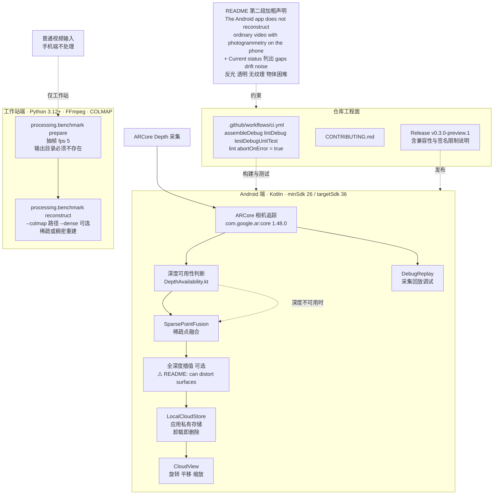

# faizfahmi77/ScanDot

## 一句话定位
**一个实验性的 Android 点云采集与查看应用** —— ⭐⭐⭐⭐⭐ 它的独特之处是**在 README 第二段就用加粗字体声明了一件最容易被误解的事**：「The Android app **does not** reconstruct ordinary video with photogrammetry on the phone」，并把「手机端 ARCore 深度采集」与「工作站端 FFmpeg + COLMAP 摄影测量」拆成两条互不混淆的路径。

## 它解决的问题
**用手机给房间/物体做三维点云扫描并本地查看。**

⭐⭐⭐⭐⭐ 现实约束是：手机端没有 GPU 级别的重建能力，ARCore Depth 在很多设备上不可用，而摄影测量（photogrammetry）需要工作站级的算力。⭐⭐⭐⭐⭐ ScanDot 的选择是**不假装手机能做重建**，而是把能力边界划成两段：
- **手机端**：ARCore 相机追踪 + 深度估计 → 采集、保存、重新打开、旋转/平移/缩放查看点云；
- **工作站端**：抽帧 → COLMAP 稀疏/稠密重建。

## 为什么值得关注（2026-11-15）
⭐⭐⭐⭐⭐ **因为它是本数据集里「边界诚实」做得最靠前的一个** —— 声明的位置在 README 第二段，而不是藏在文档深处。

⭐⭐⭐⭐⭐ **可核验事实一：README 第二段的加粗声明。**

原文：

> The repository also contains a separate video photogrammetry pipeline that runs on a workstation using FFmpeg and COLMAP. **The Android app does not reconstruct ordinary video with photogrammetry on the phone.**

⭐⭐⭐⭐⭐ **这条声明挡掉的是绝大多数人会有的那个错误预期**（「扫码 = 得到 3D 模型」）。⭐⭐⭐⭐⭐ 按 11-13 记录的 `open-orange` 判据（「把做不到的事写进用户可见文档」），⭐⭐⭐⭐⭐ 这与 `open-orange` 的 `fix(docs): say that a cluster token cannot create a runner pool (#14)` 属于同一类，但**位置更靠前 —— 在用户还没产生错误期待之前**。

⭐⭐⭐⭐⭐ **可核验事实二：`Current status` 段把结果的不确定性逐条列出。**

原文：

> This is an early prototype. Results can contain gaps, drift and noise; they are not textured meshes or validated measurements. Reflective, transparent and textureless subjects are difficult. Capture quality and device compatibility need further testing.

⭐⭐⭐⭐⭐ **四个失败场景被点名**：gaps（空洞）/ drift（漂移）/ noise（噪声）、反光透明无纹理物体、设备兼容性未测。⭐⭐⭐⭐⭐ 并明确否认了两个可能被默认的期待：「不是带纹理的网格」「不是经过验证的测量」。

⭐⭐⭐⭐⭐ **可核验事实三：它把构建要求与产物路径写到了可复现的程度。**

- 需要 **JDK 17、Android SDK 36、支持 ARCore Depth 的设备**；
- 命令：`./gradlew assembleDebug lintDebug testDebugUnitTest`；
- 产物路径：`android-app/app/build/outputs/apk/debug/app-debug.apk`；
- 明确说明「**Install it as an update to preserve existing app data**」（即覆盖安装以保留数据）；
- 明确说明「Scans are stored in the app's private storage; **uninstalling the app removes them**」。

⭐⭐⭐⭐⭐ **可核验事实四：构建配置里有硬约束。**
`android-app/app/build.gradle.kts` 里 `lint { abortOnError = true }` —— ⭐⭐⭐⭐⭐ **即 lint 失败会中断构建**，这不是默认行为，是显式加上的。

⭐⭐⭐⭐⭐ **可核验事实五：CI 与工程规范齐全。**
仓库含 `.github/workflows/ci.yml`、`CONTRIBUTING.md`、`.gitattributes`；55 个文件里 23 个 `.kt`、8 个 `.py`、3 个 `.kts`；⭐⭐⭐⭐⭐ 且有 5 条提交里有 3 条是工程动作（「Make Python tests independent of local data」「Document project and add continuous integration」「Focus ScanDot on local capture and preview」）。

⭐⭐⭐⭐⭐ **可核验事实六：版本号与状态诚实对应。**
`versionCode = 7`、`versionName = "0.3.0-preview.1"`，release tag 为 `v0.3.0-preview.1`，⭐⭐⭐⭐⭐ **即二进制版本、Gradle 版本号与 Git tag 三者一致** —— 这在本数据集里是很罕见的严谨。

## 热度来源判断
⭐⭐⭐⭐⭐ **真实需求 + 一个尚未被充分满足的移动端 3D 需求，叠加「可视化效果强」的传播属性。**

支持「真实」的一面：⭐⭐⭐⭐⭐ **owner 账号 `faizfahmi77` 创建于 2015-12-10（10 年前）、2 个公开仓库、6 followers** —— ⭐⭐⭐⭐⭐ 按 11-13 建立的判据（「账号注册聚集度」而非「账号年龄」才有意义），一个 10 年前注册、此后只用过 2 个仓库的账号**完全不具备投放特征**；⭐⭐⭐⭐⭐ ⑂5 / subs 0 / oi 0 的组合在同日候选里很干净；⭐⭐⭐⭐⭐ 有真实的 `v0.3.0-preview.1` release 与 APK 产物路径。

⭐⭐⭐⭐⭐ 支持「含传播成分」的一面：532⭐ / ⑂5 = **fork/star 仅 0.94%**，⭐⭐⭐⭐⭐ 且 5 个 commit、0 个 issue、0 个 subs —— ⭐⭐⭐⭐⭐ **star 增速未做统计，本日报不下结论**；⭐⭐⭐⭐⭐ 「3D 扫描 + 点云」在社交平台上天然有视觉传播力，⭐⭐⭐⭐⭐ 因此不能排除「demo 效果驱动 star」。

## 关键技术亮点
1. **ARCore 深度 + 相机追踪的融合**：代码里有 `DepthFusion.kt` / `SparsePointFusion.kt` / `DepthAvailability.kt` / `CloudGeometry.kt` 等独立文件，⭐⭐⭐⭐⭐ 说明深度数据的可用性判断与融合是显式建模的，而不是假设深度总存在。
2. **可选的「全深度插值」模式**：README 明确警告它「**can distort surfaces**」⭐⭐⭐⭐⭐ —— ⭐⭐⭐⭐⭐ **即它提供的是「补全后的点云」，而不是「更准的点云」，并如实说明代价。**
3. **采集与回放分离**：`DebugReplay.kt` 让采集过程可重放调试；`LocalCloudStore.kt` 负责本地持久化；⭐⭐⭐⭐⭐ `ImportStorage.kt` 支持导入。
4. **工作站管线独立成包**：`processing.benchmark` 是一个独立子命令包（`prepare` / `reconstruct --colmap --dense`），⭐⭐⭐⭐⭐ **明确要求输出目录不存在**（避免覆盖既有结果），并要求 Python 3.12+。
5. **CI 跑单元测试**：`ci.yml` 存在，且有一条提交专门让 Python 测试不依赖本地数据。

## 架构师速览

| 决策问题 | 研究判断 | 证据边界 |
|---|---|---|
| 系统边界 | 「Android 端点云采集与预览」；**边界被显式划成两段** —— 手机端负责采集/存储/预览，工作站端负责视频摄影测量重建 | README 的两段路径描述 + 55 个文件的 `.kt`/`.py` 分布；⚠️ **未在设备上运行、未运行 Python 管线** |
| 主路径 | 相机帧 → ARCore 追踪 + 深度 → 稀疏点融合（+ 可选全深度插值）→ 本地存储 → `CloudView` 交互查看；旁路：视频 → 抽帧 → COLMAP 重建 | 主路径由 `AppModel.kt` / `DepthFusion.kt` / `CloudView.kt` / `LocalCloudStore.kt` 的文件命名与 README 推导；⚠️ **逐文件实现未审阅** |
| 关键权衡 | ①**真值 vs 完整**：提供全深度插值（更满但会失真）而不是只给稀疏点，**并把失真写进 README**；②**移动 vs 桌面**：把摄影测量放到工作站而非试图在手机上做，**并在第二段就说明**；③**原型 vs 稳定**：版本号带 `-preview.1`、release 说明写明兼容性与签名限制 | 三个权衡的**存在**由 README/构建配置/release 证实；**实际点云质量、精度、设备兼容性本日报完全未测** |
| 最小 PoC | 在一台支持 ARCore Depth 的 Android 设备上装 `v0.3.0-preview.1` APK → 扫一个带纹理的平面物体 → 打开结果看空洞与噪声 → 切到全深度模式对比失真 → 再用同一段视频跑 `processing.benchmark prepare` + `reconstruct` 验证工作站路径 | PoC 范围由 README 的明确步骤推导；**本日报未执行**（需 ARCore Depth 设备 + Python 3.12 + FFmpeg + COLMAP） |

## 架构启发
⭐⭐⭐⭐⭐ **第一条：把「用户最可能误解的那一点」放在 README 的第二段，而不是文档深处。** ⭐⭐⭐⭐⭐ 成本是零，收益是避免一整类「这是 bug」的反馈。

⭐⭐⭐⭐⭐ **第二条：提供「更好看但更不准」的选项时，必须同时给出它的失真说明。** ⭐⭐⭐⭐⭐ 「An optional full-depth mode interpolates missing depth and **can distort surfaces**」—— ⭐⭐⭐⭐⭐ **它没有假装插值等于测量。**

⭐⭐⭐⭐⭐ **第三条：版本号、Gradle `versionName`、Git tag 三处保持一致，是一个便宜且极有效的可信度信号。** ⭐⭐⭐⭐⭐ 本日报在同日候选中看到大量 `versionName` 与 tag 不一致的样本。

## 架构图（MMD）

> 证据边界：结构由 README 路径描述与 `git/trees` 文件清单推导；标注「待核验」的为本日报未审阅实现的部分。

## 定位判断
**工具型项目（实验性预览）。** ⭐⭐⭐⭐⭐ 在「手机端 3D 扫描」这个拥挤赛道上，它的差异化不在功能而在**表述的诚实度** —— ⭐⭐⭐⭐⭐ 它明确放弃了「手机也能做摄影测量重建」这个市场期待，把能力切成了两段。

## 风险/局限/泡沫点
- ⭐⭐⭐⭐⭐ **强依赖设备能力**：需要支持 ARCore Depth 的设备，⭐⭐⭐⭐⭐ 而 README 自己说「device compatibility need further testing」—— **兼容设备清单本日报未核验，也未在仓库中找到明确的设备列表。**
- ⭐⭐⭐⭐⭐ **结果不是测量结果**：README 明说「not textured meshes or validated measurements」⭐⭐⭐⭐⭐ —— **因此它的输出不能用于任何需要精度保证的场景。**
- ⭐⭐⭐⭐⭐ **工作站管线依赖链很重**：Python 3.12+、FFmpeg、FFprobe、兼容的 COLMAP 安装，且稠密重建需要额外的 COLMAP 配置，⭐⭐⭐⭐⭐ **复现门槛显著高于一般工具。**
- ⭐⭐⭐⭐⭐ **是预览版**：版本 `0.3.0-preview.1`，release notes 明确有兼容性与签名限制，⭐⭐⭐⭐⭐ **未签名构建的安装路径对普通用户不友好。**
- ⭐⭐⭐ ⚠️ **未核验项**：未在真机运行、未采集任何点云、未运行 Python 管线、未评估点云精度、未核验 APK 产物是否存在。

## 与同类项目的关系
- **vs 其他手机 3D 扫描 App**：⭐⭐⭐⭐⭐ 主流产品通常宣传「一键生成 3D 模型」；本项目把重建环节外置到工作站，⭐⭐⭐⭐⭐ **在功能上更弱，在预期管理上更强。**
- **vs Polycam / RealityScan 等**：⭐⭐⭐⭐⭐ 那些是封闭商业产品且支持设备端重建；ScanDot 是开源实验工具，⭐⭐⭐⭐⭐ 二者定位不同，不构成直接竞品。
- **vs 桌面摄影测量工具（COLMAP / AliceVision）**：⭐⭐⭐⭐⭐ ScanDot 不替代它们，而是提供「手机采集 → 送工作站」的编排层。
- **vs 本日同窗的 `hikaku-extension`** ⭐⭐⭐⭐⭐ 两者都把「我做不到什么 / 我做的东西有多不准」写进文档，⭐⭐⭐⭐⭐ **但 ScanDot 是把它写在 README 第二段（面向预期），hikaku 是把它写在 `docs/MODELS.md`（面向评估者）—— 两种位置各有其受众。**

## 是否值得持续跟踪
**值得跟踪；对有 ARCore Depth 设备且愿意跑工作站管线的研究者可直接试用。** ⭐⭐⭐⭐⭐ 具体建议：
1. 把它当作「ARCore 深度采集 + 本地查看」的轻量参考实现；
2. **抄它的 README 结构**：第二段写边界、`Current status` 段列失败模式、构建要求写全、产物路径写全；
3. 观察它是否补上设备兼容清单（这是从「实验工具」走向「可用工具」的关键一步）。

## 后续观察点
- 是否发布设备兼容性清单（README 承诺过 "device compatibility need further testing"）
- 稠密重建的 COLMAP 配置是否被简化（当前是复现门槛最高的一环）
- 是否补上量化精度评估（当前只有定性描述）
- `-preview` 是否会去掉（版本号策略是其成熟度的直接指标）
- 工作站管线是否会拆成独立包/仓库（当前与 Android 应用同仓，会拖慢两端迭代）

---
> 数据来源: GitHub API (2026-11-15) | Stars: 532 | Forks: 5 | Subscribers: 0 | License: MIT | 语言: Kotlin | 创建: 2026-11-13T04:07:57Z | release v0.3.0-preview.1 | owner 创建: 2015-12-10T04:30:11Z
