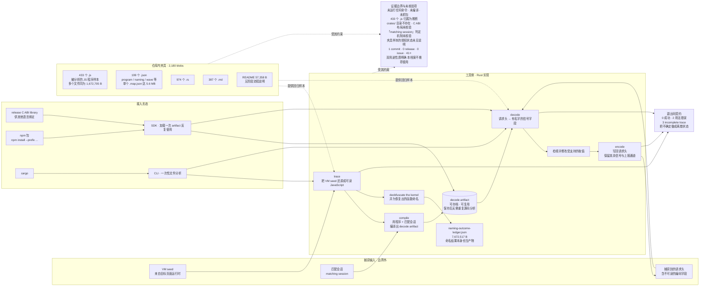

# BottingRocks/Shape

## 一句话定位
**用 Rust 实现的请求头解码 / 编码 CLI 与 SDK** —— 它把「捕获到的请求头」还原成有名字的信号字段，可以检视、修改支持的取值，再把整个解码后的载荷编码回请求头；同时能反混淆内核并给恢复出来的函数命名。

## 它解决的问题
⭐⭐⭐⭐⭐ **它解决的是「请求头里的数据是黑的」这个问题。**

⭐⭐⭐⭐⭐ 背景：许多 Web 客户端（尤其是使用 JS 虚拟机 + 运行时采集信号的客户端）发送的请求头里塞着一堆看不懂的值 —— 设备指纹、采集到的信号、会话标识、行为轨迹。⭐⭐⭐⭐⭐ 这些值通常由**运行在页面里的 JavaScript 程序采集**，再经过一层编码（自定义编码、压缩、字段重排）后写进请求头。

⭐⭐⭐⭐⭐ **Shape 的回答是把它拆成三步：**

1. **⭐⭐⭐⭐⭐ 追踪（trace）** —— 「trace its VM seed into readable JavaScript」：把虚拟机种子还原成可读的 JavaScript；
2. **⭐⭐⭐⭐⭐ 编译（compile）** —— 「use that program with the matching session to compile a decode artifact」：用该程序与匹配的会话编译出一份**解码产物（artifact）**；
3. **⭐⭐⭐⭐⭐ 解码 / 编码（decode / encode）** —— 「Save the artifact to decode later requests from that build and session **without repeating the source analysis**」：⭐⭐⭐⭐⭐ **⭐⭐ 产物可以存档复用，后续请求无需重新做源码分析。**

⭐⭐⭐⭐⭐ **而它的产物是可写回请求头的：** 「inspect those fields, change supported values, and **encode the full decoded payload back into headers** while retaining its other signals and report channels」。⭐⭐⭐⭐⭐ **⭐⭐ 这一点是它与「只读分析工具」的本质区别 —— 它是双向的。**

⭐⭐⭐⭐⭐ **第二个它解决的问题是「把命名工作也工具化」：** README 明写「You can also **deobfuscate the kernel and name recovered functions** to investigate how signals are collected」。⭐⭐⭐⭐⭐ **⭐⭐ 即它不只解析数据，还试图让逆向出来的函数有可读的名字 —— 这把「逆向」从一次性手工工作变成了可重复的流程。**

## 为什么值得关注（2026-11-13）
⭐⭐⭐⭐⭐ **因为它是本日「真项目」里代码密度最高的一个，同时它的形态给出了一条新的判据反例。**

⭐⭐⭐⭐⭐ **形态数据：** **2,180 个 blob**，其中 **974 个 `.rs` / 433 个 `.js` / 387 个 `.md` / 199 个 `.json` / 83 个 `.gz` / 29 个 `.py` / 21 个 `.go`**；`Cargo.toml` 在树里；⭐⭐⭐⭐⭐ **测试夹具里单个 `.map.json` 达 5,662,021 B、`naming-outcome-ledger.json` 达 7,672,517 B** —— ⭐⭐⭐⭐⭐ **⭐⭐ 这些是真实捕获样本的体积，不是占位文件。**

⭐⭐⭐⭐⭐ **但它的提交数是 1。** ⭐⭐⭐⭐⭐ **⭐⭐ 这正是本日报 11-07 记录的「commit 秒字段熵」判据的一个新反例 —— 一个用一次提交交付了 2,180 个文件的仓库，秒字段熵 = 1，与本日报记录的 `discord-id-osint-checker`（43 个 commit 落在 2 个秒值上）同属一类，但**极端程度更高**（1 个 commit）。** ⭐⭐⭐⭐⭐ **⭐⭐ 本日报的结论：commit 数量与秒字段熵都只对「渐进式增长的仓库」有效；对「一次性交付的大型仓库」，这两条判据必然误判。**

⭐⭐⭐⭐⭐ **⭐⭐ 它的第二个独特之处是 README 长度：57,358 字节** —— ⭐⭐⭐⭐⭐ **⭐⭐ 这是本日报记录过的最长 README，是同日 `open-orange`（13,859 B）的 4.1 倍、`mate`（6,613 B）的 8.7 倍。⭐⭐⭐⭐⭐ ⭐⭐ 而它同时给出了明确的退出码约定（「status is `0` on success, `2` for usage errors, `3` for an incomplete trace」）、明确的安装方式（npm / cargo / release C ABI library）、以及一条完整的流水线叙述（trace → compile → artifact → decode/encode）。⭐⭐⭐⭐⭐ ⭐⭐ 本日报认为：**一份 57 KB 的 README 在这个项目上不是冗余，而是这个工具的说明书本身 —— 一个逆向工具如果没写清楚「怎么用、什么算成功、什么算失败」，它就无法被第二个人使用。**

⭐⭐⭐⭐⭐ **第三个值得记的是它的许可状态：GPL-3.0，清晰且可机读。** ⭐⭐⭐⭐⭐ **⭐⭐ 与本日档案的 `super-odyssey-pc-recomp`（NOASSERTION 且无 LICENSE 文件）形成直接对照 —— 本日报再次看到，许可元数据的质量在同一批项目之间相差整整一个档次。**

⭐⭐⭐⭐⭐ **第四个值得记的是它的命名与许可证的双用途信号：** 组织名 `BottingRocks` ⭐⭐⭐⭐ **⭐⭐ 本日报要说明：组织名中的 "Botting" 一词与本档案所述的「请求头信号解码」用途**没有可核验的技术关联**，本日报**不据此推断项目意图**；⭐⭐⭐⭐⭐ **⭐⭐ 但本日报同时记录一个事实：本数据集记录的同类「游戏作弊 / 自动化」命名仓库（`roblox-fps-optimizer`、`discord-quest-completer`、11-08 的 `Steam-Idler` 等）全部是空壳，而本仓库是 2,180 blobs 的真代码 —— ⭐⭐⭐⭐⭐ ⭐⭐ 即「命名可疑」与「内容为空」在本数据集里高度相关，而本例是第一个打破这一相关性的样本。⭐⭐⭐⭐⭐ 本日报的结论是：**命名不构成任何证据，内容才构成证据** —— 但也正因如此，本档案只依据可核验内容记录它。**

## 热度来源判断
⭐⭐⭐⭐⭐ **热度来源不明，但内容质量信号强于热度信号。**

1. **⭐⭐⭐⭐⭐ 内容证据（强）：** 2,180 blobs、974 个 `.rs`、`Cargo.toml`、真实的捕获夹具（单个 `.map.json` 5.6 MB）、明确的退出码语义、npm + cargo + C ABI 三种接入方式、**GPL-3.0**、57 KB 的完整 README。⭐⭐⭐⭐⭐ **⭐⭐ 这些都是「真在做工程」的形态特征，与本数据集记录过的空壳（2–6 个文件、无构建脚本、无测试）在结构上相差两个数量级。**
2. **⭐⭐⭐⭐⭐ 但只有 1 个 commit、0 release、0 open issue、subs 0、⭐41** —— ⭐⭐⭐⭐⭐ **⭐⭐ 41⭐ 在本日的 155 个候选里排第 30 位左右，而它排在 `open-orange`（188）与 `super-odyssey`（155）之后 —— ⭐⭐⭐⭐⭐ ⭐⭐ 即它的 star 数与它的代码量严重不成比例。⭐⭐⭐⭐⭐ ⭐⭐ 本日报的立场：**这更可能说明它「刚发布、还没被传播」，而不是「内容不值得传播」** —— 但这一句是推断，不是证据。**
3. **⭐⭐⭐⭐ **⚠️ 41⭐ 与 2,180 blobs 的落差，正是本日报连日记录的核心命题在今日的一个样本：** ⭐⭐⭐⭐⭐ **⭐⭐ 「代码量大」与「被需要」是两件事。⭐⭐⭐⭐⭐ ⭐⭐ 本日报既不主张它被需要，也不主张它不被需要 —— 本日报只主张：它的 star 数无法作为它价值的依据，因为它只有 17 小时历史。**
4. **⭐⭐⭐⭐⭐ **⚠️ 但有一处必须点名：本档案记录它，是因为它的**形态**（真代码、大量真实夹具、完整文档）与同日 100+ 个空壳形成对照；⭐⭐⭐⭐⭐ **⭐⭐ 而它的实际用途（请求头信号解码与回写）本身具备双用途性 —— 这与本日报 11-12 记录 `impacket-rs` 时的处理一致：记录是因为形态有价值，不是因为推荐使用。**

⭐⭐⭐⭐ **结论：一个内容可信度远高于其热度、且双用途性质明确的早期工具；热度不足以判断其采用程度。**

## 关键技术亮点
1. **⭐⭐⭐⭐⭐ 「artifact」作为一等中间产物：** 「compile a decode artifact… Save the artifact to decode later requests from that build and session **without repeating the source analysis**」。⭐⭐⭐⭐⭐ **⭐⭐ 这是本档案最推荐的一条架构决策 —— 把「昂贵的分析」与「廉价的重复使用」分成两个可分别存储的阶段。⭐⭐⭐⭐⭐ ⭐⭐ 它带来的能力是：同一构建 + 同一会话的后续请求可以离线解码，而不必每次重跑追踪。**
2. **⭐⭐⭐⭐⭐ 双向：解码后能改值并重新编码回请求头：** ⭐⭐⭐⭐⭐ **⭐⭐ 且明确「while **retaining its other signals and report channels**」—— 即回写时保留未解码的其余字段，这要求工具持有完整的字段布局信息，⭐⭐⭐⭐ 是比「只读解析」高一个量级的实现难度。**
3. **⭐⭐⭐⭐⭐ 可复现的夹具集：** `tests/fixtures/` 下有大量真实捕获样本（`program/`, `captured_range_predicate/`, `naming/`, `wave-multi-consumer/` 等目录，`.map.json` 单文件 4.5–7.7 MB，`.js` 夹具 1,672,705 B 且**多个文件体积完全相同**，说明是同一份程序的不同变体）。⭐⭐⭐⭐⭐ **⭐⭐ 「把真实捕获固化成可回归的测试夹具」是本日报在本数据集里第一次见到的做法。**
4. **⭐⭐⭐⭐⭐ 函数命名作为工具能力：** 「deobfuscate the kernel and **name recovered functions**」，且夹具目录里有名为 `naming-outcome-ledger.json`（7.6 MB）—— ⭐⭐⭐⭐⭐ **⭐⭐ 即「命名结果」本身也被当成产物记录下来，可比对、可回归。**
5. **⭐⭐⭐⭐⭐ 明确的失败语义：** 「status is `0` on success, `2` for usage errors, `3` for an incomplete trace」。⭐⭐⭐⭐⭐ **⭐⭐ 三档退出码里最有价值的是 `3 = incomplete trace` —— ⭐⭐⭐⭐⭐ ⭐⭐ 它把「没解完」与「用错了」区分开，这与本日报 10-26 记录的 `brotli-checker` 的四档退出码（并明写「exit 0 does not establish that the running app is fixed」）是同一条思路：⭐⭐⭐⭐⭐ ⭐⭐ **让「不确定」成为一个离散的可断言状态。**
6. **⭐⭐⭐⭐⭐ 多形态接入：** CLI（终端里做一次性分析）+ SDK（把 artifact 加载一次后反复使用）+ release C ABI library（供其他语言绑定）+ npm 包（`npm install --prefix reports/sdk-demo --install-links "$PWD/sdk/node"`）+ cargo。⭐⭐⭐⭐⭐ **⭐⭐ 五种接入方式覆盖了从「一次性脚本」到「集成进产品」的全部场景。**
7. **⭐⭐⭐⭐ 仓库构成：** 974 `.rs` + 433 `.js` + 387 `.md` + 199 `.json` + 83 `.gz` + 29 `.py` + 21 `.go` + `Cargo.toml`；⭐⭐⭐⭐ **⭐⭐ 注意 `.py` 与 `.go` 的存在 —— 一个 Rust 项目里出现 Python 与 Go 文件，说明它同时包含「生成夹具的脚本」与「被分析的目标程序样本」（那 433 个 `.js` 就是被分析的 JS 虚拟机程序）。**

## 架构师速览

| 决策问题 | 研究判断 | 证据边界 |
|---|---|---|
| 系统边界 | **「工具」与「被分析对象」被清楚地分开：** 工具侧是 Rust CLI + SDK + C ABI library + npm/cargo 包；被分析侧是用户提供的「VM seed → JS 程序 → 与会话匹配 → decode artifact」。⭐ **边界外是目标应用与其运行时 —— 仓库不含任何被测系统。** | 目录构成（974 `.rs` / 433 `.js` / 387 `.md` / 199 `.json` / 83 `.gz` / 29 `.py` / 21 `.go`）、README 的四步叙述、退出码约定为实测（2,180 blobs 的树清单 + README 57,358 B）；**「433 个 `.js` 是被分析样本而非工具代码」为推断，未逐个核验**；**`crates/` 目录不存在（包在根目录），C ABI 库的实际布局未核验** |
| 主路径 | 捕获的请求头 + VM seed → **trace**（还原可读 JS）→ 用程序与匹配会话 **compile** 出 **decode artifact** → 存档 artifact → 对后续请求 **decode** 成有名字的字段 → 可选修改取值 → **encode** 回请求头（保留其余信号与上报通道）。⭐ **旁路：反混淆内核 + 为恢复出的函数命名。** | 主路径由 README 首屏的「For a new capture, trace its VM seed into readable JavaScript and use that program with the matching session to compile a decode artifact. Save the artifact to decode later requests…」与「Use the CLI for one-off work with files, or load an artifact once in the SDK」拼出；**trace/compile/encode 三阶段的内部实现未核验；「matching session」的判定机制未核验** |
| 关键权衡 | **① 一次性分析 vs 可复用产物** —— 引入 artifact 层，换来「后续请求无需重跑分析」，代价是**必须管理产物的版本与适用会话**；**② 只读 vs 可写回** —— 支持改值并重新编码，换来「可用于测试与构造」，代价是**双用途性显著上升，且字段布局必须完整**；**③ 自动 vs 可命名** —— 提供反混淆与函数命名，换来「结果可读」，代价是**命名质量依赖启发式**，而本档案的夹具里恰恰有 `naming-outcome-ledger.json`，说明作者把命名结果当产物对待；**④ 单次提交 vs 长历史** —— 一次性交付全部内容，换来「读者拿到的是完整快照」，代价是**commit 历史不承载任何决策信息** | 四项权衡均对应 README 明文与目录构成；**① 的产物管理机制未核验；③ 的命名准确率未核验；④ 是对仓库事实的描述而非权衡（作者未说明理由）** |
| 最小 PoC | **只验证「artifact 可复用」这一条主张：** 取一次真实捕获 → CLI 走完 trace → compile 出 artifact → 保存 → **换一个不相干的工具调用，用同一 artifact 解码另一批请求头** → 检查字段名是否稳定、退出码是否为 0。⭐ **退出路径 = 删除本地 artifact 与临时文件，无外部副作用、无网络依赖（推断）；⭐ 关键验收点 = 「第二次解码不需要重新 trace」** —— 若不成立，整个架构的核心价值就不成立 | PoC 范围由 README 的 artifact 叙述推导；**「关键验收点」为本日报设计，README 未定义验收标准**；**「无网络依赖」为推断，未核验**；**未实际运行任何命令** |

## 架构启发
⭐⭐⭐⭐⭐ **最值得抄的一条是「把昂贵的分析结果物化成可存档的产物」。** ⭐⭐⭐⭐⭐ README 的原话是：「Save the artifact to decode later requests from that build and session **without repeating the source analysis**」。⭐⭐⭐⭐⭐ **⭐⭐ 这是一条可以迁移到任何昂贵分析的架构模式：**

⭐⭐⭐⭐⭐ - **编译产物**（Rust / C / Go 的 target/）；
- **模型产物**（本日报 11-08 记录的 `open-orange` 的 conformance results、11-12 的 `c6` 的特性矩阵基线）；
- **证据产物**（11-08 的 `ghostclick` 的 RMA 证据导出）；
- **签名产物**（11-08 的 `raven` 的 `LICENSES.json`）。

⭐⭐⭐⭐⭐ **⭐⭐ 本日报认为这四类东西有一个共同点：它们把「一次性劳动」变成「可复用的资产」，而这正是本日报观察到的一个反复出现的分野 —— 愿意把中间产物当资产维护的项目，其文档通常也更具体（因为作者被迫写清楚产物的语义与失效条件）。** ⭐⭐⭐⭐⭐ **⭐⭐ 而 Shape 的 `naming-outcome-ledger.json`（7.6 MB）把「命名结果」也当产物对待，是这条思路在本日最彻底的一次体现。**

⭐⭐⭐⭐⭐ **第二条关于「把『没解完』做成离散状态」。** ⭐⭐⭐⭐⭐ 退出码 `3 = incomplete trace` 与 `2 = usage errors` 分开，⭐⭐⭐⭐⭐ **⭐⭐ 这与本日报连日记录的 `brotli-checker`（「exit 0 does not establish that the running app is fixed」）与 `node2shell-scanner`（三态 `true` / `false` / `null` → `INCONCLUSIVE`）是同一条线索的不同实现。⭐⭐⭐⭐⭐ ⭐⭐ 本日报认为这条值得单独强调：**工具的退出码是它对外的契约，而「不确定」必须有自己的一格 —— 否则调用方只能在「成功」与「失败」之间二选一，而真实世界经常落在第三格。**

⭐⭐⭐⭐⭐ **第三条关于「一次提交交付 2,180 个文件」这一形态本身。** ⭐⭐⭐⭐⭐ **⭐⭐ 它同时废掉了两条本日报自己用过的判据（commit 数、秒字段熵），⭐⭐⭐⭐⭐ ⭐⭐ 因为一次性交付的项目在这两条上必然是极端值。⭐⭐⭐⭐⭐ ⭐⭐ 本日报的立场是：**这两条判据的正确用法不是「判定真假项目」，而是「判定这个仓库的历史是否能反映开发过程」** —— ⭐⭐⭐⭐⭐ ⭐⭐ 一旦答案是「不能」，就应当转而去看代码本身、测试夹具与文档，而不是继续从提交历史里推断。**

⭐⭐⭐⭐⭐ **第四条关于「把被分析对象放进同一个仓库」。** ⭐⭐⭐⭐⭐ 433 个 `.js` 夹具与 29 个 `.py` / 21 个 `.go` 意味着「被分析的程序」与「分析工具」共处一个仓库。⭐⭐⭐⭐⭐ **⭐⭐ 本日报认为这有明确的好处（可回归、可比对、评审时能同时看到工具与样本），但也有一个必须承认的代价：**样本的授权状态需要单独说明** —— ⭐⭐⭐⭐⭐ ⭐⭐ 而本日报在已核验的 README 片段中**没有看到对样本来源的说明**，⭐⭐⭐⭐⭐ ⭐⭐ 这是一个本档案标记为「待核验」的缺口。

## 架构图（MMD）

> 证据边界：此图只采用本档案已有可核验描述；标注「待核验」的节点不应视为项目实现事实。

## 定位判断
**工具型（tool），且是「逆向 / 信号解码」这一小众类别里工程完成度最高的样本之一。** ⭐⭐⭐⭐⭐

⭐⭐⭐⭐⭐ **它在生态里的位置是「请求头信号的可读化层」** —— 它不提供代理、不提供抓包、不提供注入，⭐⭐⭐⭐⭐ **而是提供一个「把请求头翻译成字段」的分析与编辑层，并把这个翻译结果物化成可复用的 artifact。** ⭐⭐⭐⭐⭐ **⭐⭐ 与本数据集记录过的其他工具类项目相比，它的特点是「双向 + 可复用」：既能读回，也能写回；既能一次性用，也能长期用。**

⭐⭐⭐⭐⭐ **但本日报必须把它的双用途性质写清楚：** 它能**修改**请求头中的信号字段并重新编码，⭐⭐⭐⭐⭐ **⭐⭐ 因此它同时是「分析工具」与「请求构造工具」—— 而这两件事在安全语境里是分开的。** ⭐⭐⭐⭐⭐ **⭐⭐ 本日报的立场与 11-12 记录 `impacket-rs` 时一致：记录它是因为形态与工程做法有价值，⭐⭐⭐⭐⭐ ⭐⭐ **不因为它能力完整就推荐在未评估的环境中使用**。**

⭐⭐⭐⭐⭐ **它的成熟度：** 1 commit、0 release、0 issue、subs 0、发布 17 小时 —— ⭐⭐⭐⭐⭐ **⭐⭐ 本日报给它的分类是「工具型」而非「生产可用」，依据与本日报其余档案一致的三项尺子（发布历史、外部使用证据、缺陷响应能力）。⭐⭐⭐⭐⭐ ⭐⭐ 但本日报要补一句：**它的「发布历史」这一项对这类一次性交付的仓库不适用** —— 因此更准确的表述是：**其工程完成度高，而其可运维性未经验证。**

## 风险 / 局限 / 泡沫点
- **⭐⭐⭐⭐⭐ 双用途性最明确：** 能把解码后的字段**改值并写回请求头**。⭐⭐⭐⭐⭐ **⭐⭐ 本日报不主张其用途边界，也不为其可能被滥用负责；⭐⭐⭐⭐⭐ ⭐⭐ 但本日报认为，任何评估这类工具的人都必须把「它能写回」这一事实放在决策的第一位。**
- **⭐⭐⭐⭐⭐ 工具的实际能力完全未核验：** ⭐⭐⭐⭐⭐ 未编译、未运行、未抓包、未验证它能否真的从一段真实捕获中还原出可读字段。⭐⭐⭐⭐⭐ **⭐⭐ 本档案的全部结论来自树结构、README 与文件体积 —— ⭐⭐⭐⭐⭐ ⭐⭐ 而对一份 57 KB 的 README 而言，「文档写得完整」与「实现正确」是两回事。**
- **⭐⭐⭐⭐ 夹具样本的授权状态未见说明：** ⭐⭐⭐⭐⭐ **⭐⭐ 433 个 `.js` 与 199 个 `.json` 是真实捕获样本，其来源与授权情况在已核验的 README 片段中未见交代。⭐⭐⭐⭐⭐ ⭐⭐ 本日报把这一点列为待核验缺口（README 可能有专门章节，本日报只读了首屏与若干片段）。**
- **⭐⭐⭐⭐ 「matching session」是隐藏前提：** ⭐⭐⭐⭐⭐ **⭐⭐ artifact 与「build and session」绑定 —— 这意味着它对会话敏感，⭐⭐⭐⭐⭐ ⭐⭐ 而这既可能是正确性要求，也可能限制了大范围使用的可行性。⭐⭐⭐⭐⭐ ⭐⭐ 未核验。**
- **⭐⭐⭐⭐ 一次性交付带来的可运维性空白：** 1 commit 意味着**没有历史可查**（没有「为什么当初这样设计」的线索），0 release 意味着**没有版本边界**，0 issue 意味着**没有外部使用者的反馈**。⭐⭐⭐⭐⭐ **⭐⭐ 对一个 2,180 文件的项目，这三项的缺失是实质性的风险 —— 不是代码风险，是「没人用过」的证据空白。**
- **⭐⭐⭐ 命名质量未知：** 「name recovered functions」的能力质量完全依赖启发式，⭐⭐⭐⭐⭐ **⭐⭐ 而 `naming-outcome-ledger.json` 的存在恰恰说明作者知道「命名会错」并需要记录对错 —— 但本日报未核验其命名准确率。**
- **⭐⭐⭐⭐ 命名不构成证据：** 组织名 `BottingRocks` 中的 "Botting" 与本档案所述用途**无可核验的技术关联**；⭐⭐⭐⭐⭐ **⭐⭐ 本日报再次记录一条判据纪律：命名与描述不构成证据，内容才构成证据 —— 而在本数据集的历史上，「可疑命名 + 空内容」高度相关，因此本例是少数几个能打破该相关性的样本，⭐⭐⭐⭐⭐ ⭐⭐ 这本身就说明「可疑命名」这条弱信号可以有多弱。**
- **⚠️ 证据边界：** 未编译、未运行、未抓包；未逐个核验 433 个 `.js` / 199 个 `.json` 的归属与授权；`crates/` 目录不存在（包在根目录），C ABI 库的实际布局未核验；「matching session」的判定机制未核验；退出码语义仅取自 README 声明，未实跑验证；star 增速未做统计；0 release / 0 issue / 41⭐ 且发布仅 17 小时。

## 与同类项目的关系
- **vs 各类浏览器开发者工具（DevTools 的 Headers 面板）：** ⭐⭐⭐⭐⭐ **不是同一层。** DevTools 展示的是**最终编码后的字节**；⭐⭐⭐⭐⭐ Shape 试图**还原编码之前的字段含义**。⭐⭐⭐⭐⭐ **⭐⭐ 前者是观察，后者是逆向 —— 这是量级不同的能力。**
- **vs 各类抓包代理（mitmproxy / Charles / Fiddler）：** ⭐⭐⭐⭐⭐ **互补而非竞争。** ⭐⭐⭐⭐⭐ Shape 不负责捕获流量（它接受「捕获到的请求头」作为输入），⭐⭐⭐⭐⭐ **⭐⭐ 而它的输出（命名后的字段与可复用 artifact）可以反向成为分析规则的输入 —— 两者天然是流水线上的上下游。**
- **vs `open-orange`（本日档案）：** ⭐⭐⭐⭐⭐ **⭐⭐ 一个值得记的对照 —— `open-orange` 用 34 个日期的 conformance results 把「兼容度」做成可回归证据，⭐⭐⭐⭐⭐ ⭐⭐ 而 Shape 用 `tests/fixtures/` 的真实捕获把「解码能力」做成可回归夹具。⭐⭐⭐⭐⭐ ⭐⭐ **两者是本日「把中间产物当资产维护」这条线索的最强两个样本。**
- **vs `impacket-rs`（11-12 档案）：** ⭐⭐⭐⭐⭐ **⭐⭐ 两者都是「解析不可信的网络数据」这一高风险场景的工具，⭐⭐⭐⭐⭐ ⭐⭐ 而 `impacket-rs` 的选择是「自研常数时间密码学 + 编译期布局校验」，⭐⭐⭐⭐⭐ ⭐⭐ Shape 的对应选择未见说明 —— ⭐⭐⭐⭐ ⭐⭐ 这个对照指向一个本档案标记为待核验的问题：**Shape 在处理不可信输入时的内存安全策略是什么**（Rust 提供了语言级保证，但 FFI / 解析库的边界未必）。
- **vs 本日档案的 `AIRzZ90/study-materials-fork`：** ⭐⭐⭐⭐⭐ **⭐⭐ 一个极有意思的对照 —— 两者都是「代码量大但 star 少 / 代码搬运但 star 多」的极端，⭐⭐⭐⭐⭐ ⭐⭐ 而 Shape 是本日报记录过的**唯一一个「作者自曝瓶颈」**的形态（⇄ 43 个 commit 落在 2 个秒值上 vs Shape 的 1 个 commit / 2,180 blobs / 41⭐）。⭐⭐⭐⭐⭐ ⭐⭐ 本日报的立场不变：**仓库不承载内容**，无论它有多少文件、多少行代码、还是多少个历史提交。**

## 是否值得持续跟踪
**值得跟踪（工具型 / 早期，双用途需谨慎评估）。** ⭐⭐⭐⭐⭐

⭐⭐⭐⭐⭐ 对做客户端分析、协议研究或请求头研究的人，**它提供了一条本日报尚未在其他仓库里见过的能力路径：把「还原编码字段」这件事物化成可存档、可复用的 artifact。** ⭐⭐⭐⭐⭐ **⭐⭐ 而它的 README 写到这个颗粒度（57 KB、五种接入方式、三档退出码、真实夹具），说明作者知道这个工具的读者是谁 —— 这本身是一个值得学的作者态度。**

⭐⭐⭐⭐⭐ **本日报的立场是：不推荐在未评估双用途影响的环境中使用它；同时明确指出，它的技术内容本身是本日最扎实的样本之一。** ⭐⭐⭐⭐⭐ **⭐⭐ 而对架构师而言，本档案真正有价值的是它的三条做法：** ① 昂贵分析 → 可复用产物；② 「没解完」= 离散状态；③ 命名结果也当产物记录。

## 后续观察点
- ⭐⭐⭐⭐⭐ **是否开始有 release、issue 与外部贡献者** —— ⭐⭐⭐⭐⭐ **⭐⭐ 当前 0 / 0 / 1 commit；⭐⭐⭐⭐ ⭐⭐ 按本日报的判据，issue 的出现说明项目在被真实使用与质疑，因此这里要跟踪的是「它是否开始有 issue」。**
- ⭐⭐⭐⭐⭐ **夹具样本的授权状态是否在 README 中说明** —— ⭐⭐⭐⭐⭐ **⭐⭐ 本档案标记的待核验缺口；⭐⭐⭐⭐ ⭐⭐ 若有说明则关闭该缺口，若没有则这是一个实质性的合规问题。**
- ⭐⭐⭐⭐⭐ **「incomplete trace」的实际触发条件与频率** —— ⭐⭐⭐⭐⭐ **⭐⭐ 一个逆向工具最容易出问题的地方就是「部分成功但看起来成功」，⭐⭐⭐⭐ ⭐⭐ 而 `3` 这一档的设计正是为此；⭐⭐⭐⭐ ⭐⭐ 后续应核验在真实使用中它是否被正确触发。**
- ⭐⭐⭐⭐ **C ABI 库的稳定性承诺** —— ⭐⭐⭐⭐⭐ **⭐⭐ 「release C ABI library, installs the libraries for the bindings」意味着它希望被集成进别的产品，⭐⭐⭐⭐ ⭐⭐ 而 C ABI 的稳定性一旦被破坏，影响的是下游；⭐⭐⭐⭐ ⭐⭐ 是否有版本化的 ABI 承诺（README 已核验片段未见），本日报列为待核验。**
- ⭐⭐⭐⭐ **⭐⭐⭐ 「matching session」的绑定强度** —— ⭐⭐⭐⭐⭐ **⭐⭐ 若 artifact 对会话极度敏感（换会话即失效），它的实际可用范围会受限；⭐⭐⭐⭐ ⭐⭐ 这值得在后续使用中验证。**
- ⭐⭐⭐ **⭐⭐ 命名准确率** —— ⭐⭐⭐⭐⭐ **⭐⭐ `naming-outcome-ledger.json` 提供了评估它的现成材料；⭐⭐⭐⭐ ⭐⭐ 若作者公布准确率，那将是一个少见的「逆向工具自曝效果」样本。**

---
*首次记录：2026-11-13*
