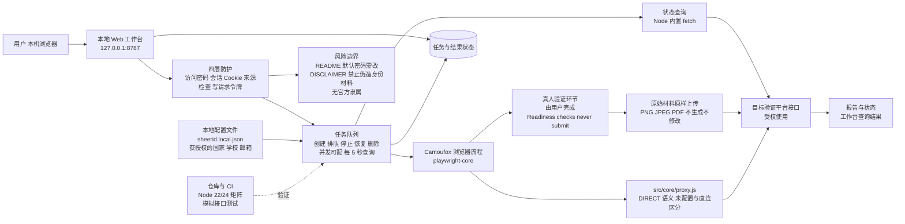

# JenkinWoo/sheeridVerify

## 一句话定位

一个基于 Node.js 的「验证流程」学习/研究工作台（本地 Web 工作台 + 任务队列 + 浏览器表单交互 + HTTP 状态查询）—— 而它本日最值得记的一件事是：它有 540⭐、358 个 fork，而 fork 的到达间隔中位数是 **73 秒**，与同一天那批 5–6 秒中位数的机器节奏完全不同。

## 它解决的问题

「学生资格验证」这类流程通常包含三类步骤：填资料、上传材料、交互式真人验证。自动化前两类容易，第三类在设计上就应该由人完成。

这个项目把整条流程做成了一个**可本地运行的 Web 工作台**：页面里创建任务、排队、限制并发、轮询结果、上传原始材料、等待用户完成真人验证。

**它明确不做什么**（README 原文）：「Upload raw PNG, JPEG, PDF files, **does not generate or modify proof materials**; interactive human verification is completed by the user」。

## 为什么值得关注（2026-11-07）

**本日它是本日报最重要的一组对照样本**：它与那批 starter 模板仓库、那批载荷仓库出现在同一份榜单上，但它的 **fork 时间分布与账号年龄分布都指向真人**。

**fork 间隔分布（`repos/{owner}/{repo}/forks` 全量 360 个，分 4 页取全）**：

| 指标 | sheeridVerify | roblox-performance-tool | roblox-studio-mcp |
|---|---:|---:|---:|
| fork 总数 | 360 | 386 | 260 |
| 时间跨度 | **12.5 小时**（10:00:40Z → 22:33:02Z） | 44 分钟 | 27 分 35 秒 |
| 相邻间隔中位数 | **73.0 s** | 6.0 s | 5.0 s |
| ≤10 秒的间隔占比 | **8.9%**（32/359） | 94.5% | 96.9% |
| p10 / p90 | 12 s / 277 s | 5 s / 8 s | 3 s / 6 s |

**抽样 12 个 fork 拥有者账号**：

| 账号 | 创建时间 | 公开仓库数 | followers |
|---|---|---:|---:|
| msjsmx | 2024-12-15 | 8 | 1 |
| meownifold | 2019-08-23 | 13 | 0 |
| niaodian | 2021-10-05 | 234 | 15 |
| zeawhy | 2017-05-09 | 28 | 1 |
| wanqt0505 | 2023-05-31 | 5 | 0 |
| navhu | 2017-06-05 | 19 | 1 |
| jiechengzhan | 2026-08-03 | 3 | 0 |
| yasyzb | 2016-11-13 | 21 | 4 |
| zlks2012 | 2024-12-15 | 159 | 13 |
| jacentsao | 2015-12-18 | 74 | 12 |
| loging | 2017-05-12 | 62 | 3 |
| Gezeek | 2026-06-22 | 49 | 0 |

**账号创建时间从 2015-11 到 2026-08 跨越近 11 年，公开仓库数从 3 到 234 不等 —— 这不是同一个脚本在批量下单。**

**⭐⭐⭐⭐⭐ 这是本日提炼出的最可复用的判据**：**不要看 star 数，也不要看 fork 数，要看 fork 的时间分布与账号年龄分布。**

**它的代码质量是本日真项目里最扎实的之一**。`src/` 的职责边界清晰：

- `src/core/` —— config / errors / http / logger / network / **proxy** / runner / status-query / storage / workflow
- `src/browser/` —— form / interaction / session
- `src/apps/sheerid/` —— client / document-workflow / document / **human-verification** / index / labels / organization / page-state / selectors / status
- `src/web/` —— jobs 等

**`src/apps/sheerid/human-verification.js` 是本日最值得抄的一段工程判断** —— 它把「真人验证」当作必须交给用户的边界，而不是要自动绕过的障碍。代码里的注释原文：

> **Readiness checks never submit. Only the page's ordinary Retry button is used; interactive challenges remain with the user.**

代码把状态机显式命名为 `BUTTON_DISABLED` / `HUMAN_VERIFICATION_LOADING` / `HUMAN_VERIFICATION_ERROR` / `SUBMIT_NOT_CLICKABLE`，并用中英双语正则识别「正在确认您是真人」与「unable to confirm you are human」。**⭐⭐⭐⭐⭐ 它还在预算边界上做了硬约束**：

> A subsequent readiness check can succeed at the budget boundary, but **no further retry or wait is allowed after that boundary**.

**⭐⭐⭐⭐⭐⭐ 而 `DISCLAIMER.md` 把禁令写在最前面**：「**不得伪造身份、学籍或材料，不得冒用信息、骗取权益或绕过资格审核**」，README 也声明「本项目与 SheerID 及任何学校均无官方隶属或认可关系」。

**⭐⭐⭐⭐ 工作台接口有四层防护**：「使用访问密码、会话 Cookie、来源检查及写请求令牌保护工作台接口」。

**⭐⭐⭐⭐ CI 是真的**：`.github/workflows/ci.yml` 在 Node 22 与 24 上跑 `npm ci && npm test`，`permissions: contents: read`，并注明「Browser tests are skipped without a locally installed Camoufox.」**⭐⭐⭐⭐⭐ 而测试用的是模拟接口**：「测试使用模拟接口及本地页面，**不向真实验证接口提交数据**」。

**⭐⭐⭐ `src/core/proxy.js` 把代理支持写成语义而非配置项**：用 `DIRECT` 集合（`direct`/`none`/`off`）与 `isUnset()` / `isDirect()` 判定「未配置」，并通过 `execFile` 调用外部程序。

**⭐⭐⭐⭐⭐ 推广风险必须点名**：仓库含 `docs/community/introduction.html` + `introduction.md` + 一张 308,831 字节的 AI 生成介绍图 `sheeridverify-intro.png`，`docs/LINUX_DO_POST.md` 是一份社区发帖草稿，其中明写「本文件**不表示帖子已经发布、截图已经上传或社区已经审核通过**」并附作者承诺模板（「我的项目介绍、**AI 生成、润色内容部分已截图发出**」）。**⭐⭐ 即项目本身与社区推广绑在一起 —— 读者应把 star 增长与社区推广行为分开理解。**

## 热度来源判断

**⭐⭐⭐⭐ 热度来源是真实的社区传播，但「540⭐」里有多少来自推广、多少来自使用，本日报无法判定。**

**⭐⭐⭐⭐ 支持「真实使用」的证据**：fork 时间分布是真人形态（73 秒中位数、跨 12.5 小时、8.9% 的间隔 ≤10 秒）；fork 拥有者账号年龄跨越 11 年；账号 `JenkinWoo` 是 User 类型且有 64 个 blob 的真实代码库；CI 配置存在且完整。

**⭐⭐⭐⭐ 支持「推广驱动」的证据**：`docs/community/` 的推广素材 + `LINUX_DO_POST.md` 的发帖草稿 + README 的「社区认可与致谢」段落。

**⭐⭐⭐⭐⭐ 最强的反向信号是 `subscribers_count` = 0**：540⭐、358 个 fork、**0 个订阅者**。**⭐⭐⭐⭐⭐ 这意味着「有人 fork」与「有人持续关注」之间的落差极大 —— 无论热度来自哪里，它都没有形成用户群。**

## 关键技术亮点

1. **⭐⭐⭐⭐⭐ 真人验证作为边界而非障碍**：readiness 检查永不提交，交互式挑战留给用户，状态机显式命名。
2. **⭐⭐⭐⭐ 预算边界硬约束**：到达 timeout 预算后不再重试也不再等待 —— 即使恰好有一次 readiness 检查成功。
3. **⭐⭐⭐⭐ 中英双语的人类检测正则**：同时覆盖「正在确认您是真人」/「無法確認您是真人」/「unable to confirm you are human」/「could not verify you are human」。
4. **⭐⭐⭐⭐ 原始材料不加工**：只接受并原样上传 PNG/JPEG/PDF，不生成也不修改证明材料。
5. **⭐⭐⭐⭐ 四层接口防护**：访问密码 + 会话 Cookie + 来源检查 + 写请求令牌。
6. **⭐⭐⭐⭐ CI 矩阵**：Node 22 与 24，`contents: read` 最小权限；浏览器用例在未装 Camoufox 时跳过。
7. **⭐⭐⭐ 测试只用模拟接口**：不向真实验证接口提交数据。
8. **⭐⭐⭐ 任务队列语义完整**：创建、排队、停止、恢复、删除；失败任务删除后可重新提交；并发可配置；提交后默认每 5 秒查询结果。
9. **⭐⭐⭐ 代理语义化处理**：`DIRECT` 集合 + `isUnset()` / `isDirect()`，把「未配置」与「直连」区分开。
10. **⭐⭐⭐ 双后端浏览器自动化**：Camoufox（材料验证流程）+ 纯 `fetch`（状态查询），README 明写「当前命令行先用 Node.js 内置 `fetch` 查询状态，再选择执行流程」。
11. **⭐⭐ `package.json` 的依赖面很小**：`camoufox` / `playwright-core` / `proxy-chain` / `undici` 四个，`engines.node >= 22.15`。
12. **⭐⭐ 部署材料齐全**：`docs/DEPLOYMENT.md`（9,666 B）、`deploy/nginx.conf.example`、`deploy/one-web.service`、`deploy/.env.web.example`。

## 架构师速览

| 决策问题 | 研究判断 | 证据边界 |
|---|---|---|
| 系统边界 | 本地 Web 工作台 + 任务队列 + 浏览器自动化适配层 + 状态查询；**面向单个目标平台的流程编排**（`src/apps/sheerid/` 是平台适配，其余为通用框架） | 依据根树 15 项与 `src/` 的 19 个源文件；`src/apps/registry.js`（357 B）的注册机制**未读** |
| 主路径 | 浏览器提交验证链接 → 创建任务（队列）→ 按配置限并发 → 需要填资料时用 Camoufox 打开页面 → **用户在页面上完成真人验证** → 材料走纯 `fetch` 接口原样上传 → 每 5 秒查询结果 → 状态机更新 | 主路径为 README「工作原理」段的语义抽象；**任务持久化格式、失败重试语义、并发上限的具体实现未核验** |
| 关键权衡 | ① **自动化 vs 人机边界**：把真人验证留给用户（放弃全自动）；② **材料原样 vs 生成加工**：原样上传（放弃「帮用户做材料」的便利）；③ **本地工作台 vs 服务端**：本地监听 127.0.0.1 + 密码/Cookie/来源检查/写令牌四层防护（放弃多用户）；④ **Camoufox vs 纯 fetch 分工**：状态查询用内置 fetch、浏览器流程用 Camoufox（少一次浏览器依赖） | ①② 有 README 与 `DISCLAIMER.md` 原文直接支撑；③④ 是本日报基于代码结构与 README 描述的**解读** |
| 最小 PoC | **不要先碰真人验证流程**：先 `npm ci` → `npm run browser:install` → `npm test`（用模拟接口，验证工作台的任务队列与状态机在**不向真实接口提交数据**的前提下工作）→ 再用 `config/sheerid.local.json` 配置**自己有权使用的**国家/学校与邮箱 → 单任务、单并发跑一遍 → 确认真人验证环节是**由用户自己完成**的 | PoC 范围由 README「测试与贡献」段（模拟接口）+ `DISCLAIMER.md`（须取得授权）推导；**本日报未运行其代码、未连接任何验证接口** |
| 证据边界 | **可核验**：GitHub 元数据、fork 时间分布、fork 拥有者账号档案、README / `DISCLAIMER.md` / `SECURITY.md` / `CONTRIBUTING.md` / `docs/LINUX_DO_POST.md` 原文、`human-verification.js` 与 `proxy.js` 源码、`ci.yml`、`package.json`、目录树。**未核验**：任务队列实现、文档流、`src/apps/registry.js`、部署脚本、`docs/browser-workflow.md` 与 `docs/DEPLOYMENT.md` 全文 | **本日报不对该项目的实际用途、合规性与 SheerID 一方的授权情况作任何判断** —— 作者自述不构成第三方核验 |

## 架构启发

**启发一：把「必须由人完成的环节」写进代码的状态机，而不是写进文档。**

`human-verification.js` 的注释是「**Readiness checks never submit**」—— 这是一条**代码级不变量**，而不是一句提醒。**如果把它写成文档，迟早有人为了「跑通流程」加一行 `await button.click()`；写成状态机与注释，它就在 review 时可见。**

**启发二：预算边界要硬到「即使这一次成功也不接受」。**

「A subsequent readiness check can succeed at the budget boundary, but no further retry or wait is allowed after that boundary」—— 这句话防的是**超时后的抖动重试**，而那正是自动化脚本里最难发现的 bug 类型。**⭐⭐⭐⭐⭐ 把「边界上成功也不算数」写进代码注释，是一种非常容易被忽视但极有价值的写法。**

**启发三：状态名要能被人读懂。**

`BUTTON_DISABLED` / `HUMAN_VERIFICATION_LOADING` / `HUMAN_VERIFICATION_ERROR` / `SUBMIT_NOT_CLICKABLE` —— 这四个名字本身就是一份故障排查文档。**⭐⭐⭐⭐ 相比 `STATE_2` / `STATE_3`，具名状态机的排障成本差一个数量级。**

**启发四：测试只用模拟接口是一条可以照抄的纪律。**

「测试使用模拟接口及本地页面，不向真实验证接口提交数据」—— **这让 CI 可以自由运行而不产生外部副作用**。**⭐⭐⭐⭐ 很多项目的 E2E 测试直接打生产接口，理由是「模拟不出来」，结果 CI 每天都在对真实系统做真实写入。**

**启发五：⭐⭐⭐⭐⭐ 本档案最大的启发其实来自反面 —— 一份可信的档案必须能说明「我没核验什么」。**

本档案列出的未核验项（`docs/browser-workflow.md` 全文、部署脚本、任务队列实现、合规性）**远多于已核验项**。**⭐⭐⭐⭐⭐ 而这正是本日报自身的工作方式：对一个自己不做判断的东西，说的越少越可信。**

## 架构图（MMD）

> 证据边界：此图只采用本档案已有可核验描述；「待核验」节点不应视为项目实现事实。

## 定位判断

**⭐⭐⭐⭐ 观察型项目（本日报的对照样本），但工程形态值得关注。**

它不是本日报推荐的产品 —— 它的用途涉及第三方平台的资格验证流程，**本日报既不推荐其用途也不评价其合规性**，只研究它的工程形态。

**⭐⭐⭐⭐ 作为对照样本它的价值是确定的**：在同一份 star 榜单上，它与两批农场并列出现，而**唯一能把它们区分开的不是 star 数、不是 fork 数、不是体积，而是 fork 的时间分布与账号年龄分布**。

**⭐⭐⭐⭐ 而作为工程样本，它的价值同样确定**：`human-verification.js` 展示了一种「把人机边界写进代码状态机」的写法，`DECISIONS.md` 式的自我约束在 `DISCLAIMER.md` 与 `SECURITY.md` 里，CI 与模拟接口测试说明它的工程纪律是真实的。

## 风险 / 局限 / 泡沫点

- **⭐⭐⭐⭐⭐ 默认访问密码写在 README 里**：「本地默认访问密码为 `JenkinWoo`」，并要求「对外开放前必须通过 `ONE_WEB_PASSWORD` 更换密码」。**在按默认配置运行时，任何能访问该端口的人都能创建任务。这是一个不应被复制的默认值。**
- **⭐⭐⭐⭐⭐ `subscribers_count` = 0**：540⭐ + 358 fork 却零订阅者 —— **无论热度来源是什么，都没有形成用户群。**
- **⭐⭐⭐⭐ 用途本身的高风险面**：项目操作的是第三方平台的资格验证流程。**本日报明确不核验、不评价其实际用途与合规性**，只核验「它宣称什么、代码怎么写、CI 跑什么、fork 时间分布如何」。**README 与 `DISCLAIMER.md` 的自述是作者声明，不是第三方核验。**
- **⭐⭐⭐⭐ 推广与项目绑定**：`docs/community/` + `LINUX_DO_POST.md` + README 致谢段。**star 增长应与社区推广行为分开理解。**
- **⭐⭐⭐ 单 commit 的一次性发布**：commit 列表只有一条「Initial release of sheeridVerify」（2026-11-06T09:56:16Z），但仓库有 64 个 blob。**与 vork 同类：commit 历史不可用于判断开发节奏。**
- **⭐⭐⭐ `oi` = 0**：没有任何 issue —— 说明没有外部用户在提交反馈。
- **⭐⭐ 平台绑定**：只为 SheerID 流程写了适配层（`src/apps/sheerid/`），通用性依赖 `src/apps/registry.js` 的机制，**该机制未核验**。
- **⭐⭐ 未核验的部署面**：`deploy/` 下的 nginx 与 systemd 示例、`docs/DEPLOYMENT.md`（9,666 B）全文**未读**。
- **⭐⭐ 生态稀缺**：仓库依赖 `camoufox` / `playwright-core` / `proxy-chain` / `undici`，其中 `camoufox` 属于相对小众的反检测浏览器方案，**其上游可用性未核验**。

## 与同类项目的关系

- **⭐⭐⭐⭐⭐ vs 本日报的 `roblox-studio-mcp`（同日反例样本）**：两者在 star 榜单上并列，但形态截然相反 —— **它有 19 个源文件、真实 CI、模拟接口测试、显式的代码级人机边界；对方有 5 个文件、无 CI、README 承诺 10 个 MCP 工具而代码为 0。** **⭐⭐⭐⭐ 这组对照是本日最有说服力的一份。**
- **⭐⭐⭐⭐ vs 本日的载荷仓库簇（91 个带 `git-software.cc` 的仓库）**：那些仓库的 README 教用户**暂停杀毒软件**再执行一个混淆过的脚本；这个项目的 README 明写**不生成不修改证明材料**、**真人验证由用户完成**、**测试不向真实接口提交数据**。**⭐⭐⭐⭐⭐ 两种「自动化」的伦理姿态完全相反。**
- **⭐⭐⭐⭐ vs 通用浏览器自动化（Playwright / Puppeteer）**：它不提供新的自动化原语，而是在其上做**流程编排 + 队列 + 状态机 + 边界处理**。**⭐⭐ 它的独特价值在流程层而非驱动层。**
- **⭐⭐⭐⭐ vs 各类「教育/学生认证」自动化脚本（Playwright 生态常见的 form-filler 仓库）**：那些脚本通常追求全自动通过；这个项目**明确放弃全自动，把真人验证留给用户**。**⭐⭐⭐⭐ 这是本日报记录到的第三种「拒绝自动化边界」的位置**（另两种是 poki 的双信号与 hermes-voice 的人格归属）。
- **⭐⭐⭐ vs `poki`（同为设备/流程自动化）**：poki 的核心问题是「动作是否生效」，这个项目的核心问题是「人机边界在哪里」。**两者都用「把状态显式化」解决不同类型的不确定性。**

## 是否值得持续跟踪

**⭐⭐⭐⭐ 值得跟踪，但跟踪目标明确：本档案是「判据样本」，不是「推荐清单」。**

**理由**：它是本日唯一一份能把「真项目」与「农场」在同一份榜单上分开、且区分依据是**可复现的机器读数**（fork 间隔分布 + 账号年龄分布）的对照样本。**⭐⭐⭐⭐ 这套判据本日报会继续用下去。**

**具体跟踪方式**：
1. 跟踪 **`subscribers_count` 是否离开 0**（这是「有没有形成用户群」的唯一直接读数）；
2. 跟踪 **fork 间隔中位数是否继续在数十秒量级**（若突然降到个位数，说明有新一波机器流量）；
3. 跟踪 **open issues 是否出现**（`oi` 现在是 0）；
4. 跟踪 **README 的默认密码是否被移除或改为强制设置**；
5. 跟踪 **`docs/community/` 的推广素材是否继续增加**（推广强度与 star 增长的对应关系）。

## 后续观察点

- **⭐⭐⭐⭐⭐ `subscribers_count` 是否离开 0**；
- **⭐⭐⭐⭐⭐ README 默认密码的处理是否收紧（`ONE_WEB_PASSWORD` 是否变为必填）**；
- **⭐⭐⭐⭐ fork 间隔中位数是否保持在数十秒量级**；
- **⭐⭐⭐⭐ 是否出现真实的 issue 或 PR**（`oi` 现为 0，contributors 现为 1）；
- **⭐⭐⭐ `docs/browser-workflow.md`（14,751 B）与 `docs/DEPLOYMENT.md`（9,666 B）的完整内容**；
- **⭐⭐⭐ `src/apps/registry.js` 的平台注册机制**（决定它能否低成本支持更多流程）；
- **⭐⭐⭐⭐ `camoufox` 上游的可用性**（依赖面里最不寻常的一项）。

---
> 数据来源: GitHub REST API (2026-11-06T22:00Z 快照区间) | Stars: 540 | Forks: 358 | Subscribers: 0 | Open Issues: 0 | License: ISC | 语言: JavaScript | 体积: 408 KB | Blobs: 64 | Commits: 1 | Contributors: 1 | Releases: 0 | 创建: 2026-11-06T09:28:09Z | 最后推送: 2026-11-06T09:54:37Z | Owner: User JenkinWoo
> 本档案未核验项：任务队列与状态机实现、`src/apps/registry.js`、材料上传流程、`docs/browser-workflow.md` 与 `docs/DEPLOYMENT.md` 全文、部署脚本、`camoufox` 上游可用性。
> **本档案不核验、不评价该项目的实际用途与合规性，也不核验 SheerID 一方的授权情况。**
