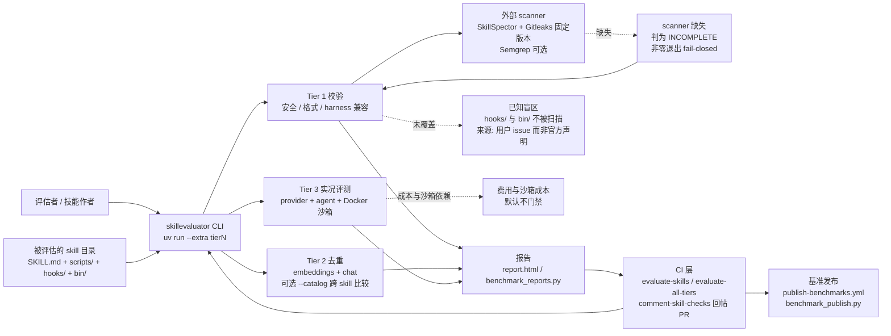

# NVIDIA/SkillEvaluator

## 一句话定位
**NVIDIA 把「一个 Agent Skill 好不好」拆成三个可独立开关的 tier —— Tier 1 静态校验（安全 / 格式 / harness 兼容性）、Tier 2 语义去重（embeddings）、Tier 3 实况评测（真 agent + 沙箱），并把三者都做成 CI 工作流与可发布的基准。**

## 它解决的问题
⭐⭐⭐⭐⭐ **Agent Skill 是一种「装进 agent 上下文就能改变其行为」的可执行文本与脚本 —— ⭐⭐⭐⭐⭐ 因此它同时具备普通软件的所有风险（恶意脚本、越权、供应链）与一项新的风险（行为改变）。**

⭐⭐⭐⭐⭐ **而 2026 年的现实是：Skill 的分发已经比 Skill 的质量控制快得多。** ⭐⭐⭐⭐⭐ 本日报实测的 17 个相关仓库里，**15 个带 `SKILL.md`、4 个带 ≥3 套 harness 清单**，⭐⭐⭐⭐⭐ **但只有 3 个同时公开两条主流安装命令 —— ⭐⭐⭐⭐⭐ 也就是说「装得多」已经成立，「装得放心」还没人管。**

⭐⭐⭐⭐⭐ 本项目补的就是这一块：**它把「质量」变成三个可分别执行、分别门禁、分别出报告的层级。**

## 为什么值得关注（2026-11-17）
⭐⭐⭐⭐⭐ **因为它的 open issue 全部是「我用自己的工具时发现了它的问题」—— 这在本数据集里是罕见的自证质量信号。**

**可核验事实一：三 tier 架构（实测 README 原文）。**

| Tier | 问题 | 命令 | 依赖 |
|---|---|---|---|
| **Tier 1: Validation** | Is the skill safe, well-formed and harness-compatible? | `uv run skillevaluator tier1 ./my-skill --no-llm` | 外部 scanner 提供完整静态覆盖；provider 与 model 客户端启用 LLM 检查 |
| **Tier 2: Deduplication** | Does guidance repeat or overlap? | `uv run --extra tier2 skillevaluator tier2 ./my-skill` | embeddings 与 chat；`--catalog ./skill-catalog.json` 做 skill 间比较 |
| **Tier 3: Live Evaluation** | Does the skill help the agent? | `uv run --extra tier3 skillevaluator tier3 ./my-skill` | provider 访问、受支持的 agent、运行中的沙箱（默认 Docker） |

⭐⭐⭐⭐⭐ **⭐⭐⭐ 实测原文两处关键设计声明：**

> Each tier is independent. Add its extra to your command.
> Tier 1 fetches pinned, verified SkillSpector and Gitleaks releases when they are missing; Semgrep is optional. … `--no-llm` does not remove scanner requirements; a scanner that cannot run is `INCOMPLETE` and exits nonzero.

⭐⭐⭐⭐⭐ **⭐⭐⭐ 第二句是本档案最看重的一句：「`--no-llm` 不会移除 scanner 要求；一个跑不起来的 scanner 会被判为 `INCOMPLETE` 并以非零码退出」。⭐⭐⭐⭐⭐ 即「跳过了 LLM」不等于「跳过了安全检查」，而且「检查没跑成」被当成失败而非跳过 —— **⭐⭐⭐⭐⭐ 这是 fail-closed 的设计，值得直接抄。**

⭐⭐⭐⭐⭐ **门禁策略（实测原文）：**

> Tier 1 gates `validate`. Tier 2 gates unless `--no-block-on-dedup` is set; Tier 3 gates only with `--block-on-agent-eval`. Model and managed-sandbox usage can incur charges.

⭐⭐⭐⭐⭐ **⭐⭐⭐ 即 Tier 1 默认门禁、Tier 2 默认门禁（可关）、Tier 3 默认不门禁（需显式开启）—— ⭐⭐⭐⭐⭐ **这是一个「越贵的检查越不默认阻断」的成本阶梯设计。**

**可核验事实二：工程化程度（实测 1,180 blobs / 8 个 CI 工作流）。**

| 项 | 实测 |
|---|---|
| CI 工作流 | 8 个：`ci.yml` / `comment-skill-checks.yml` / `dco.yml` / `evaluate-all-tiers.yml` / `evaluate-skills.yml` / `feedback-all-tiers.yml` / `publish-benchmarks.yml` / `publish-docs.yml` |
| Tier 基础设施 | `ci/Dockerfile.tier1` / `ci/bootstrap_tiers.py` / `ci/benchmark_publish.py` / `ci/benchmark_reports.py` |
| 安全配置 | `.gitleaks.toml` / `.gitleaksignore` / `SECURITY.md` / `GOVERNANCE.md` |
| 许可与第三方声明 | `LICENSE`（Apache-2.0）+ `NOTICE` + **`THIRD_PARTY_NOTICES.md`** |
| 治理 | `CODEOWNERS` / `PULL_REQUEST_TEMPLATE.md` / `CONTRIBUTING.md` / `CODE_OF_CONDUCT.md` / `RELEASING.md` / `SUPPORT.md` / `CITATION.cff` |
| 外部锚点 | arXiv `2608.20614` + `docs.nvidia.com/skills/skillevaluator/` + PyPI `skillevaluator` + NVIDIA 开发者博客 + YouTube 直播 |
| release | 11 个（`v0.9.0` 2026-11-13 · `v0.8.0` 11-06 · `v0.7.2` 11-04 · `v0.7.1` 11-03，每个 4–5 个 asset） |
| 贡献者 | `rng1995` 275 · `chrisknvidia` 254 · `YMuskrat` 17 · `mimran-khan` 14 · `rioyu123` 7 · `rookepoole` 6 · `deepujain` 5 · `kweinmeister` 5 · `mavericksea-ai` 4 · `Tomauskasz` 3 · `MaxFreedomPollard` 3 · `westonplatter` 3 |
| owner | Org `NVIDIA`（2012-05-10 创建、33,163 followers、846 repos） |

⭐⭐⭐⭐⭐ **⭐⭐⭐ 注意 `.gitleaks.toml` + `THIRD_PARTY_NOTICES.md` 的组合 —— ⭐⭐⭐⭐⭐ **这与本数据集 11-16 记录的 `lishuangqiang/mixbar`（`THIRD_PARTY_NOTICES.md` 精确到借用代码的 commit hash）属于同一条线索：⭐⭐⭐⭐⭐ **大厂也开始把「借了什么」写进产物。**

**可核验事实三：20 个 open issue 全是「对自己工具的 BUG 报告」（实测标题）。**

- `[BUG]: Packaged API caller builds invalid URLs for scalar path values containing spaces or reserved characters`
- `[BUG]: Task-list helper loses task text and changes saved status when descriptions contain status words`
- `[BUG]: Script lint skips valid UTF-8-BOM Python scripts and reports them as passed`
- `[BUG]: docs CI recipe (ci-integration.mdx) is less hardened than the repo's own workflows — empty-summary gate`
- `[FEA]: Tier 1 security on a plugin scans only its bundled skills; hooks and bin/ are never scanned and skill r…`
- `[FEA]: Move other Tier 1 configs from code to yaml files`
- `Proposal: an EvalPort/OpenEval adapter for SkillEvaluator's ValidationResult`
- `[FEA]: Letter-grade quality score for plugins, hooks and mods`

⭐⭐⭐⭐⭐ **⭐⭐⭐ 两条最值得记的：**

1. **`[BUG]: docs CI recipe (ci-integration.mdx) is less hardened than the repo's own workflows — empty-summary gate`** ⭐⭐⭐⭐⭐ —— **⭐⭐⭐ 即「文档里推荐的 recipe 比仓库自己用的工作流更弱」。⭐⭐⭐⭐⭐ 这是一个关于「文档漂移」的诚实自曝，与本数据集此前记录的 `pydtcpip` 的能力矩阵、`mixbar` 的第三方声明同属「把弱点写下来」的线索。**
2. **`[FEA]: Tier 1 security on a plugin scans only its bundled skills; hooks and bin/ are never scanned`** ⭐⭐⭐⭐⭐ —— **⭐⭐⭐ 即当前最权威的 Skill 评估器之一，存在一个已知且未修的扫描盲区（hooks 与 `bin/` 目录永不被扫），⭐⭐⭐⭐⭐ 而这个盲区是用户自己报出来的。**

⭐⭐⭐⭐⭐ **⭐⭐⭐ 这两条合起来给出了一个有意思的判断：一个把「质量评估」当作产品来做、且把 tier 流水线做成 CI 的工具，⭐⭐⭐⭐⭐ **它的安全盲区恰恰出现在「除了它明确设计的那部分之外」的地方 —— ⭐⭐⭐⭐⭐ **这提示任何分层评估体系都必须显式声明「哪些层没覆盖」。**

## 热度来源判断
⭐⭐⭐⭐⭐ **判断：热度来源是「组织资源 + 一个真实且紧迫的缺口」，不是营销。**

支撑的**可核验事实**：

1. ⭐⭐⭐⭐⭐ **⭐⭐⭐ 缺口真实存在**：本日报实测 17 个相关仓库里 15 个带 `SKILL.md`、4 个带 ≥3 套 harness 清单，而只有 3 个同时公开两条主流安装命令 —— **「Skill 到处都在装，质量没人管」是可核验的结构事实。**
2. ⭐⭐⭐⭐⭐ **⭐⭐⭐ 资源是实的**：1,180 blobs、8 个 CI 工作流、Docker tier 镜像、arXiv 论文、PyPI 包、NVIDIA 开发者博客 + 官方直播、11 个 release 带 asset。
3. ⭐⭐⭐⭐⭐ **⭐⭐⭐ 贡献者结构真实**：12 位贡献者，`rng1995` 275 + `chrisknvidia` 254 两位主力 + 10 位各 3–17 次贡献者。
4. ⭐⭐⭐⭐⭐ **⭐⭐⭐ 有人在用**：20 个 open issue 全部是具体的技术问题（含 3 个 BUG 的复现描述），⭐⭐⭐⭐⭐ 且有 3 位外部用户提功能建议 —— **⭐⭐⭐⭐⭐ 真实使用会产出「不够用」的建议，不会产出「装不上」的抱怨。**

⭐⭐⭐⭐⭐ **⚠️ 不作主张的部分：`subs 3` 相对 2,623⭐ 是极低的订阅比** —— ⭐⭐⭐⭐⭐ **本日报不主张这意味着什么；⭐⭐⭐⭐⭐ `subscribers` 端点在本窗口不可用，无法核验这 3 个订阅的身份。**

## 关键技术亮点

1. **⭐⭐⭐⭐⭐ 三 tier 正交切分：校验 / 去重 / 实况**
   ⭐⭐⭐⭐⭐ **⭐⭐⭐ 三个 tier 回答的是三个**不同的问题**（安全且格式对吗 / 内容重复吗 / 真的有用吗），⭐⭐⭐⭐⭐ 而不是同一个问题的三个强度 —— **⭐⭐⭐⭐⭐ 这让用户可以按成本与需要自由组合。**

2. **⭐⭐⭐⭐⭐ fail-closed 的 scanner 语义**
   ⭐⭐⭐⭐⭐ 实测原文：a scanner that cannot run is `INCOMPLETE` and exits nonzero。⭐⭐⭐⭐⭐ **⭐⭐⭐ 「检查没跑成」≠「检查通过」—— 这条规则直接堵死了「装个不完整的工具然后声称通过」这条路。**

3. **⭐⭐⭐⭐⭐ 成本阶梯式门禁**
   ⭐⭐⭐⭐⭐ Tier 1 默认门禁 → Tier 2 默认门禁可关 → Tier 3 默认不门禁需显式开启，⭐⭐⭐⭐⭐ 且明确提示 model 与托管沙箱会产生费用。⭐⭐⭐⭐⭐ **⭐⭐⭐ 越贵的检查越不默认阻断，这个方向是对的。**

4. **⭐⭐⭐⭐⭐ 外部 scanner 的版本固定与校验**
   ⭐⭐⭐⭐⭐ 实测原文：fetches **pinned, verified** SkillSpector and Gitleaks releases。⭐⭐⭐⭐⭐ **⭐⭐⭐ 即评估工具自己不信任「latest」—— ⭐⭐⭐⭐⭐ 这在 11-15 记录的「投放体可以凭空制造各种字段」的背景下尤其值得注意。**

5. **⭐⭐⭐⭐⭐ CI 化与基准发布**
   ⭐⭐⭐⭐⭐ `evaluate-all-tiers.yml` / `evaluate-skills.yml` / `feedback-all-tiers.yml` / `publish-benchmarks.yml` / `comment-skill-checks.yml`（把检查结果回帖到 PR）⭐⭐⭐⭐⭐ —— **⭐⭐⭐⭐⭐ 即评估不是一次性命令，而是「装在 PR 上的门禁 + 可查的基准历史」。**

6. **⭐⭐⭐⭐⭐ 治理文件与第三方声明齐全**
   `GOVERNANCE.md` / `CODEOWNERS` / `CITATION.cff` / `THIRD_PARTY_NOTICES.md` / `NOTICE` / `SECURITY.md` / `SUPPORT.md` ⭐⭐⭐⭐⭐ —— **⭐⭐⭐⭐⭐ 一个「评估工具」本身被当作需要治理的工程项目来治理。**

## 架构师速览

| 决策问题 | 研究判断 | 证据边界 |
|---|---|---|
| 系统边界 | **一个 CLI + 一组 CI 流水线 + 一个基准库**。输入 = 一个 skill 目录（或插件目录）；输出 = 各 tier 的验证结果与报告（`report.html` 等）。**边界不含模型本身、不含 skill 的分发** | 仓库树实测（1,180 blob / `ci/` 4 文件 / 8 工作流）；README 三 tier 表；**未安装、未运行任何 tier** |
| 主路径 | ①**Tier 1**：`tier1 ./my-skill` → 拉取固定版本的 SkillSpector + Gitleaks（可选 Semgrep）→ 静态检查（安全 / 格式 / harness 兼容性）→ 报告；②**Tier 2**：`tier2` → embeddings + chat → 判定指导内容是否重复；③**Tier 3**：`tier3` → provider + 受支持 agent + Docker 沙箱 → 实况执行对照 → 报告。CI 侧：`evaluate-skills.yml` / `evaluate-all-tiers.yml` 跑评估，`comment-skill-checks.yml` 把结果回帖 PR，`publish-benchmarks.yml` 发布基准 | 三个 tier 的命令与依赖来自 README 原文；**tier 内部实现未读**；**Tier 3 的「有/无 skill 对照实验」如何构造未核验**（README 提到 autopilot 会复用来源或创建一个 skill-grounded case） |
| 关键权衡 | ①**覆盖强度 vs 运行成本** → Tier 1/2 默认门禁、Tier 3 需显式开启；②**fail-open vs fail-closed** → scanner 跑不起来即 `INCOMPLETE` + 非零退出；③**静态 vs 实况** → 三 tier 拆分而不是一个「大而全」的评分 | ①、② 有 README 原文支撑；③ 是架构归纳；**⭐⭐⭐ 「Letter-grade quality score」仍是 FEA 而非已实现，说明「一个统一分数」这个设计尚未落地** |
| 最小 PoC | 造一个**故意含缺陷**的最小 skill 目录（一个 `SKILL.md` + 一个 `scripts/x.sh` 含 `rm -rf` 与一个明文 token）→ 只跑 `skillevaluator tier1 ./x --no-llm` → 核对三件事：①是否报出安全问题 ②scanner 缺失时是否非零退出 ③`hooks/` 与 `bin/` 下的文件是否**未被**扫描（复现那个已知盲区）→ 再跑 `tier2` 验证去重判定 → Tier 3 先不做（涉及费用与沙箱） | PoC 由本档案推导；⭐⭐⭐ **第③条是本档案最建议验证的一条**，因为它是官方 issue 承认的盲区；⭐⭐⭐ **scanner 依赖 Gitleaks / SkillSpector 的实际行为未核验** |

## 架构启发
⭐⭐⭐⭐⭐ **启发一：分层评估的切分维度应该是「不同的问题」，不是「同一问题的不同强度」。**
Tier 1 问安全与格式、Tier 2 问重复、Tier 3 问有用性 —— ⭐⭐⭐⭐⭐ 三者互不替代，⭐⭐⭐⭐⭐ **这比「给一个 0–100 的分数」更有工程价值**（⭐⭐⭐⭐⭐ 事实上 `Letter-grade quality score` 至今仍是 FEA 提案，说明项目自己也认为统一分数不急着做）。**

⭐⭐⭐⭐⭐ **启发二：fail-closed 的语义值得抄进任何 CI 门禁。**
「一个跑不起来的 scanner 判为 `INCOMPLETE` 并非零退出」⭐⭐⭐⭐⭐ —— ⭐⭐⭐⭐⭐ 这条规则的成本几乎为零（几行代码），⭐⭐⭐⭐⭐ 但它堵死的是整类「静默跳过」问题。⭐⭐⭐⭐⭐ **本数据集此前记录的 `pydtcpip` 的「Unverified (profile implemented)」三档标注是同一原则的另一种表达：⭐⭐⭐⭐⭐ 「没验证」必须与「验证过且不通过」区分开。**

⭐⭐⭐⭐⭐ **启发三：⭐⭐⭐⭐⭐ 「评估工具自身的盲区」应该被显式声明，而不是等用户来报。**
⭐⭐⭐⭐⭐ 实测 issue `[FEA]: Tier 1 security on a plugin scans only its bundled skills; hooks and bin/ are never scanned` —— ⭐⭐⭐⭐⭐ **这个盲区目前是用户发现的，不是官方声明的。⭐⭐⭐⭐⭐ 一个成熟的评估工具应当输出一份「本次未覆盖的范围」清单，⭐⭐⭐⭐⭐ 这与本数据集记录的 `pydtcpip` 的三档能力矩阵是同一种诚实。**

⭐⭐⭐⭐⭐ **启发四：⭐⭐⭐⭐⭐ 成本阶梯式门禁是一个可以直接复用的策略模板。**
⭐⭐⭐⭐⭐ 便宜的检查默认阻断、贵的检查需显式开启，⭐⭐⭐⭐⭐ 并且明确告知「会花钱」⭐⭐⭐⭐⭐ —— **⭐⭐⭐ 这比「一律全开」或「一律默认关」都更符合真实团队的采纳路径。**

## 架构图（MMD）

> 证据边界：此图只采用本档案已有可核验描述；标注「待核验」的节点不应视为项目实现事实。

## 定位判断
**平台候选 —— 严格说，它是「Agent Skill 分发链路上缺失的那一环」。**

⭐⭐⭐⭐⭐ 在本日报实测的 17 个仓库里，**没有一个在做「Skill 的质量门禁」** ⭐⭐⭐⭐⭐ —— 4 个带多 harness 清单的是分发方，2 个做评估（SkillEvaluator 与 EGM 的协议层），⭐⭐⭐⭐⭐ **但没有一个把「这个 skill 安不安全、是不是重复、到底有没有用」变成 CI 门禁。**

⭐⭐⭐⭐⭐ ⭐⭐⭐ 更重要的是它与本数据集其余项目的关系：⭐⭐⭐⭐⭐ **11-13 至 11-17 这五天的核心主题一直是「投放体可以用低成本伪造任何单个字段」（star、commit、release、subs、注册时间），⭐⭐⭐⭐⭐ 而 SkillEvaluator 代表的正是**「用工程手段把单个字段换成可核验的多层证据」**这条路。⭐⭐⭐⭐⭐ 它是本数据集里第一个正面回应这五天主题的项目。

⭐⭐⭐⭐⭐ **但要保持克制：它只有 2,623⭐，11 个 release，最新 `v0.9.0` —— ⭐⭐⭐⭐⭐ 版本号还在 0.x，⭐⭐⭐⭐⭐ 即「平台」是方向而不是现状。**

## 风险/局限/泡沫点
1. ⭐⭐⭐⭐⭐ **⭐⭐⭐ 已知安全盲区**：`hooks/` 与 `bin/` 永不被 Tier 1 扫描，⭐⭐⭐⭐⭐ **⭐⭐⭐ 而这两处恰恰是最可能藏可执行载荷的位置。⭐⭐⭐⭐⭐ 这个盲区目前由用户 issue 报告，⭐⭐⭐⭐⭐ **官方是否已修复未核验。**
2. ⭐⭐⭐ ⚠️ **Tier 3 的实况评测成本高且依赖外部**（provider 访问 + 受支持 agent + Docker 沙箱），⭐⭐⭐ ⚠️ **默认不门禁意味着大多数团队不会跑它 —— ⭐⭐⭐ ⚠️ 即「最有说服力的一层」恰恰是最少被启用的一层。**
3. ⭐⭐⭐ ⚠️ **依赖外部 scanner 的供应链风险**：虽然使用了固定版本，⭐⭐⭐ ⚠️ **但「pinned, verified」的具体校验机制未核验**，⭐⭐⭐ ⚠️ 而 scanner 本身若被投毒，评估结论会整体失真。
4. ⭐⭐⭐ ⚠️ **文档与实现存在已知的强度差**（issue 实测：docs 里的 CI recipe 比仓库自身工作流更弱），⭐⭐⭐ ⚠️ **意味着按文档接入的用户得到的保障更低。**
5. ⭐⭐ ⚠️ **未核验项**：Tier 3 的对照实验如何构造、基准数据的样本量与代表性、11 个 release 的资产内容、arXiv 论文的实验结论、`subscribers` 端点不可用导致 3 个订阅未取证。

## 与同类项目的关系
- **vs `kajisho5/ffmpeg-skill`**：⭐⭐⭐⭐⭐ **互补且相互印证 —— ffmpeg-skill 自建 `evals/results/iteration-*.json` 的自评闭环，⭐⭐⭐⭐⭐ SkillEvaluator 试图把这件事标准化并外部化。⭐⭐⭐⭐⭐ 两者指向同一个问题：Skill 的质量需要被测量。**
- **vs `google/elephant-goldfish-model`**：⭐⭐⭐⭐⭐ **EGM 管「规范工作流怎么跑」，SkillEvaluator 管「这个 skill 靠不靠谱」—— ⭐⭐⭐⭐⭐ EGM 自己也应当是 SkillEvaluator 的评估对象。**
- **vs `addyosmani/agent-skills` / `anthropics/skills`**：⭐⭐⭐⭐⭐ **这些是 skill 的供给方；⭐⭐⭐⭐⭐ 而 Tier 2 的 `--catalog ./skill-catalog.json` 正是为「跨 skill 比较重复」准备的 —— ⭐⭐⭐⭐⭐ ⭐⭐⭐ 说明评估方已经把供给方的规模考虑进设计了。**
- **vs 本数据集记录的投放体家族**（11-13 `Gemini-Config-Checker-` / 11-14 `GitHub-Copilot-app` / 11-15 `ai--manus2.0` / 11-16 `steam-library-bridge` / 11-17 `cheat client` 族）：⭐⭐⭐⭐⭐ **⭐⭐⭐ 概念上互补 —— 投放体用低成本的单个字段伪造可信度，⭐⭐⭐⭐⭐ 而 SkillEvaluator 代表的正是用多层可核验证据取代单个字段。⭐⭐⭐⭐⭐ 二者的张力正是本数据集这五天的主题。**
- **vs `NVIDIA/skills`（Verified Skills pipeline）**：⭐⭐⭐⭐⭐ 实测 README 声明本项目是 `NVIDIA/skills` 流水线的一部分，⭐⭐⭐⭐⭐ **即它不是孤立的工具，而是一个更大的认证流水线的一环** —— 本档案未核验该上游仓库。

## 是否值得持续跟踪
**值得，优先级高。**

⭐⭐⭐⭐⭐ 三条理由：① 它是本数据集里**第一个正面回应「投放体可以伪造单个字段」这一主题**的项目；⭐⭐⭐⭐⭐ ② 它的 fail-closed 语义与成本阶梯门禁**可以直接抄进任何 CI**；⭐⭐⭐⭐⭐ ③ `hooks/`/`bin/` 盲区若被修复，将是「评估工具承认并关闭盲区」的一个可引用的先例。

## 后续观察点
1. ⭐⭐⭐⭐⭐ **`hooks/` 与 `bin/` 的扫描盲区是否被修复**（`v0.10.0` 前后）—— ⭐⭐⭐⭐⭐ **这是本项目最重要的单一观察点**
2. ⭐⭐⭐⭐⭐ **是否引入统一评分**（`Letter-grade quality score` 那个 FEA）⭐⭐⭐⭐⭐ —— **若引入，说明「多 tier 正交」的取向发生变化**
3. ⭐⭐⭐⭐⭐ **是否接入 `NVIDIA/skills`（Verified Skills pipeline）** 并形成官方认证标记 ⭐⭐⭐⭐⭐ —— 若形成，⭐⭐⭐⭐⭐ **它将真正成为分发链路的门禁方**
4. ⭐⭐⭐ ⭐ **Tier 3 是否从「需显式开启」变成默认** —— ⭐⭐⭐ ⭐ 这取决于托管沙箱的成本曲线
5. ⭐⭐⭐ ⚠️ **是否发布基准数据**（`publish-benchmarks.yml` 已在仓库里，⭐⭐⭐ ⚠️ 但公开基准的样本量与代表性未核验）
6. ⭐⭐⭐ ⚠️ **`subscribers` / `stargazers` 端点恢复后**，回测 3 个订阅与 star 增速

---

*首次记录：2026-11-17 · 全部元数据取自 2026-11-17 CST 的 GitHub REST API 快照（`repos/*`、`git/trees/*?recursive=1`、`commits`、`readme`、`releases`、`contributors`、`users/*`）*
