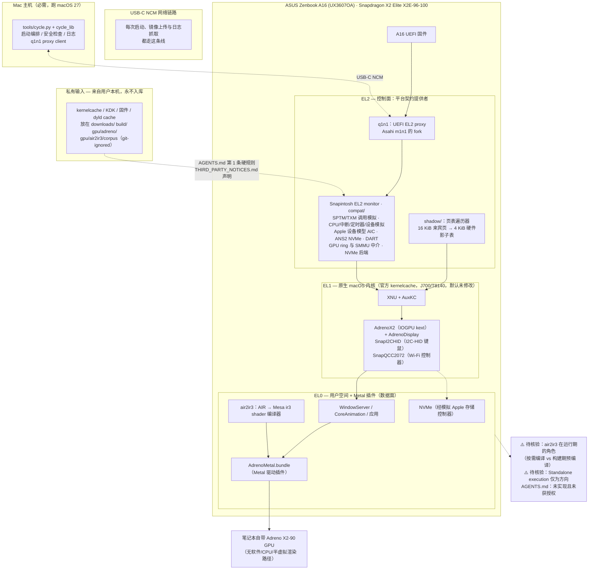

# Acelogic/Snapintosh

## 一句话定位

在 ASUS Zenbook A16（Snapdragon X2 Elite）笔记本上运行 Apple 官方 macOS 27 的 EL2 监控器（hypervisor）及其工具链——它不改内核，而是提供内核期待的 Apple silicon 平台契约（SPTM/TXM 调用、16 KiB 页表翻译、Apple 设备模型），并为笔记本自带的 Adreno X2-90 GPU 写了一套完整的 Metal 驱动栈。

## 它解决的问题

Apple 的 macOS 内核（以官方 kernelcache 形式，J700/T8140 内核）**默认未修改地**运行在一台 Snapdragon X2 Elite 机器上。它必须向内核提供 Apple silicon 硬件通常会提供的一切：SPTM 与 TXM 安全监控调用、内核 16 KiB 页表的翻译（该 SoC 的 MMU 只支持 4 KiB）、以及 AIC、DART、ANS2 NVMe 等 Apple 设备模型。

Snapintosh 的做法是在 EL2 层构造这些契约，让**内核保持官方二进制不动**。README 明确写：「The monitor runs Apple's stock kernelcache (the J700/T8140 kernel) unmodified by default.」

图形部分则完全不依赖虚拟化或透传：项目自带 `AdrenoMetal.bundle`（Metal 驱动插件）、`AdrenoX2`（IOGPU kernel extension，配 `AdrenoDisplay` 驱动内屏）、以及 `air2ir3`（把 Apple 的 AIR 即 Metal 的 IR 翻译成 Mesa 的 ir3）。README 用一句硬边界封住退路：**「There is no software, CPU or paravirtual rendering path.」**

## 为什么值得关注（2026-10-23）

**它是本日四个项目中唯一一个把状态写成逐项表格、并对每个未达标项给出目标值的项目。** README 的 Status 表原文：

| 方面 | 状态 |
|---|---|
| A16 上的 macOS 桌面 | 启动到桌面且有 GPU 加速，渲染正确，桌面测试场景的像素检查通过 |
| 流畅度 | 进行中，交互可用但尚不流畅。目标是**稳定约 60 Hz，屏幕的 120 Hz 排在后面** |
| 输入 | 内置键盘与触摸板可用，含触控板手势、Mission Control 与应用切换 |
| Wi-Fi（QCC2072） | 扫描、WPA2 连接、DHCP、ping 在由 Mac 侧驱动的 host-proxy 测试架上可用；**从 macOS Wi-Fi 菜单发起连接尚不可用** |
| 存储 | macOS 已安装到内置 NVMe 并从其启动 |
| 其他硬件 | **音频、摄像头、蓝牙、休眠与外接显示器均不支持** |

**这张表比 star 数信息量大得多**：它把「已通过像素检查」和「交互尚不流畅」放在同一张表里，且给出了明确的量化目标（60 Hz → 120 Hz）。

**第二条值得记的是它的 AGENTS.md 开篇一句**：「This is the complete policy, not an addendum to an earlier AGENTS.md.」——明确宣告这份政策文件是完整而非增量，避免贡献者把它当成需要叠加的补丁。这与 10-22 的 NVIDIA/flare 是同一种做法，但措辞更直接。

## 热度来源判断

530⭐ ⑂29 出现在创建后约 20 小时（首条 commit `Snapintosh public release` 时间戳为 2026-10-22T01:26:36Z，`pushed_at` 为 2026-10-22T06:36:50Z）。fork/star 5.5%，`subscribers_count = 4`，`open_issues_count = 4`。

**热度主要来自话题性而非可用性**：这是一个"让 macOS 跑在非 Mac 上"的演示型项目，而 README 第一句就把它写为「**This is experimental software, written for one laptop model.**」。**它只支持一台机器（ASUS Zenbook A16 UX3607OA，Snapdragon X2 Elite X2E-96-100）**——README 原文「Nothing else is supported. The monitor, device tables, clocks and register addresses are specific to this machine.」

fork/star 5.5% 偏低也符合这个形态：没有第二个机型可移植，fork 一个单机型 hypervisor 没有直接用途。

**必须同时记录的一个可核验事实：全仓库仅 11 个 commit**，且最新提交集中在公开后的 5 小时内（含 3 个 Merge PR）。这说明**这是一个刚刚公开的快照**，不是有持续历史的项目。

## 关键技术亮点

1. **EL2 monitor 模拟完整 Apple 平台契约**：SPTM/TXM 监控调用、CPU/中断/定时器/设备模拟、GPU ring 与 SMMU 中介、NVMe 后端（`compat/`）。AGENTS.md 的分层表把这些职责逐条对应到文件位置。
2. **16 KiB → 4 KiB 影子页表**（`shadow/`）：页表遍历器把来宾的 16 KiB 页表翻译成硬件的 4 KiB 影子表。这是与 UniXNU 相同的核心技术难点，两个独立项目都把它当作核心章节。
3. **完整的 GPU 栈而非透传**：`AdrenoX2`（IOGPU kext）+ `AdrenoDisplay`（内屏）+ `AdrenoMetal.bundle`（Metal 插件）+ `air2ir3`（AIR→Mesa ir3 shader 编译器）。**自己写 shader 编译器是把 Metal 图形栈搬到非 Apple GPU 上的必要条件**，这也是与 Asahi（Linux 直接用 Mesa）路线截然不同之处。
4. **q1n1 作为独立组件**：从 Asahi Linux 的 m1n1 fork 出来的 UEFI EL2 proxy，**通过 USB-C 上的 NCM 网络链路把机器交给一台 Mac 主机驱动**——每次启动、上传与日志抓取都走这条链路。README 明确：**必须有一台跑 macOS 27 的 Mac 主机**。
5. **AGENTS.md 的三条硬规则**：① 绝不提交 Apple/Qualcomm/ASUS 的 kernelcache、固件、restore-image 部件、KDK、kext、dyld cache、ACPI dump、反汇编/vtable/ABI dump、重建的 `*26A428.h` 头文件、以及从 Apple shader 编译出的 shader 集；② 绝不提交密钥或机器标识数据（个人路径、用户名、主机名、接口名、IP/MAC、序列号、SSID/密码、SSH 密钥、容器 ID）——用 `tools/cycle_lib/pins.example.json` 参数化；③ 保留 opt-in 语义（新运行时特性需编译期开关 `ADRENO_*` / `SNAP_*`）。
6. **`THIRD_PARTY_NOTICES.md` 主动声明**：「The repository contains no Apple, Qualcomm, ASUS or Microsoft binaries.」并说明输入来自用户自己机器、停在 git-ignored 的 `downloads/`、`build/`、`gpu/adreno/`、`gpu/air2ir3/corpus` 目录。`LICENSES/` 目录含 BSD-3-Clause.txt、GPL-2.0-only.txt、GPL-2.0-or-later.txt、MIT.txt。

## 架构师速览

| 决策问题 | 研究判断 | 证据边界 |
|---|---|---|
| 系统边界 | 一台 ASUS Zenbook A16 + **一台必须存在的 macOS 27 Mac 主机**（经 USB-C NCM 驱动）+ EL2 monitor（`compat/` `shadow/` `probes/`）+ EL1 原生内核与 AuxKC（`gpu/adreno-kext/kext/` `drivers/`）+ EL0 用户空间与 Metal 插件（`AdrenoMetal.bundle` + air2ir3 运行时）。**控制面在 EL2 契约提供者与主机侧工具链；数据面是 GPU 命令流与 NVMe I/O** | 全部来自 README 的 Architecture in brief mermaid 图（该图由作者本人提供）、Repository layout 表、AGENTS.md 的分层职责表；**「Mac 主机的作用边界」——q1n1 只做 proxy，实际驱动逻辑在 `tools/cycle.py` 与 q1n1 proxy client 侧，README 未细述控制流，待核验** |
| 主路径 | A16 UEFI → q1n1（EL2 proxy，经 USB-C NCM 连到 Mac 主机）→ Snapintosh EL2 monitor（SPTM/TXM 契约、16K→4K 影子页表、Apple 设备模型 AIC/ANS2/DART、GPU ring 与 SMMU 中介）→ 官方 XNU 内核 + AuxKC（AdrenoX2 + AdrenoDisplay、SnapI2CHID 等）→ 用户空间（WindowServer、Core Animation、应用、AdrenoMetal.bundle + air2ir3） | **README 自带的 mermaid 图与逐层文字说明，本档案的架构图在此基础上补出「私有输入不入库」的合规边界与待核验节点**；**「air2ir3 编译器在运行期的角色」README 未明说（推测为按需编译或构建期预编译，待核验）** |
| 关键权衡 | **不改内核（补齐平台契约）vs 改内核**（保持官方二进制意味着继承其全部不兼容与漏洞，也省掉 rebase）· **自写 Metal 驱动 + shader 编译器 vs 虚拟 AGX vs GPU 透传**——README 明确否决软件/CPU/半虚拟渲染路径；`gpu/agx*` 目录是"更早的虚拟 AGX 模型，保留作参考"，说明这个项目**自己也走过更省事的路并放弃了** · **依赖一台 Mac 主机 vs 目标机独立运行**——AGENTS.md 明写「Standalone execution is a direction, not an already implemented or authorized replacement for this flow」，**即独立运行是方向而非已实现路径，且未获授权** · **只支持一台机器 vs 多机型**——README 明写「Nothing else is supported」，用规模换深度 · **GPL-2.0 组件与 MIT 主体共存 vs 单一许可**（`LICENSES/` 四份许可文本 + `THIRD_PARTY_NOTICES.md` 的成分列表） | AGENTS.md 的「Non-Negotiable Safety, Provenance & Compatibility」三条 + README 的 Status 表与 Required hardware 段 + `gpu/agx*` 目录存在 + `LICENSES/` 四份文本 + THIRD_PARTY_NOTICES 的「contains no ... binaries」声明；**未明示：为什么依赖 Mac 主机而非独立运行、GPU ring 中介的具体实现、air2ir3 的支持度（是否覆盖完整 Metal 特性集）** |
| 最小 PoC | 1. **确认你有指定的那台机器**——ASUS Zenbook A16 UX3607OA + Snapdragon X2 Elite X2E-96-100，**不支持任何其他机型**→ 2. **确认你有第二台跑 macOS 27 的 Mac 主机**（这是比目标机更硬的门槛）→ 3. 按 `docs/RUNNING.md` 接好 USB-C，AC 供电（工具在电量低于阈值时拒绝启动或写盘）→ 4. **按 AGENTS.md 的「Start Here」顺序读**：`README.md` → `docs/ARCHITECTURE.md` → `docs/BUILDING.md` → `docs/STATUS.md`，硬件执行再读 `docs/RUNNING.md`；AGENTS.md 明确「Do not rely on status summaries from earlier sessions in place of the current tree」→ 5. 按 `tools/` 的脚本从**自己机器**获取 kernelcache 与固件（**不下载、不提交**，见 THIRD_PARTY_NOTICES）→ 6. **只验证 Status 表第一行**：能否启动到桌面且 GPU 加速、桌面测试场景像素检查通过 → 7. **明确不要验证 60 Hz**——README 自己写着「In progress」，把它当失败判据是误读 → 8. 用 `tools/test-*` 与 `tools/replay-*`（README 称其为 host tests、offline replays 与 diagnostics）对照，而不要依赖真机重复跑 | 步骤完全按 README 与 AGENTS.md 已给出的顺序倒排；**第 1–2 步是纯硬件门槛，先于任何技术判断**；**第 7 步是本 PoC 最重要的判断**：README 的 Status 表把「已可用」与「进行中」明确分开，读错这张表就会得出错误结论 |

> 证据边界：主体结构（EL2 monitor → EL1 XNU → EL0 用户空间）与各层职责来自 README 自带的 mermaid 图、Repository layout 表与 AGENTS.md 的分层职责表。本档案补入「私有输入不入库」合规边界（来自 AGENTS.md 第 1 条与 THIRD_PARTY_NOTICES.md）与两个待核验节点。

## 架构启发

**它最值得学的两件事，都跟技术无关。**

第一是 **Status 表这个形式本身**。它把「能启动到桌面且像素检查通过」「交互尚不流畅，目标是 60 Hz」「Wi-Fi 菜单发起连接尚不可用」「音频摄像头蓝牙休眠外接显示器不支持」放在同一张表里，用同一套「已可用 / 进行中 / 不支持」的三档措辞。**读者不需要读完全文就知道这台机器现在能干什么。** 对比很多同规模项目只写一句「coming soon」，这张表的信息密度高一个量级。

第二是 **AGENTS.md 第 1 条的严格程度**。它列举了九类不得提交的内容（kernelcache、固件、restore-image 部件、KDK、kext、dyld cache、ACPI dump、反汇编/vtable/ABI dump、重建的 `*26A428.h` 头文件），并加了一句「Do not paste protected source material into PRs, tickets, build logs or test fixtures」——**把「不要贴」的范围从代码扩展到了 issue、日志与测试夹具**。这是 10-22 的 flare 之后，第二个把「什么绝对不能做」写成可执行清单的当日项目。

第三条架构层面的启发：**`gpu/agx*` 目录的存在本身就是一份诚实的路线记录**。README 说这是「an earlier virtual-AGX model, kept for reference」。保留一条放弃的路径并标注为参考，比删掉它更能让读者理解为什么现在选原生驱动——**项目保留了它的判断过程，而不只是它的结果**。

## 定位判断

**单机型硬件研究项目（观察型）。** 它明确不是消费级软件（只支持一台笔记本，且必须配一台 Mac 主机），不是通用移植方案（README 直言「Nothing else is supported」），也不是研究论文（可运行、有完整分层与测试工具）。它的正确定位是**一份可运行的 ARM64 上运行 Apple 内核的完整参考实现**，价值在于分层清晰、边界明确、状态诚实。

**「依赖一台 Mac 主机」这一点决定了它的使用门槛高于其 star 数给人的印象。** 任何想试的人先要解决的不是技术问题，而是"我手边得有两台特定设备"。

## 风险 / 局限 / 泡沫点

1. **⚠️ GitHub `license.spdx_id` 为 `NOASSERTION`，而 LICENSE 文件首行明写 `MIT License`**，`THIRD_PARTY_NOTICES.md` 也写明「Snapintosh is licensed under the MIT licence」。以文件为准是可用的 MIT；但 GitHub 侧无法自动识别，依赖 license 扫描器的工具会当成非标准协议。**可核验的元数据与文件不一致，与 UniXNU 同类。**
2. **只支持一台笔记本**：README「Nothing else is supported」，且「The monitor, device tables, clocks and register addresses are specific to this machine」。任何其他 A16 用户无法使用。
3. **必须有一台 macOS 27 的 Mac 主机**：AGENTS.md 明写「The present workflow still uses q1n1 and a Mac host over USB-C NCM」，并把独立运行列为「a direction, not an already implemented or authorized replacement」。
4. **功能缺口明确且不小**：音频、摄像头、蓝牙、休眠、外接显示器**全部不支持**；Wi-Fi 只能通过 host-proxy 测试架，不能从 macOS 菜单连接；流畅度「usable but not yet smooth」，60 Hz 是**目标**而非现状。
5. **⭐ 11 个 commit、单机型、单次公开**：全仓库历史集中在 2026-10-22 的 5 小时内（01:26 首次公开 → 06:36 最后一次推送，含 3 个 Merge PR）。**这不是成熟项目，是一个刚公开的快照。**
6. **未经第三方复现**：README 声称「pixel checks across the desktop test scenes pass」——这是作者自述，本日报无法核验；仓库按其自身规则不含可分发的运行产物。
7. **GPL-2.0 成分**：项目主体 MIT，但 `LICENSES/` 含 GPL-2.0-only 与 GPL-2.0-or-later 文本，`THIRD_PARTY_NOTICES.md` 有成分列表。**具体哪些文件是 GPL-2.0，本窗口未逐项核验**——若用于分发需先确认。
8. **无 release**：`releases` API 返回空数组，分发路径为从源码构建。

## 与同类项目的关系

- **vs UniXNU/UniXNU（本日另一个项目）**：**同题、同日、不同路径、互不相识。** 两者都要解决 16 KiB→4 KiB 页表（Macintosh 的 `shadow/`、UniXNU 的 `docs/xnu/four-k-page-tables`）与 Apple 私有输入不入库（Macintosh 的 AGENTS.md 第 1 条、UniXNU README 的 Private blobs 段）。差别在于：**Macintosh 用 EL2 hypervisor 且依赖 Mac 主机，UniXNU 用 UEFI 且面向 35 款设备移植。** 两条独立路径撞上同一组核心技术难点，这本身是这组技术难度的最好证据。
- **vs Asahi Linux**：Asahi 在 Linux 上支持 Apple Silicon（M 系列 Mac 跑 Linux），Macintosh 在 Android 笔记本上支持 Apple macOS。**方向正交**；但 Macintosh 依赖的 q1n1 正是 Asahi 的 m1n1 的 fork，两者在这条链上有血缘。
- **vs Corellium / UTM**：商业产品的免费通道，有分发物与支持；Macintosh 是无分发物的工程快照。
- **vs 项目内 `gpu/agx*`**：自有的、更早放弃的虚拟 AGX 路径。

## 是否值得持续跟踪

**值得跟踪，但应作为「分层与状态记录的样本」而非「可用工具」来跟踪。** 理由与 star 数无关：它的 EL2/EL1/EL0 分层表、Status 三档措辞、AGENTS.md 的九条禁止提交清单、THIRD_PARTY_NOTICES 的成分声明——**这四样加起来是一份关于「如何在硬件逆向项目里表达边界」的完整示范**，而这些都不需要它继续可用。

**7 天后判断标准**：看两件事——① Status 表里「Smoothness」是否从 in progress 推进到 60 Hz（这决定它是否从研究快照变成可用系统）；② 是否出现第二台机器（这决定它是封闭作品还是可移植方案）。**若两者都不发生，它仍然保有方法论价值，只是不再保有实用价值。**

## 后续观察点

- 「60 Hz 稳定」与「120 Hz」这两个量化目标是否有进展记录（README 明写目标与现状差距）
- Wi-Fi 能否从 macOS 菜单发起连接（当前仅 host-proxy 测试架可用）
- Standalone execution 是否从「方向」变成实际实现（AGENTS.md 明确标注它未获授权）
- 是否出现第二台受支持机型——这决定 `docs/STATUS.md` 是单页还是多页
- AGENTS.md 第 1 条的边界在实际协作中是否被守住（看 issue/PR 中是否出现私有输入的意外泄露）

---
*首次记录：2026-10-23*