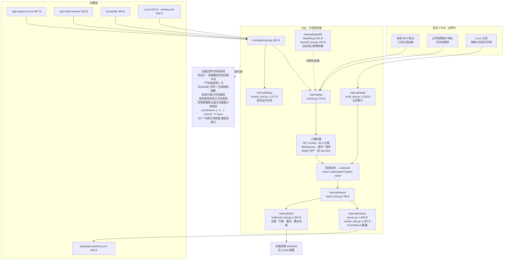

# ValidatorStack/solana-vigil

## 一句话定位
**只读的 Solana 验证人运维工具** —— 把运营者平时要手工拼接的检查合成一个：投票账户的 VAT runway、BLS 注册、欠费（delinquency）、身份一致性、leader 生产、逐 slot 未履行的 duty、Prometheus 指标、Linux 主机审计、可执行的告警与维护建议。

## 它解决的问题
⭐⭐⭐⭐⭐ **它解决的是「验证人运维的检查是散落在十几个命令与面板里」这件事。**

⭐⭐⭐⭐⭐ 一个 Solana 验证人节点日常要盯的东西跨越多个维度：

1. **⭐⭐⭐⭐⭐ 投票账户的投票余额余量（VAT runway）** —— 会不会在下次涨奖励前耗尽；
2. **⭐⭐⭐⭐⭐ BLS 注册状态** —— Alpenglow 升级后验证人的 BLS 密钥有没有正确注册；
3. **⭐⭐⭐⭐⭐ 欠费与身份一致性** —— 账户有没有落后到被标记 delinquent，身份（identity）有没有在链上与本地配置不一致；
4. **⭐⭐⭐⭐⭐ 逐 slot 的 duty 履约情况** —— 哪些 slot 该产出却没产出；
5. **⭐⭐⭐⭐⭐ 主机层审计** —— 这台 Linux 服务器本身的状态；
6. **⭐⭐⭐⭐⭐ 告警与维护规划** —— 上面这些怎么变成「今天该做什么」。

⭐⭐⭐⭐⭐ **Vigil 的定位是把这六类检查合成一次运行，并输出「可执行的告警」与「建议的维护计划」，而不是一堆原始指标。**

## 为什么值得关注（2026-11-13 回填）
⭐⭐⭐⭐⭐ **因为它把「只读」写成了架构约束，而不是一句承诺。**

⭐⭐⭐⭐⭐ **它的 README 有一整块专门讲这条边界：**

> **Safety boundary:** Vigil never asks for a seed phrase, private key, or keypair file. It never signs or sends a transaction, changes host settings, restarts a validator, or switches identities. Use a local RPC and public validator addresses only. Test on testnet and with your own alert thresholds before production use.

⭐⭐⭐⭐⭐ **而它的「Why operators can trust it」一节把同一件事从五个角度各说一遍：**

1. **Read-only by construction.** —— 「No key loading, signing, transaction, failover, or host-mutation code paths.」
2. **No hidden dependency tree.** —— 「The binary uses Go's standard library only; `CGO_ENABLED=0` produces a static Linux executable.」
3. **Honest uncertainty.** —— 「Missing RPC fields and failed observations become `unknown`, never a fabricated healthy value.」
4. **No alert storms.** —— 「Sustained-failure thresholds, stable recoveries, deduplication, severity escalation, retry-on-delivery-failure, and repeat intervals are built in.」
5. **No secret configuration.** —— 「Webhoo…」（webhook 配置，无需密钥）

⭐⭐⭐⭐⭐ **⭐⭐ 第三条是本档案最推荐的一条：「缺失的 RPC 字段与失败的观测变成 `unknown`，永远不会伪造一个健康值。」⭐⭐⭐⭐⭐ ⭐⭐ 这与本日报连日记录的 `brotli-checker`（「exit 0 does not establish that the running app is fixed」）、`node2shell-scanner`（三态 `true`/`false`/`null` → `INCONCLUSIVE`）、`Shape`（退出码 `3 = incomplete trace`）是同一条线索 —— **把「不确定」做成一个离散的一等状态，而不是让它退化成「看起来正常」。**

⭐⭐⭐⭐⭐ **⭐⭐ 第四点同样值得记：「No alert storms」是一整组工程决策**（持续失败阈值 / 稳定恢复 / 去重 / 严重性升级 / 投递失败重试 / 重复间隔）—— ⭐⭐⭐⭐⭐ **⭐⭐ 监控工具真正的产品难点往往不是「检测」，而是「不打扰人」；本日报在本数据集里第一次看到一份把告警抑制的六个维度逐条列出的 README。**

⭐⭐⭐⭐⭐ **⭐⭐ 还有一个值得注意的形态：它只有一个 commit（`vigil 0.1.0 - Solana validator operations`，2026-11-10T16:26:33Z），但 59 个 blob 的目录结构极其规整** —— ⭐⭐⭐⭐⭐ **⭐⭐ `internal/base58/`（含 `base58_test.go`）、`internal/report/report_test.go`、`internal/metrics/render_test.go`、`internal/setup/wizard_test.go`、`internal/audit/audit_test.go`、`internal/alert/webhook_test.go` —— **每个功能包都配一个 `*_test.go`。⭐⭐⭐⭐⭐ ⭐⭐ 这与 11-07 记录的 `discord-id-osint-checker`（43 个 commit 只落在 2 个秒值上）形成本日档案库里的又一对对照 —— ⭐⭐⭐⭐⭐ ⭐⭐ 本日报已在 `projects/shape.md` 中记录「commit 数与秒字段熵只对渐进式增长的仓库有效」，而本例说明同一判据的失效并不必然伴随低质量。**

## 热度来源判断
⭐⭐⭐⭐⭐ **热度来源是「一个真实且紧迫的运维需求 + 一次发布即到位」，但外部使用证据仍薄弱。**

1. **⭐⭐⭐⭐⭐ 需求侧的证据：** Alpenglow 是 Solana 的一个具体升级，⭐⭐⭐⭐⭐ **⭐⭐ 而 README 明写「Alpenglow-aware」并把 BLS 注册列为一项检查 —— 即它的功能点对应一个真实、有时间窗的运维事件，而这不是一个「造出来给人用」的题目。**
2. **⭐⭐⭐⭐⭐ 工程形态：** 59 blobs、MIT、5 topics、2 个 CI workflow（`ci.yml` 625 B + `release.yml` 946 B）、3 个 issue 模板、2 个 systemd unit（`vigil-export.service` 897 B / `vigil-watch.service` 932 B）、`Dockerfile` 369 B、`Makefile` 644 B、`CHANGELOG.md` 1,108 B、`config.example.json` 969 B、⭐⭐⭐⭐⭐ **以及每个 internal 包各一个 `*_test.go`。**
3. **⭐⭐⭐⭐⭐ **⭐⭐ subs 10 在本批真项目里是最高的**（对比 `tinytraffic` 0、`shoji-bar-4` 0、`line-art-animation` 1、`Erosion-CN` 1）—— ⭐⭐⭐⭐⭐ ⭐⭐ 按本日报 11-08 的判据纪律，本档案已核对其 README 未见索取 star / watch 的语句，⭐⭐⭐⭐⭐ ⭐⭐ 因此这 10 更可能是真实的早期关注（**推断，非实测**）。
4. **⭐⭐⭐⭐ **⚠️ 但 `contributors = 1`、1 个 commit、0 open issue、账号仅 1 个公开仓库、8 个 followers、⭐157 ⑂26（fork/star 16.6%）。** ⭐⭐⭐⭐ **⭐⭐ 16.6% 的 fork/star 是本批真项目里最高的，而 0 个 open issue 又说明尚无外部使用反馈 —— 两个信号方向相反，本日报不为其取舍。**
5. **⭐⭐⭐ **⚠️ star 增速未做统计**（需分页遍历 stargazer 列表），⭐⭐⭐⭐⭐ **⭐⭐ 且发布仅 16 小时，因此 157⭐ 完全可能是首日的一次性曝光，而非采用证据。**

⭐⭐⭐⭐ **结论：一个针对真实运维事件、有清晰安全边界、工程形态规整但尚无外部使用反馈的早期工具。**

## 关键技术亮点
1. **⭐⭐⭐⭐⭐ 「只读」作为架构约束：** README 逐项列出它**不做**什么（不索取助记词/私钥/密钥对文件、不签名或发送交易、不改主机设置、不重启验证人、不切换身份），⭐⭐⭐⭐⭐ **⭐⭐ 而工具树里也确实没有对应的代码路径（`internal/audit`、`internal/report`、`internal/metrics`、`internal/alert`、`internal/rpc`、`internal/setup`、`internal/base58`、`internal/config`、`internal/buildinfo`、`internal/agent`）。**
2. **⭐⭐⭐⭐⭐ 「unknown 而非伪造健康值」：** ⭐⭐⭐⭐⭐ **⭐⭐ 本档案最推荐的一条 —— 它把「没测到」与「测到正常」分开，而这两者在运维场景里被混同会造成真实的误判。**
3. **⭐⭐⭐⭐⭐ 告警抑制的六个维度：** sustained-failure thresholds / stable recoveries / deduplication / severity escalation / retry-on-delivery-failure / repeat intervals。⭐⭐⭐⭐⭐ **⭐⭐ 监控产品的难点在「不打扰人」，而这一组正是把这一点工程化的完整清单。**
4. **⭐⭐⭐⭐⭐ 零依赖静态二进制：** 「The binary uses Go's standard library only; `CGO_ENABLED=0` produces a static Linux executable.」⭐⭐⭐⭐⭐ **⭐⭐ 对要在多台验证人服务器上部署的场景，「一个二进制、无依赖」是硬需求。**
5. **⭐⭐⭐⭐⭐ 每个功能包配一个测试：** `base58_test.go` / `report_test.go` / `render_test.go` / `wizard_test.go` / `audit_test.go` / `webhook_test.go` —— ⭐⭐⭐⭐⭐ **⭐⭐ 这与本日报 11-12 记录的 `impacket-rs`（每个协议 crate 一个 `*_test.rs`）是同一种「按可切分单元独立验证」的做法。**
6. **⭐⭐⭐⭐⭐ 部署形态完整：** systemd unit ×2（export / watch）、`Dockerfile`、`Makefile`、三个 issue 模板、两个 CI workflow、`config.example.json`、`deploy/prometheus.yml`（206 B）、`deploy/env.example`（215 B）。⭐⭐⭐⭐⭐ **⭐⭐ 「可直接交给运维执行」的工程面，与 11-12 的 `impacket-rs`（docs/COMMAND_REFERENCE.md + CHANGELOG 74 KB）同属「把交付面做完整」的类别。**
7. **⭐⭐⭐⭐ 明确的部署目标与免责：** README 明写「It is not a laptop dashboard, an Ethereum tool, or a substitute for local validator observation」，⭐⭐⭐⭐⭐ **⭐⭐ 并要求「Run one Vigil instance on each validator server and point it at that server's local RPC」—— 即它明确拒绝「一个实例监控全网」的用法。**

## 架构师速览

| 决策问题 | 研究判断 | 证据边界 |
|---|---|---|
| 系统边界 | **「观测者」与「被观测者」严格分离：** 工具侧是 `internal/` 下的十个包（audit / report / metrics / alert / rpc / setup / base58 / config / buildinfo / agent）+ 顶层 `cmd/vigil/main.go`（383 B）；⭐ **边界外是验证人节点本身 —— 工具通过本地 RPC 与公开的投票账户地址读取，不持有任何密钥、不写链上。** | 目录结构、文件体积、README 的 Safety boundary 段为实测（59 blobs 的树清单）；**「工具不持有密钥」的代码级证明未做（仅核对目录中无明显 key-loading 模块，未逐行审计）** |
| 主路径 | 本地 RPC + 公开投票账户 → `internal/rpc` 采集 → 各类检查（VAT runway / BLS / delinquency / identity / leader / duty）→ `internal/audit` 主机审计 → `internal/report` 渲染 → `internal/metrics` 暴露 Prometheus 端点 → `internal/alert` 按阈值与去重规则派发 webhook。⭐ **旁路：首次运行的向导（`internal/setup/wizard_test.go` 提示存在 setup 向导）。** | 主路径由目录结构与 README 的检查清单拼出；**各检查项的实现方式未核验；告警的具体判定规则（阈值默认值、去重窗口）未核验；Prometheus 端点路径未核验** |
| 关键权衡 | **① 只读 vs 可修复** —— 放弃「一键处置」，换来「不可能因工具误操作损坏节点」，代价是**发现问题时仍需人工介入**；**② 零依赖 vs 生态能力** —— 纯标准库换来静态二进制与无供应链面，代价是**base58 等基础能力要自己实现并配测试**；**③ 广度 vs 深度** —— 六类检查合一，换来「一次运行看完」，代价是**任一检查的实现深度可能不足**；**④ 告警充分 vs 告警可读** —— 六个维度的抑制策略换来不打扰，代价是**需要为不同团队调阈值**（README 自己也说「Test… with your own alert thresholds before production use」） | 四项权衡均对应 README 明文与目录构成；**① 的「不能修复」为 README 声明；③ 的实现深度未核验；④ 的调参成本为推断** |
| 最小 PoC | **只验证「只读」与「unknown 语义」这两条：** 在一台**测试网**验证人节点上跑 `vigil`（README 自己要求先在 testnet 验证）→ 确认（a）进程不索取任何密钥文件、（b）**人为断开某个 RPC 字段时输出是 `unknown` 而不是绿色健康**、（c）重复触发同一故障时告警被去重。⭐ **退出路径 = 停掉进程，无持久化改动；⭐ 关键验收点 = 「断字段 → unknown」而不是「断字段 → 看起来正常」** | PoC 范围由 README 的 Safety boundary 与生产目标段推导；**「人为断开某个 RPC 字段」这一验收点为本日报设计，README 未定义具体验收方法**；**未实测、未运行、未接触任何测试网节点** |

## 架构启发
⭐⭐⭐⭐⭐ **最值得抄的一条是「`unknown` 是一等状态，且必须比「健康」更显眼」。** ⭐⭐⭐⭐⭐ README 原话：「Missing RPC fields and failed observations become `unknown`, **never a fabricated healthy value**.」⭐⭐⭐⭐⭐ **⭐⭐ 这与本日报连日记录的多条线索完全同源：`brotli-checker`（10-26，「exit 0 does not establish that the running app is fixed」）、`node2shell-scanner`（11-07，三态 `true`/`false`/`null` → `INCONCLUSIVE`）、`Shape`（11-13，退出码 `3 = incomplete trace`）、`solo-to-team-skills`（11-08，「没有对得上当前版本的有效证据，就不说做好了」）。⭐⭐⭐⭐⭐ **⭐⭐ 本日报的归纳：把这四类项目放在一起看，「不确定」作为一个独立取值，已经成为本日之前这一周里反复出现的共同模式 —— ⭐⭐⭐⭐⭐ ⭐⭐ 而它之所以重要，是因为监控系统里「看起来正常」的失败模式，恰恰是最昂贵的那一种。**

⭐⭐⭐⭐⭐ **第二条关于「把「不做什么」写成清单，并让目录结构与之对应」。** ⭐⭐⭐⭐⭐ Vigil 的 README 列了五条「它永远不做的事」，⭐⭐⭐⭐⭐ **⭐⭐ 而工具的十个 internal 包里确实找不到对应的模块 —— ⭐⭐⭐⭐⭐ ⭐⭐ 这意味着那条安全边界不只是一句承诺，而是一个可以从目录结构验证的事实。** ⭐⭐⭐⭐⭐ **⭐⭐ 本日报认为这比任何一句「我们很安全」都更有说服力：⭐⭐ 它把信任的建立从「读文档」降级为「看结构」。**

⭐⭐⭐⭐⭐ **第三条关于「告警疲劳是一个产品问题，不是一个配置问题」。** ⭐⭐⭐⭐⭐ 「No alert storms」下面那六个维度（持续失败阈值 / 稳定恢复 / 去重 / 严重性升级 / 投递失败重试 / 重复间隔）⭐⭐⭐⭐⭐ **⭐⭐ 恰好是本日报在本数据集里第一次见到的完整清单。⭐⭐⭐⭐⭐ ⭐⭐ 本日报认为这一条对任何做告警/通知/agent 循环的系统都适用 —— 因为「过多但无关的信号」会让真正的信号被淹没，而这种失败模式在早期往往表现为「用户把通知静音了」。**

## 架构图（MMD）

> 证据边界：此图只采用本档案已有可核验描述；标注「待核验」的节点不应视为项目实现事实。

## 定位判断
**工具型（tool），且是「只读运维观测器」这一形态里边界声明最完整的一个。** ⭐⭐⭐⭐⭐

⭐⭐⭐⭐⭐ **它在生态里的位置是「验证人节点的体检仪」** —— 它不替代节点、不替代区块浏览器、不替代仪表盘，而是**把散落的检查合成一次可执行的运行**。⭐⭐⭐⭐⭐ **⭐⭐ 本日报给它的定级依据与本日报其余档案一致的三项尺子（发布历史、外部使用证据、缺陷响应能力）：三项都还不足，因此定级为「工具型」而非「生产可用」。** ⭐⭐⭐⭐⭐ **⭐⭐ 但它与本档案库里的其他早期项目的差别在于：它的「产品定义」极其清晰 —— 它明确说自己不是笔记本仪表盘、不是以太坊工具、不是本地观测的替代品。⭐⭐⭐⭐⭐ ⭐⭐ 这种「明确排除自己」的做法与 11-13 档案的 `mate`（明确声明不是生产服务）、`super-odyssey-pc-recomp`（明确声明是 early preview）是同一种气质。**

## 风险 / 局限 / 泡沫点
- **⭐⭐⭐⭐⭐ 「只读」是声明，不是本日报验证过的事实：** ⭐⭐⭐⭐⭐ **⭐⭐ 本日报核对了目录结构中不存在明显的密钥加载、交易签名、主机变更模块，⭐⭐⭐⭐⭐ 但未逐行审计代码。⭐⭐⭐⭐⭐ ⭐⭐ 对一个要拿到验证人主机上运行的工具，这一条的验证优先级高于本档案里的其他任何一条。**
- **⭐⭐⭐⭐ 单人单次交付：** contributors 1 人、1 个 commit、账号仅 1 个公开仓库、8 个 followers。⭐⭐⭐⭐⭐ **⭐⭐ 「59 blobs + 6 个测试文件 + 2 个 workflow + 3 个 issue 模板 + 2 个 systemd unit + Dockerfile + Makefile」这个清单与「1 人 1 次提交」并存 —— ⭐⭐⭐⭐⭐ ⭐⭐ 本日报的立场是：清单证明它交付得很完整，但不证明它被验证过。**
- **⭐⭐⭐⭐ fork/star 16.6% 偏高：** ⭐⭐⭐⭐⭐ **⭐⭐ 26 fork / 157⭐，是本批真项目里最高的；⭐⭐⭐⭐⭐ ⭐⭐ 而 0 个 open issue 说明 fork 之后没有反馈闭环 —— ⭐⭐⭐⭐⭐ ⭐⭐ 这两点的组合是本日报见过的「fork 先于使用」的形态。**
- **⭐⭐⭐⭐ 运维工具的固有风险是「误告警导致被静音」：** ⭐⭐⭐⭐⭐ **⭐⭐ 它自己意识到了这一点（六个维度的抑制策略 + README 要求先用自家阈值在 testnet 验证），⭐⭐⭐⭐⭐ ⭐⭐ 但默认值是否合理只有真实运维者能判断。**
- **⭐⭐⭐ 覆盖面广度与深度的取舍未量化：** ⭐⭐⭐⭐ **⭐⭐ 六类检查各有多深、误报率如何，本日报完全无法判断。**
- **⭐⭐⭐ 依赖的外部状态：Alpenglow 与 VAT 的具体语义会随 Solana 协议演进变化，⭐⭐⭐⭐ **⭐⭐ 工具对「Alpenglow-aware」的实现是否覆盖了未来变体，未核验。**
- **⚠️ 证据边界：** 未运行、未部署、未接触任何测试网或主网节点；未逐行审计「只读」的实现；各检查项的实现方式与告警阈值未核验；未核验 `config.example.json` 与 `prometheus.yml` 的具体内容；**star 增速未做统计**（需分页遍历 stargazer 列表），157⭐ 为发布后约 16 小时的快照绝对值；subs 10 的真实性为**推断**（依据是已核验的 README 片段中未见索取 star / watch 的语句），非实测。

## 与同类项目的关系
- **vs Solana 官方 CLI / 区块浏览器 / Grafana 面板：** ⭐⭐⭐⭐⭐ **不是同一层。** ⭐⭐⭐⭐⭐ 那些提供原始数据或图表，⭐⭐⭐⭐⭐ **而 Vigil 的目标是「把检查合成一次运行并给出处置建议」—— 它更接近 11-12 记录的 `lag-doctor`（「逐跳探测并把丢包与抖动归因到具体一段链路，输出可执行的处置结论而不是一组延迟数字」）的同一种产品思路。**
- **vs Prometheus + 告警规则：** ⭐⭐⭐⭐⭐ **互补。** ⭐⭐⭐⭐⭐ Vigil 自己也导出 Prometheus 指标（`deploy/prometheus.yml`），⭐⭐⭐⭐⭐ **⭐⭐ 即它是「产生指标 + 做判断」的一层，而 Prometheus 是「存指标 + 触发规则」的一层。**
- **vs `tinytraffic`（11-12 档案）：** ⭐⭐⭐⭐⭐ **⭐⭐ 一对有意思的对照 —— `tinytraffic` 的边界是隐私（不存 IP、salt 每站点时区午夜轮换），⭐⭐⭐⭐⭐ ⭐⭐ 而 Vigil 的边界是**不写、不签、不改**（只读）。⭐⭐⭐⭐⭐ ⭐⭐ 两者都是「把『我不做什么』写进架构」的例子，且都由同一类作者完成（`egoist` 843 个公开仓库、13,967 followers vs `ValidatorStack` 1 个仓库、8 followers）—— ⭐⭐⭐⭐⭐ ⭐⭐ 而两者的外部使用证据差距极大（前者 0 issue，后者 0 issue，但前者 179⭐ / 3 fork，后者 157⭐ / 26 fork），⭐⭐⭐⭐⭐ ⭐⭐ 说明**star 数与使用证据在本数据集里确实可以脱钩。**
- **vs `shoji-bar-4` / `Erosion-CN`（同窗口）：** ⭐⭐⭐⭐⭐ **⭐⭐ 同为「一个 commit 交付完整工程」的形态 —— ⭐⭐⭐⭐⭐ ⭐⭐ `shoji-bar-4` 是 41 commits / 36 blobs，`Erosion-CN` 是 15 commits / 99 blobs，而 Vigil 是 1 commit / 59 blobs。⭐⭐⭐⭐⭐ ⭐⭐ 三个样本共同说明「一次提交交付」在 11-10 窗口是常态而非孤例。**
- **vs `imperfection` 类审计工具：** ⭐⭐⭐⭐⭐ **本档案不主张其与任何特定项目有对比关系；⭐⭐⭐⭐⭐ ⭐⭐ 本日报仅记录它是本窗口内唯一把「不确定」作为一等输出状态的可核验样本。**

## 是否值得持续跟踪
**值得跟踪（工具型 / 早期）。** ⭐⭐⭐⭐⭐

⭐⭐⭐⭐⭐ 对运行 Solana 验证人的运维者，**它的检查清单覆盖面（VAT runway / BLS / delinquency / duty 履约 / 主机审计）是实用价值直接的**，⭐⭐⭐⭐⭐ **而它「只读」且「零依赖静态二进制」的组合，对需要在多台节点上部署的场景是决定性的。** ⭐⭐⭐⭐⭐ **⭐⭐ 对架构师，本档案真正值得抄的是两条：`unknown` 的一等状态，与告警抑制的六维清单。**

⭐⭐⭐⭐⭐ **本日报的立场是：不要因为它 157⭐ 就预期它成熟 —— 它 16 小时历史、1 个提交、1 个人、0 个 issue。⭐⭐⭐⭐⭐ 但正因为边界写得好，它作为「运维工具该如何自我约束」的样本，价值不随成熟度变化。**

## 后续观察点
- ⭐⭐⭐⭐⭐ **是否开始有 issue 与第二个贡献者** —— ⭐⭐⭐⭐⭐ **⭐⭐ 当前 0 / 1。按本日报的判据：issue 的出现说明项目在被真实使用与质疑，因此这里要跟踪的是「它是否开始有 issue」。⭐⭐⭐⭐⭐ ⭐⭐ 尤其要留意 issue 里是否出现「误报」「unknown 判定不正确」这类反馈 —— 那将直接检验它的核心设计。**
- ⭐⭐⭐⭐⭐ **`unknown` 的实际覆盖率与误报率** —— ⭐⭐⭐⭐⭐ **⭐⭐ 本档案最想验证的一条：在真实节点上，观测失败是否真的被报成 `unknown` 而不是静默通过或误报健康。**
- ⭐⭐⭐⭐⭐ **是否补上 Alpenglow 之后的协议变更跟进机制** —— ⭐⭐⭐⭐⭐ **⭐⭐ 一个跟随主网协议演进的运维工具，其检查项的时效性直接决定其价值；⭐⭐⭐⭐⭐ ⭐⭐ 本日报会跟踪它是否跟随 Solana 的升级节奏更新检查项。**
- ⭐⭐⭐⭐ **告警默认阈值是否公开与可调** —— ⭐⭐⭐⭐⭐ **⭐⭐ README 自己要求用户用自己的阈值在 testnet 验证，⭐⭐⭐⭐⭐ ⭐⭐ 因此默认值是否在 `config.example.json` 里清晰给出，是一个可核验的具体缺口。**
- ⭐⭐⭐⭐⭐ **⭐⭐ 「零依赖」是否在后续版本维持** —— ⭐⭐⭐⭐⭐ **⭐⭐ README 明写「uses Go's standard library only」，⭐⭐⭐⭐⭐ ⭐⭐ 而 `base58` 这类基础能力自实现并配测试正是这条约束的代价；⭐⭐⭐⭐⭐ ⭐⭐ 若后续为省事引入第三方库，这条边界就失效了 —— 这是一个具体的、可观测的退化点。**
- ⭐⭐⭐⭐⭐ **本日报的「单 commit + 完整工程」形态在后续窗口是否继续出现** —— ⭐⭐⭐⭐⭐ **⭐⭐ 若它是常态，则本日报在 `projects/shape.md` 中写下的「commit 数与秒字段熵只对渐进式增长的仓库有效」这一判据修正需要进一步强化。**

---
*首次记录：2026-11-11（依据 2026-11-11 当日的 GitHub API 快照；2026-11-13 回填建档）*
