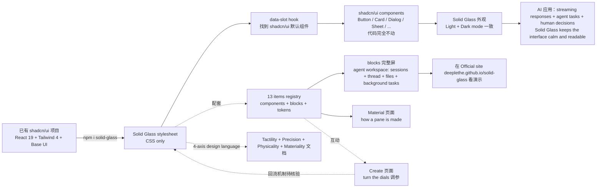

# deeplethe/solid-glass

## 一句话定位
Solid Glass 是一个专为 AI 应用程序设计的设计系统——一种「stands between flat design and liquid glass」的玻璃质感美学，只需一个 stylesheet 即可让既有 shadcn/ui 组件自动获得 Solid Glass 外观，无需改动组件代码。

## 它解决的问题
2026 年 AI 应用程序（chat / agent / streaming / decision UI）大量需要专属 design system，但现状：（1）shadcn/ui 默认 flat 美学，AI 应用场景偏「calm and readable」；（2）Apple 风格 liquid glass 受商用许可约束不能随便 fork；（3）各家 design system 多是半成品或商用。Solid Glass 直击痛点：（1）**One stylesheet finds shadcn/ui data-slot 不改组件**——已有 shadcn/ui 项目只需 import stylesheet；（2）**13 items registry**——从 components 到 blocks 一站式；（3）**4-axis design language**（Tactility / Precision / Physicality / Materiality）有清晰设计哲学；（4）**blocks 完整屏**（agent workspace: sessions, the thread, files and background tasks）可直接借鉴；（5）**Material + Create 调参页**——可视化的 token 编辑；（6）**AI 应用场景特别设计**——Solid Glass keeps the interface calm and readable. Neutral surfaces reduce visual distractions, depth establishes hierarchy, and color and motion are reserved for meaningful feedback。

## 为什么值得关注（2026-10-15）
- **Stars:** 590（截至 2026-10-15），3 天 590⭐ ⑂5 fork/star 0.8%，**增长率** 0.8%（design system 类 fork 一般不高，属正常）
- **Forks:** 5，社区参与度适中（设计系统 fork 普遍较低，因依赖设计哲学而非代码贡献）
- **Size:** 17518 KB（含 docs/screenshots + registry.json + 多张 banner / dark / light 截图）
- **License:** MIT
- **语言:** TypeScript + React 19 + Tailwind CSS 4 + Base UI
- **活跃度:** created 2026-10-12，pushed_at 2026-10-14，持续高活跃
- **平台:** 浏览器 / Web（React 19 + Tailwind CSS 4 + shadcn/ui Base UI 项目）

## 热度来源判断
Solid Glass 的热度是 **「AI 应用 design system 刚需 × shadcn/ui 生态绑定 × one stylesheet 不改组件 × 13 items registry × blocks 完整屏（agent workspace 等）× Material/Create 调参 × 4-axis 设计语言（Tactility / Precision / Physicality / Materiality）× MIT × 开源免费 × Designed for AI applications」** 的组合。AI 应用程序的复杂性（streaming responses / background tasks / decisions）让传统 design system 难以满足 calm + readable 的需求，Solid Glass 提供了一个明确「为 AI 应用设计」的 design system。热度真实且具「AI 类 chat / agent / streaming UI」严肃工程化场景的强需求。

## 关键技术亮点
1. **One stylesheet：** Solid Glass is one stylesheet. It finds each part of a shadcn/ui component by the `data-slot` and the classes it already carries, so the components you have need no changes
2. **Stands between flat design and liquid glass：** Flat is an opaque block with no finish to speak of; liquid glass is nearly clear, and on a page with a lot of text the reader is always fighting the background for the words. Solid Glass lets only an outline through: enough to know it is glass, not enough to get in the way of reading
3. **AI applications are built around information that is constantly changing** — responses streaming in, agents performing tasks, and decisions waiting for human input. Solid Glass keeps the interface calm and readable. Neutral surfaces reduce visual distractions, depth establishes hierarchy, and color and motion are reserved for meaningful feedback
4. **4-axis design language：** Tactility（Interfaces that feel tangible. Every interaction carries a subtle sense of touch and response.）+ Precision（Clean geometry, refined details, and restrained lighting create a precise, technical aesthetic.）+ Physicality（Depth comes from thickness, shadow, and spatial hierarchy, giving every element a sense of physical presence.）+ Materiality（Subtle edge highlights, fine borders, and soft shadows define the character of each surface.）
5. **Lightweight CSS in both light and dark modes：** 整个系统用轻量 CSS，可在 light / dark 模式下同时工作
6. **blocks（whole screens made of the components）：** an agent workspace made of it: sessions, the thread, files and background tasks；可直接借鉴或 copy
7. **Material page shows how a pane is made, and Create page lets you turn the dials：** 两个工具页面让用户可视化编辑 token
8. **13 items registry：** 包括 components + blocks + tokens
9. **Start from a shadcn/ui project (React 19, Tailwind CSS 4, the Base UI components)：** 严丝合缝 shadcn/ui 生态
10. **Built by DeepLethe + Official site deeplethe.github.io/solid-glass + Registry 13 items + Tailwind CSS 4 + React 19 badges：** 完整的 OSS 资产身份

## 架构师速览

| 决策问题 | 研究判断 | 证据边界 |
|---|---|---|
| 系统边界 | 一个 Solid Glass stylesheet（仅 CSS + 可选 token 文件）+ 一个 13 items registry（components + blocks + tokens）+ 一个 Official site deeplethe.github.io/solid-glass（blocks 完整屏 + Material/Create 调参页 + Home dark/light 对比）+ 一个 shadcn/ui 适配层（data-slot + 已有 classes 不改）+ 一个 design language 文档（4-axis Tactility/Precision/Physicality/Materiality）+ 一个 React 19 + Tailwind CSS 4 + Base UI 标准栈 | 仅基于 README「Solid Glass is one stylesheet + It finds each part of a shadcn/ui component by the data-slot and the classes it already carries + 13 items registry + Built by DeepLethe」+ license badge + size 推断；具体每个 component 的 CSS 变量覆盖深度、Create 页面 token 编辑如何同步回 stylesheet、blocks 可复制性（copy-paste vs CLI）未在档案明示 |
| 主路径 | 用户新建 shadcn/ui (React 19 + Tailwind CSS 4 + Base UI) 项目 → `npm i solid-glass` → import Solid Glass stylesheet → 已有 components 自动获得 Solid Glass 外观 → 打开 Official site 看 blocks（agent workspace 等完整屏）→ 参考 Material 页面学 token / Create 页面调参 → Light/Dark 一致 | 主路径为 README「The style + Install + What is here + An agent workspace made of it」段落整理；具体 data-slot 匹配哪些 shadcn/ui 默认元素、dark mode 切换的 token 覆盖完整度未在档案明示 |
| 关键权衡 | 设计系统 vs 单一 components 库 vs Liquid Glass 商用许可 vs 设计自由度 vs install 即用 vs 13 items vs blocks 完整屏 vs 4-axis 设计语言 vs MIT vs vs 各家 design system 半成品（Tailwind UI / shadcn / Radix Themes / Mantine） | 权衡来自 README「stands between flat design and liquid glass + one stylesheet finds shadcn/ui 的 data-slot + 13 items registry + 4-axis design language + MIT」 |
| 最小 PoC | `npm create shadcn@latest` 起 shadcn/ui 项目（React 19 + Tailwind CSS 4 + Base UI）→ `npm i solid-glass` → import Solid Glass stylesheet → 在 Agent workspace block 复制一个 chat + sidebar 布局 → 切换 Light/Dark 验证 Material/Create 调参 | PoC 由 README「Install + blocks（agent workspace）+ Material/Create」段落整理；具体 token 调控（Create 页面）保存路径、blocks 导出完整度未在档案明示 |
| 证据边界 | 仅核验：仓库存在、stars/forks/description/license/size/language 来自 GitHub API；README 节录自 raw 接口；13 items registry + Built by DeepLethe + MIT + shadcn/ui + React 19 + Tailwind CSS 4 + Base UI + Light/Dark + 4-axis design language 由 README 直接叙述 | 待核验：每个 component 的 CSS 变量覆盖深度、Create 页面 token 编辑回流机制、blocks 导出完整度、与非 shadcn 项目的兼容性、社区贡献治理 |

## 架构启发
Solid Glass 的核心启发是 **「AI 应用程序需要专属 design system + shadcn/ui 生态 + stylesheet 不改组件即升级 design system」**。当前 design system 多半是通用 SaaS 模板（Tailwind UI / shadcn 默认 / Radix Themes / Mantine），专门为 AI 应用程序做设计的极少。Solid Glass 把「AI 应用场景下的 calm and readable」做成明确目标，用 4-axis design language（Tactility / Precision / Physicality / Materiality）锚定设计哲学，用 blocks（agent workspace 等完整屏）让用户直接借鉴而不只是参考 abstract component。这指向 **「AI 应用 design system 是 vertical SaaS」**。Solid Glass 还展示了 **「用 data-slot 做 stylesheet hook 是 design system 的低侵入升级」**——shadcn/ui 的 data-slot 设计允许 Solid Glass 在不修改组件代码的情况下覆盖样式，类似 BEM / CSS Modules / Tailwind 之外的第四条路。

## 架构图（MMD）

> 证据边界：此图只采用本档案已有可核验描述；"待核验"节点不应视为项目实现事实。

## 定位判断
**垂直 design system 候选型项目（AI 应用专属）。** Solid Glass 不仅是 design system，更瞄准了 AI 应用程序场景——chat / streaming / agent / decision UI。这种「vertical design system」是 design system 行业的新可能：通用 design system 难以满足 AI 应用的特殊性（streaming / constantly changing info / agent background tasks），需要一个专门「calm and readable」的 design system。13 items registry + blocks 完整屏 + 4-axis 设计语言 + MIT + shadcn/ui 生态绑定的严肃工程化样本。能否成长为更大的 design system，取决于（a）blocks 数量与覆盖度；（b）Create 调参机制是否做闭环；（c）社区贡献治理；（d）非 shadcn 项目的兼容支持。

## 风险/局限/泡沫点
- **shadcn/ui 生态绑定：** 仅兼容 shadcn/ui Base UI + React 19 + Tailwind CSS 4 栈，不与非 shadcn 项目兼容（Vue / Svelte / Angular / 原生 React）
- **每个 component 的 CSS 变量覆盖深度未公开：** 哪些 component 完全重写 / 哪些只是 margin 调整，未明示
- **Create 页面调参的回流机制：** 用户在 Create 页面编辑 token 后能否一键导出回 stylesheet 未明示
- **blocks 导出完整度：** 完整屏在 GitHub 仓库 / Official site 上是 demo 还是可复制源（copy-paste / CLI）未明示
- **社区贡献治理：** 是否接受外部 PR / RFC / contribution 流程不明
- **AI 应用 vs 通用 design system：** 是否会被 Tailwind UI / shadcn 默认 / Radix Themes 等通用 design system 在 AI 场景"轻度适配"挤压
- **Lightweight CSS 的代价：** 12 KB stylesheet 是入门门槛；dark mode / accessibility / RTL 等边界完整度未明示
- **vs Liquid Glass 商用：** 与 Apple liquid glass 美学近似但开源 + free + non-commercial use is fine，但 liquid glass 的视觉氛围（refraction / fluidity）未被完全复制（Solid Glass 选择 「lets only an outline through」）

## 与同类项目的关系
- **vs shadcn/ui default：** shadcn/ui 默认是 flat 美学；Solid Glass 是专为 AI 应用做的一层覆盖
- **vs Tailwind UI / Radix Themes / Mantine：** 通用 design system 半 SaaS；Solid Glass 垂直 AI 应用
- **vs Apple liquid glass (commercial license)：** Solid Glass 选择 "stands between flat and liquid glass" + MIT，是 liquid glass 的开源非商用替代
- **vs shadcn ecosystem themes：** 那些是 shadcn 主题切换；Solid Glass 是 design system 完整重写 + blocks
- **vs craft-launcher / anatomy / wordcraft：** 那些是 craft app ecosystem 严肃工程化；Solid Glass 是 design system 严肃工程化（不同维度）

## 是否值得持续跟踪
**值得跟踪（AI 应用垂直 design system 候选）。** Solid Glass 代表了 AI 应用场景下 vertical design system 的尝试——通过 4-axis 设计语言 + blocks 完整屏 + stylesheet 不改组件 + MIT 严肃工程化路径。建议关注：（a）blocks 数量与覆盖度；（b）Create 调参回流机制；（c）与非 shadcn 项目兼容性；（d）社区贡献流程；（e）AI 应用主流项目（chat / agent / streaming）采纳速度。对 AI 类 chat / agent / decision UI 团队，`npm i solid-glass` + import stylesheet 即可获得 calm readable 美学 + blocks 借鉴；对 design system 观察者，它是 vertical AI design system 的样本。

## 后续观察点
- 13 items registry 是否持续扩展（Components + Blocks + Tokens）
- blocks 完整屏是否扩展到 chat 场景 / agent 场景 / streaming 场景
- Create 页面 token 编辑是否做闭环（一键导出 / 持久化 / 版本管理）
- 与非 shadcn 项目（Vue / Svelte / Angular）的兼容路线
- 主流 AI 应用（OpenCut / CLI-Anything / scout / HeyPuter）是否采用
- 4-axis 设计语言是否被 AI 设计师社区接受
- Solid Glass 与 Liquid Glass（Apple 商用许可）的视觉差异
- community contribution 流程 + 商业生态

---
> 数据来源: GitHub API (2026-10-15) | Stars: 590 | Forks: 5 | License: MIT | 语言: TypeScript | 创建: 2026-10-12
