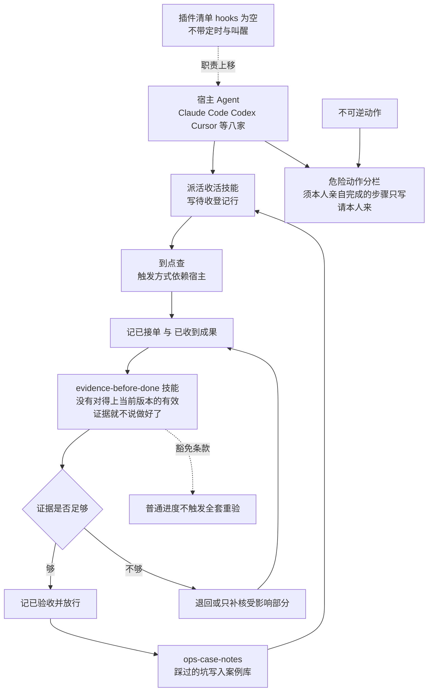

# dabingfy-dot/solo-to-team-skills

## 一句话定位
一套**「一个人统筹一支 AI 团队」**的协作技能包（中英双语，4 支技能 + 模板 + 脱敏案例），核心是一组**可执行的交付纪律**：谁该做什么、活怎么派、怎么收回来、**说「做好了」之前必须有什么证据**，以及一条把「执行人报告」与「独立核验」严格分开的规则。

## 它解决的问题

⭐⭐⭐⭐⭐ 当一个人同时指挥多个 AI 助手（派活 → 收活 → 核验 → 判断）时，**最常见的失效不是助手不会做，而是助手「说做好了」**。而这条失效链有一个特别隐蔽的形态：**助手转述另一个助手的「已完成」，而它自己没看过成品。**

⭐⭐⭐⭐⭐ 现有的 agent 协作实践几乎都在解决「怎么让助手做得更多、更快」，很少有项目在解决**「怎么让助手不说它没验证过的话」**。⭐⭐⭐⭐⭐ 而这个问题的成本结构很特别：**它不在能力层，而在承诺层** —— 一个能力很强但会把「写完了」当成「做完了」的助手，其净效果是负的，因为它把不确定性从工具侧转移到了使用者侧。

⭐⭐⭐⭐⭐ `solo-to-team-skills` 把这条承诺层纪律做成了**四支可安装的技能**：⭐⭐ **① `dispatch-accept-verify`（派出去的活要收回来）② `evidence-before-done`（交活前要有证据）③ `beginner-ops-writing`（新手操作说明）④ `ops-case-notes`（脱敏运营记录）**，外加一个登记行模板与一个完整走查样例。

⭐⭐⭐⭐⭐ 而它的第二个特点是**把「宿主能力」与「技能包能力」严格分开**：⭐⭐⭐⭐ **技能包自带 `hooks: {}`，明确不带定时与叫醒** —— 「到点查、记接单、叫开工」由宿主（Claude Code / Codex / Cursor 等）的定时能力负责。⭐⭐⭐⭐⭐ **这个切分避免了「技能包假装自己能做一切」的常见问题，也让同一套方法能落在八种不同宿主上。**

## 为什么值得关注（2026-11-08）

**⭐⭐⭐⭐⭐ 本日最值得抄的是它把「证据先于完成声明」写成了一条带反例清单的铁规，而不是一句口号。**

`skills/evidence-before-done/SKILL.md` 的开篇是一条可判定的规则：

> **没有对得上当前版本的有效证据，就不说「做好了」。**

⭐⭐⭐⭐⭐ **而它给这条规则配了一个「可复用 / 要补核」的可执行判定**：

> - **可以复用**：上一回已经核过、之后没改过、没出过失败、环境没换的那部分。复用时写明是哪一次核的、核的哪个版本。
> - **要补核**：之后有改动、有过失败、换了环境（换电脑、换账号、换软件版本）的部分。**只补核受影响的部分**，不必每次从头全套再来；拿不准影响到哪，就把范围放大一点。
> - **不算证据**：别人说好了的（**执行人报告不能当独立核验**）、核的是旧版本或别的范围的、「应该没问题」的。

⭐⭐⭐⭐⭐ **「执行人报告不能当独立核验」这一条直接堵住了 agent 生态里最常见的自证漏洞**，而它的 SKILL.md 用了一整段把它讲透：

> **分清两种东西：执行人报告（干活的人说「好了」，附他自己的核法）和独立核验（收的人或指定核验人亲手看过）。前者是线索，不能当后者用。**

⭐⭐⭐⭐⭐ **而它的「想说什么 → 要什么证据」对照表是本档案认为最实用的一份产物**（每行给出「够」与「不够」两栏）：

| 想说 | 要的证据 | 不够的 |
|---|---|---|
| 文档做好了 | 用对应软件打开，或转成图片逐页看过：字、表格、页码、中文字体都正常 | 「生成成功」的提示；文件存在 |
| 视频做好了 | 从头播过，至少抽看开头、中间、结尾 | 导出进度到了 100% |
| 数字算对了 | 换一种办法重算一遍，总数和分项对得上 | 算过一次 |
| 链接能用 | 点开过，内容就是要的那篇 | 搜索结果里看见过 |
| 电脑问题修好了 | 按原来出问题的步骤再走一遍，问题不再出现 | 改了设置；「理论上应该好了」 |
| 东西放到某处了 | 到那个位置看见了，文件名、大小、份数都对 | 复制时没报错 |
| **已放行的发送、同步成功了** | **在收件或目标那一端看得到** | **工具返回「成功」** |
| **别的助手或子任务说做完了** | **自己去看改动和成品** | **对方的报告** |
| 委托方的要求全做到了 | 重读原始要求和修改记录，逐条打勾 | 「主要部分做完了」 |

⭐⭐⭐⭐⭐ **注意倒数第三行的细度**：「电脑问题修好了」这一行的「够」里还附了一条 ——「会被自动更新、定时任务、同步改写的，**写明下一次改写时间，到点再测，没测前只说「当场测通，待 X 点复测」**」。⭐⭐⭐⭐⭐ **这一句把「可复现的时间维度」加进了证据模型** —— 它承认「当场测通」是一个有时间限制的结论，并要求把这个限制说出来。

⭐⭐⭐⭐⭐ **它还给了两张「刹车」清单**，这在本日报记录过的所有项目中是最完整的：

> **该停一下的信号**：想用「应该」「大概」「看起来」「差不多」；还没核就想说「搞定」「完美」「没问题」；想直接转述别人的「已完成」；只核了一部分，想推到全部；**心里冒出「就这一次」「太晚了，先交了再说」**。

> | 借口 | 实际上 |
> |---|---|
> | 应该好了 | 去核一下 |
> | 我有把握 | **有把握不等于有证据** |
> | 就这一次 | **没有例外** |
> | 检查工具没报错 | **没报错不等于结果对** |
> | 它说成功了 | **自己去看** |
> | 只查一部分就够了 | **一部分只能证明那一部分** |

⭐⭐⭐⭐⭐ **「就这一次 → 没有例外」这一行值得单独指出**：它不是道德说教，而是**承认人会这样想、并且提前给出答案**。⭐⭐⭐⭐ **这是行为规则设计的正确形态 —— 不假设使用者会守规矩，而是为「不守规矩的那一刻」预先写好答案。**

⭐⭐⭐⭐⭐ **而它对自己支持状态的声明，是本日全部项目里最诚实的一份**。README 顶部的状态段逐个宿主标注了真实程度：

> 已在多个 Agent 工具中完成实际使用验证（取得→装／配置→按名调用→产出登记行；另外当前包上八家各有一例有限任务的验收记录（真实成果→对照要求检查→人工验收）：Codex 保留此前单独验证的一例，其余七家按同一会议转写题补验，部分宿主**经受阻重跑或退回修订后才通过**；**不代表稳定性或所有任务都能做成**，调用方式各家不同……**部分宿主未保留技能加载的原始轨迹；不表示每家四个技能都逐一被调用，也不证明效果**），范围：**Codex、WorkBuddy、DeepSeek Harness、Cursor、CodeBuddy、Kimi Work、千问办公（QwenWork）** 写「支持」；**Grok Bot** 写「支持，需手动配置」；**Claude Code** 写「结构已备、走通待补，不在首发支持之列」。

⭐⭐⭐⭐⭐ **而 SKILL.md 里对应的一栏更克制**：

> 队内交付已按「先有证据再说做完」执行；**公开包保证的是「核对步骤可照做」。能否降低返工率，见同仓 `../ops-case-notes/`「仍未证明」栏，本技能正文不下效果结论。**

⭐⭐⭐⭐⭐ **这两段合起来构成了本日最完整的「能力边界声明」范式**：它把「我做成了什么」（步骤可照做）、「我没做成什么」（效果未证明）、「哪些还没走通」（Claude Code 结构已备但未走通）、「我凭什么这么说」（八家各一例，含受阻重跑与退回修订）四件事分开说。⭐⭐⭐⭐⭐ **这正是本日报本日追��的那条主线 ——「把不确定性写进输出」—— 在一份技能包里被完整实现。**

## 热度来源判断

130⭐ ⑂14（fork/star 10.8%）、**subs 4、oi 9、contributors 1 人、releases 0、5 个 topics、23 个文件**。

⭐⭐⭐⭐⭐ **热度来源判断：真实需求 + 真实争议，且两者都在 oi 里。**

- ⭐⭐⭐⭐ **需求是真实的**：多助手协作的「派—收—核—判」链路是 2026 年 agent 使用的真实痛点，而市面上的多数方案解决的是「怎么让助手更能干」。
- ⭐⭐⭐⭐⭐ **oi 9 是本批真项目中最高的**（对比 phoneuse 0、satmux 0、ghostclick 0、两个农场 0）。⭐⭐⭐⭐ **这几乎是唯一一个「有人在用、有人在质疑」的样本** —— 而这恰恰是本日报最想要的信号类型。⭐⭐⭐⭐⭐ **9 条 issue 在 130⭐ 的体量下不算少，它意味着这个包正在被真实安装并被真实检验。**
- ⭐⭐⭐⭐ **fork/star 10.8% 属真人区间**，且**有明确的可解释来源**：README 写明各宿主「怎么装、怎么叫」，**每个宿主都需要各自的配置，因此 fork 去改自己的宿主段是一个合理动作** —— 这与「farm 为了刷 fork 而 fork」是相反的动机。
- ⭐⭐⭐⭐⭐ **subs 4 在本日是一个特殊信号**：**它是本日唯一 subs 高于 star/10 的真项目**（4/130 = 3.1%），而两个 425⭐ 空壳是 5.9% 与 8.2%，phoneuse 是 1.7%、satmux 0.3%、ghostclick 0%。⭐⭐⭐⭐ **且它的 README 不索取 star** —— 这与「subs 可以被索取 star 抬高」的机制无关，所以这 4 个 subscriber 更可能是真实的深度关注者。**
- ⚠️ **但热度来源仍有未解释的部分**：⭐⭐ **13,997 KB 体积中包含一个 17 页 PDF（`docs/solo-to-team-value.pdf`），而这正是最容易引发「内容农场」质疑的形态** —— 本日报未打开该 PDF 核验其内容。

## 关键技术亮点

1. **「执行人报告 ≠ 独立核验」被写成规则本体**
   ⭐⭐⭐⭐⭐ 这是本项目最核心的一条，也是整个 agent 协作生态当前最缺的一条。⭐⭐⭐⭐⭐ 它与 SKILL.md 描述里的「分清两种东西：执行人报告……和独立核验……前者是线索，不能当后者用」是一回事，**但它出现在 SKILL.md 的 description 里，意味着任何宿主加载该技能时这句话都在上下文里**。

2. **「可复用 / 要补核」的可执行判定**
   ⭐⭐⭐⭐⭐ 「之后有改动、有过失败、换了环境的部分要补核，只补核受影响的部分」⭐⭐⭐⭐⭐ **这是一个增量验证模型**，而不是「每次全量重验」或「上次验过就永远有效」两个极端。⭐⭐⭐⭐⭐ 「拿不准影响到哪，就把范围放大一点」这一句给出了不确定时的默认方向 —— **保守**。

3. **「普通进度不触发全套重验」的显式豁免**
   ⭐⭐⭐⭐ 「只说『进行到哪、下一步做什么』，照实说就行，不用为此重跑检查；一旦说『这部分做完了／好了』，那部分就要走上面五步。」⭐⭐⭐⭐⭐ **这条豁免极其关键**：没有它，纪律会退化成噪声而被忽略。⭐⭐⭐⭐⭐ **规则必须写清「什么时候不适用」，否则它会被当成负担而不是契约。**

4. **五步开口流程**
   ⭐⭐⭐ ① 想清楚：哪件事能证明我要说的这句话？② 拿证据（复用 / 补核 / 亲手做）③ 看完结果（整份看完，不只看开头几行；**有几处出错就数清几处**）④ 对照（撑不住就照实说现在到哪一步，撑得住才说结论）⑤ 再开口。⭐⭐⭐⭐⭐ **第 ③ 步的「数清几处」是一个容易被忽略但很关键的细节** —— 它防止「看到一处问题就以为只有一处」。

5. **三栏职责切分：本包技能负责 / 宿主能力负责 / 须人做**
   ⭐⭐⭐⭐⭐ 表格逐行把「提目标 / 分工 / 交接 / 核对 / 判断」五个环节拆给三方。⭐⭐⭐⭐⭐ **其中「须人做」一栏包含：定目标、定先后、定做到什么算完；决定派给谁；**花钱、发出、删除等危险动作由人点头**；登录、付款、本人确认这类只能本人做的步骤；**放行、退回、改方向：最后拍板永远是人**。⭐⭐⭐⭐⭐ **这与本日报记录的 `android-ad-cleaner` 的 10 条硬规则（不替用户点同意、不绕过锁屏、不截图账号页）是同一条纪律线：把不可逆的动作从自动化可达范围里拿走 —— 但这里用的是「分栏」而不是「硬拒绝」，因此更弱也更实用。**

6. **新人可照做的操作说明规范（`beginner-ops-writing`）**
   ⭐⭐⭐⭐ 「一次一步、点名唯一、写清做完会看到什么」⭐⭐⭐⭐⭐ 以及一条极具体的要求：「**凡须本人亲自完成的步骤，只写「请本人来」，不写代做办法**」⭐⭐⭐⭐⭐ **这条把「可被 agent 抄去代做」的路径显式堵掉，是防 prompt injection 式滥用的设计。**

7. **多宿主分发与来源可追溯**
   ⭐⭐⭐ 同时提供 `.claude-plugin/`、`.codex-plugin/`、`.agents/plugins/` 三套插件清单与 `plugin.json`；⭐⭐⭐⭐ `NOTICE` 声明借鉴来源，各技能末尾另附「来源／借鉴说明」；⭐⭐⭐⭐⭐ README 明写「**借鉴的是方法思路；交付的是改写后的中文协作包，外加两支原创技能**」—— **即它没有把借鉴包装成原创，这一点比大多数 skill 包做得好。**

8. **样例包含「失败样本」**
   ⭐⭐⭐ `examples/walkthrough-meeting-notes/` 下有 `input.md` / `output-ok.md` / **`output-missing.md`** / `register-lines.md` 四份 —— ⭐⭐⭐⭐⭐ **有一个「缺证据」的样例与「通过」的样例并排**，这是本日报在其他项目里反复见到的正确做法（如 KohakUnlock 的结果表明确写出「没赢的地方」）。

## 架构师速览

| 决策问题 | 研究判断 | 证据边界 |
|---|---|---|
| 系统边界 | **「协作方法包」而非运行时**：它交付的是 SKILL.md 形式的规则与模板，被宿主 agent 加载；**它自带 `hooks: {}`，不含定时/叫醒/跨助手消息**，这些归宿主 | 依据 README「技能本身不带定时和叫醒（插件清单 `hooks: {}`）」与三栏职责表；`hooks: {}` 是否意味着宿主确实不会触发任何自动动作，本窗口未逐字段核验 |
| 主路径 | 派活前写「待收」登记行 → 到点查（宿主定时或人工）→ 记「已接单」→ 收到后记「已收到成果」→ **按 `evidence-before-done` 取证并核对** → 核过记「已验收」→ 放行或退回 → 踩过的坑写入 `ops-case-notes` | 主路径为 README「首版核心流程」表的语义抽象；「到点查」的实际触发方式依赖宿主，未核验；登记行模板字段未逐项核验 |
| 关键权衡 | **①「不自带运行时」换「可跨八宿主复用」**（把定时/消息交给宿主，代价是能力弱）**②「规则写在 description 里」换「每宿主加载都可见」**（description 越长占用上下文越多）**③「给反例与刹车清单」换「可读性下降」**（规则文本更啰嗦）**④「把危险动作划给人」换「自动化程度降低」**（少做一些事，但做得可信）**⑤「v0.9-draft 公开自陈」换「显得不够成熟」** | ①②③④⑤均有 README/SKILL.md 直接文本支持；②的上下文成本未量化 |
| 最小 PoC | 在**一个**宿主上只跑通一件事：装上 `evidence-before-done` → 让助手交付一个小产物 → **故意让助手说「做好了」而未取证 → 看它是否按铁规拒绝或要求证据** → 再验「别的助手说做完了」这一行是否触发「自己去看成品」；全过程记录哪一步卡住 | PoC 由 skill 的五步流程与「该停一下的信号」清单推导；安装步骤随宿主不同（README 有逐宿主说明），本窗口未验证任一宿主的实际安装 |
| 证据边界 | 全部结论基于 2026-11-08 CST 的 GitHub API 快照与 README / `skills/evidence-before-done/SKILL.md` 原文；**本日报未在任何宿主上安装或运行该技能包，未验证其任何一次实际调用结果**；`docs/solo-to-team-value.pdf`（17 页）未打开核验；README 中的「八家各一例验收记录」为作者自述 | 无独立复现；oi 9 未逐条读取（可能存在反对意见，本窗口未取） |

## 架构启发

⭐⭐⭐⭐⭐ **启发一：把「承诺层」当成独立的一层来设计。**

绝大多数 agent 工具只处理「怎么做」，不处理「怎么声称做完了」。⭐⭐⭐⭐⭐ `solo-to-team-skills` 把后者单独立为一支技能（`evidence-before-done`），**并给它与「派活收活」并列的地位**。⭐⭐⭐⭐⭐ **这个分层可以直接搬走用到任何 agent 系统上 —— 与框架无关、与模型无关、与宿主无关。**

⭐⭐⭐⭐⭐ **启发二：规则必须写清「什么时候不适用」。**

⭐⭐⭐⭐⭐ 「普通进度不触发全套重验」与「只报进行到哪的普通进度不触发全套重验」两处显式豁免 —— **没有豁免的纪律会变成噪声**。⭐⭐⭐⭐⭐ **这是行为规则设计里最容易被忽略的一条：例外条款不是规则的漏洞，是规则能被遵守的前提。**

⭐⭐⭐⭐⭐ **启发三：规则的形态应该是「信号 → 动作」，而不是「原则 → 期望」。**

⭐⭐⭐⭐⭐ 它的对照表每一行都是「你想说的话 → 必须拿到的证据 → 不够的东西」。⭐⭐⭐⭐⭐ **「不够的」这一栏尤其关键 —— 它把常见的自欺话术直接写在纸面上（『文件存在』『导出进度到了 100%』『检查工具没报错』『对方的报告』），使人无法用一句模糊的好话蒙过去。** ⭐⭐⭐⭐⭐ **本日报称之为「把借口预先写好」—— 它假设人会想蒙混，并且在那一刻之前就给出答案。**

⭐⭐⭐⭐⭐ **启发四：把「不可逆的动作」显式移出自动化范围，但用「分栏」而不是「拒绝」。**

⭐⭐⭐⭐⭐ 与 `android-ad-cleaner` 的做法对比很有意思：后者用**代码层的硬拒绝**（`run.py` 直接拒绝挂载受保护包），前者用**文档层的分栏**（危险动作由人点头）。⭐⭐⭐⭐⭐ **前者更强但更脆（用户会想办法绕过），后者更弱但更可落地（用户自己选择边界）。** ⭐⭐⭐⭐⭐ **两种做法都对，取决于你能不能控制工具的执行路径。**

⭐⭐⭐⭐ **启发五：把「借鉴」与「原创」分开声明，并把效果结论单独留白。**

⭐⭐⭐⭐⭐ 「借鉴的是方法思路；交付的是改写后的中文协作包，外加两支原创技能」+「本技能正文不下效果结论」⭐⭐⭐⭐⭐ **两句话合起来，是本日报见过的最干净的「我做了什么 / 我没证明什么」表达方式。**

## 架构图（MMD）

> 证据边界：此图只采用本档案已有可核验描述；“待核验”节点不应视为项目实现事实。

## 定位判断

**工具型项目（Agent 协作方法与纪律包）。**

⭐⭐⭐⭐ 它在生态里的位置很特殊：**它不是工具，不是框架，也不是模型 —— 它是一套「协议」**。⭐⭐⭐⭐⭐ 这类资产的价值不在功能，而在**可移植性**：它的方法可以脱离这个仓库、被抄进任何工作流。⭐⭐⭐⭐⭐ 而它同时提供三套插件清单，本身也在做「让规则能被自动加载」这件事。

⭐⭐⭐⭐⭐ **但它当前的自我定位是诚实的、也是弱的**：`v0.9-draft`、`非最终发布稿`、`Claude Code 结构已备、走通待补，不在首发支持之列`、单 commit、无 release。⭐⭐⭐⭐⭐ **对一个「方法包」来说，单 commit + 无 release 意味着它还是一篇文档，而不是一个被版本化的产品。**

⭐⭐⭐⭐ **在 2026 年的语境下，它占据的位置是「多 agent 协作的验收层」** —— 而这个位置目前几乎没有人占。⭐⭐⭐⭐⭐ **市场的注意力目前在「更强的模型」与「更顺的 UI」上，而「更可信的交付承诺」是一个被普遍忽略的方向。**

## 风险 / 局限 / 泡沫点

- ⚠️⚠️⚠️ **效果未证明 —— 作者自己承认**：⭐⭐⭐⭐ 「公开包保证的是『核对步骤可照做』。**能否降低返工率……本技能正文不下效果结论**」。⭐⭐⭐⭐⭐ **一个纪律包的价值最终取决于它是否真的减少了返工，而这一点目前没有任何数据支持，包括作者自己的。**
- ⚠️⚠️⚠️ **「八家各一例」是极小的样本**：⭐⭐⭐⭐ 「八家各有一例有限任务的验收记录」—— **一例任务无法支撑「支持」这个结论**，作者自己也写了「不代表稳定性或所有任务都能做成」「不表示每家四个技能都逐一被调用」。⭐⭐⭐⭐ **但至少这些限制是写在第一屏的，这比绝大多数项目强。**
- ⚠️⚠️ **「部分宿主未保留技能加载的原始轨迹」**：⭐⭐⭐⭐ **这一句等于承认部分验收记录不可复查** —— 即那些案例无法被第三方验证。
- ⚠️⚠️ **单 commit、无 release、单贡献者**：⭐⭐ **23 个文件、13,997 KB、1 个 commit** —— 意味着整个包是一次性写入的，没有演进历史可供检验。
- ⚠️⚠️ **owner 账号仅两个月大、2 个公开仓库**：⭐⭐ **130⭐ + oi 9 与「账号 2026-10-18 创建」并存** —— 说明这是一个几乎无历史的新项目在做一件有难度的事。
- ⚠️ **13,997 KB 体积 + 17 页 PDF 的观感风险**：⭐⭐⭐ **17 页的组织与协作报告 PDF 是本仓库收录的所有项目里最容易被质疑为「内容包装」的一项**，本日报未打开核验，因此列为待核验而非结论。
- ⚠️ **强纪律可能降低自动化程度**：⭐⭐ 「最后拍板永远是人」「花钱、发出、删除等危险动作由人点头」⭐⭐⭐ **这对信任是加分的，但确实降低无人值守场景的可用性** —— 它选择的是可信而非自动。
- ⚠️ **规则的长上下文成本**：⭐⭐⭐ 把铁律、反例、借口表、刹车清单写进 SKILL.md，**每次加载都会占用宿主上下文**；在超长会话里这份开销会被放大。
- ⚠️ **9 条 issue 未逐条核验**：⭐⭐⭐ **本窗口未读取这 9 条 issue 的内容**，因此不排除其中存在对本档案结论的反驳。

## 与同类项目的关系

- **vs `unclebob/ub-mode`（2026-10-22 建档）**：⭐⭐⭐⭐⭐ **两者是同一族问题的两种层级**：ub-mode 把工程原则（攻击前提、行为测试而非实现测试）绑定到三个真实工具仓库上；solo-to-team 把协作原则绑定到「证据—验收」这条链上。⭐⭐⭐⭐ **ub-mode 是「给 agent 的工程纪律」，solo-to-team 是「给 agent 的交付纪律」** —— 后者更贴近日常使用，前者更贴近代码生产。
- **vs `android-ad-cleaner` 的 10 条硬规则（2026-10-25 建档）**：⭐⭐⭐⭐⭐ **同一纪律的两种实现强度**：android-ad-cleaner 用**代码层拒绝**（工具自己 refuse），solo-to-team 用**文档层分栏**（人来点头）。⭐⭐⭐⭐⭐ **两者都对，取决于你是否控制工具执行路径 —— 本日报在本日把它们并列为「同一原则的两种落点」。**
- **vs `evidence-before-done` 与各类 agent 评测框架**：⭐⭐⭐⭐ 评测框架（eval）测的是「模型在给定输入下会不会做对」，而这个技能包管的是「模型在交付时会不会说实话」。⭐⭐⭐⭐⭐ **后者在 agent 越权、越界、误报成功的场景下，比前者更贴近实际损失来源。**
- **vs Claude Code / Codex 等宿主的内置 hook 与权限系统**：⭐⭐⭐⭐ 宿主的 hooks 能做「做完时自动跑测试」这类事，但**它们无法判断「证据是否对得上当前版本」** —— 那需要语义判断。⭐⭐⭐⭐⭐ **两者的关系是互补而非替代：hook 是机制，技能是判据。**
- **vs `poki` 的 `docs/verification.md`（2026-11-07 建档）**：⭐⭐⭐⭐⭐ **同一天的两种「不把不确定折叠掉」**：poki 把「触摸写进去了」与「设备确认了」分成两件事（信号语义）；solo-to-team 把「执行人报告」与「独立核验」分成两件事（信任语义）。⭐⭐⭐⭐⭐ **两者的结构完全同构：都是把一个被默认折叠的二值判断，重新拆成两个必须分别成立的条件。**
- **vs `wshobson/agents`（跨平台插件市场）**：⭐⭐⭐⭐ wshobson 是「能力分发中心」，solo-to-team 是「单一纪律的可安装实现」。⭐⭐⭐⭐⭐ **两者不冲突，反而互补 —— 后者可以作为前者平台上的一份技能存在。**

## 是否值得持续跟踪

**值得跟踪，且理由比 star 数强得多。** ⭐⭐⭐⭐⭐

⭐⭐⭐⭐⭐ **它命中了一个几乎无人占据、但每天都在造成损失的位置：agent 的「交付承诺层」。** ⭐⭐⭐⭐⭐ 在一个 agent 可以做任何事、却总能说「做完了」的系统里，**「如何让承诺可核验」是比「如何让能力更强」更接近实际损失的问题。**

⭐⭐⭐⭐ **作为研究对象它的价值也高**：⭐⭐⭐⭐ **它是本日报至今读到的、把「我做了什么 / 我没证明什么 / 哪些还没走通」三件事分开写在同一屏的最完整范例** —— 可以直接作为其它项目写「限制」章节时的结构参考。

⭐⭐⭐⭐ **跟踪它应该盯的**：(a) oi 9 之后是否持续有 issue（**这是它是否在被真实使用的唯一信号**）；(b) 是否发布第一个 release 与版本历史；(c) 「Claude Code 走通待补」是否补上；(d) 是否有人给出「返工率下降」的量化证据 —— **如果出现，这条线就从一个好文档变成一个被验证的方法**。

## 后续观察点

1. **oi 9 的具体内容**：⭐⭐⭐⭐⭐ **这是本档案最需要补的证据** —— 9 条 issue 是「有人在用、有人在质疑」的直接痕迹，可能包含对规则可行性的反驳。本窗口未逐条读取。
2. **第一个 release 与 changelog**：⭐⭐⭐ 目前 releases 0、commits 1。**一旦有版本化发布与变更记录，才能判断这套方法在实践中被如何修正。**
3. **`docs/solo-to-team-value.pdf`（17 页）的内容**：⭐⭐⭐ 需核验它是方法说明还是营销材料。
4. **「能否降低返工率」是否被量化**：⭐⭐⭐⭐⭐ 这是决定这个方向能否从「好文档」变成「方法」的��键。
5. **是否支持 Claude Code**：⭐⭐ 「结构已备、走通待补」是否补上。
6. **技能数量与宿主数量的增长**：⭐⭐ 4 支技能 / 8 个宿主，是否扩展。
7. **是否被其他项目引用**：⭐⭐⭐ 若 `wshobson/agents` 之类的聚合平台收录它，说明这套方法被认可为通用资产。

---
*首次记录：2026-11-08*
