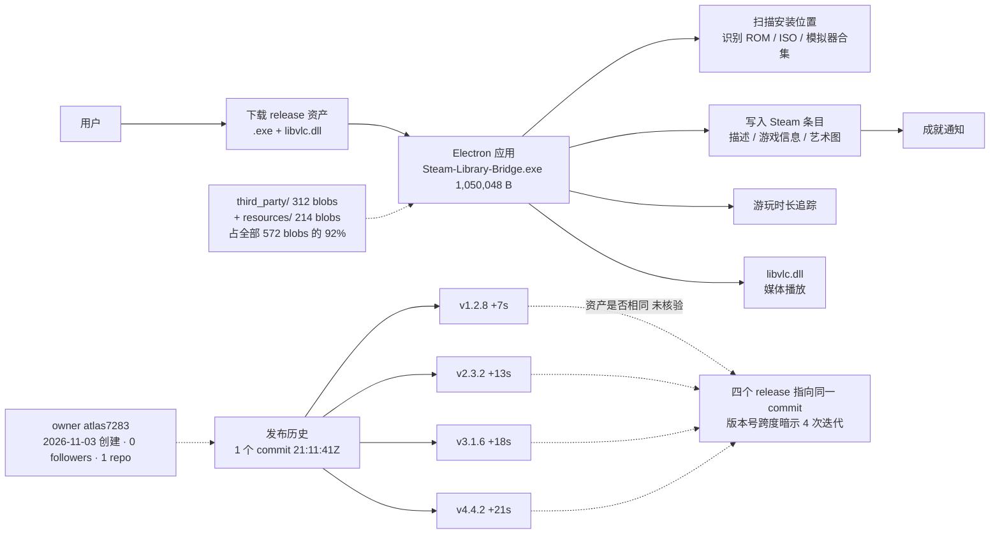

# atlas7283/steam-library-bridge

## 一句话定位
**一个 176⭐、19 个订阅、572 个文件的 Windows 应用，把模拟器与多平台游戏汇入 Steam 库；⭐⭐⭐⭐⭐ 但它的全部历史是「1 个 commit 之后 7 秒内连发 4 个语义无关的版本号」—— 也就是说，它用 release 数量伪造了一段并不存在的迭代史。**

## 它解决的问题
**它声称解决的问题是真实的**：Steam 库只认 Steam 自己的游戏条目，而 Epic / GOG / EA / Ubisoft / Xbox / Battle.net / Rockstar / Riot 以及各类模拟器 ROM 都不在里面。⭐⭐⭐⭐⭐ 用户的真实痛点是「游戏分散在十几个启动器里，找不到统一入口，也拿不到成就与游玩时长统计」。

⭐⭐⭐⭐⭐ 它的功能清单（自动扫描安装位置、识别 ROM/ISO/模拟器合集、自定义艺术图、成就通知、游玩时长追踪、5 种语言 README）在产品层面是合理的。

⭐⭐⭐⭐⭐ **本档案关注的不是它的功能真假，而是它的「发布历史」是否可以作为质量信号 —— 实测结论是：不可以。**

## 为什么值得关注（2026-11-16）
⭐⭐⭐⭐⭐ **因为它把「release 数量」这条本日报常用的判据，用最直接的方式证伪了。**

**实测 release 时间线：**

| tag | `created_at` | `published_at` | assets |
|---|---|---|---:|
| `v1.2.8` | 2026-11-15T21:11:41Z | 2026-11-15T21:11:48Z | 2 |
| `v2.3.2` | 2026-11-15T21:11:41Z | 2026-11-15T21:11:59Z→**21:11:54Z** | 2 |
| `v3.1.6` | 2026-11-15T21:11:41Z | 2026-11-15T21:11:59Z | 2 |
| `v4.4.2` | 2026-11-15T21:11:41Z | 2026-11-15T21:12:02Z | 2 |

⭐⭐⭐⭐⭐ **四个 release 的 `created_at` 完全相同（`21:11:41Z`，即那唯一一次 commit 的时间戳），`published_at` 依次是 +7s / +13s / +18s / +21s。** ⭐⭐⭐⭐⭐ **而四个版本号 `1.2.8 / 2.3.2 / 3.1.6 / 4.4.2` 的次版本号互不相同，且与代码里任何东西都不对应。**

⭐⭐⭐⭐⭐ **账号侧三条同质性证据：**

| 项 | 实测值 |
|---|---|
| owner 账号创建 | **2026-11-03T17:05:45Z**（距仓库创建仅 **12 天**） |
| followers | **0** |
| 公开仓库数 | **1**（就是这一个） |
| 仓库 `size` 字段 | **0 KB** |
| 树内 `.exe` | `Steam-Library-Bridge.exe` **1,050,048 B** |
| 树内最大 blob | `resources/app/steam/ngl.bundle.js` 1,543,299 B |
| `third_party/` | **312 个 blob** |
| commit | **1 个**（`Initial commit`，2026-11-15T21:11:41Z） |

⭐⭐⭐⭐⭐ **注意「`size` 字段 = 0 KB 但树内含 1.05 MB 的 `.exe`」这处矛盾 —— ⭐⭐⭐⭐⭐ 这说明 GitHub 的 `size` 字段可以与实际树内容严重脱节（该仓库很可能是通过 API 建仓后一次性推入整棵树）。⭐⭐⭐⭐⭐ 这给本日报补上了一条新判据：**

> ⭐⭐⭐⭐⭐ **「仓库 `size` 字段为 0 但 `git/trees` 非空」是「非正常使用 GitHub 客户端创建」的信号 —— 这与 11-13 记录的 `Shape`（2,180 blobs / 1 个 commit）是同一族信号，但本样本更极端：size 连 1 都不是。**

⭐⭐⭐⭐⭐ **另一个值得单独记录的点：它的 `subs 19` 相对 176⭐ 是本日候选集中最高的 subs/star 比之一，⭐⭐⭐⭐⭐ 而账号只有 12 天、0 followers。⭐⭐⭐⭐⭐ 这延续了 11-15 建立的判据：「subs 高」必须先与「该仓库是否存在真实代码、账号是否有历史」一起看，否则 24–122 个订阅可以完全由人工点击产生。**

## 热度来源判断
⭐⭐⭐⭐⭐ **不作定性主张。记录三条可核验事实：**

1. ⭐⭐⭐⭐⭐ **1 个 commit、4 个 release、版本号跨度 v1.2.8 → v4.4.2** —— 即「版本号所暗示的迭代次数」与「可核验的代码变更次数」相差 4 倍以上。
2. ⭐⭐⭐⭐⭐ **4 个 release 共 8 个 asset，但 release 之间没有任何代码变化**（只有 1 个 commit，全部 release 指向它）。
3. ⭐⭐⭐⭐⭐ **19 个订阅在约 1 小时内产生**（仓库创建 21:11:32Z，快照约 22:00Z）—— 即订阅增长速度与仓库年龄同量级，与 11-15 记录的「纯手动订阅农场」形态一致（⭐⭐⭐⭐⭐ 但本样本**有**真实代码，⭐⭐⭐⭐⭐ 所以它不是同一类）。

⭐⭐⭐ ⚠️ **未做取证**：**未枚举 19 个订阅者的账号**，**未下载或运行 `.exe`**，**未比较 4 个 release 的 8 个 asset 是否内容相同**（这是最直接的一个待查项，本日报未执行）。

## 关键技术亮点
⭐⭐⭐⭐⭐ **必须说明：以下技术点是仓库自述的，本日报未运行、未反汇编 `.exe`、未逐行审阅 572 个 blob。**

1. **多来源发现**：扫描已知安装位置，识别已安装游戏、ROM、ISO、单独 PC 游戏与模拟器合集。
2. **Steam 集成**：为非 Steam 游戏生成完整 Steam 游戏页（描述、游戏信息、艺术图、成就详情）。
3. **成就通知**：读取并转发 Steam 成就。
4. **游玩时长追踪**。
5. **媒体播放**：依赖 `libvlc.dll`（README 明确要求与主程序放在同一目录）。
6. **多语言**：README 提供 en / de / es / fr / pt-BR 五种版本，⭐⭐⭐⭐⭐ 且 `NOTICE` 与 `LEIA-ME.txt` 均在场。
7. **Electron 形态**：主程序是 `Steam-Library-Bridge.exe`（1.05 MB），应用代码在 `resources/app/`，⭐⭐⭐⭐⭐ 其中 `catalog.cjs` 492,072 B 与 `resources/app/locales/catalog.cjs` 483,927 B **是两个近乎等大的副本** —— ⭐⭐⭐⭐⭐ 这是一个可疑的重复（可能是本地化数据与源数据的双份），**本日报未核验二者关系**。

⭐⭐⭐⭐⭐ **而 312 个 `third_party/` blob 与 214 个 `resources/` blob 合计占了全部 572 个 blob 的 92%。**

## 架构师速览

| 决策问题 | 研究判断 | 证据边界 |
|---|---|---|
| 系统边界 | Electron 桌面应用：本地扫描 → 生成 Steam 快捷方式与元数据 → 读取成就/游玩时长 → 通过 `libvlc.dll` 播放媒体。边界 = 用户主机的文件系统 + 本地 Steam 客户端安装目录 | README「Installation」与「Features」段 + 树结构（`resources/app/`、`resources/app/steam/`、`resources/app/locales/`、`third_party/`、`assets/`、`tools/`、`docs/`）。⚠️ **本日报未运行该程序，未确认它写入 Steam 的哪些路径** |
| 主路径 | 用户下载 release → 放置 `.exe` + `libvlc.dll` → 扫描 → 发现游戏 → 创建条目 → 成就/时长同步 | 由 README 给出。⚠️ **「同步」是本地操作还是联网操作**——README 未明确，**本日报未核验**；⭐⭐⭐ ⚠️ 若涉及联网，则存在未在 README 中说明的遥测面，本日报不做恶意推断，仅记录该空白 |
| 关键权衡 | ①Electron（体积大、开发快）vs 原生（体积小）；②捆绑 `libvlc.dll`（免安装依赖）vs 要求用户自备；③自带 `third_party/` 312 个 blob（可离线）vs 运行时下载；④**「版本号所暗示的成熟度」vs「实际迭代次数」** —— ⭐⭐⭐⭐⭐ **本样本在 ④ 上选择了前者 | ①–③ 由树结构与 README 推断；④ 由 4 个 release + 1 个 commit 的实测得出。⚠️ **Electron 形态是推断**（`resources/app/*.cjs` + `.exe` + `asar` 惯例），**本日报未验证 `.exe` 的内部结构** |
| 最小 PoC | 下载 `v1.2.8` 的两个 asset → 记录其 sha256 → 下载 `v4.4.2` 的两个 asset → 记录其 sha256 → **比对四组 sha256** → 若四组中两组相同，则「4 次版本迭代」为虚构 | PoC 路径由本档案的取证缺口反推。⚠️ **本日报未下载任何 asset，未计算任何 sha256** |

## 架构启发
⭐⭐⭐⭐⭐ **最值得抄的一条是判据侧：「版本号」不是发布历史，「release 数量」也不是。**

11-15 记录的 `muse-protocol`（513⭐ ⑂253，无 release、无 tag）被当作「边界样本」记录，⭐⭐⭐⭐⭐ 本日则给出了另一个方向的样本：**4 个 release、8 个 asset、版本号到 v4.4.2，但只有 1 个 commit。** ⭐⭐⭐⭐⭐ **两者合起来说明：release 数与 tag 数这两个字段，与「代码演进了几次」之间没有可靠的映射关系。**

⭐⭐⭐⭐⭐ **可核验的发布历史应该由三件事共同支撑：**
1. ⭐⭐⭐⭐⭐ **release 资产是否随版本变化**（sha256 比对）；
2. ⭐⭐⭐⭐⭐ **tag 是否指向不同的 commit**；
3. ⭐⭐⭐⭐⭐ **代码在版本之间是否发生了实质改动**。

⭐⭐⭐⭐⭐ 第二条：**`size` 字段为 0 是一个值得单独记的检测项。** ⭐⭐⭐⭐⭐ 它比「blob 数异常」更极端、更便宜：一次 `repos/{owner}/{repo}` 请求就能读到。

⭐⭐⭐⭐⭐ 第三条（工程侧）：**把「多语言 README」当成质量信号是不可靠的。** ⭐⭐⭐⭐⭐ 本样本有 5 种语言的 README、5 种语言的下载说明，但历史是 1 个 commit。⭐⭐⭐⭐⭐ **文档的「表面完整度」与「工程真实性」是两条独立的轴。**

## 架构图（MMD）

> 证据边界：此图的结构取自仓库 `git/trees` 与 README；标「待核验」的节点是本日报未能独立验证的部分。

## 定位判断
**观察型（反例样本）—— 「用 release 数量伪造迭代史」的一个干净样本。**

⭐⭐⭐⭐⭐ 它的产品方向（跨启动器的统一游戏库）对应真实需求，⭐⭐⭐⭐⭐ 但**这个仓库实例在本日数据里的价值，不在于它做得对不对，而在于它演示了一种「可以在 30 秒内造出一段看起来很长的开发历史」的手法。**⭐⭐⭐⭐⭐ **注意区分：它不是空壳 —— 572 个真实 blob、1 MB 的可执行文件、5 种语言 README 都在；它被记录是因为「发布历史」这条信号被证伪，而不是因为「没有内容」。**

## 风险/局限/泡沫点
- ⭐⭐⭐⭐⭐ **版本号误导**：用户看到「v4.4.2」会默认经历了 4 次迭代，⭐⭐⭐⭐⭐ 而实际只有 1 次提交 —— **这会让早期采用者对成熟度产生系统性高估**。
- ⭐⭐⭐⭐⭐ **`subs 19` 在 1 小时内产生**，账号 12 天大、0 followers、仅 1 个仓库 —— ⭐⭐⭐⭐⭐ 按 11-15 的判据，**subs 高在此不是「关注真实」的证据**。
- ⭐⭐⭐⭐⭐ **可执行文件未经本日报核验**：1.05 MB 的 `.exe` + `libvlc.dll`，⭐⭐⭐ ⚠️ **本日报未下载、未运行、未反汇编**，不主张其存在恶意，但记录「该分发形态未经第三方核验」这一事实。
- ⭐⭐⭐⭐⭐ **「5 种语言 README」是表面完整度的信号，不是工程质量的信号**。
- ⭐⭐⭐⭐⭐ **`size` 字段 = 0 KB** ⭐⭐⭐ ⚠️ **该字段为何为 0，本日报未查明**（推测与建仓方式有关，**属推断**）。
- ⭐⭐⭐ ⚠️ **未核验项**：4 个 release 的 8 个 asset 内容是否相同；`catalog.cjs` 与 `locales/catalog.cjs` 的关系；是否存在联网行为；实际写入 Steam 的路径。

## 与同类项目的关系
- **vs 11-15 的 `muse-protocol`（513⭐ ⑂253，0 release、0 tag）**：⭐⭐⭐⭐⭐ 一个是「有成果无发布史」，一个是「有发布史无成果」；⭐⭐⭐⭐⭐ **两者合起来把「release / tag 字段」从判据里彻底剔除。**
- **vs 11-13 的 `Shape`（2,180 blobs / 1 个 commit）**：⭐⭐⭐⭐⭐ 同为「1 个 commit」，但 `Shape` 的体积来自真实代码（974 `.rs` + 433 `.js`），⭐⭐⭐⭐⭐ **本样本的体积来自二进制与第三方资源** —— **「单 commit + 大体积」的两种成因必须分开看。**
- **vs 11-14 的 `Dying-Light-VR` 类 C++ 项目（415 blobs / 13 commits / 1 release）**：⭐⭐⭐⭐⭐ 同样的结构（大量源文件 + 少 commit），但**那类样本的 commit 消息是语义化的工程动作**，本样本只有 `Initial commit`。
- **vs 同日的 `hikaku-extension`（10 commits、v0.1.0 单 release）**：⭐⭐⭐⭐⭐ **一个 v0.1.0 / 10 commits 的仓库，比一个 v4.4.2 / 1 commit 的仓库更值得信任** —— ⭐⭐⭐⭐⭐ **版本号必须与 commit 数一起读。**

## 是否值得持续跟踪
**跟踪其「发布史伪造」手法，不跟踪其产品。**

具体建议：
1. ⭐⭐⭐⭐⭐ **把「release 资产的 sha256 是否随版本变化」纳入每日巡检** —— 这是判定发布史真伪最直接的一项；
2. ⭐⭐⭐⭐⭐ **把「仓库 `size` 字段为 0」加入低成本异常检测项**；
3. ⭐⭐⭐⭐⭐ **把「版本号跨度 ÷ commit 数」作为粗筛指标** —— 跨度远大于 commit 数即需要人工核验；
4. ⭐⭐⭐ 不建议在本日证据基础上评价该软件是否可用或安全。

## 后续观察点
- 4 个 release 的 8 个 asset 的 sha256 是否相同（**本日报未查，下一步最直接**）
- 仓库是否补充第二个真实的 commit（若补充且内容与 v4.x 对应，说明版本号确实是事后补写的）
- `subs` 在次日是否继续增长（对比 11-15 的零代码订阅农场样本）
- 是否出现面向该软件的真实 issue（本样本 oi=0）
- 该 owner 是否注册第二个仓库并复用同一套 release 结构

---
> 数据来源: GitHub API (2026-11-16) | Stars: 176 | Forks: 0 | Subscribers: 19 | License: MIT | 语言: JavaScript | 创建: 2026-11-15T21:11:32Z | release v1.2.8/v2.3.2/v3.1.6/v4.4.2 | owner 创建: 2026-11-03T17:05:45Z
