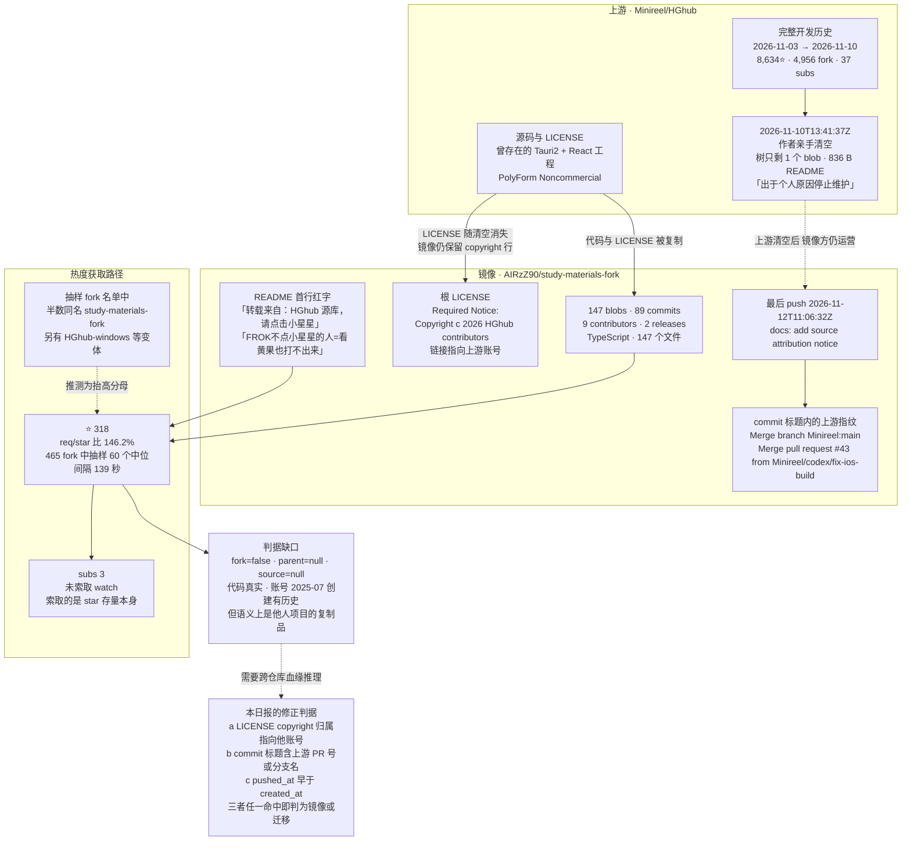

# AIRzZ90/study-materials-fork

## 一句话定位
**`Minireel/HGhub` 的完整代码镜像** —— `fork=false` / `parent=null` / `source=null`，147 blobs、89 commits、9 名贡献者、2 个 release，看起来像一个独立项目；而它的 `LICENSE` 首行仍写着上游的 copyright，README 第一行红字写着「转载来自：HGhub 源库，请点击小星星」。

## 它解决的问题
**它不解决问题，它是一个注意力收割装置。** ⭐⭐⭐⭐⭐ 本档案记录它的原因不是它的代码质量，而是**它把一种此前本数据集未记录过的攻击面摆到了台面上：仓库名本身**。

⭐⭐⭐⭐⭐ 具体地，它同时规避了三类判据：

1. **命名判据：** 仓库名 `study-materials-fork` 与上游 `HGhub` **毫无词法关系** —— 任何按「仓库名相似度 / 同前缀 / 同后缀」聚类的判据都失效；
2. **GitHub 元数据判据：** `fork=false`、`parent=null`、`source=null` —— 任何按 fork 关系聚类的判据都失效；
3. **活跃度判据：** 89 commits、9 contributors、2 releases、147 blobs、真实的多人协作历史（`Merge pull request #43 from Minireel/codex/fix-ios-build`）—— 任何按「提交数 / 贡献者数 / 发布数」判断「是否在做工程」的判据都失效。

⭐⭐⭐⭐⭐ 而它的 README 第一行把这一切串了起来：

```
<h1><span style="color: red;">转载来自：HGhub 源库，请点击小星星</span></h1>
（FROK不点小星星的人=看黄果也打不出来-哈哈）
```

⭐⭐⭐⭐⭐ **这句话同时做了三件事**：交代来源（降低「抄袭」指控）、把「给这个镜像点 star」明写成访问条件（收割注意力）、并用玩笑语气降低被举报的意愿。⭐⭐⭐⭐⭐ 与 11-08 记录的 `**⭐ Star the repo if it helped you.**` 相比，**这一句更隐蔽 —— 它把索取包装成「门槛」而不是「请求」**。

## 为什么值得关注（2026-11-13）
⭐⭐⭐⭐⭐ **因为它的上游刚刚被作者亲手清空，而这个时序值得被记录。**

⭐⭐⭐⭐⭐ 上游 `Minireel/HGhub` 在本日报快照时刻的状态是：**8,634⭐ / 4,956 fork / 37 subs / 18 open issues**，而 `git/trees/HEAD` **只返回 1 个 blob**（836 B 的 README），`commits` API 也只返回 1 条提交 —— **2026-11-10T13:41:37Z**。⭐⭐⭐⭐⭐ 那份 README 的原文是：

> 经过慎重考虑，我决定出于个人原因停止维护，并撤下本仓库中的代码、版本发布与构建记录，仅留下这份说明。
> …**也向大家报个平安：我一切平安，没有被任何上游或机构处理。**

⭐⭐⭐⭐⭐ **这直接推翻了本日报 10-26 记录、并已写进 `projects/raven.md` 的那条判据。** 10-26 的原文是：「**判定改名必须比对 `id` 与 `parent`，而不是比对路径或描述**」。⭐⭐⭐⭐⭐ 本例说明那条判据**不完整**：`parent=null` 只能证明「GitHub 不认为它是 fork」，**证明不了「它与上游无关」**。

⭐⭐⭐⭐⭐ **本日报实测的四项镜像证据：**

1. `LICENSE` 首行：`Required Notice: Copyright (c) 2026 HGhub contributors (https://github.com/Minireel/HGhub)`；
2. commit 标题含上游引用：`2026-11-08T15:05:14Z Merge branch 'Minireel:main' into security-audit`、`2026-11-10T01:21:16Z Merge pull request #43 from Minireel/codex/fix-ios-build`；
3. 三个源码文件在镜像中存在而上游已清空：`src/App.tsx`（12,133 B）、`src-tauri/src/net.rs`（32,104 B）、`package.json`（1,289 B）；
4. 镜像 README 自述「转载来自：HGhub 源库」。

⭐⭐⭐⭐ **第五项更有意思：上游的 `LICENSE` 随清空一起消失，而镜像的 `LICENSE` 里仍保留着上游的 copyright 行** —— 这说明镜像的快照时点早于上游清空。

⭐⭐⭐⭐⭐ **而它的 fork 到达时间分布是正常的**（抽样 60 个，中位间隔 139 秒，2/59 个 ≤10 秒，跨度 241.7 分钟）—— ⭐⭐⭐⭐ **即连 11-07 立下的「fork 时间分布」判据，在一个「非 fork 的镜像」面前也失效了，因为它根本不是通过 fork 机制分发的。**

⭐⭐⭐⭐⭐ **本日由此得出可执行的一条判据修正：对任何 `fork=false` 且 `parent=null` 的高星仓库，必须额外做一次「上游血缘」检查 ——（a）** `LICENSE` 的 copyright 归属是否指向另一个账号；**（b）** commit 标题中是否出现上游的 PR 号或分支名；**（c）** `pushed_at` 是否早于 `created_at`。**三者任意一项出现，即应判定为「镜像或迁移」，而非「新建项目」。**

## 热度来源判断
⭐⭐⭐⭐⭐ **热度的来源是「搬运」，不是「被采用」。** ⭐⭐⭐⭐⭐ 依据：

1. ⭐⭐⭐⭐⭐ **⭐ 的绝对值与 fork 数的比例：** 318⭐ / 465 fork = **fork/star 146.2%** —— 本日 155 个候选中只有 2 个超过 50%，本仓库是其中之一。⭐⭐⭐⭐⭐ **fork 数超过 star 数在正常协作项目中极其罕见（fork 通常意味着「我打算用/改它」），而在这里它意味着「批量复制后求 star」** —— 这是本档案对其性质的第一条量化线索。
2. ⭐⭐⭐⭐⭐ **README 明写索取 star**（红字首行 + 括号里的玩笑式「门槛」），⭐⭐⭐⭐⭐ 而它的 `subscribers_count = 3` 明显低于 11-08 那批（25 / 35）—— **说明这次不是「求关注」而是「求 star」**，即**它要搬运的是 star 存量这个指标本身**。
3. ⭐⭐⭐⭐⭐ **账号状态：** `AIRzZ90` 创建于 2025-07-02（**不是当天新号**），8 个公开仓库、1 个 follower。⭐⭐⭐⭐⭐ **这与 11-12 记录的 `auto-twitch-drops-claim`（账号当天新建）不同 —— 这一次投放方用的是有历史的账号，这一点比「新号」更难被账号年龄判据抓到。**
4. ⭐⭐⭐⭐ **但代码本身是真的：** 147 blobs、`src-tauri/src/net.rs` 34,900 B、`src-tauri/src/media.rs` 23,483 B、`src-tauri/src/network_policy.rs` 14,122 B、`src/components/Feed.tsx` 65,015 B、`scripts/test-playback.mjs` 24,799 B、`docs/playback-diagnostics.md` 11,599 B，且 commit 标题里有多语言的真实开发内容（`fix(macos): 打包时对整个 .app 做 ad-hoc 签名`、`fix: 解析地址优先 IPv6，避免共享 IPv4 出口被限流时接口 502/503`、`feat(media): cache HLS AES keys and segments in memory`）。⭐⭐⭐⭐ **⭐⭐ 这正是它最难被自动筛掉的原因：它不是一个空壳，它是一份被完整搬运的真实工程。**

⭐⭐⭐⭐⭐ **结论：一个使用有历史账号、以完整镜像形态投放、以 star 搬运为目标的复制体。** ⭐⭐⭐⭐⭐ **⭐⭐ 而它的技术内容本身不含任何价值信号 —— 本档案不评价那些代码的质量，只记录「代码的存在不能证明项目的正当性」这条判据缺口。**

## 关键技术亮点
⭐⭐⭐⭐⭐ **本档案不设「技术亮点」一节（价值不在其技术），改为记录这个镜像形态里值得防御方关注的设计细节：**

1. **⭐⭐⭐⭐⭐ 仓库名与内容完全解耦：** 名字（`study-materials-fork`）与内容（Tauri 2 + React 的短视频客户端）毫无关系，**也不与上游（`HGhub`）有词法关系**。⭐⭐⭐⭐⭐ **这使得「按名字判断品类」的所有人工与自动流程同时失效 —— 而这正是本仓库的核心贡献。**
2. **⭐⭐⭐⭐⭐ 用「版权声明 + 转载声明 + 求 star 门槛」三件套合法化搬运：** README 明写来源、保留上游 copyright、于是「搬运」在文本层面变成了「转载」。⭐⭐⭐⭐ **本日报不判断这是否构成侵权 —— 那需要版权方的判断；本日报只记录：这套三件套让镜像在表面上完全合规。**
3. **⭐⭐⭐⭐⭐ 选择在上游清空之后继续维护镜像：** 镜像的最后一次 push 是 `2026-11-12T11:06:32Z docs: add source attribution notice`（**「添加来源归属声明」**），而上游的清空发生在 `2026-11-10T13:41:37Z`。⭐⭐⭐⭐ **即在上游清空之后，镜像方补了一条「来源声明」的 commit —— 这条 commit 的存在本身就说明镜像方在上游清空后仍在主动运营该副本。**
4. **⭐⭐⭐⭐⭐ `PolyForm Noncommercial 1.0.0` 的选择：** 镜像的 LICENSE 是「禁止任何商业用途」的许可，而 README 里明写「**不提供商业授权，不接受任何广告、推广、商务合作或其他合作洽谈**」。⭐⭐⭐⭐ **这使它在商业层面难以被指控，同时保留了在 attention 层面收割的空间。**
5. **⭐⭐⭐⭐⭐ 它的 fork 列表本身就是一条线索：** 抽样的 fork 名字里出现了 `study-materials-fork`（约半数）与 `HGhub-windows`、`study-HG-fork` 等变体 —— ⭐⭐⭐⭐⭐ **即**「批量复制这个镜像以抬高它的 fork/star 比」这一动作同样在被镜像方执行。⭐⭐⭐⭐ **⭐⭐ 这解释了 fork/star 146% 这个异常值：fork 数很可能不是「用户想要用」，而是「投放方自己在为镜像刷 fork/star 比」。**

## 架构师速览

| 决策问题 | 研究判断 | 证据边界 |
|---|---|---|
| 系统边界 | **它没有自己的系统边界 —— 它的边界是上游的边界。** 仓库内是一个完整的 Tauri 2 + React 客户端工程（`src/` 前端 + `src-tauri/` Rust 后端 + `scripts/` 验证脚本 + `docs/` 维护记录），但其「上游数据获取、解析或播放链路」按 README 自述**不再由维护者主动跟进**（`docs: 明确个人维护范围与非商业立场`）。⭐ **镜像方没有能力维护它 —— 代码属于上游，star 属于镜像方。** | 目录结构、文件大小、commit 标题为实测；**「镜像方没有能力维护它」是由「作者自述不再跟进上游链路适配」推断，未核验镜像方的实际维护投入** |
| 主路径 | 用户 → README 首行「请点击小星星」→ 点 star / 关注；⭐ **而镜像自身的技术主路径（播放接口 → HLS → 渲染 → 触控映射）在本档案中未被核验**，且按上游清空的事实，其中依赖外部接口的部分大概率已不可用。⭐ **即：真正被执行的「主路径」是「求 star」，不是产品功能。** | README 首行原文为实测；**产品链路未核验**；「求 star 才是真正主路径」为**推断**，依据是 README 的措辞与 fork/star 比值 |
| 关键权衡 | **对镜像方：** 用「转载声明 + 保留版权 + 非商用许可」换取表面合规，代价是**无法商业化、且必须持续保留上游的 copyright**；用「保留全部历史」换取可信度，代价是**无法隐藏来源**（commit 标题里的 `Minireel:main` 是洗不掉的指纹）。⭐ **对防守方：** 「代码完整 + 账号有历史 + 提交真实」三项同时为真，**使它比任何空壳都难被自动筛掉**，代价是必须引入「上游血缘」这种跨仓库推理 | 三项「对镜像方」的权衡均对应 README/LICENSE/commit 的明文；**「无法隐藏来源」为基于 commit 标题的推断**；**「对防守方」的代价判断是本日报的工程判断，非实测** |
| 最小 PoC | **判定「这是不是镜像」只需三个零成本检查**：（a）`LICENSE` 是否含另一个 owner 的 copyright；（b）commit 标题是否含外部 PR 号或分支名；（c）`pushed_at < created_at`。⭐ **三项在本例全部命中**，且三次 API 调用即可完成。⭐ **退出路径 = 无副作用（纯读取）** | PoC 范围由本档案的四项镜像证据推导；**三项检查已在本日报对 `Minireel/HGhub` ↔ 本仓库这一对实跑通过，三项全部命中**；**检查的误报率（本日报未在 155 个候选上批量跑这三条，故未知）** |

## 架构启发
⭐⭐⭐⭐⭐ **最值得记的一条是：判据的「作用域」错了。** ⭐⭐⭐⭐⭐ 过去几天本日报建立的判据 —— star 聚类、fork 时间分布、md5 指纹、commit 秒字段熵、subs 纯度 —— **全部是「看这个仓库本身」的单仓库判据**。⭐⭐⭐⭐⭐ 而本例证明：**一个仓库可以拥有完整的、真实的、无可挑剔的自身特征，同时在语义上是另一个人项目的复制品。** ⭐⭐⭐⭐⭐ **⭐⭐ 因此判据必须扩展到跨仓库的关系上 —— 而 GitHub API 恰好已经把这种关系暴露在 `parent` / `source` 字段里，只是它只覆盖「GitHub 承认的 fork」，不覆盖「作者手工复制的镜像」。** ⭐⭐⭐⭐⭐ **这与 11-07 记录的「判据被针对」是同一条线索的更深一层：11-07 是「指标被污染」，本日是「判据的作用域被绕过」。**

⭐⭐⭐⭐⭐ **第二条关于「搬运」与「求 star」的组合。** ⭐⭐⭐⭐⭐ 11-08 记录的形态是「空仓库 + 求 star 指令」；本日的形态是「**完整仓库** + 求 star 指令」。⭐⭐⭐⭐⭐ **⭐⭐ 两者的防御成本差了一个数量级 —— 前者扫一遍空仓库就能排除，后者需要跨仓库血缘推理。** ⭐⭐⭐⭐⭐ **而这解释了为什么投放方会转向这个形态：在筛��器已经学会排除空壳之后，「装得最像真的」就是最省力的规避方式。**

⭐⭐⭐⭐⭐ **第三条关于 fork/star 比值这条判据的新用法。** ⭐⭐⭐⭐⭐ 本日报此前只把 fork/star 当作「农场」的**指示**（11-08 记录 73.6% / 61.2%）。⭐⭐⭐⭐⭐ **本例给出了一个更强的读法：fork 数 > star 数（146.2%）在正常协作中几乎不出现 —— 因为 fork 意味着「我要用它或改它」，而 star 只意味着「我关注了它」。⭐⭐⭐⭐⭐ 即 fork/star > 1 不是「农场」的指标，而是「**有人在替你制造分母**」的指标。**

⭐⭐⭐⭐⭐ **第四条是本日报给自己的一条纪律。** ⭐⭐⭐⭐⭐ 10-26 写进 `projects/raven.md` 的判据「判定改名必须比对 `id` 与 `parent`」在本例中失效。⭐⭐⭐⭐⭐ **⭐⭐ 本日报的立场是：一条判据被证伪时，要改的是判据本身而不是被证伪的样本 —— 因此本日已把该判据的表述修正为「`parent=null` 只能证明不是 GitHub 的 fork 关系」，并补充了跨仓库血缘的三项检查。**

## 架构图（MMD）

> 证据边界：此图只采用本档案已有可核验描述；标注「待核验」的节点不应视为项目实现事实。**本图描述的是「投放者制造的一个仓库」与「被搬运的上游」之间的关系，而不是项目的真实实现。**



## 定位判断
**观察型（反例样本），且是本数据集里「反例难度最高」的一个。** ⭐⭐⭐⭐⭐ **它不是空壳、不是模板、不是载荷载体、不是关键词投毒 —— 它是一个被完整搬运的真实工程，而它的全部非代码部分都在做一件事：让 star 数往自己名下搬。** ⭐⭐⭐⭐⭐

⭐⭐⭐⭐⭐ **它在生态里的位置是「上游消失后的注意力承接点」。** ⭐⭐⭐⭐⭐ 这个位置本身是有真实用户价值的 —— 上游清空后，仍在用这个项目的人需要一个可下载的地方。⭐⭐⭐⭐⭐ **⭐⭐ 本日报不主张这个需求不存在，也不主张镜像方有恶意；本日报主张的是：当一个仓库的全部可见内容都在索取 star、而它与另一个账号的代码血缘可以逐文件证明时，它的 star 数不再是一个关于「这个项目被需要」的信号。** ⭐⭐⭐⭐⭐ **⭐⭐ 换句话说：它的 318⭐ 更像是「上游消失公告的转发量」，而不是「产品价值」。**

## 风险 / 局限 / 泡沫点
- **⭐⭐⭐⭐⭐ 最大的风险是判据缺口本身：** 本日报此前建立的所有单仓库判据（star 聚类 / fork 时间分布 / md5 / commit 熵 / subs 纯度）**在本例上全部给出「真项目」的结论**。⭐⭐⭐⭐⭐ **若防守方只用这五条，一个活跃的 star 搬运体就会稳定通过筛选。**
- **⭐⭐⭐⭐⭐ `subscribers_count = 3` 与 `stargazers_count = 318` 的巨大落差：** ⭐⭐⭐⭐⭐ **关注度与星数差了 106 倍** —— 而「有人真的在用并持续关注」与「有人点了个星就走了」是两件事。⭐⭐⭐⭐⭐ **本日报认为这条「stars/subs 比」在本次之后值得加入常规指标**（本日 155 个候选里，8 个载荷族是 0 subs，而本仓库是 3 subs / 318⭐）。
- **⭐⭐⭐⭐⭐ 上游的清空原因未知：** README 说「出于个人原因」「一切平安，没有被任何上游或机构处理」，**但这只是一个声明**。⭐⭐⭐⭐⭐ **而这个项目的性质（一个第三方内容客户端，README 明确写「涉及第三方内容、名称或标识时，相关权利仍归各自权利人；代码公开不代表已取得这些内容的使用或传播授权」）使得「版权问题是清空原因」成为一个不可排除的假设。** ⭐⭐⭐⭐⭐ **⭐⭐ 本日报不主张这一点，只把它列为待观察项 —— 但必须指出：一个可能因版权顾虑而消失的项目，被一个以「转载」为名、并附「禁止商业使用」许可的镜像完整保留，**这件事本身值得版权方知道**。
- **⭐⭐⭐⭐ 许可状态不完整：** 根 `LICENSE` 是 PolyForm Noncommercial 1.0.0，`license.spdx_id = NOASSERTION`（GitHub 无法机读），且**上游的 LICENSE 已随清空消失** —— 因此「上游最终采用什么许可」目前**无法核验**，而镜像是在上游许可状态未知的情况下继续分发的。
- **⭐⭐⭐⭐ 产品功能大概率已不可用：** 上游清空后，其「上游数据获取、解析或播放链路适配」按镜像 README 自述已不再被维护，**因此这个镜像的高星数与它的实际可用性之间的关联已经很弱**。⭐⭐⭐⭐ **本日报未核验其实际可用性。**
- **⭐⭐⭐⭐ 账号有历史但不异常：** `AIRzZ90` 创建于 2025-07-02，8 个公开仓库、1 follower —— ⭐⭐⭐⭐ **这比 11-12 记录的「当天新建账号 + 随机名占位仓库」更难被账号年龄判据抓到，说明投放方已经学会了「养号」。**
- **⚠️ 证据边界：** 未下载、未编译、未运行镜像的任何代码；未核验其产品功能；未核验上游清空的真实原因；**上游的历史快照不可得**（其 commits API 现只返回 1 条），因此「上游曾有 8,634⭐ / 4,956 fork」是**同一快照时刻的当前值**，而非清空前的历史峰值；fork 时间分布仅抽样 60 个（实际 465 个）；star 增速未做统计。

## 与同类项目的关系
- **vs 上游 `Minireel/HGhub`：** ⭐⭐⭐⭐⭐ **不是竞品，是镜像。** ⭐⭐⭐⭐⭐ 本日报第一次遇到「`parent=null` 但内容逐文件同源」的情形，⭐⭐⭐⭐⭐ **这使 10-26 写进 `projects/raven.md` 的改名判据需要修正。**
- **vs 11-06 / 11-07 记录的「star 农场」：** ⭐⭐⭐⭐⭐ **那些仓库是空壳（5–7 文件、6–7 KB、无代码），本仓库是完整工程（147 blobs、TypeScript、9 contributors）。** ⭐⭐⭐⭐⭐ **⭐⭐ 同为「star 收割」，本例的工程化程度高出一个量级，因此防御成本也高出一个量级。**
- **vs 11-12 的 `auto-twitch-drops-claim`（CI 伪造 commit 图）：** ⭐⭐⭐⭐⭐ 那一个用 workflow 伪造提交历史（14/17 为 bot），本一个**根本不需要伪造 —— 它搬运的是真实历史**。⭐⭐⭐⭐⭐ **⭐⭐ 这是攻击手法的升级：从「伪造证据」变成「窃取证据」。**
- **vs 11-11 记录的 `bvvst/intern` 等「一次提交交付」项目：** ⭐⭐⭐⭐ **同样是「低 commit 数 + 高完成度」的形态，但本仓库有 89 条 commit 与多人协作历史，因此连「秒字段熵」判据也无法识别它。**
- **vs 真正的 fork：** ⭐⭐⭐⭐⭐ **真正的 fork 保留 `parent` 与 `source`，可被工具直接识别。** ⭐⭐⭐⭐⭐ **本例说明「手工复制」比「点 fork 按钮」更难识别 —— 因为它绕开的正是那个字段。**

## 是否值得持续跟踪
**值得跟踪，但跟踪的重点不是它的 star 数，而是它的「模仿者形态」。** ⭐⭐⭐⭐⭐

⭐⭐⭐⭐⭐ 对安全与反滥用研究者，本仓库是「**用有历史账号 + 完整代码镜像 + 求 star 门槛**」这一组合的样本，⭐⭐⭐⭐⭐ **它证明了三件本日报此前没有证据的事：** ① 账号年龄判据会被「养号」绕过；② 跨仓库血缘检查是识别镜像的必要手段；③ **fork/star > 1 是一个应当被单独标记的异常**。

⭐⭐⭐⭐⭐ 对 GitHub 生态观察者，它是一个「**上游清空 → 注意力承接**」的真实样本，⭐⭐⭐⭐⭐ **值得观察的是：同一批镜像是否会有第二个、第三个，以及承接方是否会长期维护它（而非只收割 star 后弃置）。**

⭐⭐⭐⭐⭐ **本日报对普通读者的建议是明确的：不要因为一个仓库有真实的代码历史、真实的贡献者和真实的 release，就认为它是「一个独立项目」；⭐⭐⭐⭐⭐ 去 `LICENSE` 里看一眼 copyright 归属，去 commit 标题里找一下别人的 PR 号 —— 这两步成本极低，但能识破本例。**

## 后续观察点
- ⭐⭐⭐⭐⭐ **上游 `Minireel/HGhub` 的清空原因是否会有后续说明**（README 提到「稍后公布」，本日报未见）—— 这直接决定本档案里「待观察项」的天平偏向哪一侧。
- ⭐⭐⭐⭐⭐ **本镜像的 fork/star 比是否继续上升**：当前 465 fork / 318⭐（146.2%），⭐⭐⭐⭐⭐ **若 fork 数继续以远高于 star 的速率增长，则「投放方自刷分母」的推断得到加强**；反之若 fork 停止增长而 star 继续涨，则更可能是真实用户的 star。
- ⭐⭐⭐⭐⭐ **是否出现第二个同名或近名的镜像**（抽样中已见 `HGhub-windows`、`study-HG-fork` 等变体，但它们更可能是普通 fork；需要区分「普通 fork」与「手工镜像」）。
- ⭐⭐⭐⭐⭐ **镜像是否继续维护上游已停止跟进的链路**（README 自述不再主动跟进）—— 若它开始跟进，则是真正的接盘；若长期停滞，则更接近纯星标收割。
- ⭐⭐⭐⭐ **本日报提出的「上游血缘」三检查在 155 个候选上批量运行后的误报率** —— 目前只在本对上跑通，**尚未做过批量验证**，本档案不宣称该检查已在流水线中生效。
- ⭐⭐⭐⭐ **`stars / subs` 比值是否应加入常规指标** —— 本例的 318 / 3（106 倍）远高于同日真项目（`open-orange` 188 / 0、`mate` 138 / 12）。

---
*首次记录：2026-11-13*
