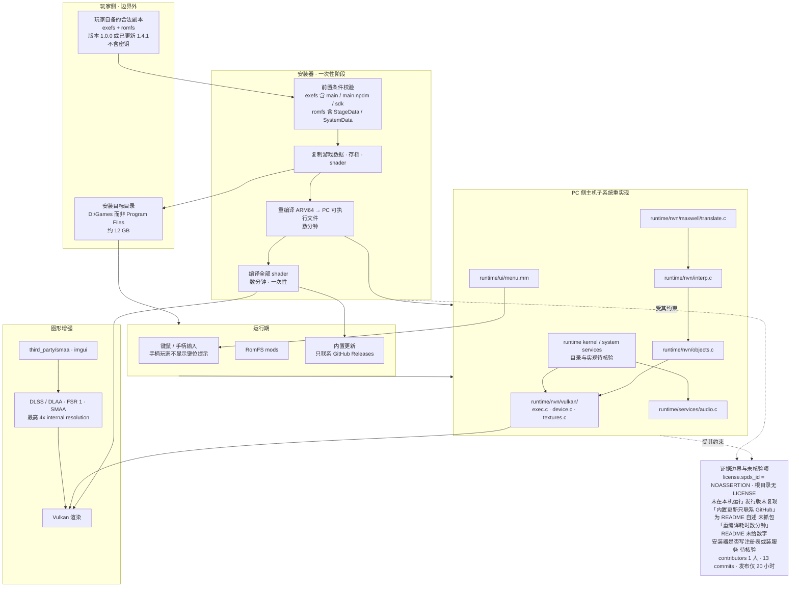

# Simon3Sarkis/super-odyssey-pc-recomp

## 一句话定位
**用静态重编译把《Super Mario Odyssey》的 ARM64 代码转成原生 Windows 程序**（不是模拟器，游玩时没有模拟器在跑）—— 仓库里**不含任何游戏文件**，需要玩家自备已解包的 `exefs` 与 `romfs`。

## 它解决的问题
⭐⭐⭐⭐⭐ **它解决的是「Switch 游戏在 PC 上跑」这件事里最麻烦的一层：不是「能跑」，而是「跑得像原生程序」。**

⭐⭐⭐⭐⭐ 现有的 Switch 游戏 PC 化路径大致有三条，各有硬伤：

1. **模拟器（Ryujinx / Yuzu 系）** —— 需要模拟整个主机（CPU、GPU、OS 服务），**性能开销大、兼容性问题多，且在法律与道德上处于争议区**；
2. **移植（decompilation / porting）** —— 逐函数重写，**工作量以人年计**，且通常不完整；
3. **静态重编译（static recompilation）** —— **把 ARM64 机器码翻译成 C / 汇编，再用本机编译器编成原生程序**，同时在 PC 侧重实现游戏所依赖的主机侧子系统。

⭐⭐⭐⭐⭐ **本项目走的是第三条，而且它对「第三条难在哪」的判断很清楚** —— README 写：「The game's ARM64 code is translated to C ahead of time and compiled into a regular Windows program — **no emulator runs while you play**. The parts of the Switch the game talks to (kernel, system services, the NVN graphics API, audio) are reimplemented on the PC, with Vulkan for graphics.」

⭐⭐⭐⭐⭐ **也就是说，它的产出是「一份可编译的源码 + 一份 PC 侧的主机子系统实现」，而不是「一个能双击的成品包」。** ⭐⭐⭐⭐⭐ **⭐⭐ 这条区分极其重要 —— 它决定了使用者需要具备的能力，也决定了这个仓库该被怎么读。**

⭐⭐⭐⭐⭐ **第三个它解决的问题是「安装期成本前置」：** README 写「**Every shader compiled at install time**, so effects don't stutter the first time they appear」—— ⭐⭐⭐⭐⭐ **⭐⭐ 即它把「首次播放特效时的卡顿」这笔运行期成本一次性搬到了安装期。**

## 为什么值得关注（2026-11-13）
⭐⭐⭐⭐⭐ **因为它把「我知道这不完美」写在了 README 的第一屏，而不是藏在末尾的 Known issues 里。**

⭐⭐⭐⭐⭐ **它的 README 前两块是两级 GitHub 提示框：**

> `> [!IMPORTANT]`
> **You must bring your own game.** This project contains **no game files, no game code, no assets and no keys** - only the installer and the source code. To play, you need the **`exefs` and `romfs` folders of your own copy of Super Mario Odyssey**, already extracted. No keys are needed or asked for. Instructions for getting game files are not provided, and **requests for game files or keys will be closed.**

> `> [!WARNING]`
> **This is an early preview.** The whole game can be played, but there are known issues (see [Known issues](#known-issues)) and things that still need fixing. Please report what you find.

⭐⭐⭐⭐⭐ **这三条做对的事，本日报认为是本日最值得抄的声明方式：**

1. **⭐⭐⭐⭐⭐ 主动声明「不提供什么」，并且把社区预期的边界也钉住** —— 不提供游戏文件、代码、素材、密钥，**且明确写「索要游戏文件或密钥的请求会被关闭」**。⭐⭐⭐⭐⭐ **⭐⭐ 这一句把「法律边界」与「社区预期」一次性解决，而不是留给每个来问的人。**
2. **⭐⭐⭐⭐⭐ 把「能玩」与「已完善」分成两句话** —— 「The whole game can be played, but there are known issues」。⭐⭐⭐⭐⭐ **⭐⭐ 本日报连日记录的一个反复出现的优秀做法就是「把边界结构化」：11-08 的 `satmux` 把物理 RTT 下界写进 `## Limits`，11-12 的 `phoneuse` 用 `[!WARNING]` 写明「Under heavy construction」，11-12 的 `tinytraffic` 写明「不开 `TT_TRUST_PROXY` 会发生什么」—— 本项目是同一族做法在本日的样本。**
3. **⭐⭐⭐⭐⭐ 明确「不需要密钥」** —— 这在一片「破解/密钥工具」的项目里是罕见的清晰表态：**它做的是「把代码搬走」，不是「绕过加密」。**

⭐⭐⭐⭐⭐ **而它的 11 个 open issue 是本日真项目里最多的** —— ⭐⭐⭐⭐⭐ **⭐⭐ 按本日报 11-12 记录 `solo-to-team-skills`（9 个 open issue）时的同一条判据：**issue 的存在说明项目正在被真实使用与质疑**，**这是一个正信号，而不是「维护得不够好」的证据。**

⭐⭐⭐⭐⭐ **⭐⭐ 值得同时记录的是它的许可状态：`license.spdx_id = NOASSERTION`，根目录没有 LICENSE 文件。** 一个 155⭐、有 11 个 issue 在讨论、且发布了两个可下载发行版的项目，**许可状态对 GitHub 与对使用者都是不可机读的**。⭐⭐⭐⭐⭐ 本日报在 10-25 与 10-26 多次记录过同类问题（`mcreplay` / `unbloat-android-tv` 的 NOASSERTION 但 LICENSE 首行清晰、`raven` 的组合许可未结构化），⭐⭐⭐⭐⭐ **⭐⭐ 本例更极端：连 LICENSE 文件都没有。**

## 热度来源判断
⭐⭐⭐⭐⭐ **热度来源是「真实的技术好奇心 + 一个有明确社区记忆点的作品」，但同样要区分可核验事实与推断。**

1. **⭐⭐⭐⭐⭐ 仓库形态是工程形态：** 230 blobs、13 commits、2 个 release（`v0.1.0`、`v0.1.1`，均含 `Super.Odyssey.PC.Recomp-0.1.1-windows.zip` 资产）、12 个 open issue。⭐⭐⭐⭐⭐ **⭐⭐ 发行版资产的存在说明有人真的下载并测试它 —— 这是本日真项目里少见的「分发物可核验」信号。**
2. **⭐⭐⭐⭐⭐ commit 标题高度具体：** `Mouse camera: the mouse turns the camera`、`Keyboard prompts: nothing of them for controller players`、`Mouse camera: straight into the game's camera; Enter / Backspace as symbols`、`Keyboard and mouse button prompts`、`Docs: the game's extracted exefs and romfs folders, no keys`。⭐⭐⭐⭐⭐ **⭐⭐ 这些是「逐条解决具体体验问题」的提交，而不是功能罗列 —— 这与本日报记录的许多「体量宏大但功能空泛」的仓库形成对照。**
3. **⭐⭐⭐⭐⭐ 仓库体积与技术栈真实：** `runtime/nvn/vulkan/exec.c` 390,161 B、`runtime/nvn/maxwell/translate.c` 164,489 B、`runtime/nvn/renderer.m` 148,159 B、`runtime/nvn/interp.c` 73,355 B、`runtime/services/audio.c` 66,087 B、`runtime/ui/menu.mm` 70,467 B；⭐⭐⭐⭐⭐ **⭐⭐ 注意 `runtime/nvn/` 目录名保留了 Switch 的 NVN（NVIDIA Tegra 的图形 API）命名 —— 这是「按主机子系统分目录重实现」这一架构的直接证据，而不是笼统的「port」。**
4. **⭐⭐⭐⭐⭐ fork/star = 3.2%，subs 5，oi 11** —— ⭐⭐⭐⭐ **⭐⭐ 这三项一起看，是「被真实关注且真实被质疑」的形态，与本数据集记录过的多数高星空壳（fork/star 60–90%、subs 0–77、oi 0）完全不同。**
5. **⭐⭐⭐ **⚠️ 但发布仅 20 小时，13 commits，contributors 1 人** —— ⭐⭐⭐ **全部工作由单人在一天内完成；⭐⭐ 本日报未复现任何功能，也未在本机上运行过它的发行版。**

⭐⭐⭐⭐ **结论：一个单人一天内完成的、技术路线清晰、且把自身局限主动写在第一屏的静态重编译项目；热度主要来自作品本身的传播力，而非采用证据。**

## 关键技术亮点
1. **⭐⭐⭐⭐⭐ 静态重编译 + 主机子系统重实现的双层结构：** `runtime/nvn/`（Vulkan / Maxwell / interpreter / objects / textures / device）、`runtime/services/audio.c`、`runtime/ui/menu.mm`、`runtime/kernel` 相关实现，加上 `third_party/`（`smaa`、`imgui`）。⭐⭐⭐⭐⭐ **⭐⭐ 这就是「第三条路径」的完整含义：主机侧的四块（kernel、system services、NVN、audio）必须被逐个重实现，否则游戏无法运行。**
2. **⭐⭐⭐⭐⭐ ARM64 → C 的提前翻译：** README 明写「translated to C **ahead of time** and compiled into a regular Windows program」。⭐⭐⭐⭐⭐ **⭐⭐ 「ahead of time」这四个字是关键 —— 它把运行期的翻译成本变成了编译期的一次性成本，因此游玩时「no emulator runs」。**
3. **⭐⭐⭐⭐⭐ 图形走 Vulkan + 多档超分：** 「Up to 4x internal resolution, NVIDIA **DLSS / DLAA**, AMD FSR 1, SMAA, ultrawide *Fill window*」。⭐⭐⭐⭐⭐ **⭐⭐ 而 `third_party/smaa/` 的实际存在（`AreaTex.h` 1,166,747 B）证明 SMAA 是真集成而非口号。**
4. **⭐⭐⭐⭐⭐ 安装期预编译全部 shader：** 「**Every shader compiled at install time**, so effects don't stutter the first time they appear」。⭐⭐⭐⭐⭐ **⭐⭐ 本日报认为这是本项目最值得抄的一条架构决策 —— 它把「首次出现的卡顿」这类只在真实使用中才会暴露的体验问题，提前到了一个可预期的、一次性的、可等待的阶段。**
5. **⭐⭐⭐⭐⭐ 输入层的细节工程：** 「Keyboard and controller rebinding, RomFS mods, an in-game settings menu, and built-in updates」。⭐⭐⭐⭐⭐ **⭐⭐ 而 commit 里的 `Keyboard prompts: nothing of them for controller players`（手柄玩家不显示键位提示）是一个典型的「从真实使用反馈里长出来的细节」。**
6. **⭐⭐⭐⭐⭐ 明确的版本与文件要求：** 安装器要求 `exefs` 与 `romfs`，支持 **1.0.0 或已应用更新的 1.4.1**（且要求「its full `romfs`, not only the update's」）；⭐⭐⭐⭐⭐ `exefs` 需含 `main`、`main.npdm` 与 `sdk`；⭐⭐⭐⭐⭐ 明确写出 `romfs` 含 `StageData` 与 `SystemData` 等目录。⭐⭐⭐⭐⭐ **⭐⭐ 这种颗粒度的前置条件说明作者对目标用户的实际环境做过核对。**
7. **⭐⭐⭐⭐ 约 12 GB 的磁盘占用与明确的落地路径：** 「Install the game to: where the game data, saves and shaders go (about 12 GB)」，⭐⭐⭐⭐⭐ 且明确要求装在**自己拥有的目录**（`D:\Games`）而非 `Program Files`。⭐⭐⭐⭐⭐ **⭐⭐ 「不装进 Program Files」这条建议本身就是一个关于权限与卸载体验的判断。**

## 架构师速览

| 决策问题 | 研究判断 | 证据边界 |
|---|---|---|
| 系统边界 | **「翻译产物 + PC 侧主机子系统 + 安装器」三层，边界外是玩家自备的游戏文件。** 仓库内是 `runtime/`（NVN/Vulkan/Maxwell/interpreter/objects/audio/UI）、`third_party/`（smaa、imgui）、`data/pipeline-seed.bin`（4,861,160 B）、`docs/` 与安装器源码。⭐ **边界外 = `exefs` / `romfs`，即游戏本体 —— 仓库明确不含它。** | 目录结构、文件体积、README 的三层描述为实测（230 blobs 的树清单）；**「三层」的划分是从目录命名与 README 段落归纳，未核验构建系统的实际分层** |
| 主路径 | 玩家提供已解包的 `exefs` + `romfs` → 安装器复制游戏数据 → **把 ARM64 代码重编译为 PC 可执行文件**（数分钟）→ **编译全部 shader**（数分钟，一次性）→ 启动 → 游戏经 `runtime/nvn/vulkan` 走 Vulkan 渲染、经 `runtime/services/audio.c` 出声、经 `runtime/ui/` 出提示 → 内置更新从 GitHub Releases 拉取。⭐ **注意「内置更新只联系 GitHub，不做别的联网」是 README 明写的边界。** | 主路径由 README 的 Install / Updating / What it is 三段拼出；**「只联系 GitHub」为 README 自述，未抓包核验**；**实际运行未复现** |
| 关键权衡 | **① 静态重编译 vs 模拟器** —— 换来「游玩时无模拟器、无性能税」，代价是**必须自己维护一份主机子系统重实现**（kernel / services / NVN / audio 四块）；**② 自备文件 vs 打包分发** —— 换来「仓库零版权风险、用户自担获取责任」，代价是**上手门槛转移到玩家身上**（需自己解包、需懂 `exefs`/`romfs` 概念）；**③ 提前翻译 vs 运行时翻译** —— 换来运行期零翻译开销，代价是**每次更新都要重新编译**（README 明写「The game checks for them at start… the game code is recompiled」）；**④ 成本前置 vs 安装等待** —— 把 shader 卡顿换成安装期几分钟等待 | 四项权衡均对应 README 明文；**① 的维护成本未量化（仓库 13 commits / 1 人）**；**② 的门槛量化未做**；**③ 的重编译耗时 README 未给具体数字** |
| 最小 PoC | **只验证「翻译 + 编译 + 启动」这条链，不追求可玩性：** 准备一份自己合法拥有的 1.0.0 或 1.4.1 的 `exefs` + `romfs` → 跑安装器 → 只确认「重编译成功、shader 编译完成、程序能进主菜单」→ 然后**观察 Known issues 里的条目是否与 README 描述一致**。⭐ **退出路径 = 删除安装目录与 `D:\Games` 下的数据，无系统级改动（不装驱动、不改注册表）；⭐ 关键验收点 = 「能否进主菜单」，而不是「能否通关」** | PoC 范围由 README 的 Install 段与「early preview」定位推导；**「已知问题是否与 README 一致」这一验收点为本日报设计**；**「无系统级改动」为推断，未核验安装器是否写注册表或装服务** |

## 架构启发
⭐⭐⭐⭐⭐ **最值得抄的一条是「用 `[!IMPORTANT]` / `[!WARNING]` 两级告示把最重要的边界放在第一屏」。** ⭐⭐⭐⭐⭐ ⭐⭐ 具体地，它的三层信息是：**（a）** 你必须自带什么（并逐项列出文件结构与版本）；**（b）** 我不提供什么（且明确「请求会被关闭」）；**（c）** 当前完成度到哪（early preview，有 known issues，请上报）。**

⭐⭐⭐⭐⭐ **⭐⭐ 这三层正好对应本日报连日记录的「三种诚实」：** ① **前置条件诚实**（不给模糊的「需要你的游戏」而给出 `exefs`/`romfs`/版本号/目录名）；② **边界诚实**（不提供密钥，且明确拒绝相关请求）；③ **完成度诚实**（early preview ≠ 完成）。⭐⭐⭐⭐⭐ **⭐⭐ 相比之下，本数据集记录过的许多仓库的 README 是「先说能做多少，最后才说有哪些坑」—— 而用户往往在最后一句之前就已经决定要不要用了。**

⭐⭐⭐⭐⭐ **第二条关于「把运行期成本前置到安装期」。** ⭐⭐⭐⭐⭐ 「Every shader compiled at install time, so effects don't stutter the first time they appear」—— ⭐⭐⭐⭐⭐ **⭐⭐ 这是一个通用模式：在有持久状态的系统里，把「首次触发才发生的昂贵计算」提前到一次性阶段，用户体验的成本从「随机卡顿」变成「一次等待」。** ⭐⭐⭐⭐⭐ **⭐⭐ 本日报认为这条比任何具体的图形技术都更值得抄。**

⭐⭐⭐⭐⭐ **第三条关于「目录命名保留原始概念」。** ⭐⭐⭐⭐⭐ `runtime/nvn/vulkan/`、`runtime/nvn/maxwell/`、`runtime/nvn/interp.c`、`runtime/nvn/objects.c` —— ⭐⭐⭐⭐⭐ **⭐⭐ 用原主机 API 的名字（NVN）与架构名（Maxwell）来命名 PC 侧的重实现目录，使「哪一块对应什么」不需要额外文档即可读出。** ⭐⭐⭐⭐⭐ **⭐⭐ 这对「重实现/移植/重编译」这一整类项目都适用：目录结构本身就是最有效的架构文档。**

⭐⭐⭐⭐⭐ **第四条关于「让 README 的第一块承担全部免责与前置条件」。** ⭐⭐⭐⭐⭐ ⭐⭐ 本项目的 11 个 open issue 意味着它正在被真实使用 —— ⭐⭐⭐⭐⭐ **⭐⭐ 而「明确写下不会回答什么」正是让 issue 数量转化为「真实反馈」而非「重复问答」的前提。** ⭐⭐⭐⭐⭐ **⭐⭐ 本日报在本项目上看到的是这条模式的完整闭环：文档说清边界 → 用户按边界使用 → issue 里出现的是真问题。**

## 架构图（MMD）

> 证据边界：此图只采用本档案已有可核验描述；标注「待核验」的节点不应视为项目实现事实。

## 定位判断
**工具型（tool），且是「移植/重编译」这一品类里少见的、边界声明做得很干净的一个。** ⭐⭐⭐⭐⭐

⭐⭐⭐⭐⭐ **它在生态里的位置是「主机游戏的 PC 化路线选择器」**：模拟器（法律与性能双争议）、逐函数移植（人力密集）、静态重编译（本项目）三条路中的一个具体实现。⭐⭐⭐⭐⭐ **⭐⭐ 本日报认为它的独特价值在于：它不是「又一个模拟器」，而是提供了「非模拟」这一选项的可执行样本 —— 而这条路线在 2026 年的意义在于它对硬件的要求低得多。**

⭐⭐⭐⭐⭐ **但它的成熟度明确是 preview，且许可状态缺失。** ⭐⭐⭐⭐⭐ **⭐⭐ 本日报给它的分类是「工具型」而非「生产可用」：13 commits、1 人、2 个 release、NOASSERTION 无 LICENSE、发布不足一天 —— 这五项里任何一项单独都不致命，但同时出现时，只能定性为早期工具。** ⭐⭐⭐⭐⭐ **⭐⭐ 而它同时是本日报记录过的「README 诚实度最高」的项目之一 —— 这两件事不矛盾：⭐⭐ 早期工具诚实地说明自己是早期的，比一个假装成熟但没有 LICENSE 的工具更有价值。**

## 风险 / 局限 / 泡沫点
- **⭐⭐⭐⭐⭐ 许可状态缺失：** `license.spdx_id = NOASSERTION`，根目录**没有 LICENSE 文件**。⭐⭐⭐⭐⭐ **⭐⭐ 一个 155⭐、11 个 issue、两个可下载发行版的项目，使用者无法从仓库得知授权条款。** ⭐⭐⭐⭐⭐ **本日报在 10-25 与 10-26 记录过多例同类问题，但那些至少还有 LICENSE 文件（只是 GitHub 识别不出）；本例连文件都没有，是本数据集记录到的更严重一档。**
- **⭐⭐⭐⭐⭐ 单人单日交付：** 13 commits、contributors 1 人、发布 20 小时。⭐⭐⭐⭐⭐ **⭐⭐ 「整个项目在一天内由一人完成」这件事本身不是问题（静态重编译的工作量高度集中在翻译与子系统实现），但它意味着**没有第二个人验证过它**，也没有社区分支在维护。**
- **⭐⭐⭐⭐ 性能与兼容性完全未核验：** ⭐⭐⭐⭐⭐ README 承诺「Native 120 FPS (experimental) 或帧插值」与「Up to 4x internal resolution」，⭐⭐⭐⭐⭐ **⭐⭐ 但本日报未在任何硬件上运行，也未见基准数据；本日报连项目自己标注的「experimental」都应予保留。**
- **⭐⭐⭐⭐ 上手门槛高：** 需要玩家自己解包 `exefs` / `romfs`、理解 `main` / `main.npdm` / `sdk` 的结构、准备约 12 GB 空间、并把程序装在非系统目录。⭐⭐⭐⭐ **⭐⭐ README 明确「Instructions for getting game files are not provided」—— 这在法律上是负责任的，在体验上是一道很高的门槛。**
- **⭐⭐⭐⭐ 版权边界敏感：** 项目本身不含游戏文件是明确的加分项，⭐⭐⭐⭐ **⭐⭐ 但「静态重编译商业游戏」这一行为类别本身处于法律灰色地带；本日报不评价其合法性，只记录它明确采取了「不提供素材、不提供密钥、不指导获取」的责任姿态。**
- **⭐⭐⭐ 已知问题的存在被明确承认：** README 明写「there are known issues… and things that still need fixing」，⭐⭐⭐⭐ **⭐⭐ 而本日报未打开核验该章节的具体条目 —— 这是一个应该在后续跟踪中补上的缺口。**
- **⚠️ 证据边界：** 未在本机运行任何发行版；未复现任何画面、帧率或兼容性；未打开核验 Known issues 章节的具体条目；未核验安装器是否写入注册表或安装系统服务；**「重编译与 shader 编译耗时数分钟」为 README 自述，README 未给出具体数字**；`license.spdx_id = NOASSERTION` 且无 LICENSE 文件（已核验）；star 增速未做统计。

## 与同类项目的关系
- **vs 模拟器（Ryujinx / Yuzu 系）：** ⭐⭐⭐⭐⭐ **不是同一品类的竞争者，而是路线选择。** ⭐⭐⭐⭐⭐ 本项目的差异是**游玩时无模拟器进程**，且**不含任何游戏文件**（模拟器同样通常不含）。
- **vs 其他静态重编译项目（如 Switch 2 的 `mkw-recomp`、`MKW-THWOMP`，11-10 窗口的同批项目）：** ⭐⭐⭐⭐⭐ **⭐⭐ 本日报在 11-10 窗口已记录 `adriadam10/mkw-recomp`（101⭐，C，13 commits）与 `STS78721/MKW-THWOMP`（86⭐，C，100 commits，GPL-3.0）。** ⭐⭐⭐⭐⭐ **⭐⭐ 本项目是同一条技术路线上的第三个样本，且规模明显更大（230 blobs vs 更小的树），⭐⭐⭐⭐⭐ ⭐⭐ 但本项目的许可状态是三者中最差的（另外两者中一个明确 GPL-3.0）。** ⭐⭐⭐⭐⭐ **⭐⭐ 三者同框说明「静态重编译 Switch 游戏」在本季度已不是孤例 —— 这是一个正在成型的品类，值得单独跟踪其生态（工具链、shader 编译、mod 支持的复用情况）。**
- **vs `Simon3Sarkis` 的同作者其他仓库（7 个公开仓库）：** ⭐⭐⭐ **⭐⭐ 本日报未核验其余 6 个仓库的内容，因此不能判断本项目是孤例还是同一系列工作的一部分。**
- **vs 11-13 档案的 `open-orange`：** ⭐⭐⭐⭐ **⭐⭐ 两者恰好是一对「两种不可验证断言」的对照 —— 一个宣称「零改代码迁移」但成本数字无测量条件，一个宣称「能玩」但无任何基准。⭐⭐⭐⭐ ⭐⭐ 二者都把「未验证的部分声明在前」做到了及格线附近，但都还有明确的未核验项。**
- **vs 本日档案的 `AIRzZ90/study-materials-fork`：** ⭐⭐⭐⭐⭐ **⭐⭐ 这是本日报记录过的最好的一组对照 —— 同样是搬运生态（一个搬运游戏代码，一个搬运整个仓库），⭐⭐⭐⭐⭐ ⭐⭐ 但一个把「不提供素材、索要会被关闭、这是 early preview」写在第一屏，另一个把「请点击小星星」写在第一屏。⭐⭐⭐⭐⭐ ⭐⭐ 同样的位置（第一屏），完全相反的用法。**

## 是否值得持续跟踪
**值得跟踪（工具型 / 早期）。** ⭐⭐⭐⭐⭐

⭐⭐⭐⭐⭐ 对关注「主机游戏 PC 化」这条技术路线的人，**它是目前本数据集记录到的样本里工程结构最完整、且边界声明最清楚的一个**，⭐⭐⭐⭐⭐ **而它的 README 是「如何诚实地介绍一个早期项目」的范本 —— 这部分价值与它能不能跑无关。**

⭐⭐⭐⭐⭐ **对做静态重编译的工程师，它的三条做法可直接对照：** ① 用原主机 API 名（NVN / Maxwell）命名重实现目录；② 把 shader 编译前置到安装期；③ 把「前置条件 / 不提供什么 / 完成度」写成 README 的第一块。

⭐⭐⭐⭐⭐ **本日报的立场是：不要因为它 155⭐ 就期待它能玩 —— 它是 preview，本日报也未在任何硬件上验证过它。**

## 后续观察点
- ⭐⭐⭐⭐⭐ **是否补上 LICENSE 文件** —— ⭐⭐⭐⭐⭐ **⭐⭐ 本日报的立场是：在一个 11 个 issue 在讨论、两个发行版可下载的项目上，许可缺失是最容易修复也最应该先修的一项。**
- ⭐⭐⭐⭐⭐ **Known issues 章节的具体条目** —— 本日报未打开核验，⭐⭐⭐⭐⭐ **⭐⭐ 后续应补上该清单的条目数与分类，因为「把已知问题的数量与范围公开」是本档案最想验证的一项。**
- ⭐⭐⭐⭐ **issue 的内容构成：** 11 个 open issue 中，**有多少是真实缺陷、有多少是重复提问、有多少是「索要游戏文件」**（README 声明这类请求会被关闭）—— ⭐⭐⭐⭐⭐ **⭐⭐ 若「索要游戏文件」类请求确实被关闭，说明声明被兑现，这是文档与行为一致性的直接证据。**
- ⭐⭐⭐⭐ **是否开始有第二个贡献者** —— 当前 contributors 1 人；⭐⭐⭐⭐ **⭐⭐ 这类项目通常会有 shader、mod 支持、平台适配方面的社区贡献，⭐⭐⭐⭐ 第一个外部 PR 的到来将是一个明确信号。**
- ⭐⭐⭐ **是否公布性能基准** —— 「Native 120 FPS (experimental)」目前无任何数据支撑；⭐⭐⭐⭐ **⭐⭐ 若作者补上机器配置与测量方法，本档案中「性能完全未核验」一条即可关闭。**
- ⭐⭐⭐⭐ **同品类项目的动向：** `mkw-recomp`、`MKW-THWOMP` 与本项目若出现共享工具链或交叉引用，⭐⭐⭐⭐⭐ **⭐⭐ 则「静态重编译 Switch 游戏」从一个项目变成一个品类，其工具链值得单独跟踪。**

---
*首次记录：2026-11-13*
