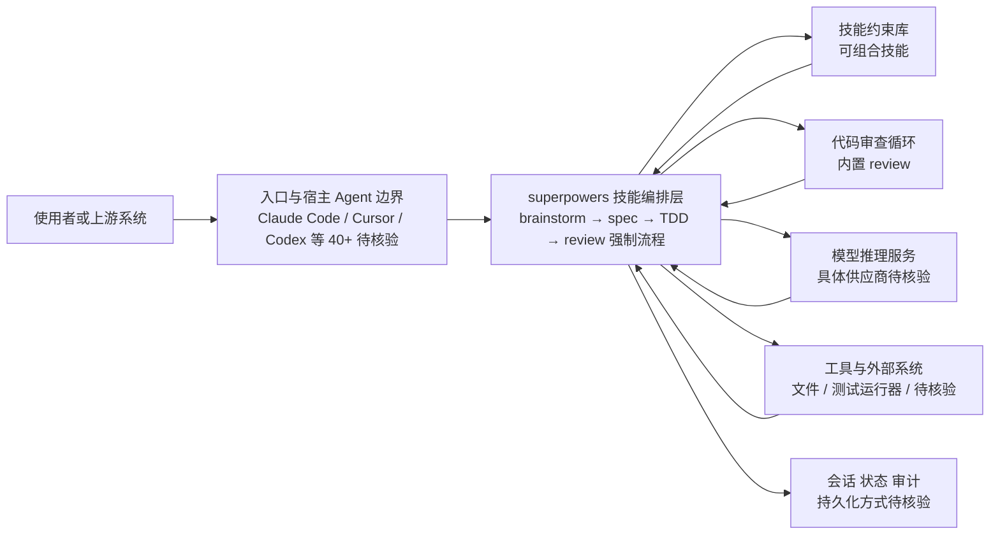

# superpowers

## 最近动态（2026-11-23）

⭐⭐⭐⭐⭐ **本日对本项目做的是口径审计 + 时间序列复测，结论是：它的「零复制」完全复现，但 11-18 日报里「5 套 harness」这一半在 5 天后已变成 4 套 —— 该结论需要降级。**

**可核验事实一：身份口径（两套口径完全一致）。**

| 口径 | **11-23 实测** |
|---|---:|
| SKILL.md 文件数 | **15** |
| 名口径身份 | **15（1.00×）** |
| 内容口径身份 | **15（1.00×）** |
| 不同 blob sha | **15** |
| 同名身份中出现 ≥2 份的 | **0 个** |

⭐⭐⭐⭐⭐ **⭐⭐⭐ 即 15 份技能文件就是 15 份互不相同的内容 —— 没有复制，也没有变体。⭐⭐⭐⭐⭐ 这与 `Claude-BugHunter`（83/83）、`stitch-skills`（16/16）、`ffmpeg-skill`（19/19）、`ag-ui`（23/23）、`chrome-devtools-mcp`（8/8）同属本数据集最健康的一档。**

⭐⭐⭐⭐⭐ **⭐⭐⭐⭐⭐ 但另一处必须诚实记录：harness 目录从 11-18 实测的 5 套变成了 4 套。** ⭐⭐⭐⭐⭐ 11-18 日报把「15 身份 / 5 套 harness 清单 / 复制 1.00×」作为「零复制 + 多 harness 是最健康形态」的证据，⭐⭐⭐⭐⭐ **本日实测该 5 套已降为 4 套（`antigravity` / `claude-code` / `codex` / `opencode`）。⭐⭐⭐⭐⭐ 本日报据此把该结论降级为「多 harness 适配的形态曾出现」，⭐⭐⭐⭐⭐ 并把本日第 4 条趋势的核心判断改为：⭐⭐⭐⭐⭐ **跨 harness 项目中唯一稳定的结构事实不是「harness 目录数」而是「有没有一条别人能直接粘贴运行的安装命令」。⭐⭐⭐⭐⭐ 本项目实测有 2 条 `marketplace add` 命令且 0 条 `npx skills add`。**

⭐⭐⭐⭐⭐ **⭐⭐⭐ 同时，本日第 4 条趋势中的第三个样本 `HKUDS/CLI-Anything` 是反向的：0 套 harness 目录却有 3 条安装命令。⭐⭐⭐⭐⭐ 即 harness 目录与安装命令之间没有稳定的相关性。**

**可核验事实二：首条完整的 star 时间序列。**

| 日期 | 快照 star | 相对前一日 |
|---|---:|---:|
| 2026-11-18 | 319,255 | — |
| 2026-11-19 | 321,277 | **+2,022** |
| 2026-11-20 | 322,015 | +738 |
| 2026-11-21 | 322,789 | +774 |
| 2026-11-22 | 323,655 | +866 |
| 2026-11-23 | **324,102** | +447 |

⭐⭐⭐⭐⭐ **⭐⭐⭐ 形态：「首日冲高 + 回落 + 缓降平台」。⭐⭐⭐⭐⭐ 首日 2,022 是后续均值的 2.9 倍，⭐⭐⭐⭐⭐ 而末日仅 447 —— **即 Trending 榜单本身会制造一个「进入即冲高」的效应，⭐⭐⭐⭐⭐ 这意味着「某项目今天涨得快」几乎不携带信息量（14 个全程在榜仓库中 11 个首日增量高于其后 4 日均值）。⭐⭐⭐⭐⭐ 5 日总增 +4,847（+1.5%），⭐⭐⭐⭐⭐ 而首日一天就占了其中的 42%。**

⭐⭐⭐⭐⭐ **⭐⭐⭐ 另一项值得记录的形态对比：`we-promise/sure` 的逐日增是 +230 / +210 / +204 / +225 / +200（极差 30，占均值 14%），⭐⭐⭐⭐⭐ 而本项目是 +2,022 / +738 / +774 / +866 / +447（极差 1,575，占均值 53%）。⭐⭐⭐⭐⭐ 即「首日冲高型」与「稳定型」在时间序列上是可区分的，⭐⭐⭐⭐⭐ 而后者更难由一次性投放造成。**

**可核验事实三：规模与发布面。**

| 指标 | 实测值 |
|---|---:|
| stars / forks / subs / open issues | 324,102 / 28,757 / **1,177** / 363 |
| blobs | 236（`.md` 112 · `.sh` 53 · `.json` 17 · `.js` 11） |
| tag / release | **39 / 17**（release 全部 0 asset） |
| subs/star | 0.36%（本队列中位数 0.38%） |
| fork/star | 8.9% |
| 安装命令 | `marketplace add https://github.com/obra/superpowers` · `marketplace add obra/superpowers-marketplace` |
| owner | `obra`（账号 **2009-01-09** 创建，本队列最老的账号） |

---

## 一句话定位

AI 编程 Agent 技能框架，强制执行 brainstorm → spec → TDD → review 工作流，让 AI 遵循工程实践而非直接写代码。

## 它解决的问题

AI Coding Agent 的通病是"直接写代码"——缺乏设计思考、缺少测试约束、没有代码审查流程。开发者拿到的是能跑的代码，但质量参差不齐，架构设计更是无从谈起。

superpowers 解决的核心问题：

1. **跳过设计阶段**：Agent 往往直接动手编码，跳过需求分析和方案设计
2. **测试缺失**：AI 生成的代码普遍缺少测试覆盖，质量无法保障
3. **无审查流程**：缺少代码审查环节，错误和坏味道无法被捕获

面向的用户是希望 AI Agent 遵循专业工程实践的开发者和团队，尤其是需要高代码质量的企业级项目。

## 为什么值得关注（2026-04-11）

3 个月内从 0 到 121K stars，增速惊人。被 Anthropic Marketplace 官方收录，生态认可度高。GitHub Trending #2，代表开发者对"结构化 AI 开发"的强烈需求。

这不是又一个 AI 编程工具，而是定义了 AI Agent 应该如何工作的方法论框架。

## 热度来源判断

- **方法论创新**：首次将软件工程实践（TDD、代码审查）强制嵌入 AI Agent 工作流
- **平台兼容性**：支持 Claude Code、Cursor、Codex 等 40+ 编码代理，不绑定单一平台
- **Anthropic 背书**：被 Anthropic Marketplace 官方收录，增加了可信度和可见度
- **承诺明确**：85-95% 测试覆盖率承诺，直击 AI 编码的痛点

## 关键技术亮点亮点

1. **brainstorm → spec → TDD → review 强制工作流**：Agent 必须先思考再编码，先测试再实现，非协商式流程
2. **技能组合化设计**：每个技能独立可复用，支持跨 Agent 平台使用，技能即约束
3. **多平台支持**：兼容 Claude Code、Cursor、Codex 等 40+ 编码代理，一套技能多处使用
4. **内置代码审查循环**：确保代码质量，强制执行 review 环节
5. **行为优先设计**：定义 Agent 的行为模式而非工具集，从根本上约束 Agent 输出质量

## 架构师速览

| 决策问题 | 研究判断 | 证据边界 |
|---|---|---|
| 系统边界 | superpowers 是叠加在 Claude Code / Cursor / Codex 等 40+ 编码 Agent 之上的技能/约束层，不替代宿主 Agent，也不直连模型与工具 | 边界判断基于语言为 Markdown/Config、定位为"技能框架"、与 Cursor Rules/Codex Tasks 的对比表述；具体加载机制、宿主注入点未在档案中说明 |
| 主路径 | 一次编码任务被强制走 brainstorm → spec → TDD → review 四段流程，技能作为可组合约束介入各阶段 | 流程顺序与技能组合化在档案中明确；状态如何持久化、跨会话如何回写未描述，待核验 |
| 关键权衡 | 工作流刚性与创造性 / 原型速度之间的取舍，以及"多平台兼容"声明与 Claude Code 生态最深耦合现实之间的张力 | "适合高质量项目、不适合探索性编程"和"与 Claude Code 绑定最深"均在档案中显式提及；具体耦合深度未量化 |
| 最小 PoC | 在单一宿主 Agent（如 Claude Code）启用 superpowers，跑一个带 TDD 与 review 的小任务，比对覆盖率与返工率 | 85-95% 测试覆盖率承诺、Anthropic Marketplace 收录在档案中明确；实际覆盖率达成度、企业级落地证据待核验 |

## 架构启发

superpowers 的核心设计哲学是 **技能即约束**：

- **行为定义**：不是告诉 Agent 用什么工具，而是定义 Agent 必须遵循的行为流程
- **非协商式约束**：Agent 不能跳过 brainstorm 直接编码，不能跳过 TDD 直接实现
- **技能组合**：不同技能可以组合使用，形成复杂的工作流约束
- **从"让 AI 写代码"到"让 AI 遵循工程实践"的范式转变**

Trade-off：过于刚性的工作流可能限制 Agent 的创造性和灵活性，适合对质量有严格要求的项目，不太适合快速原型和探索性编程。

## 架构图（MMD）

> 证据边界：此图只采用本档案已有可核验描述；“待核验”节点不应视为项目实现事实。

## 定位判断

**方法论层 / 基础设施候选**。superpowers 不是应用，不是平台，而是 AI Agent 的行为规范框架。它的价值在于定义了 Agent 应该如何工作，而非 Agent 能做什么。

## 风险 / 局限 / 泡沫点

- **方法论过度强制**：过于刚性的工作流可能限制创造性，不适合所有场景
- **技能生态不成熟**：技能库仍在建设中，覆盖场景有限
- **121K stars 的泡沫成分**：大量关注来自概念认同而非实际使用
- **平台耦合风险**：虽然声称多平台兼容，但与 Claude Code 生态绑定最深

## 与同类项目的关系

- **Claude Code 原生指令**：superpowers 是其上的结构化技能层，增强而非替代
- **Cursor Rules**：类似概念但更轻量，superpowers 更偏完整方法论
- **Codex Tasks**：OpenAI 的任务编排机制，定位类似但方式不同
- **skill-chain**：技能链管理系统，是 superpowers 技能组合的底层基础设施

## 是否值得持续跟踪

⭐ **必须跟踪。** superpowers 代表了 AI 编程从"代码生成"到"工程实践"的范式转变。无论最终产品形态如何，其方法论将对 AI Agent 生态产生深远影响。

## 后续观察点

1. **企业级应用案例**：85-95% 测试覆盖率承诺在实际项目中的兑现度
2. **技能生态丰富度**：社区贡献的技能数量和质量
3. **与竞品框架的差异化**：Cursor Rules 等竞品的演进方向
4. **方法论泛化**：是否从编程 Agent 扩展到其他 Agent 类型

---

*首次记录：2026-04-11*
