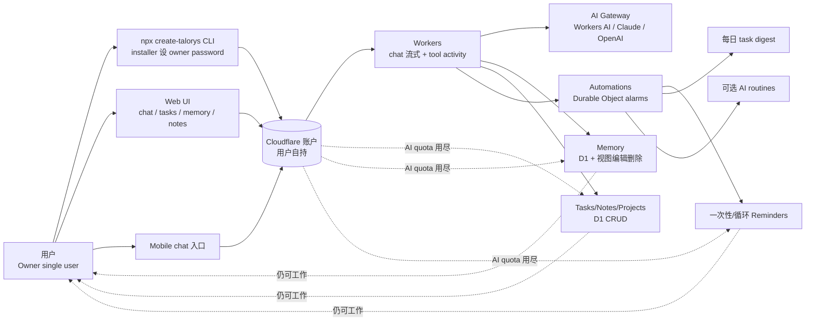

# rociiu/talorys

## 一句话定位
Talorys 是「跑在用户自己 Cloudflare 账户上的开源个人 AI 助手」——一个 `npx create-talorys@latest` 即可部署到你自己 Cloudflare 账户、跑 Workers/D1/Durable Objects/R2/AI Gateway 的单用户 agent。

## 它解决的问题
ChatGPT / Claude.ai / Cursor Composer / 各 Coding Agent 都是「别人的云、别人的模型、别人的数据」——个人用户没有：
- **数据控制权**：Memory、tasks、notes、reminders 都锁在 SaaS 平台
- **成本控制权**：免费配额耗尽 → 付费墙；API 价格由平台定
- **持续性**：平台改政策、封号、改价 → 用户完全被动

Talorys 的目标是让普通用户像 `brew install` 一个 CLI 一样装一个「自己的 AI agent」——数据在用户自己的 Cloudflare 账户（D1 + Durable Objects），凭据由用户掌控，AI quota 用尽仍可工作。

## 为什么值得关注（2026-10-11）
- **Stars:** 312（截至 2026-10-11），2 天累计
- **Forks:** 18，fork/star 5.8%（社区贡献门槛适中）
- **License:** MIT，商用清晰
- **Language:** TypeScript（Cloudflare Workers 原生）
- **Size:** 1030 KB，仓库大小精简（与一些 50MB+ 的 Next.js SaaS 模板对比）
- **创新点:** 完整把 Cloudflare Workers 生态（Workers + D1 + Durable Objects + R2 + AI Gateway）拼成「一个 npx 命令即用的个人 AI 助手」
- **定位：** Cloudflare 生态的「个人 AI agent 全栈模板」+「自己云、自己的数据」方向的开源代表

## 热度来源判断
rociiu/talorys 的热度是「**个人 AI agent + 数据主权 + Cloudflare 零运维 + npx 一键部署**」的强劲组合。2025-2026 年 Coding Agent 爆发后，用户开始意识到：**agent 应该是我的工具，不是平台的产品**——ChatGPT/Claude.ai 锁定数据、Cursor 锁定 IDE 工作流、Replit 锁定代码。Talorys 用 Cloudflare Workers 提供的「零运维边缘云」+ Durable Objects 提供的「单用户状态存储」+ AI Gateway 提供的「多模型路由」把整套 agent 模板化。npx create-talorys@latest 这一行命令把「装一个 AI 助手」的门槛降到与 `brew install` 同档。18 个 fork 反映社区尝试参与——这是「个人 AI agent 模板」赛道的早期信号。

热度**真实且具定位意义**——但需警惕：依赖 Cloudflare 账户（被封/Quota 耗尽/Workers 改了定价 → 用户卡住）+ 单用户 by design（无法扩展到团队/家庭）+ Durable Object alarms 有 6 小时上限（长期任务需 workaround）+ 与 ChatGPT/Claude.ai 的「开箱即用」相比仍需 npx 安装 + Cloudflare 账户绑定。

## 关键技术亮点
1. **npx create-talorys@latest 一键部署：** 单一命令即装即用，与 `brew install` / `npm install -g` 同档的装机体验
2. **Cloudflare Workers + D1 + Durable Objects + R2 + AI Gateway 五件套：** 把 Cloudflare 边缘云全栈拼成一个 personal AI 助手
3. **Durable Object alarms 驱动 reminders/automations：** 提醒和自动化不需长驻进程，由 Durable Object alarms 触发（节省成本）
4. **持久化 Memory 视图编辑删除：** 用户掌控自己的记忆（不是锁在 LLM context window）
5. **单用户 by design：** 不试图做多租户 SaaS（installer 设 owner password）
6. **AI quota 用尽仍可工作：** tasks、notes、memories、reminders 在 Workers AI 不可用或 quota 用尽时仍能运行
7. **CLI/UI/chat 三入口：** 同一 agent 三种交互方式（CLI 自动化、UI 桌面、chat 移动）
8. **12 个 Tier 1 集成：** 聊天流式 Markdown、工具活动指示器、Memory 视图编辑删除、tasks/notes/projects CRUD、一次性/循环 reminders、daily task digest、AI routines 等

## 架构师速览

| 决策问题 | 研究判断 | 证据边界 |
|---|---|---|
| 系统边界 | 个人 AI agent 跑在用户 Cloudflare 账户上的全栈 Workers 应用，外部仅依赖 AI provider（Workers AI / Anthropic / OpenAI via AI Gateway） | 仅基于 README 列出的 Workers/D1/Durable Objects/R2/AI Gateway 集成；具体状态机、权限模型、Memory 索引方式未在档案中给出 |
| 主路径 | 用户 npx create-talorys → 部署到用户 Cf 账户 → installer 设 owner password → 单用户登录 → UI/CLI/chat 三入口 → Agent 调用 AI Gateway → Memory/Task/Reminder 落到 D1 + Durable Objects + Durable Object alarms | 主路径来自 README 描述；具体 LLM 调用频率限制、Memory 检索排序、reminders 触发失败重试策略均待核验 |
| 关键权衡 | 零运维（Cloudflare Workers）vs 单 Cloudflare 供应商锁定 vs 单用户 by design vs Memory 视图编辑（用户掌控）vs AI quota 用尽降级（task/note/reminder 离线可用） | 档案明示零运维/单用户/quota 降级三点权衡；具体降级路径细节、Memory 自动合并策略、跨设备同步方案未证实 |
| 最小 PoC | `npx create-talorys@latest` 部署到测试 Cloudflare 账户 → 装完访问 UI → 添加一个任务/笔记/提醒 + 触发一次 Memory 写入 → 关闭 Workers AI 模拟 quota 用尽，确认 task/note/reminder 仍可用 | PoC 范围由 README「Works without AI」反推；具体 Memory 自动合并、跨设备、迁移到其他 Cloudflare 账户路径待核验 |

## 架构启发
rociiu/talorys 的核心启发是 **「个人 AI agent 应该像 npm 包一样能一键安装并跑在我自己的基础设施上」**。当前大多数「AI agent」是 SaaS 平台——ChatGPT、Claude.ai、Cursor、Replit、Devin——数据锁在平台、定价由平台决定、政策随时可变。Talorys 用 Cloudflare Workers 提供的「零运维边缘云」+ Durable Objects 的「单用户状态存储」+ AI Gateway 的「多模型路由」把整套 agent 模板化。这与「本地 LLM（Ollama / LM Studio）」方向互补：**Talorys 是「我自己的云」，Ollama 是「我自己的电脑」**。更深层的启发是：**「数据主权 + 零运维 + npx 一键部署」是个人 AI agent 普及化的关键组合**——它把个人 agent 从「极客玩具」推向「普通用户可消费」。

## 架构图（MMD）

> 证据边界：此图只采用本档案已有可核验描述；"待核验"节点不应视为项目实现事实。

## 定位判断
**平台候选型项目（个人 AI agent 全栈模板 + 数据主权方向）。** rociiu/talorys 不只是工具，更是「**自己云、自己的数据、自己的 agent**」方向的开源代表。它把 Cloudflare Workers 生态（Workers + D1 + Durable Objects + R2 + AI Gateway）拼成一个 `npx` 命令即用的全栈模板——这与 Supabase、Vercel、Railway 等「全栈 BaaS」模板化思路同源，但聚焦「个人 AI agent」这一垂直场景。其潜在演进路径：(1) 成为「个人 AI agent」的事实标准模板（类似 Next.js 之于 React 全栈）；(2) 衍生出团队版（多用户但仍自部署）；(3) 被 Cloudflare 官方采纳为「Cloudflare AI agent starter kit」。当前定位：「个人 AI agent + 数据主权」赛道的开源先驱。

## 风险 / 局限 / 泡沫点
- **Cloudflare 供应商锁定：** 账户被封/Quota 耗尽/Workers 改了定价 → 用户卡住（无迁移路径）
- **单用户 by design：** 无法扩展到团队/家庭（多用户需重写）
- **Durable Object alarms 6 小时上限：** 长期任务/recurring reminders 频率受限
- **npx 安装 + Cloudflare 账户绑定门槛：** 比 ChatGPT/Claude.ai 网页「开箱即用」仍多 2 步
- **rociiu 个人项目：** 治理可持续性、版本节奏、安全更新频率未观察
- **AI Gateway 成本：** 用户用 Claude/OpenAI 时仍需付费（不是免费，只是「数据主权」层面的）
- **Memory 自动合并未明：** 用户手动编辑 Memory 的体验细节、重复处理、跨设备同步未在档案中描述

## 与同类项目的关系
- **vs ChatGPT Memory：** ChatGPT Memory 锁在 OpenAI 账户；Talorys 在用户自己的 Cf 账户
- **vs Cursor Composer：** Cursor 聚焦 IDE 工作流；Talorys 是通用个人 agent（聊天 + 任务 + 提醒）
- **vs LangChain / AutoGPT：** 那些是「agent 框架」；Talorys 是「现成的 agent 应用」（无需自己写）
- **vs Open WebUI：** Open WebUI 跑在用户自己的服务器；Talorys 跑在用户自己的 Cf 账户（零运维）
- **vs Ollama / LM Studio：** 那些是「本地 LLM」；Talorys 是「自托管 agent」（可用任何 LLM）
- **vs Cloudflare 官方 AI agent 模板：** 官方可能有但 Talorys 早一步整合 Memory + Tasks + Reminders 全栈

## 是否值得持续跟踪
**值得跟踪（个人 AI agent + 数据主权方向的开源代表）。** rociiu/talorys 代表了「自己的云、自己的数据、自己的 agent」方向——无论其本身成败，这一方向是行业趋势。建议关注：Cloudflare Workers 生态演进、用户采用数据（npx 下载量）、是否衍生团队版、是否被 Cf 官方采纳。对个人用户，这是「ChatGPT 数据主权版本」的开源选择，值得直接尝试；对 Agent 生态观察者，这是「零运维 + 自部署 + npx 装机」三件套的范式样本。

## 后续观察点
- npx 下载量与活跃部署数（npm 统计可观察）
- Cloudflare 官方是否推出对标「Personal AI agent starter kit」
- 团队/家庭版计划（多用户 by design 扩展）
- 跨 Cloudflare 账户迁移工具（防止锁定）
- Memory 自动合并 / 跨设备同步 / 备份方案
- 衍生插件生态（如第三方 Memory 类型、第三方 automations、第三方 task 类型）

---
> 数据来源: GitHub Search API + Repository API (2026-10-11) + README 公开摘录 | Stars: 312 | Forks: 18 | License: MIT | 语言: TypeScript | 创建: 2026-10-09
