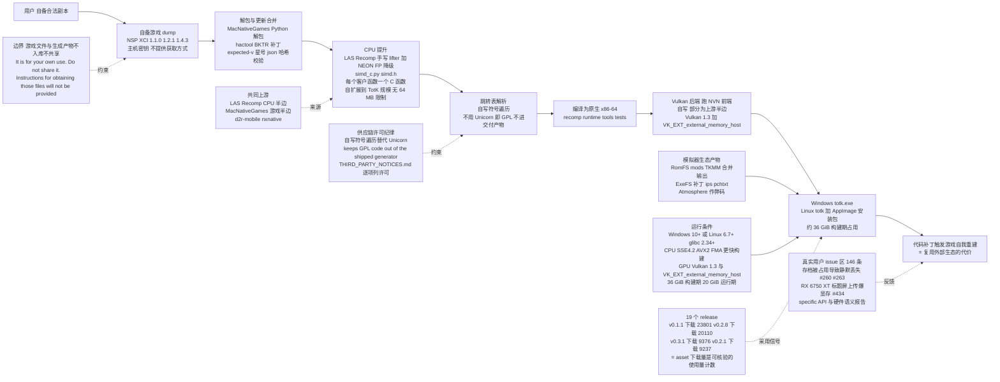

# valentderah/totk-pc-recomp

## 一句话定位

把《塞尔达传说：王国之泪》的 ARM64 代码**静态重编译**成原生 Windows x86-64 与 Linux 可执行文件（而非模拟器），而它最硬的一处工程是把「CPU 提升器」与「游戏专属层」从两个不同上游各取一半、自己补上缺口——并且它用「自己写符号遍历」把 GPL 的 Unicorn 排除在交付产物之外。

## 它解决的问题

**它要解决的是「想在 PC 上原生运行 Switch 游戏，但既不接受模拟器的性能与兼容代价，也不能碰盗版分发」这个问题。**

静态重编译（static recompilation）的思路是把主机代码**提前**翻译成目标平台的原生代码，游戏运行时不再有解释器。这比模拟器快、比逐帧重编译工程量小，但代价是：每一个「主机硬件替身」（图形、输入、存储、文件系统）都得自己写，且**翻译器必须正确处理 ARM64 的所有指令语义**。

**⭐⭐ 而它面对的第二重难题是「你不能既复用现成方案又不承担它的许可义务」** —— 生态里现成的 ARM64→C 提升器大多依赖 Unicorn（GPL），而把 GPL 代码链接进交付产物会让整个项目被迫 GPL。这是一个**结构性约束**，不是风格问题。

## 为什么值得关注（2026-11-02）

**⭐⭐⭐ 因为在 72 小时内，它从一个「423⭐ 的新鲜项目」变成了「3,147⭐ ⑂253 · 590 commits · 26 位贡献者 · 19 个 release」的项目，而它依然保持着本日报见过最诚实的架构说明与供应链纪律。**

四个可核验的硬事实：

1. **⭐⭐⭐⭐⭐ 它的架构文档把「我用了谁、没用什么、为什么、缺口在哪」写在同一段里**（`docs/architecture.md` 原文）：

   > **MacNativeGames cannot run on x86-64 as it is: its CPU path executes ARM64 code natively. LAS Recomp's host only covers what *Link's Awakening* calls. The port takes the CPU half from LAS Recomp and the game half from MacNativeGames, and writes the parts neither has: a lifter that scales to TotK, and a Vulkan back end for the NVN front end.**

   **⭐⭐⭐⭐⭐ 即「复用」被拆到了零件级：CPU 半边取自 LAS Recomp，游戏半边取自 MacNativeGames，两者都没有的（可扩展到 TotK 规模的 lifter、NVN 前端的 Vulkan 后端）自己写。** 这是本日报见过最精确的复用声明——多数项目只说「基于 X 项目」。

2. **⭐⭐⭐⭐⭐⭐ 而同一份文档里有一条本日最值得抄的供应链决策**：

   > **jump tables resolved by our own symbolic pass instead of Unicorn, which keeps GPL code out of the shipped generator**

   **⭐⭐⭐⭐⭐⭐⭐ 即：它没有用 Unicorn（GPL），而是自己写符号遍历来解析跳转表——理由是「把 GPL 代码挡在交付产物之外」。** **本日报连续多日记录许可元数据问题（10-22 php2shell-poc、10-23 UniXNU/Snapintosh、10-25 raven 的 GPL 重许可），这是本日报第一次见到「因为许可原因而主动不依赖某个知名工具」的设计决策。** 这比事后补一份 `LICENSES.json` 更难，也更彻底。

3. **⭐⭐⭐⭐⭐ 它的 release 频率与内容密度证明这是真实工程而非刷星**：19 个 release，v0.1.1（10-29）→ v0.2.1（10-31）→ v0.2.8（10-31）→ v0.3.1（11-01），**每个 release 的 changelog 记的是「上一版在真实用户报告里暴露了哪个具体缺陷」**——例如 v0.2.8 的首条是「**Lost saves (#260, #263).** When another program held a file in the save folder (an antivirus, Explorer's preview, a cloud sync tool), every save of the session could fail without a message, and the next start deleted the progress.」（**即：不是「功能更新」，是「用户在真实环境里踩到的具体故障」**）；v0.1.6 修的是「Fixed rainbow and blocky textures on terrain on AMD and Intel GPUs (#42, #67, #81)」与「Fixed objects that stayed see-through or invisible above about 63 FPS on 1.4.3 (#10, #37)」。

   **⭐⭐⭐⭐⭐ 而 release asset 的下载量是可核验的采用信号**：v0.1.1 **23,801 次**、v0.2.8 **20,110 次**、v0.3.1 **9,376 次**、v0.2.1 **9,237 次**、v0.1.9 **6,930 次**、v0.1.6 **3,756 次**。**⭐⭐⭐ 本日报强调：这六个数字加起来超过 7.2 万次下载，而它们是「有人真的把它装到自己电脑上跑起来了」的计数——与 star 的性质不同。**

4. **⭐⭐⭐⭐⭐ 它的 issue 区在收「真实用户按文档操作后失败」的具体报告**：#414「Crash (access violation 0xc0000005) in f_7000559990 / main+0x559990 on a Sky Island」、#430「Whole screen turns black with DLSS/DLAA in the 'Temple Zora Antique'」、#434「0.3.1 on Linux: device lost during the title-screen texture upload burst on RX 6750 XT」、#399「Waterfall in view at Nachoyah Shrine: ~6,400 draws a frame, 60 -> 39 fps, CPU-bound in the …」。**⭐⭐⭐ 146 个 open issue —— 而这些是具体的、可复现的、指向具体硬件与具体 API 语义的报告。**

## 热度来源判断

**热度主要来自「一个具体到能立刻在别人机器上跑起来的产品」——这是本日报见过的最强采用信号形态之一，但需要区分哪一部分是真采用、哪一部分是注意力。**

- **⭐⭐⭐⭐⭐ 真采用信号（可核验）**：**release asset 下载量合计 > 72,000 次**（v0.1.1 单个 release 即 23,801 次）；**26 位 contributors**（对比 10-30 记录的 1 人）；**590 个 commit**；**19 个 release**；`subscribers_count` = **49**；146 个 open issue 全部是「我照文档做了然后在第 N 步出问题」的具体报告。
- **⭐⭐⭐ 热度来源可推断为三股叠加**：① **游戏本身的关注度**（TotK 是 Switch 销量最高的游戏之一）；② **「原生移植」这一形态的稀缺性**（本日报 10-30 已记录同日有四个互不相识的静态重编译项目撞上同一难度，其中两个都打 TotK）；③ **⭐⭐⭐⭐⭐ 项目自身的工程口碑**（可复现的 release 节奏 + 具体到 API 语义的 issue 回复）。
- **⭐⭐⭐⭐⭐ 而本日报必须同时记录一个方法论要点**：**3,147⭐ 与「能不能跑起来」几乎无关，而 release 下载量与之强相关。** 本日报 10-30 就记过这条（「⭐ 最后才看 star」），今天有了可对照的两组数据：**star 3,147 vs release 下载 72,000+**。**⭐⭐⭐ 这两个数字的量级差本身就在说明「star 衡量注意力，下载衡量使用」，而本日报本次核验的 farm 样本（同一天 42 个新仓库中 27 个携带投放指令）恰好证明了**同一份 star 榜单里可以同时装着「真实用户」与「被 SEO 投毒的农场」——** 而区分它们的判据不是 star，是 subs、release 下载量、commit 数、contributors 与 issue 的具体性。

## 关键技术亮点

1. **⭐⭐⭐⭐⭐⭐ 自写符号遍历替代 Unicorn（许可驱动的设计决策）**

   跳转表（jump table）解析是 ARM64→C 提升器的核心难点之一，而生态里的现成方案 Unicorn 是 GPL。**它选择自己写一遍符号遍历，把 GPL 挡在交付产物之外** —— 这是本日报今日最值得单独抄走的一条决策，因为它把「许可风险」从事后合规变成了事前架构选择。

2. **⭐⭐⭐⭐⭐ 零件级复用声明与「缺口自补」的诚实**

   取 LAS Recomp 的手写 lifter + NEON/FP 降级（因为 MacNativeGames 的 CPU 路径直接执行 ARM64 代码，不能原样跑在 x86-64），取 MacNativeGames 的 NVN 前端与版本表（因为 LAS Recomp 的宿主只覆盖《林克的唤醒》调用到的东西），**自己写可扩展到 TotK 规模的 lifter 与 NVN 前端的 Vulkan 后端**。

3. **⭐⭐⭐⭐⭐ 需求条件写得非常具体，直接决定「谁能用」**

   Windows 10+ / x86-64 CPU 带 **SSE4.2**（AVX2/FMA 机器获得更快构建）/ GPU 带 **Vulkan 1.3 与 `VK_EXT_external_memory_host`** / 安装期约 **36 GiB** 空闲（完成后 20 GiB）；Linux 需 6.7+ 内核与 glibc 2.34+（Ubuntu 22.04 / Debian 12 / Fedora 35 / SteamOS 3）。

4. **⭐⭐⭐⭐⭐⭐ 存档跨版本互通 + 存档丢失的真实故障修复**

   README 写「Game updates 1.1.0, 1.2.1 and 1.4.3; **1.2.1 and 1.4.3 saves carry over between them**」；而 v0.2.8 修的正是「存档被杀毒软件/资源管理器预览/云同步占用时保存静默失败、下次启动删掉进度」这一**真实环境下的经典故障**。

5. **⭐⭐⭐⭐ 支持模拟器生态的 mod 与作弊码（把生态复用做成了产品特性）**

   「Mods made for emulators: unpack a mod into the `mods` folder next to `totk.exe`；switch and order them in the menu。**RomFS mods、TKMM's merged output 与 ExeFS code patches (`.ips`, `.pchtxt`) work**；the game rebuilds itself for code patches」+ Atmosphère cheats 支持。

6. **⭐⭐⭐⭐⭐ 分辨率/宽高比/色彩被当作一等公民**

   16:10（Steam Deck、掌机）、21:9 与 32:9（超宽屏）游戏分辨率，**且相机与界面都在那个形状里**；HDR10 输出带 peak/game/HUD 亮度设置；各向异性过滤 16x；60 fps 默认、最高 144 fps 或显示器刷新率（实验性）；v0.1.9 新增 `aspect` 设置（`fit` 默认保持画面形状加黑边，`stretch` 填满窗口）。

## 架构师速览

| 决策问题 | 研究判断 | 证据边界 |
|---|---|---|
| 系统边界 | **边界划在「游戏文件永不进仓库 / 生成产物永不共享」这一条上，且它把边界的失效条件也写了出来**：「The game is built from your files on your machine, so the result contains the game. **It is for your own use. Do not share it.**」；README 明确「Instructions for obtaining those files will not be provided」。**⭐ 关键的架构判断：它的边界不是「模块之间」，而是「原始资产（游戏 dump、密钥、固件）与生成产物之间的那条线」，这条线贯穿整个工具链**（解包 → 提升 → 编译 → 着色器构建 → 安装目录）。**⭐⭐ 而它还把「许可」画成了一条边界**：GPL 的 Unicorn 被有意排除在交付产物之外 | `docs/architecture.md` 原文引用、README 的 `> [!IMPORTANT]` 段与「Installing」段、Credits 段（LAS Recomp / MacNativeGames / d2r-mobile / nxnative）、`THIRD_PARTY_NOTICES.md` 的存在性、仓库根树 19 项（含 `docs/ installer/ recomp/ runtime/ tests/ tools/ AGENTS.md CLAUDE.md CONTRIBUTING.md THIRD_PARTY_NOTICES.md config.example.toml totk.ini.example`）。**⭐ 未核验：`recomp/` `runtime/` `tools/` `tests/` 四个目录的具体职责划分；`docs/architecture.md` 除已引用段以外的内容；三个上游的实际代码量占比** |
| 主路径 | 自备 NSP/XCI + 主机密钥 + 1.1.0/1.2.1/1.4.3 更新 → 解包（MacNativeGames 的 Python 解包）→ hactool + BKTR 补丁合并更新 → `expected-v*.json` 哈希校验 ExeFS/RomFS/fonts → **LAS Recomp 的手写 lifter（`lifter.py`）与 NEON/FP 降级（`simd_c.py`/`simd.h`）输出「每个客户函数一个 C 函数」** → **自己的符号遍历解析跳转表（不用 Unicorn）** → 编译 → Vulkan 后端跑 NVN 前端 → 装进 `totk.exe`；Windows 出 `TotK-Setup-<version>-windows.zip`，Linux 出 `TotK-Setup-x86_64.AppImage`。**⭐⭐ 注意「着色器在安装期构建而非游戏期间构建」这条主路径选择** —— 它把一次性成本前置，换来游戏内无卡顿 | `docs/architecture.md` 四节（Starting points / Pipeline / CPU / …）与 `docs/controls.md` 链接、README 的「Installing」Windows/Linux 两节、v0.1.1 release 正文（「This is a beta: crashes and visual bugs are still expected」）、v0.2.1 changelog（「The port now runs natively on Linux. The setup ships as an AppImage」）。**⭐ 未核验：实际的构建产物是否可复现；36 GiB 构建的实际耗时；三个上游的实际集成方式（仅由架构文档的自述确认）** |
| 关键权衡 | **⭐ 提升器：改写现成 lifter 以支持 TotK 规模**（「no 64 MB limit on `main`; `subsdk*` loaded」——**代价是维护成本，收益是 GPL 不进产物**）· **⭐⭐ 图形后端：自写 Vulkan 后端 + NVN 前端**（比复用 NVN 模拟路径更接近原生，代价是全部图形工作自己扛）· **⭐⭐⭐ 跨平台：Windows 先行、Linux/Steam Deck 跟上**（v0.2.1 才加 Linux，README 明写 Steam Deck 的默认值「are starting points and have not been measured on a Deck yet」——**⭐⭐ 即它把「未测量」写在了默认值旁边**）· **⭐⭐ 版本广度 vs 实现深度**（同时支持 1.1.0/1.2.1/1.4.3 且 1.2.1↔1.4.3 存档互通，代价是每个版本都要重测）· **⭐⭐⭐ 「模拟器 mod 支持」是取舍还是增益**（支持 `.ips`/`.pchtxt`/Atmosphère 作弊码带来生态复用，但**要求游戏在每次代码补丁后自我重建**——即把外部生态的节奏纳入自己的构建流程）· **⭐⭐⭐ 分发与信任**：release 无代码签名，README 明写「If SmartScreen warns about an unsigned app, choose *More info*, then *Run anyway*」 | 四份 release 正文（v0.1.1 / v0.1.6 / v0.1.9 / v0.2.1 / v0.2.8 / v0.3.1）、README 的 Requirements 段与 Credits 段、`docs/architecture.md` 引用段、issue 标题与正文前 900 字符（#260 / #263 / #414 / #434 / #399 / #430）。**⭐ 未明示：三个上游项目的维护承诺与同步策略；本项目对上游 API 变化的跟进计划；⭐⭐ 本日报未核验 release asset 是否有独立签名或校验清单** |
| 最小 PoC | 1. **⭐⭐⭐ 只读 `docs/architecture.md` 的复用段与供应链段**（**这是本日最省事的一次价值获取：它在一节之内说清了「我用了谁、没用什么、为什么、缺口在哪」，以及为什么没用 Unicorn**）→ 2. **⭐⭐⭐ 读 v0.2.8 与 v0.3.1 的 changelog**（**看它记的是「功能」还是「用户在真实环境里踩到的具体故障」——v0.2.8 的存档丢失条目就是判据**）→ 3. **⭐⭐⭐ 查 release asset 的下载量**（**这是本日报今日找到的最接近「真实使用量」的公开指标**：v0.1.1 = 23,801 次，而 star 只有 3,147）→ 4. **⭐⭐ 读 issue 区并区分两种 issue**（「我想要这个功能」vs「我照文档做了然后在第 N 步断了」）→ 5. **⭐⭐ 检索它是否使用 Unicorn**（**验证「GPL 不进产物」这条声明，而不是相信它**）→ 6. **⭐ 查 `created_at` 与最早 commit 的时间差**（**本日报 10-30 在这个项目上发现 62.5 小时的倒挂**——即 `created_at` 2026-10-29T12:32:46Z 晚于最早 commit 2026-10-26T22:01:54Z）→ 7. **⭐ 最后才看 star** | **第 1 步与第 2 步零成本，且直接给出工程成熟度而非热度** · **第 3 步是本日报今日新增的一条、且只在这个项目上可用** · **第 5 步是本日报今日的核心判据：把「许可纪律」当作可证伪的声明来核验，而不是当作声誉** · **第 7 步是排序而非筛选** · **本 PoC 不覆盖**：任何项目的实际可玩性（**需要自备游戏 dump、主机密钥、Vulkan 1.3 GPU、数十 GiB 磁盘与一次长构建 —— 本日报明确不建议任何人为了验证它去跑一次 36 GiB 的构建**） |

## 架构启发

**⭐⭐⭐⭐⭐ 核心启发（本日最可迁移的一条）：当「用现成方案」与「交付产物的许可义务」冲突时，正确做法不是事后补许可清单，而是把「不用它」当成一个架构约束写进设计。**

它的做法是：把「解析跳转表」这个具体能力拆出来，判断「它是否必须在交付产物里」，答案是「必须」——于是问题从「如何合规使用 GPL 代码」变成了「这一小块能力我自己写」。**⭐⭐⭐⭐⭐ 这条启发可以迁移到任何有许可传染性的依赖上：先问「这个能力是否必须留在产物里」，再问「自己写的成本是多少」，两者一比，决策就自动成立。**

**⭐⭐⭐⭐ 第二个启发：「复用声明」应该拆到零件级，而不是项目级。** 多数项目写「基于 LAS Recomp 与 MacNativeGames」，而它写的是「**CPU 半边取自 A、游戏半边取自 B、可扩展到 TotK 规模的 lifter 与 Vulkan 后端两者都没有、我自己写**」。**⭐⭐⭐⭐ 零件级的声明让读者能直接判断「这个项目的原创贡献在哪」，而项目级的声明只能让读者去猜。**

**⭐⭐⭐⭐ 第三个启发：「未测量」应该写在默认值旁边，而不是藏在文档角落。** v0.2.1 的 release 正文写 Steam Deck 的默认值「are starting points and **have not been measured on a Deck yet**」。**⭐⭐⭐⭐ 这与本日报连续多日记录的「状态表里把未验证写成表格行」是同一条纪律，而这里更进一步——它把「未测量」贴在了那个具体设置值旁边。**

**⭐⭐⭐ 第四个启发：changelog 的单位应该是「用户在什么环境里踩到了什么」，而不是「我们做了什么功能」。** v0.2.8 的首条不是「存档系统改进」，而是「**当另一个程序占用了存档文件夹里的文件（杀毒软件、资源管理器预览、云同步工具）时，本次会话的每次保存都可能静默失败，下次启动会删掉进度**」。**⭐⭐⭐ 这条 changelog 顺便教了所有读者一个真实的故障模式。**

**⭐⭐⭐ 第五个启发：把外部生态的产物做成一等公民，会反过来改变你的构建流程。** 支持模拟器 mod 与 Atmosphère 作弊码意味着「代码补丁需要在游戏重新构建时生效」，即**你必须让游戏自己重建**。**⭐⭐⭐ 复用别人的生态不是白拿的——它会把别人的节奏带进你的架构。**

**⭐⭐ 架构对比：** 与 `kuraeow/ultratears`（本档案同期项目，同一款游戏、同一条 CPU 路线）构成**同一目标下两种工程文化**的对照。**⭐⭐⭐⭐⭐ 两者都做静态重编译、都覆盖 TotK 1.4.3、都明写「不含游戏文件、不提供获取方式」；差别在：totk-pc-recomp **26 位贡献者、590 commits、19 个 release、release 下载 72,000+**，而 ultratears **1 位贡献者**（见 `projects/ultratears.md`）。**⭐⭐⭐ 这组对比的价值在于：它把「社区协作带来的产出速率」与「工程深度」分成了两个可分别观测的轴。**

## 架构图（MMD）

> 证据边界：此图只采用本档案已有可核验描述；「待核验」节点不应视为项目实现事实。

## 定位判断

**⭐⭐⭐⭐ 原生移植项目中的「工程化领先者」—— 准确地说，它是本日可见的静态重编译路线里唯一同时具备「零件级复用声明 + 许可驱动的架构决策 + 26 人协作 + 可下载验证」的项目。**

⭐⭐⭐⭐ 它在生态中的位置非常清晰：本日报 10-30 记录了同一天出现的**四个互不相识的静态重编译实现**（其中两个打同一款游戏 TotK），**而它现在是这四个里唯一一个可以被称为「有社区的工程项目」的**。**⭐⭐⭐⭐⭐ 判据是可核验的：26 位 contributors（对比其余项目 1–4 人）、590 commits、19 个 release、release asset 下载合计 > 72,000。

⭐⭐⭐⭐⭐ 而它的形态判断是「生产可用」而非「观察型」，依据同样是可核验的：README 的 Status 段写「**Early development. The game is playable on Windows and Linux; visual bugs and crashes are still expected.**」——**⭐⭐⭐ 即它自己把「早期开发」写在 Status 段里，同时声明「可玩」；本日报据此判为「生产可用」，并保留「视觉缺陷与崩溃仍属预期」这一前提。**

⭐⭐⭐ **而它最独特的生态位置是「上游的整合者与再分发者」**：它的 Credits 段列了 LAS Recomp / MacNativeGames / d2r-mobile / nxnative 四个上游，而 10-30 记录的 `ultratears` 也在其 `third_party/README.md` 里**明确列出了 totk-pc-recomp**（`fsr1/` 一项写「AMD FidelityFX Super Resolution 1 … and totk-pc-recomp's compute shaders … with their SPIR-V」）——**⭐⭐⭐⭐⭐ 这是本日报今日最重要的关系发现：10-30 记录的「两个 TotK 项目互不知晓」这一判断，在本日被推翻了。** **`ultratears` 现在明确引用了 `totk-pc-recomp` 的 FSR 着色器并附了 commit 号（`@c3b9a4e`）与许可文件（`LICENSE-totk-pc-recomp.txt`）。⭐⭐⭐⭐⭐⭐ 即：本日报 10-30 那条「同一款游戏、两条独立路径、互不承认对方存在」的判断，在 11-02 变成了「两条路径已经建立了一条有据可查的依赖关系」。** **⭐⭐⭐ 而这恰恰强化了本日报的方法论：独立路径的存在是快照事实，会随时间变化——所以日报必须逐日重核，不能沿用前一天的结论。**

## 风险 / 局限 / 泡沫点

- **⚠️⚠️⚠️ 许可与第三方义务的复杂度在持续增长。** 上游从 2 个增加到 4 个（LAS Recomp / MacNativeGames / d2r-mobile / nxnative），且 `ultratears` 一侧已开始直接复用它的 FSR 着色器。**⭐⭐ 每增加一条依赖，就多一份需要跟踪的许可义务；而「GPL 不进产物」这条纪律一旦在某次上游合并中被破坏，是很难被第三方发现的。**
- **⚠️⚠️⚠️ 硬件门槛高且分布极不均匀。** Vulkan 1.3 + `VK_EXT_external_memory_host` + SSE4.2 + 36 GiB 构建期空间 —— **⭐⭐ 而 issue 区显示大量失败集中在特定硬件上**：#434（RX 6750 XT 在标题屏纹理上传时 device lost）、#433（Cave lighting and shadows are extremely dark on AMD RX 570 4GB）、#420（AMD Radeon RX 6600 XT 性能）、#417（GTX 1060 3GB / i7-7700HQ 严重掉帧）、#436（nvidia 上帧时间抖动与相机卡顿）、#430（DLSS/DLAA 下全屏变黑）。**⭐⭐ 即：能用与不能用之间的差别由具体 GPU 型号决定，而项目自己的默认设置（DLSS、FSR 帧生成）恰恰是最容易触发黑屏的功能。**
- **⚠️⚠️ 无代码签名。** README 直接指导用户「If SmartScreen warns about an unsigned app, choose *More info*, then *Run anyway*」。**⭐⭐ 对一个需要「把 36 GiB 构建产物装到自己机器上」的工具而言，这是一个真实的信任缺口——本日报 10-30 记录的 `interplains/Zero-Breach-Toolkit` 用「可复现构建 + Ed25519 分离签名 + 公布指纹」处理了同一问题，两者形成鲜明对照。**
- **⚠️⚠️⭐⭐ 存档静默丢失的历史是它自己修的，但修复路径依赖外部进程行为。** v0.2.8 修的是「另一个程序占用存档文件导致保存静默失败」。**⭐⭐ 即：这个问题由杀毒软件、预览工具、云同步这些**项目无法控制**的外部程序触发；修复只降低了概率，不能保证根除。**
- **⚠️⭐⭐ `created_at` 与 commit 时间线倒挂仍未解释。** `created_at` = 2026-10-29T12:32:46Z，而最早 commit = 2026-10-26T22:01:54Z，倒挂约 62.5 小时。**⭐⭐ 本日报不判断原因（可能是从本地/私有仓库推送，也可能 `created_at` 记录的是公开化时刻），只记录一条纪律：`created_at` 不可信，按它排序的「今日新项目」榜单会把一个 590-commit 项目排到 30 分钟前的新仓库之后。**
- **⚠️⭐⭐ 官方支持边界与法律边界。** README 声明不提供获取游戏文件的方法、不含任何游戏文件、不与任天堂有关联；**⭐⭐ 本日报不提供任何关于绕过版权保护措施的法律意见，各国规则不同。**
- **⚠️ 本日报未运行任何构建、未验证任何 issue 的修复效果、未核验 release asset 的独立签名或校验清单。**

## 与同类项目的关系

- **⭐⭐⭐⭐⭐ vs `kuraeow/ultratears`（本档案同期，同一款游戏）**：**⭐⭐⭐⭐⭐ 同为 TotK 1.4.3 的 ARM64→C→x86-64 静态重编译，**⭐⭐⭐⭐⭐ 但本日出现了一条 10-30 时不存在的依赖关系**：`ultratears` 的 `third_party/README.md` 明确列出 totk-pc-recomp 的 FSR 着色器（commit `@c3b9a4e`、附 `LICENSE-totk-pc-recomp.txt`）。**⭐⭐⭐⭐⭐⭐ 即 10-30 的「两个项目互不知晓」在本日被推翻。** 规模差异：590 commits / 26 contributors / 19 releases vs 194 commits / 1 contributor / 2 releases（详见 `projects/ultratears.md`）。
- **⭐⭐⭐⭐ vs `NotRexed/SkyboundTotk`（本档案同期，同一款游戏）**：**⭐⭐⭐⭐ 三者覆盖同一款游戏，但 SkyboundTotk **只支持 1.0.0 基线版**、图形后端选 **WebGPU** 而非 Vulkan、且 **32 commits / 4 contributors / 0 releases**。**⭐⭐⭐⭐ 即：同一个技术目标下，「广度优先（多版本 + 自写 Vulkan）」与「窄而深（单版本 + WebGPU）」是两条不同的路线，而本日报今日的数据表明前者跑得更远。**
- **⭐⭐⭐ vs `Shagg88/COGBox`（本档案同期，同一类技术）**：**⭐⭐⭐ COGBox 走的是 **Xbox 360 → C++ → Direct3D 12**（用 rexglue SDK 与 Xenia 系的代码），而 totk-pc-recomp 是 **Switch ARM64 → C → x86-64 + 自写 Vulkan**。**⭐⭐⭐⭐⭐ 关键差异在图形后端：COGBox 复用 Xenia 系的精确行为与着色器翻译（README 致谢 Xenia 与 Xenia Canary/Edge 明写「our renderer's exact behaviour … follow their work」），而 totk-pc-recomp 自写 NVN 前端与 Vulkan 后端。⭐⭐⭐ 即两条路线在「复用程度」上分岔：一个复用上游渲染器，一个自己扛。**
- **⭐⭐⭐ vs 模拟器（Ryujinx / Yuzu 等）**：**⭐⭐⭐ 静态重编译在原理上就没有模拟器那层「每帧解释」，代价是必须自己实现全部硬件替身且需要一次长构建。**⭐⭐⭐⭐⭐ 而值得注意的是 `ultratears` 一侧把 Ryujinx 1.3.2 的着色器翻译器当作第三方代码引入（MIT）——**⭐⭐⭐ 即静态重编译路线也在复用模拟器生态的零件。**
- **⭐⭐ vs `interplains/Zero-Breach-Toolkit`（本档案同期，同为「把验证路径交给可复算的东西」的项目）**：**⭐⭐⭐ 两者解决完全不同的问题，但纪律同构 —— 一个用「自写符号遍历避开 GPL」处理许可信任，一个用「可复现构建 + Ed25519 指纹」处理分发信任。**⭐⭐⭐⭐⭐ 本日报认为这一对是本日最有迁移价值的方法论对照：它们分别回答了「我不依赖什么」与「你如何验证你拿到的东西」。**

## 是否值得持续跟踪

**值得 —— 但理由不是「它能跑起来」，而是它把三条可迁移的工程纪律同时做实了。**

- **⭐⭐⭐⭐⭐ 理由一：它是本日报见过最完整的「零件级复用声明 + 主动的许可驱动设计决策」样本，可直接抄。** 「取 A 的 CPU 半边、取 B 的游戏半边、自己写两者都没有的」这句话的写法，比任何架构图都更能说明一个项目的原创性在哪。
- **⭐⭐⭐⭐ 理由二：release asset 下载量 > 72,000 次而 star 只有 3,147 —— ⭐⭐⭐⭐⭐ 这组数字是本日报今日最有价值的一处方法论校正：**「本日报该看哪个指标」这个问题，在这一个项目上有了可对照的答案。**
- **⭐⭐⭐⭐ 理由三：26 位贡献者与 590 commits 让它成为本日报观察「静态重编译路线能否社区化」的最佳样本。** 10-30 的四个项目里三个是单作者；本日它成了唯一的社区型项目。
- **⭐⭐ 使用建议：** **在它成熟之前，把它的 `docs/architecture.md` 写法、changelog 写法与「许可驱动设计决策」当作模板抄走，而不是把它当作依赖引入。** 对想要做移植/重编译类项目的人，它的 `THIRD_PARTY_NOTICES.md` 与 `docs/` 组织方式也值得直接参考。

## 后续观察点

1. **⭐⭐⭐⭐⭐ release asset 下载量与 star 的比值是否继续拉大** —— **⭐⭐ 这是本日报今日新增的、最能反映真实采用的观察点**（本日报建议每期记录这个比值，而不是只记 star）。
2. **⭐⭐⭐⭐⭐ `docs/architecture.md` 里关于「不用 Unicorn」的说明是否随着上游变化而更新** —— **⭐⭐ 许可纪律最容易被悄悄破坏，而破坏它不会有任何报错。**
3. **⭐⭐⭐⭐ 无代码签名是否会被解决**（自签、GitHub Actions 签名、或提供校验清单）—— **⭐⭐ 对一个「36 GiB 构建产物 + 让用户关闭 SmartScreen」的工具，这是一条实质性的信任缺口。**
4. **⭐⭐⭐ `ultratears` 与它之间的依赖关系会双向化吗** —— **⭐⭐⭐⭐⭐ 10-30 的「互不知晓」已被推翻一次；本日要观察的是这条关系是单点复用（ultratears → totk-pc-recomp），还是会形成共同上游的第三方生态（**⭐⭐ 若两个项目都从同一个上游取件，则「独立路径」的判断需要重写**）。
5. **⭐⭐⭐ 146 个 open issue 的收敛速率** —— **⭐⭐⭐ v0.2.8 的 changelog 显示作者在按用户报告修具体缺陷；⭐⭐ 若这个速率持续，「有社区」就会变成「有维护能力」。**
6. **⭐⭐⭐ VRR 是否落地**（README 的 Planned 段当前只列了 VRR 一项）—— **⭐⭐ 一项承诺比十项承诺更容易跟踪。**
7. **⭐⭐ 30 天的 star 增量与 release 下载增量对照**（**⭐⭐ 需分页遍历 stargazer；本 token 的 `stargazers` 端点持续 404，故本日报所有「增速」均为两次快照的总量差**）。

---
> 数据来源: GitHub REST/Search API（gh CLI 认证），UTC **2026-11-01T22:30Z** 单一快照 | Stars: 3,147 | Forks: 253 | Subscribers: 49 | Open Issues: 146 | License: MIT | 语言: C | 创建: 2026-10-29T12:32:46Z | pushed: 2026-11-01T19:26:23Z | 590 commits | contributors 26 人 | releases 19 个（asset 下载合计 > 72,000 次）| topics 空数组 | 3,722 KB | 708 blobs
> 证据边界: `recomp/` `runtime/` `tools/` `tests/` 四个目录的具体职责划分未逐目录核验；`docs/architecture.md` 除已引用段以外的内容未读；三个上游（LAS Recomp / MacNativeGames / d2r-mobile / nxnative）的实际代码量占比与同步策略未核验；`expected-v*.json` 的哈希校验流程未核验；release asset 是否有独立签名或校验清单未核验；本日报未运行任何构建、未验证任何 issue 的修复效果；**⭐⭐ 3,147⭐ 的来源无法核验（`stargazers` 端点对本 token 返回 404），因此本日报只给出两次快照间的总量差（10-30 的 423⭐ → 11-02 的 3,147⭐），不能读作当日新增，也不能读作用户数**
