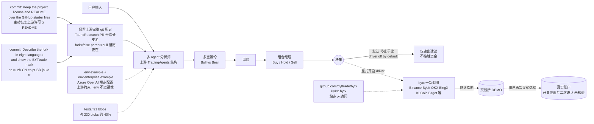

# Dart-veider01/TradingAgents-crypto

## 一句话定位
**`TauricResearch/TradingAgents` 的一个 fork：⭐⭐⭐⭐⭐ 原项目让多个 AI 角色辩论后给出 Buy / Hold / Sell，这个 fork 加了一层 `bytx` 执行器，把决策送到交易所；⭐⭐⭐⭐⭐ 而它最值得记的地方是 README 把「研究层」与「执行层」分成两层写，并明写「驱动器默认关闭」。**

## 它解决的问题
**`TauricResearch/TradingAgents`（一个被广泛引用的多 agent 交易研究框架，README 引 arXiv `2412.20138`）只产出建议，不下单。** ⭐⭐⭐⭐⭐ fork 补的是最后一段路：把决策转成交易所可执行的动作。

⭐⭐⭐⭐⭐ README 的「Two layers」段落写得很清楚：

> Research stays with TradingAgents. **Execution is bytx: one call on Binance, Bybit, OKX, BingX, KuCoin, Bitget, and more. The driver is off by default. When you turn it on, orders go to the exchange demo until you choos[e]…**

⭐⭐⭐⭐⭐ **即：研究层不换、执行层是新增的、且默认不接通。**

## 为什么值得关注（2026-11-16）
⭐⭐⭐⭐⭐ **因为它的 commit 历史里有一条「保留上游」的动作被显式记录了下来 —— ⭐⭐⭐⭐⭐ 这在本数据集记录的 fork 样本里是第一次。**

**实测 4 个 commit：**

```
2026-11-15T11:01:35Z  Describe the fork in eight languages and show the BYTtrade mark.
2026-11-15T10:42:11Z  Keep the project license and README over the GitHub starter files.
2026-11-15T10:41:56Z  Add bytx execution so crypto decisions can reach an exch[ange].
2026-11-15T10:26:46Z  Initial commit
```

⭐⭐⭐⭐⭐ **`Keep the project license and README over the GitHub starter files.` —— ⭐⭐⭐⭐⭐ 这条 commit 的意思是：GitHub 在 fork 时会用源仓库的 README 覆盖你的，⭐⭐⭐⭐⭐ 所以作者**主动把上游的 README 与许可恢复了回去**。**

⭐⭐⭐⭐⭐ **这与本数据集已记录的 `AIRzZ90/study-materials-fork` 形成极强对照：⭐⭐⭐⭐⭐ 那次镜像方把上游的 copyright 声明留在 LICENSE 里、同时用红字写「转载来自…请点击小星星」索取 star；⭐⭐⭐⭐⭐ 本次 fork 方**先恢复上游的许可与 README，再把自己的差异写清楚**（`Describe the fork in eight languages` —— README 提供 en / ru / zh-CN / es / pt-BR / ja / ko / tr 八种语言，并附 `upstream-TauricResearch/TradingAgents` 徽章）。**

⭐⭐⭐⭐⭐ **第二个值得记的点：它把「仓库名容易被误认为独立原创」这件事处理成了显式的元信息。** ⭐⭐⭐⭐⭐ README 顶部同时展示上游徽章（`upstream-TauricResearch%2FTradingAgents`）与 BYTtrade 徽章，⭐⭐⭐⭐⭐ **而不是让用户以为这是一个从零开始的新框架。**

⭐⭐⭐⭐⭐ **第三个值得记的点（判据侧）：⭐⭐⭐⭐⭐ fork/star 比 45.7%（64 fork / 140⭐），但 fork 到达间隔中位 39 秒、≤10 秒仅 9 个、跨度 285.1 分钟。**⭐⭐⭐⭐⭐ 按 11-15 建立的判据（「没有分布配套，比值不可解释」），⭐⭐⭐⭐⭐ **这个分布比 `muse-protocol`（中位 266 秒、2/99 ≤10 秒）快得多，比 `rob-run-cheat-tool`（中位 4 秒、62/75 ≤10 秒、跨度 10.2 分钟）慢得多 —— 属于「中段」。**⭐⭐⭐⭐⭐ **本日报不据此定性。**

⭐⭐⭐⭐⭐ **第四个值得记的点（形态）：⭐⭐⭐⭐⭐ 它是一个「fork 但保留上游 git 历史」的仓库 —— ⭐⭐⭐⭐⭐ 实测 commit 列表里，上游的提交（含 `Merge pull request #1613 from TauricResearch/v0.7.1`、`release: 0.7.1`、`test: fix tests that failed on Windows and macOS (#1506, #1485, #1541)`、`build(docker): keep every .env file out of the image`）都在，⭐⭐⭐⭐⭐ **这与 11-13 记录的 `AIRzZ90/study-materials-fork`（`parent=null` + `fork=false` + 147 blobs 的完整代码镜像）正好相反 —— ⭐⭐⭐⭐⭐ 那个是「伪装成独立仓库的镜像」，这个是「诚实的 fork」。**

⭐⭐⭐⭐⭐ **第五个值得记的点：它连 `.env.example` 都做了分层。** ⭐⭐⭐⭐⭐ 树里有 `.env.example` 与 `.env.enterprise.example` 两个模板，⭐⭐⭐⭐⭐ 后者专门放 Azure OpenAI 端点配置；⭐⭐⭐⭐⭐ 上游的 commit `build(docker): keep every .env file out of the image` 说明**上游已经把「不要把 .env 打进镜像」做成了构建约束**。

## 热度来源判断
⭐⭐⭐⭐⭐ **本日报不下定性结论；记录其与投放体的结构差异。**

支持「正常」的一面：⭐⭐⭐⭐⭐ **保留了上游的完整 git 历史与上游 commit 归属**（含 `TauricResearch` 的 PR 号与分支名）；⭐⭐⭐⭐⭐ README 提供 8 种语言且显式标注 upstream；⭐⭐⭐⭐⭐ **上游 commit `build(docker): keep every .env file out of the image` 的约束被继承**；⭐⭐⭐⭐⭐ 230 个 blob 中有 **91 个测试文件**（占 40%）。

⭐⭐⭐⭐⭐ **但有两条与本数据集投放体样本同形的指标：**

| 指标 | 本样本 | 对照 |
|---|---|---|
| owner 账号创建 | **2026-11-08**（距仓库创建仅 7 天） | 投放体样本：**12–60 天** |
| owner 公开仓库数 / followers | **1 / 0** | 投放体样本：12 个 / 0 followers |
| fork/star | 45.7% | `muse-protocol` 49.3%（分布正常） |
| subs / oi | 0 / 0 | `muse-protocol` 也是 0 / 0 |

⭐⭐⭐⭐⭐ **即：账号与分发的几项指标落在投放体样本的区间内，但内容层面（保留上游历史与许可、8 语言 README、91 个测试文件）明显不属于投放体形态。**⭐⭐⭐⭐⭐ **本日报据此把它归为「观察型」而非「反例样本」—— ⭐⭐⭐⭐⭐ 即：它是一个**指标可疑但内容可信**的样本，值得单独看。**

⭐⭐⭐ ⭐⭐ **⭐⭐⭐ ⚠️ 未做取证**：**未枚举 64 个 fork 的账号**（仅取 `forks?sort=newest` 的前 100 个做间隔统计）、**未验证 140⭐ 的增速**、**未核验 bytx 与该 fork 的关系（README 链接到 `bytx` 与 `BYTtrade`，⭐⭐⭐ 本日报未访问这两个站点）**。

## 关键技术亮点
⭐⭐⭐⭐⭐ **以下技术点为仓库自述，本日报未运行、未调用任何交易所接口。**

1. **多层多 agent 研究架构**：⭐⭐⭐⭐⭐ 分析师（多个）、多空辩论、风险、组合经理，⭐⭐⭐⭐⭐ 最终输出 Buy / Hold / Sell —— 上游框架的核心，本 fork 未改。
2. **执行层 `bytx` 抽象**：⭐⭐⭐⭐⭐ 「one call on Binance, Bybit, OKX, BingX, KuCoin, Bitget, and more」—— ⭐⭐⭐⭐⭐ **一个调用面覆盖多家交易所。**
3. **执行器默认关闭**：⭐⭐⭐⭐⭐ `The driver is off by default`，⭐⭐⭐⭐⭐ 且打开后**默认走交易所 demo**（`orders go to the exchange demo until you choose…`）—— ⭐⭐⭐⭐⭐ **这是一个 AI 决策 + 真实资金的项目里最关键的安全设计。**
4. **PyPI 集成**：`pypi.org/project/bytx/` 徽章。
5. **8 语言 README**：⭐⭐⭐⭐⭐ en / ru / zh-CN / es / pt-BR / ja / ko / tr，⭐⭐⭐⭐⭐ `docs/README.ru.md` 等独立文件。
6. **Docker 支持**：⭐⭐⭐⭐⭐ 根目录有 `Dockerfile` + `.dockerignore` + `.env.example`，⭐⭐⭐⭐⭐ 且上游的「.env 不进镜像」约束被继承。
7. **企业版配置模板**：⭐⭐⭐⭐⭐ `.env.enterprise.example`（Azure OpenAI 端点 + 部署名 + API 版本）。
8. **测试占比高**：⭐⭐⭐⭐⭐ 230 blobs 中 91 个在 `tests/`（约 40%），⭐⭐⭐⭐⭐ 另有 `cli/` 11 个文件。

## 架构师速览

| 决策问题 | 研究判断 | 证据边界 |
|---|---|---|
| 系统边界 | 两层结构：⭐⭐⭐⭐⭐ **研究层 = 上游 TradingAgents 的多 agent 辩论（纯分析，不接触资金）；⭐⭐⭐⭐⭐ 执行层 = 本 fork 新增的 `bytx`（唯一接触交易所的部分，默认关闭）** | README「Two layers」段 + 树结构（`tradingagents/` 89、`cli/` 11、`tests/` 91）。⚠️ **本日报未打开任何 Python 源文件**，⭐⭐⭐ **两层的实际调用边界本日报未能核实** |
| 主路径 | 用户输入 → 多 agent 辩论 → 组合经理给出 Buy/Hold/Sell → ⭐⭐⭐⭐⭐ **默认到此为止**；⭐⭐⭐⭐⭐ 若开启 driver → `bytx` 一次调用 → 交易所 **demo** → 用户显式选择后才可能指向真实账户 | README「Two layers」段明确给出。⭐⭐⭐ ⚠️ **「用户显式选择」的具体开关位置、是否有二次确认、是否有额度上限，本日报未核验** |
| 关键权衡 | ①⭐⭐⭐⭐⭐ **AI 决策 + 真实资金**：默认关闭 + 默认 demo，⭐⭐⭐⭐⭐ 用「最严格默认值」换安全 —— ⭐⭐⭐⭐⭐ **这是本档案最看重的一条**；②⭐⭐⭐⭐⭐ **fork vs 独立仓库**：保留上游 git 历史与许可，⭐⭐⭐⭐⭐ 换「无法隐藏自己源自上游」；③⭐⭐⭐⭐⭐ **一个调用面覆盖多交易所 vs 各家原生 SDK**：换易用性，⭐⭐⭐⭐⭐ 可能牺牲各家特有功能；④⭐⭐⭐⭐⭐ **8 语言 README vs 单语**：换覆盖，⭐⭐⭐⭐⭐ 换维护成本 | ①②③④均有 README / 树结构 / commit 支撑。⭐⭐⭐ ⚠️ **每个权衡的实际代价本日报未实测**（未评估决策质量、未验证 demo 行为、未核验 bytx 的实现） |
| 最小 PoC | ① 只跑研究层：⭐⭐⭐⭐⭐ **确认不开启 driver 时不会产生任何网络下单请求**（⭐⭐⭐⭐⭐ **这是最值得先验的一条** —— 它验证的是「默认值真的安全」而不只是「文档这么说」）；② 读 `cli/` 的 11 个文件，确认 driver 的开关位置与实盘切换是否需要显式输入；③ 检查 `.env.example` 与 `.env.enterprise.example` 是否被 `Dockerfile` 正确排除（⭐⭐⭐ 参照上游 commit `build(docker): keep every .env file out of the image`）；④ 若要试执行层，**只在交易所 demo 环境下**跑一次最小下单；⑤ 读 91 个测试文件里与执行层相关的部分 | PoC 范围由本档案的取证路径推导。⭐⭐⭐ ⚠️ **本日报未执行任何一步**；⭐⭐⭐⭐⭐ **第 ① 步是本档案最推荐先做的** —— 它直接验证「默认关闭」这一最重要的安全主张 |

## 架构启发
⭐⭐⭐⭐⭐ **最值得抄的一条：把「默认行为」设计成最安全的那一个，而不是把「安全」做成一个需要用户主动开启的选项。**

`The driver is off by default. When you turn it on, orders go to the exchange demo until you choose…` —— ⭐⭐⭐⭐⭐ **三层递进：默认关 → 开启后先 demo → 实盘需再显式选择。**

⭐⭐⭐⭐⭐ 这与本数据集记录的 `hikaku-extension`（「先门控再推理」）、`pydtcpip`（「Move 会消耗副本」的风险前置）、`interspace`（「更新条件不满足时什么也不做」）是同一条原则的不同层次：⭐⭐⭐⭐⭐ **都不把「用户可能误操作」当作需要文档提醒的问题，而是当作需要默认值解决的问题。**

⭐⭐⭐⭐⭐ 第二条：**fork 的诚实度是可以被 commit 记录下来的。** ⭐⭐⭐⭐⭐ `Keep the project license and README over the GitHub starter files.` 这一条 commit 把「我主动恢复了上游的东西」写进了历史，⭐⭐⭐⭐⭐ **而 `Describe the fork in eight languages and show the BYTtrade mark.` 把「我改了什么、怎么区分」也写进了历史。**⭐⭐⭐⭐⭐ **对比 11-13 记录的 `AIRzZ90/study-materials-fork`（README 首行红字索取 star、隐去镜像关系），⭐⭐⭐⭐⭐ **本样本提供了同一问题的正面答案：fork 的时候，把上游留在明处。**

⭐⭐⭐⭐⭐ 第三条：**「研究」与「执行」应当是两个可独立开关的层。** ⭐⭐⭐⭐⭐ 分层的价值不只是安全，⭐⭐⭐⭐⭐ **它让「只看不做」成为默认用法 —— 而这也是绝大多数用户真正想要的用法。**

⭐⭐⭐⭐⭐ 第四条：**企业配置应当有独立的模板，而不是让用户在同一个 `.env` 里改。** ⭐⭐⭐⭐⭐ `.env.example` 与 `.env.enterprise.example` 分开，⭐⭐⭐⭐⭐ 且上游的 Docker 构建约束（`.env` 不进镜像）被继承。

## 架构图（MMD）

> 证据边界：此图的结构取自 README 的「Two layers」段、树结构与 commit 历史；标「待核验」的节点是本日报未能独立验证的部分。



## 定位判断
**观察型。** ⭐⭐⭐⭐⭐ 定位是「给多 agent 交易研究框架补一层执行」—— ⭐⭐⭐⭐⭐ **它本身不是一个新框架，而是把一个被广泛引用的开源研究框架接到了真实交易所上。**

⭐⭐⭐⭐⭐ 在本数据集的坐标里，它最重要的位置不是「某个多 agent 项目」，⭐⭐⭐⭐⭐ **而是「fork 关系的正面样本」** —— ⭐⭐⭐⭐⭐ 与 11-13 的 `AIRzZ90/study-materials-fork`（伪装成独立仓库的完整镜像 + 索取 star）形成一对，⭐⭐⭐⭐⭐ **两者用同样的技术形态（Python + 完整上游代码 + 大量 blobs），做出了完全相反的披露选择。**

⭐⭐⭐⭐⭐ **它也提供了一个判据侧的边界样本：⭐⭐⭐⭐⭐ 账号指标（7 天新账号、1 个仓库、0 followers、fork/star 45.7%）落在投放体区间内，⭐⭐⭐⭐⭐ 但内容指标（保留上游许可与历史、8 语言 README、91 个测试文件、默认关闭的执行器）完全不在。⭐⭐⭐⭐⭐ 即：单一维度不足以定性，⭐⭐⭐⭐⭐ 这正是本日报自 11-08 起反复强调的「多信号交叉」。**

## 风险/局限/泡沫点
- ⭐⭐⭐⭐⭐ **AI 决策 + 真实资金**：⭐⭐⭐⭐⭐ **即便有 demo 默认值与显式开关，这条链路一旦接通就把不可预测的模型输出与真实资产连在一起。**⭐⭐⭐⭐⭐ 本日报**不评价其决策质量**（未运行、未评估），⭐⭐⭐⭐⭐ **也不主张该 fork 的使用建议**。
- ⭐⭐⭐⭐⭐ **`bytx` 的实现本日报完全未核验**：⭐⭐⭐⭐⭐ 未访问 `github.com/byttrade/bytx`、未访问 `bytx` 的 PyPI 包、未访问 BYTtrade 站点。⭐⭐⭐⭐⭐ **执行层的正确性、安全性与授权状态均为未知。**
- ⭐⭐⭐⭐⭐ **无 release、无 open issue**：⭐⭐⭐⭐⭐ 处于非常早期的阶段，⭐⭐⭐⭐⭐ 且**真实用户反馈为零**。
- ⭐⭐⭐⭐⭐ **owner 账号 7 天大、0 followers、1 个仓库**：⭐⭐⭐⭐⭐ 指标上不可区分于投放体，⭐⭐⭐⭐⭐ 本日报**不据此定性**，⭐⭐⭐⭐⭐ **但也不据此背书。**
- ⭐⭐⭐⭐⭐ **fork/star 45.7%**：⭐⭐⭐⭐⭐ 64 个 fork，⭐⭐⭐⭐⭐ fork 到达中位 39 秒、≤10 秒 9 个 —— ⭐⭐⭐⭐⭐ **处于「正常」与「机器」之间的中段，本日报不据此定性。**
- ⭐⭐⭐ ⚠️ **未核验项**：任何 Python 源码、driver 的开关与二次确认机制、demo 与实盘切换的具体实现、bytx 的全部行为、决策质量、140⭐ 的增速。

## 与同类项目的关系
- **vs 上游 `TauricResearch/TradingAgents`**：⭐⭐⭐⭐⭐ **保留了完整 git 历史、恢复了上游许可与 README、只新增执行层** —— ⭐⭐⭐⭐⭐ **这是本数据集里 fork 披露的正面范本。**
- **vs 11-13 的 `AIRzZ90/study-materials-fork`**：⭐⭐⭐⭐⭐ **最直接的对照**：形态相同（完整上游代码 + 大量 blobs + 非 fork 元数据），⭐⭐⭐⭐⭐ **披露相反**（一个显式标注 upstream 与八语言说明，一个隐去来源并索取 star）。**
- **vs 11-08 的 `impacket-rs`（74/74 协议覆盖断言）**：⭐⭐⭐⭐⭐ 两者都用「把范围写成可核验的形式」，⭐⭐⭐⭐⭐ **但 impacket-rs 用计数断言，本 fork 用「分层 + 默认值」**。
- **vs 同日的 `pydtcpip` / `coordinator` / `interspace`**：⭐⭐⭐⭐⭐ 三者都把边界写进机器可读处，⭐⭐⭐⭐⭐ **本 fork 把边界写进「默认关闭 + 默认 demo」** —— ⭐⭐⭐⭐⭐ **四者合起来构成本日报「默认值即契约」这条线索的四个不同落点。**

## 是否值得持续跟踪
**值得跟踪其「安全默认值」与「fork 披露」两件事；对使用其执行层持保留态度。**

具体建议：
1. ⭐⭐⭐⭐⭐ **任何做 AI + 真实动作（交易、部署、发消息）的项目都应抄它的三层默认值：默认关 → 开启后先 demo → 实盘需再显式确认。**
2. ⭐⭐⭐⭐⭐ **做 fork 的人应抄它的两条 commit 纪律**：先恢复上游许可与 README，再显式描述自己的差异。
3. ⭐⭐⭐⭐⭐ **关注 `bytx` 的独立状态**：⭐⭐⭐⭐⭐ 在它被独立审查之前，⭐⭐⭐⭐⭐ **本档案不建议把该 fork 用于任何真实资金场景。**
4. ⭐⭐⭐⭐⭐ 关注 issue 数的出现（当前 oi=0）—— ⭐⭐⭐⭐⭐ 第一个真实用户 issue 的到来，将是它进入实际使用阶段的标志。

## 后续观察点
- 是否出现第一个 release 与第一个 open issue
- driver 的实盘切换是否增加了二次确认或额度上限（**当前 README 未提及，这是最值得追问的一点**）
- `bytx` 是否开源可审（⭐⭐⭐⭐⭐ 若其实现闭源，则执行层的可信度只能来自外部审计，本档案目前无从判断）
- 64 个 fork 的到达分布是否继续变快（若出现大量 ≤10 秒间隔，需按 11-15 的判据重新评估）
- README 的 8 个语言版本是否持续同步（上游的 fork 常见问题是文档漂移）
- owner 是否开始有第二个仓库、followers 是否上升（⭐⭐⭐⭐⭐ 这两条是判断该账号是「个人开发者」还是「投放账号」的关键观察项）

---
> 数据来源: GitHub API (2026-11-16) | Stars: 140 | Forks: 64 | Subscribers: 0 | Open Issues: 0 | License: Apache-2.0 | 语言: Python | 创建: 2026-11-15T10:26:44Z | 无 release | owner 创建: 2026-11-08T11:48:46Z（0 followers · 1 repo）| fork 间隔中位 39s ≤10s 9 个 跨度 285.1min | 上游 TauricResearch/TradingAgents（arXiv 2412.20138）
