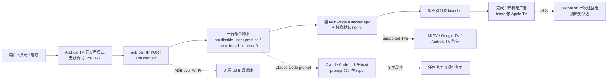

# Gathin23/tv-vibehack

## 一句话定位
Gathin23 个人 2026-10-17 发布的「**Android TV / Google TV 系统级去广告 + 替换 launcher**」严肃工程化实现：**ADB over Wi-Fi + 一行命令 + 不 root + 不卸载 + tvOS-inspired launcher + one-line restore + Claude Code 一下午搞定 Mi TV + prompt 公开在 repo**——给父母/客厅电视去广告的「agent 时代严肃工程化剧本」。

## 它解决的问题
2025-2026 Android TV / Google TV 阵营（小米 Mi TV / TCL / 海信 / 索尼等）开机广告 + 推荐流广告 + 不可卸载系统应用三大痛点：
- **开机广告**：厂商开机 5-15 秒强制广告，无法跳过
- **推荐流广告**：home screen 大量 sponsored 推荐位
- **不可卸载系统应用**：原生 launcher / 视频平台 / 游戏中心等无法用常规方式卸载
传统方案要么 root（破坏售后）、要么 ADB + pm uninstall（恢复出厂后失效）、要么商业远程工具（收费且闭源）。tv-vibehack 直击——**ADB over Wi-Fi + pm disable-user + pm hide + pm uninstall -k --user 0 + tvOS-inspired 自研 launcher + one-line restore.sh**，且**不 root + 不卸载 + 可恢复 + Claude Code 一下午 + prompt 公开**——这是 2026-Q4 严肃工程化「**消费者设备 OS 治理 + agent 写就 + prompt 公开**」的代表样本。

## 为什么值得关注（2026-10-19）
今日观察窗为 GitHub Search API 抓取时刻起、且截至 2026-10-19 仍在快速增长的新发现项目。`Gathin23/tv-vibehack` 2 天 1739⭐ ⑂206 fork/star 11.8%——1739⭐ 在 2 天是异常高的「**消费者设备 OS 治理**」信号（fork 11.8% 远高于一般 2-5% 平均，反映大量「**想给父母/客厅电视去广告**」的真实需求）。**ADB over Wi-Fi + 不 root + 不卸载 + one-line restore + Claude Code 一下午 + prompt 公开**六要素共振，**让客厅设备治理大众可及**。

## 热度来源判断
tv-vibehack 的热度是「**Android TV 开机广告刚需 + Claude Code 一下午 + prompt 公开 + 不 root 不卸载 + 一行命令 + tvOS-style launcher + 父母/客厅场景**」八要素共振：
- **Android TV 开机广告刚需**：小米/TCL/海信等品牌强制开机广告，痛点真实
- **Claude Code 一下午 + prompt 公开**：从 Mi TV 父母场景出发，**整个工程化全过程作为可复用剧本**
- **不 root 不卸载**：保留官方 launcher / 系统应用，**保售后**
- **ADB over Wi-Fi**：无 USB 调试线，对客厅电视友好
- **one-line restore**：restore.sh 一次性回退到原始状态
- **tvOS-inspired launcher**：自研或开源 launcher 二次开发，**看起来像 Apple TV**
- **公开 Claude Code prompt**：README 明示「the prompt that did it is in this repo」——把工程化全过程作为可复用剧本
- **topics：adb / android-tv / claude-code / debloat / launcher / xiaomi**

热度**真实且具消费者大规模可及性**——1739⭐ + 206 fork + 11.8% fork 比例 + Mi TV 父母 use case 是真实需求信号。

## 关键技术亮点
1. **ADB over Wi-Fi**：adb pair IP:PORT + adb connect，无 USB 调试线，对客厅电视友好
2. **pm disable-user -k --user 0**：保留系统应用包但禁用，可恢复，对售后友好
3. **pm uninstall -k --user 0**：可选卸载用户层应用，保留缓存（-k）可恢复
4. **tvOS-inspired launcher**：自研或开源 launcher 二次开发，**看起来像 Apple TV** 而不是 Material Design
5. **one-line restore**：restore.sh 一次性回退到原始状态
6. **公开 Claude Code prompt**：README 明示「the prompt that did it is in this repo」——把工程化全过程作为可复用剧本
7. **supported TVs 列表**：Mi TV / Google TV / Android TV 阵营
8. **docs/stock-vs-new-side.jpg before/after**：可视化对比原始 vs 去广告后效果

## 架构师速览

| 决策问题 | 研究判断 | 证据边界 |
|---|---|---|
| 系统边界 | ADB over Wi-Fi（adb pair / adb connect）+ pm disable-user / pm hide / pm uninstall -k --user 0 + launcher apk 替换 home + restore.sh 一次性回退 + Claude Code prompt 公开 | 基于 README「Quick start」+「Doing it by hand」+「The launcher」+ topics（adb / android-tv / claude-code / debloat / launcher / xiaomi） |
| 主路径 | 用户执行一行命令 → ADB pair IP:PORT + connect → pm disable-user -k --user 0 <bloat 包名> → 装 launcher apk + 替换默认 home → 设置永不退到原 launcher → restore.sh 回退 | 主路径由 README 段落 + topics 推导；具体 launcher apk 名字 + 调试可见性 + 远程固件 OTA 后是否需重做待核验 |
| 关键权衡 | ADB over Wi-Fi（无 USB 调试）vs 安全开关需手动开 / pm disable-user（可恢复）vs pm uninstall -k --user 0（可恢复）vs 真 root 卸 / 不 root（保售后）vs root 干净 / 公开 Claude Code prompt vs 私藏 / tvOS launcher 自研 vs 开源 launcher 二次开发 | 档案明示不 root + 不卸载 + ADB over Wi-Fi + 一行命令 + tvOS-style launcher + one-line restore 六点权衡；具体 launcher UI 实现 + 长期 OTA 兼容性未公开 |
| 最小 PoC | 1. Android TV 开启开发者模式 + 无线调试 → 2. 手机端 adb pair IP:PORT → 3. 一行命令执行去广告脚本 → 4. 切换 tvOS-style launcher → 5. 试 restore.sh 回退到原始 | PoC 由 README Quick start 段 + supported TVs 列表推导；具体 launcher 演示 GIF / 兼容性矩阵 / OTA 后重做命令待核验 |

## 架构启发
tv-vibehack 的核心启发是「**消费者设备 OS 治理 = ADB over Wi-Fi + 不 root 不卸载 + 一行命令 + 可恢复 + prompt 公开**」五要素。与某些「**root + 卸 + 折腾 + 售后无**」的旧方案对比，**保售后 + 可恢复 + 一行命令 + 大众可及**完整一个量级。更深层的启发是：**Claude Code prompt 公开 = agent 工作流可复用剧本**——从「**一个 Mi TV 父母场景的解决方案**」到「**任何客厅电视的解决方案**」，README 把整个工程化全过程作为可复用剧本公开，这意味着任何想给父母/岳父母/客厅电视去广告的人，**不需要懂 Android 内部机理**，只需要执行一行命令 + 告诉他「**想还原就再执行一行**」。

## 架构图（MMD）

> 证据边界：此图只采用本档案已有可核验描述；"待核验"节点不应视为项目实现事实。

## 定位判断
**工具型项目（消费者设备 OS 治理 + agent 写就 + prompt 公开）。** tv-vibehack 不仅是去广告工具，更是「**agent 时代客厅设备治理的开源剧本**」——把 Claude Code 一下午搞定 Mi TV 父母场景的工程化方案**作为可复用剧本公开**。与某些「**root + 卸 + 折腾 + 售后无**」的旧方案对比，**保售后 + 可恢复 + 一行命令 + 大众可及**完整一个量级。在生态中的位置类似「**agent 时代去广告领域的 Debian**」——开源、严肃工程化、agent 写就、prompt 公开。

## 风险 / 局限 / 泡沫点
- **NOASSERTION license**：LICENSE 文件未明确，可能限制商用 fork 与二次分发，对严肃工程化生态不利
- **4880 KB 中包含 launcher apk**：size 偏大，可能含二进制依赖，git clone 较慢
- **OTA 后可能需重做**：Android TV 系统升级可能恢复原 launcher / 重新启用 bloat 应用，README 未明示自动化应对
- **adb pair IP:PORT 流程**：需手动进 TV 设置→开发者模式→无线调试，需一定动手能力
- **2 天 1739⭐ 早期信号**：Mi TV 父母用例广，但跨品牌（Sony / Samsung / LG 等）适配可能踩坑
- **launcher apk 来源**：自研 vs 开源 launcher 二次开发，README 未明示具体技术栈
- **单一作者**：Gathin23 个人维护，长期维护可持续性待观察

## 与同类项目的关系
- **vs 商业去广告工具（如当贝 / 乐家盒子）**：商业工具收费 + 闭源 + 远程控制，tv-vibehack 开源 + 不 root + 一行命令 + 可恢复
- **vs 通用 ADB 工具箱（如甲壳虫 ADB 助手）**：通用工具需用户手动选包名，tv-vibehack 预置 Mi TV 父母场景最佳实践
- **vs 各种 tvLauncher**（如 ATV Launcher / Wolf Launcher）：tvLauncher 仅替换 home，但不去广告；tv-vibehack 同时去广告 + 替换 launcher + 公开 prompt
- **vs Android TV 官方去广告设置**：官方仅关推荐流广告，**无法关开机广告**；tv-vibehack 通过 pm disable-user 关开机广告
- **vs Claude Code 其他 agent 应用**：Claude Code 之前用于反向工程（leanrea）/ 视频（huashu-motion）/ 游戏（coop-anything）/ 渲染（web-ocean），tv-vibehack 是**首次严肃工程化应用在消费者设备 OS 治理**

## 是否值得持续跟踪
**值得跟踪（消费者设备 OS 治理 + agent 时代严肃工程化）。** tv-vibehack 是 2026-Q4 严肃工程化「**消费者设备 OS 治理 + agent 写就 + prompt 公开**」的代表样本。**保售后 + 可恢复 + 一行命令 + 大众可及**三件套使「**给父母/客厅电视去广告**」从极客操作变为大众可及。建议关注：跨品牌 OTA 后兼容性 + launcher apk 来源 + 公开 Claude Code prompt 的具体内容 + 长期维护可持续性。对想给父母/岳父母/客厅电视去广告的人，这个仓库是 2026-Q4 严肃工程化首选。

## 后续观察点
- 跨品牌 OTA 后兼容性（Sony / Samsung / LG / TCL 等）
- launcher apk 来源（自研 vs 开源 launcher 二次开发）
- 公开 Claude Code prompt 的具体内容（在哪个文件）
- 长期维护可持续性（单一作者风险）
- 是否推出 Android TV 之外的车载系统 / 智能音箱治理
- 是否与「**agent + 消费者设备**」领域其他项目（如 leanrea / coop-anything）形成生态联动

---
> 数据来源: GitHub API (2026-10-19) | Stars: 1739 | Forks: 206 | License: NOASSERTION | 语言: Java | 创建: 2026-10-17 | Size: 4880 KB | Topics: adb, android-tv, claude-code, debloat, launcher, xiaomi