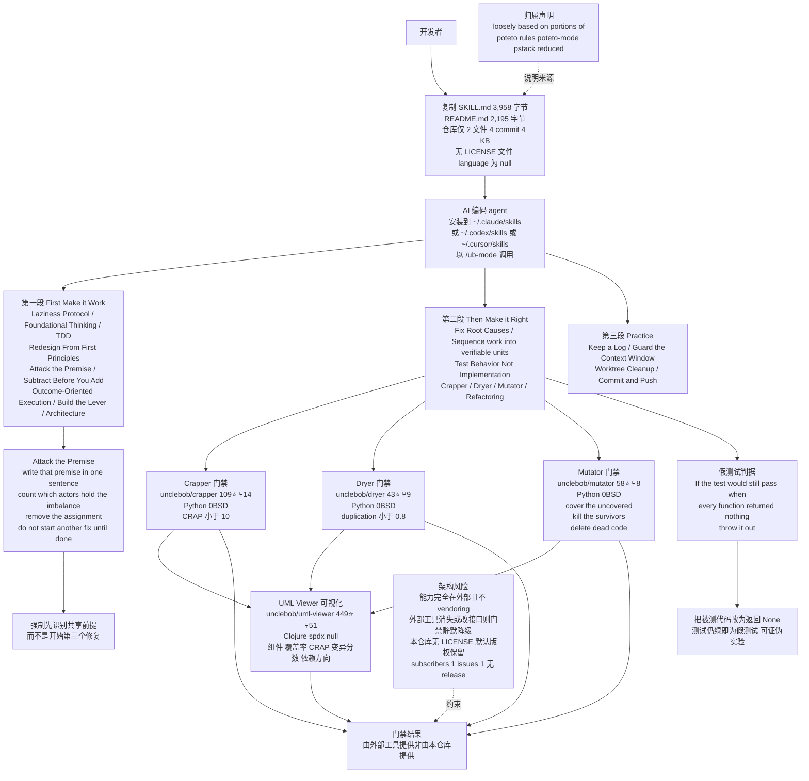

# unclebob/ub-mode

## 一句话定位
一份把软件工程原则**绑定到四个能真的拒绝你的工具**上的 agent skill——它自己只有 4 KB、2 个文件、4 个 commit，而真正的门禁能力在 `crapper` / `dryer` / `mutator` / `uml-viewer` 四个独立仓库里。

## 它解决的问题
**AI 编码 agent 的失效模式不是「不会写代码」，而是「写出一堆看起来合理、但实际上什么都没验证的代码」。**

具体表现：一个函数返回 `None`，测试仍然通过；两段逻辑重复的代码被复制粘贴；圈复杂度 47 的函数里藏着三个早退分支；变异测试显示你的断言根本不区分实现变更。

**⭐ 而「写一份 AGENTS.md 说要有测试」显然不管用——因为规则没有强制力。** 这个项目的核心主张就是：**原则必须绑定到一个能真的拒绝你的工具上。**

## 为什么值得关注（2026-10-26）
**⭐⭐⭐ 因为它是本日唯一一个「原则文档 + 可执行门禁」成对出现的样本，而且门禁是真实的、独立的、有 star 数的公开仓库。**

可核验的硬事实：

1. **⭐⭐⭐ 四条原则各自绑定到一个独立的、真实存在的工具仓库**（README 的表格原样列出）：

   | 工具 | 仓库 | star / fork | 语言 / 许可 | 判据 |
   |---|---|---|---|---|
   | `crapper` | `unclebob/crapper` | 109⭐ ⑂14 | Python / **0BSD** | 圈复杂度 + 覆盖率 → **CRAP < 10** |
   | `dryer` | `unclebob/dryer` | 43⭐ ⑂9 | Python / **0BSD** | 结构重复度 → **≥ 0.8 即消除** |
   | `mutator` | `unclebob/mutator` | 58⭐ ⑂8 | Python / **0BSD** | 变异测试：覆盖未覆盖、杀死存活变异体、删除死代码 |
   | `uml-viewer` | `unclebob/uml-viewer` | 449⭐ ⑂51 | Clojure / spdx null | 可视化组件、覆盖率、CRAP、变异分数与依赖方向 |

2. **⭐⭐⭐ README 明确说它「relies on deterministic quality-gate tools to enforce structure, complexity, duplication, and test thoroughness」**——即**它自己不做判定，它把判定外包出去。**
3. **⭐⭐⭐ `SKILL.md` 里最锋利的一条判据是可执行的**：「Test Behavior, Not Implementation —— The test calls the code the way its user does and checks the result that user would see. **If the test would still pass when every function returned nothing, throw it out.**」
4. **⭐⭐⭐ 而本日报认为最有迁移价值的是 `Attack the Premise` 这一条**：「When two fixes that share one premise fail the same gate, write that premise in one sentence and count which actors hold the imbalance. Remove the assignment. **Do not start another fix until you have done that.**」
5. **⭐⭐⭐ 而它的作者身份与它的仓库体量形成鲜明对照**：`unclebob` 账号创建于 **2008-11-27**，**106 个公开仓库**，**17,434 followers**。

## 热度来源判断
**⭐⭐⭐ 热度主要来自作者身份，而仓库体量说明它是一个「指针」而非「实现」——必须把这两件事分开记录。**

- **⭐⭐⭐ 最可核验的解释是作者的关注度**：`unclebob`（Robert C. Martin / Uncle Bob）有 **17,434 followers**、106 个公开仓库、18 年账号历史。**341⭐ 在 6.5 小时内获得，与 17k followers 的规模是相称的。** **这是身份驱动的注意力，而非工具被大规模采用的证据。**
- **⭐⭐ 硬证据反证「采用」**：**subscribers_count = 1**、open issues = 1、**contributors API 返回 1 人**、**`releases` API 返回 0 个**、topics 为空数组、**仓库仅 4 KB / 2 个文件 / 4 个 commit**。**⭐ 即 341⭐ 的背后几乎没有人在「订阅」或「使用」它。**
- **⭐⭐⭐ 而这与它的四个伴随工具形成对比**：`crapper` 109⭐ ⑂14、`dryer` 43⭐ ⑂9、`mutator` 58⭐ ⑂8 —— **这三个才是真正承载能力的仓库，而它们的 star 数全部低于 ub-mode。** **⭐⭐ 这说明本项目自己也知道「分发指针」不需要大工程量——4 KB 是设计选择，不是缺陷。**
- **⭐⭐⭐⭐ 而 fork/star 4.7%（16/332）是本日一批新项目里最低的一档（对比 `ZiChuanLan/agent-purge` 的 128.6%）。** **⭐ 这与「用户 fork 去改写一份 skill 文本」的典型模式不同——**它更像是一个「被读、被抄、被引用」的对象**，而不是一个「被分叉改造」的对象。**
- **⭐ 而它主动声明了来源**：「loosely based on portions of @poteto's rules (poteto-mode / pstack), **reduced**」。**⭐ 即它不是凭空原创，而是他人规则集的删减版——这是本日报见到的少见的、主动的归属声明。**

## 关键技术亮点

1. **⭐⭐⭐ 三段式结构：先能跑，再正确，再练习**
   `SKILL.md`（3,958 字节）的结构非常清晰：
   - **First Make it Work**：Laziness Protocol / Foundational Thinking / TDD / Redesign From First Principles / **Attack the Premise** / Subtract Before You Add / Outcome-Oriented Execution / Build the Lever / Architecture
   - **Then Make it Right**：Fix Root Causes / Sequence work into verifiable units / Test Behavior Not Implementation / **Crapper** / **Dryer** / **Mutator** / Refactoring
   - **Practice**：Keep a Log / Guard the Context Window / Worktree Cleanup / Commit and Push

   **⭐ 而这个顺序本身就是一条主张：先让它跑起来，再让它正确——而不是一开始就追求正确。**

2. **⭐⭐⭐ 判据是数字，不是形容词**
   - **CRAP < 10**（`crapper`）：圈复杂度与覆盖率的组合指标
   - **duplication < 0.8**（`dryer`）：结构重复度阈值
   - **变异测试**（`mutator`）：「cover the uncovered, kill the survivors, delete dead code」
   **⭐ 三条全部可由工具机械判定——这是「原则」与「门禁」之间的桥。**

3. **⭐⭐⭐ 「假测试」的可操作判据**
   > **If the test would still pass when every function returned nothing, throw it out.**

   **⭐⭐ 这条判据的价值在于它可以被执行**：把被测代码全部改成返回 `None`，跑测试，如果还绿 → 这个测试是假的。**⭐ 这是一个可以机械化的证伪方法，而不是一条需要人来遵守的纪律。**

4. **⭐⭐⭐ `Attack the Premise` —— 本日报认为最具迁移价值的一条**
   > **When two fixes that share one premise fail the same gate, write that premise in one sentence and count which actors hold the imbalance. Remove the assignment. Do not start another fix until you have done that.**

   **⭐⭐⭐ 三个动词构成了完整的流程：write（把前提写成一句话）→ count（统计谁持有这个不平衡）→ remove（移除这个分配）→ and only then（在此之前不要开始第三个修复）。**
   **⭐⭐⭐ 而它命中的是一个非常具体的现实：今天有 17 个仓库共享同一个结构模板、3 个仓库共享同一个 CVE、2 个 Android 项目共享同一个「设备操作纪律」——**当多个修复共享同一个前提而都卡在同一个检查上时，正确的动作是先识别前提，而不是开始第三个修复。**

5. **⭐⭐ `Subtract Before You Add` 与 `Fix Root Causes`**
   这两条与 `Attack the Premise` 同族：**它们都指向「先减少」而非「先增加」**——这与本日报记录的 brotli-checker「不发送畸形流」和 KohakUnlock「默认禁用执行」是同一条工程直觉的不同表述。

6. **⭐⭐ `Guard the Context Window`**
   这是一条针对 AI agent 特有的实践：上下文窗口是稀缺资源，需要主动管理。**⭐ 这印证了本日报的推断——这些规则集是写给 AI 编码 agent 用的。**

7. **⭐⭐ 它把四个工具的调用也写进了流程**
   README 与 `SKILL.md` 提到 `crapper` / `dryer` / `mutator` 三个工具，并有 `uml-viewer` 用于可视化。**⭐ 本日报未核验 SKILL.md 是否真的在流程里**调用**它们（而非仅列出名字）——这是本档案最关键的待观察项。**

8. **⭐⭐ 4 个 commit 的完整轨迹可核验**
   `16:04:08` 初始提交 → `16:05:10` 文档 → `16:07:11` 标注来源（poteto）→ `16:07:58` 移除 Clojure 引用。**⭐ 即最后一个 commit 是删掉了一个引用（`uml-viewer` 是 Clojure），而 `uml-viewer` 仍然留在 README 的工具表里——这暗示作者有意不把 Clojure 作为前置依赖。**

## 架构师速览

| 决策问题 | 研究判断 | 证据边界 |
|---|---|---|
| 系统边界 | **本项目没有运行时**——仓库只有 `README.md`（2,195 B）与 `SKILL.md`（3,958 B）两个文件，无语言字段（`language` 为 null），无 `LICENSE`。**真正的执行边界落在四个独立的外部工具仓库里**：`crapper` / `dryer` / `mutator`（Python / 0BSD）承担判定，`uml-viewer`（Clojure / spdx null）承担可视化。**边界划在「原则不自动执行，判据由外部工具提供」**——**⭐ 而这个边界的代价是本档案反复强调的：能力完全在外部，且不 vendoring**。**另一个边界是「无 LICENSE」**：即默认版权保留，他人不可安全复用 | 仓库仅 2 个文件、4 个 commit、4 KB；四个伴随工具的 API 元数据（star/fork/language/license）；README 的 Installation 节与 SKILL.md 三段结构。**⭐ SKILL.md 是否真的调用那三个工具（而非仅列出名字）本窗口未核验——这是本档案最关键的待核验项** |
| 主路径 | 用户把 `SKILL.md` 复制到 agent 的 skills 目录（README 给出 `~/.claude/skills/` / `~/.codex/skills/` / `~/.cursor/skills/` 三条路径）→ 在 agent 里用 `/ub-mode` 调用 → agent 按 SKILL.md 的三段流程工作 → **实际的门禁由 `crapper` / `dryer` / `mutator` 三个独立工具承担**（用户需自行安装并运行这三个 CLI）→ 需要看全局结构时用 `uml-viewer` 可视化组件、覆盖率、CRAP、变异分数与依赖方向 | README 的 Installation 节（三个 skills 目录路径）与工具表、`SKILL.md` 的 Practice 段「Commit and Push」。**⭐ 「三工具是否被 skill 自动调用」未核验；「uml-viewer 如何被调用」未核验；四个工具的安装方式本窗口未核验** |
| 关键权衡 | **⭐ 写一份原则文档 vs 原则 + 工具**（选择后者——**代价是用户要装三个独立的 Python 工具，且它们各自的维护节奏与 ub-mode 不一致**）· **⭐ 门禁内建 vs 门禁外包**（把判定外包到独立仓库，**好处是每个工具可被单独使用、单独演化；坏处是 ub-mode 无法保证它们的行为**）· **⭐ 数字阈值 vs 文字要求**（CRAP<10、重复度<0.8，**代价是阈值本身需要按项目校准**——SKILL.md 用 "CRAP < 10" 与 "Dryer (duplication < 0.8)" 作为默认）· **⭐ 先能跑 vs 先正确**（三段顺序明确先能跑，**代价是早期阶段的质量债**）· **⭐ 不 vendoring vs 自包含**（**⭐ 这是最大风险点**：若 `unclebob/crapper` 等仓库消失或改接口，ub-mode 的门禁会静默降级为「只有文字」）· **⭐ 声明来源 vs 原创宣称**（明写 loosely based on @poteto's rules, reduced，**代价是原创性打折，但换来诚实**）· **⭐ 删减 vs 完整**（reduced，**代价是丢掉 @poteto 规则集里可能有价值但作者认为冗余的部分**）· **⭐⭐ 「假设即门槛」——即 `Attack the Premise` 把「先别改」写成了硬约束** | README 全文与工具表、SKILL.md 三段结构与具体判据、4 个 commit 的时间与标题。**未明示：四个工具的兼容性矩阵与版本约束；ub-mode 与工具版本之间的同步机制；无 LICENSE 意味着不可安全复用** |
| 最小 PoC | 1. **⭐ 先读 `SKILL.md` 全文（约 4 KB）**，并明确写下「这份 skill 不含可执行门禁，能力在四个外部仓库」→ 2. **⭐ 安装 `crapper` / `dryer` / `mutator` 三个工具**（Python / 0BSD）→ 3. 把 `SKILL.md` 装进一个 agent（`~/.claude/skills/` 等）→ 4. **⭐⭐ 关键步骤：在一个故意写坏的小项目上跑 `/ub-mode`，并真的去跑 `crapper` / `dryer` / `mutator`** —— **若 skill 只是列出工具名而不调用它们，则「门禁」是纸面的** → 5. **⭐⭐ 关键步骤：用第 4 步的产物验证「If the test would still pass when every function returned nothing, throw it out」这条判据能否真的判出一个假测试**（把被测函数改成返回 `None`，跑测试，看是否仍绿）→ 6. **⭐ 验证 `Attack the Premise` 是否真的能阻止第三次同前提的修复**（人为制造一个「两次修复都卡在同一检查」的场景，看 agent 是否先要求写前提）→ 7. **⭐ 验证 `uml-viewer` 的可视化是否真的能看到依赖方向与 CRAP 分布**（它需要 Clojure 环境）→ 8. **⭐ 收尾：读一遍 `SKILL.md` 里没有工具支撑的条目**（如 `Subtract Before You Add`、`Outcome-Oriented Execution`），确认哪些是可执行判据、哪些只是措辞——**这个区分决定了整份 skill 的实际约束力** | **第 4、5 步是本 PoC 唯一的「证伪其核心主张」的步骤**（其余只验证它能被加载）· **第 5 步是「假测试」判据的唯一检验方式** · **第 8 步是区分「原则」与「门禁」的唯一手段** · 本 PoC **不覆盖** 四个工具自身的实现正确性（仅验证可调用）· **不覆盖** Clojure 环境的 `uml-viewer` 在无 Clojure 时的降级行为 |

## 架构启发

**⭐⭐⭐ 核心启发：原则的可执行性不取决于它写得多具体，而取决于是否存在一个能拒绝你的工具。**

绝大多数 AI 编码规范（「请写单元测试」「避免深层嵌套」「使用有意义的命名」）之所以无效，不是因为写得不清楚，而是因为**没有任何东西会因为违反它而失败**。ub-mode 的做法是把每一条原则翻译成一个阈值或一个工具调用：CRAP < 10、重复度 < 0.8、变异测试杀死存活变异体。**⭐ 一旦判据是数字，违反就必然产生一个非零退出码——这才是「门禁」。**

**⭐⭐⭐ 第二个启发（本日报认为今日最具迁移价值的一条）：在开始第三个修复之前，先把共享的前提写成一句话。**

`Attack the Premise` 的三步——write it in one sentence / count which actors hold the imbalance / remove the assignment——本质上是一句「**别再打补丁了，先看看这个 bug 到底属于谁**」。
**⭐⭐ 而它恰好命中本日被反复观察到的一个现象：今天有 17 个仓库共享同一个结构模板、3 个仓库共享同一个 CVE 触发条件、2 个 Android 项目共享同一套「设备操作纪律」。** **在这种情况下，「第三个修复」几乎总是错的——真正需要做的是移除那个共同前提本身。**
**⭐⭐⭐ 而这条规则的价值在于：它不依赖任何工具、不依赖任何语言、不依赖任何框架。** 一个纯文本的 agent 提示词就能承载它，而它解决的问题是本日最普遍的那一类。

**⭐⭐ 第三个启发：「先能跑，再正确」是一个真实的工程策略，不是懈怠。** 三段顺序（First Make it Work → Then Make it Right → Practice）意味着**它承认在第一阶段放弃质量是可接受的代价**——这与本日报记录的 `subtract before you add`、`Fix Root Causes` 属于同一条思路：**先让系统有可用的形状，再收敛质量。**

**⭐⭐⭐ 第三个关于「可证伪性」的启发**：它给出的假测试判据（「把每个函数都改成返回 None，测试还通过就扔掉」）是本日报见过最干净的可证伪设计——**因为它把一个主观判断（「这个测试有用吗」）转换成了一个二值实验。** **⭐⭐ 值得与本日报记录的 oss-verify `oft check` 对照：那个工具在 `Print Assumptions` 阶段拒绝越界公理，同样是把「我凭什么相信这个结论」变成一次显式的检查。**

**⭐⭐ 第四个启发：2 个文件、4 KB、4 个 commit 的体量，对这个项目是优点而不是缺点。** **⭐ 它把「维护面」压到了最小——一份文档不需要版本策略、不需要兼容矩阵、不需要测试。** **⭐⭐ 但同时必须记录它的反面：这个体量也意味着它对四个外部工具没有任何版本约束，而它自己不 vendoring——**这是本档案标记的最大风险。

## 架构图（MMD）

> 证据边界：此图只采用本档案已有可核验描述；「待核验」节点不应视为项目实现事实。

## 定位判断
**分发指针（Distribution pointer），不是实现，也不是扫描器。**

在 AI 编码工具的生态里，它属于「**规则集**」这一类。**⭐⭐ 但它的独特之处在于：绝大多数规则集止步于文本，而它把文本翻译成了四个可执行的门禁。**

**⭐ 从架构位置看，它是一层「薄壳 + 厚外部依赖」**：本仓库几乎没有代码，价值全部在四个独立的 Python/Clojure 工具里。**⭐⭐ 这意味着评估这个项目的正确方式是评估那四个工具，而不是评估这 4 KB。**

**⭐⭐⭐ 而它与 `DenisSergeevitch/ex-ussr-kinship-research` 形成一组有意思的同日对照：** 两个都是 agent skill，**但一个把「证据强度」编码进代码强制（`audit_evidence.py`），另一个把「代码质量」编码进外部工具阈值。** **⭐⭐ 即：本日两个被验证过的 agent skill，都走了「把原则变成可机器判定的东西」这条路——只是一个自己写判定器，一个引用外部判定器。**

**⭐⭐ 而它与 `KohakuBlueleaf/KohakUnlock` 的对照更有意思：两者都是「agent 可以做的事 + 明确的不可做清单」，但 KohakUnlock 的不可做清单是**物理上**不可做的（不刷固件、不卸载模块），ub-mode 的不可做清单是**流程上**不应做的（不再开始第三次修复）。**

## 风险 / 局限 / 泡沫点

- **⚠️⚠️⚠️ 最关键的未知：SKILL.md 是否真的调用那三个工具，还是仅列出工具名。** **⭐ 本日报未能核验这一点。** **⭐⭐ 而这决定了整个项目是「有门禁的原则集」还是「一份提到工具名的原则集」——两者的实际约束力相差一个数量级。**
- **⚠️⚠️⚠️ 仓库根没有 LICENSE 文件，`license.spdx_id` 为 null。** **⭐ 即按默认版权保留处理——这不是「MIT」，也不是「0BSD」，而是「未经许可不得复制」。** **⭐⭐ 在一个 341⭐、作者有 17k followers 的仓库里，这是最容易被忽略、也最该被指出的事实。** **⭐ 而它的四个伴随工具中有三个明确标注 0BSD——这个对比让本仓库的缺失更显眼。**
- **⚠️⚠️ 能力完全在外部、且不 vendoring。** 若 `unclebob/crapper` 等仓库被删除、改名或改 CLI 契约，ub-mode 的门禁会**静默降级为纯文字**——而使用者不会收到任何提示。**⭐ 这是「薄壳架构」的固有代价。**
- **⚠️⚠️ 四个工具之间没有可见的版本兼容矩阵。** 本日报未发现 ub-mode 声明它适配哪些版本的 crapper/dryer/mutator。**⭐ 而三个工具都是独立演进的 Python 项目。**
- **⚠️ 阈值需要按项目校准。** CRAP < 10 与重复度 < 0.8 是默认值，**对一个遗留系统或一个刻意简单的脚本库，这两条都可能不适用**——而 skill 没有说明如何调整它们。
- **⚠️ `uml-viewer` 需要 Clojure 环境。** 而 ub-mode 最后一个 commit 恰恰是「移除 Clojure 引用」——**⭐ 即作者有意不让 Clojure 成为前置依赖，那么 `uml-viewer` 这一格对多数用户是不可用的。**
- **⚠️ 单作者、4 commit、0 release、subs 1、oi 1。** **⭐ 无版本、无变更记录、无外部反馈通道。**
- **⚠️ 热度来源主要是作者身份。** 17,434 followers 与 341⭐ 之间的因果关系是本日报的推断，**本日报无法拆解 star 的来源结构**（`stargazers` 端点 404）。
- **⚠️ 它是「删减版」。** 明写 loosely based on @poteto's rules, reduced——**⭐ 读它的人应当知道它不是完整版，某些规则可能缺失。**

## 与同类项目的关系

- **⭐⭐⭐ vs 四个伴随工具**：**不是竞品，是依赖**。**crapper / dryer / mutator** 是三个 Python 门禁（**0BSD 许可，109 / 43 / 58⭐**），**uml-viewer** 是 Clojure 可视化（449⭐，spdx null）。**⭐⭐ 关键差异：ub-mode 是这四个的门禁说明与使用顺序，而那四个是独立可用的通用工具。**
- **⭐⭐ vs `DenisSergeevitch/ex-ussr-kinship-research`（本日同期另一位 key_project）**：**同日出现的两个 agent skill，路径不同**。ex-ussr 把「证据强度」编码进自带的 `audit_evidence.py`（19,284 字节）并**在代码层强制**（声明的独立性组若无 artifact 归属即报错）；ub-mode 把「代码质量」编码进**外部工具的阈值**。**⭐⭐ 共同点是：两者都不满足于写文字规则。**
- **⭐⭐ vs `KohakuBlueleaf/KohakUnlock`（本日同期另一位 key_project）**：**两者都给 AI agent 明确的不可做清单**。KohakUnlock 的不可做清单是**物理层面**的（不刷固件、不卸载模块、不提供焊接指南），ub-mode 的不可做清单是**流程层面**的（不开始第三次同前提的修复）。**⭐⭐ 而两者都用 `AGENTS.md` / `SKILL.md` 把边界写给 agent——本日的一个共同形态。**
- **⭐ vs `@poteto` 的 `poteto-mode` / `pstack`**：**明确的被引用关系**（ub-mode 自述为其删减版）。**⭐ 即它是二手规则的再编辑，而它主动声明了这一点。**
- **⭐ vs 通用 AI 编码规范**（各类 `AGENTS.md` / `CLAUDE.md` 模板）：**⭐⭐ 差异在「有没有能拒绝你的东西」。** 那些模板是纯文本，ub-mode 有四个带数字阈值的工具。**⭐⭐ 而它仍共享那些模板的最大弱点——依赖 agent 自觉调用。**
- **⭐ vs 商业 AI 编码助手自带的 lint / test 门禁**：**⭐ 那类门禁由厂商维护、不可自选；ub-mode 的四个工具是 0BSD 开源、可自选可替换。**

## 是否值得持续跟踪
**值得，但跟踪的重点应放在「门禁是否真实」而非「star 数」。**

- **⭐ 理由一：`Attack the Premise` 这一条本身就值得单独跟踪与借鉴** ——它不依赖任何工具，可以立刻写进任何 agent 的提示词，而它解决的问题（第三个同前提的修复）在本日报本日被反复观察到。
- **⭐⭐ 理由二：它是本日「原则 → 可执行判据」这条主线的最纯粹样本**，且四个门禁工具是 0BSD 开源，可以直接采用。
- **⭐⭐ 理由三：四个伴随工具（crapper 109⭐ / dryer 43⭐ / mutator 58⭐ / uml-viewer 449⭐）是本日批次里唯一一组「能力明确、许可明确（三个 0BSD）、可独立使用」的组合** ——即使 ub-mode 本体被弃用，这四个仍然可用。
- **⚠️ 不宜依赖的部分**：ub-mode 本体——**4 commit、0 release、无 LICENSE、单作者、subs 1**。**它的正确用法是「读它的 SKILL.md，装它的四个工具」，而不是「把 ub-mode 作为 CI 依赖引入」。**
- **⭐⭐ 而若要判断这个项目是否会长期存在，最快的指标是：四个工具的 commit 频率 + ub-mode 是否出现第二个 commit。**

## 后续观察点

1. **⭐⭐⭐ SKILL.md 是否真的调用三个工具（最高优先级）** —— 一旦社区有人在 issue 里贴出「skill 只列出工具名」的反馈，本档案的定位判断需要修正。
2. **⭐⭐⭐ 是否补上 LICENSE** —— 一个 341⭐ 的仓库无许可声明，这个矛盾值得持续跟踪。
3. **⭐⭐ 是否出现第二个 commit / 首个 release** —— 判断「一次性发布」还是「持续维护」的最直接指标。
4. **⭐⭐ 四个工具的版本兼容性**：是否出现 ub-mode 声明适配矩阵，或工具 CLI 契约变更导致 ub-mode 失效。
5. **⭐ `uml-viewer` 的 Clojure 依赖是否被进一步弱化** —— 最后一个 commit 已移除 Clojure 引用，而工具表里仍保留 uml-viewer，**这个不一致值得观察**。
6. **⭐⭐ `Attack the Premise` 这条原则是否被其他 agent skill 采纳** —— **⭐⭐ 本日报认为这是本日最值得观察的扩散点**：一条不依赖任何工具的规则，如果被广泛采纳，其影响远大于它本身的 star 数。

---
> 数据来源: GitHub API (2026-10-25T22:55:09Z 快照) | Stars: 341 | Forks: 16 | Subscribers: 1 | Open Issues: 1 | License: null（根目录无 LICENSE 文件，按默认版权保留处理） | 语言: null | 创建: 2026-10-25T16:04:09Z | pushed: 2026-10-25T16:07:59Z | 4 commits | contributors 1 人 | releases 0 个 | topics 0 | 4 KB（2 文件：README.md 2,195 + SKILL.md 3,958）
> 附: 账号 `unclebob` 创建于 2008-11-27T04:34:23Z，106 个公开仓库，17,434 followers；伴随工具 `unclebob/crapper` 109⭐ ⑂14（Python/0BSD）、`unclebob/dryer` 43⭐ ⑂9（Python/0BSD）、`unclebob/mutator` 58⭐ ⑂8（Python/0BSD）、`unclebob/uml-viewer` 449⭐ ⑂51（Clojure/spdx null）
> 证据边界: SKILL.md 是否真的调用三个工具（而非仅列出名字）未核验；四个工具的实现与安装方式未核验；`uml-viewer` 的调用路径未核验；无 LICENSE 导致不可安全复用；star 来源结构不可拆解（stargazers 端点 404）
