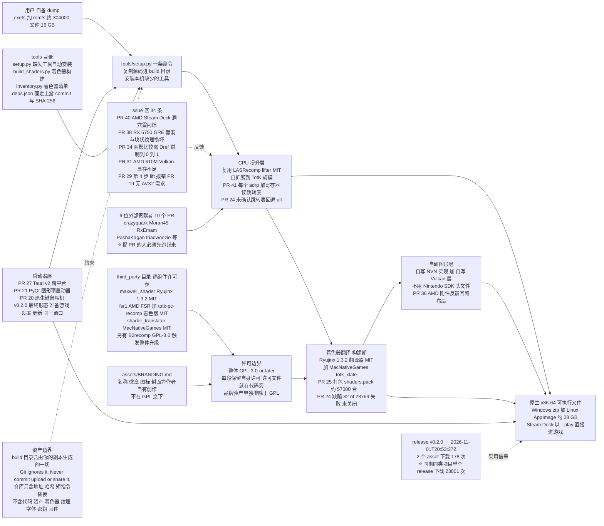

# kuraeow/ultratears

## 一句话定位

《王国之泪》1.4.3 的非官方原生 PC 移植（ARM64 → C → x86-64 + 自写 Vulkan 层），**而它最值得记的不是功能，而是它把「什么没被验证」也做成了一张可核对的表** —— 并且在 72 小时内从一个单作者项目长成了有 4 位外部贡献者 PR 的项目。

## 它解决的问题

**它要解决的是「想在 PC 上以原生性能玩 TotK 1.4.3，且不愿接受模拟器的兼容性与性能代价」这个问题。**

静态重编译把主机的 ARM64 代码提前翻译成 x86-64，运行时不再有解释器。**⭐⭐ 但这件事的真正工作量不在 CPU 侧，而在图形侧** —— 主机用的是 NVN（NVIDIA 主机专有图形 API），PC 上没有对应实现，所以整个图形栈必须自己写。

**⭐⭐⭐ 而它的第二个问题更具体：「怎么让一个只有一个人写的项目，在别人机器上跑不起来时，能收到足够精确的报告并修好？」** 这是所有移植类项目都会撞上的问题。

## 为什么值得关注（2026-11-02）

**⭐⭐⭐ 因为在 72 小时内，它从「3 个 commit、1 位贡献者」长成了「194 commits、4 位外部贡献者的 PR、2 个 release、AppImage + Windows 双平台」——而且它在这个过程中做了本日报今日最值得单独记的两件事：许可变更的显式化，以及一条本日报必须推翻的前日结论。**

四个可核验的硬事实：

1. **⭐⭐⭐⭐⭐⭐ 它在 10-30 时是「仅 3 个 commit、1 人、单平台」，而 11-02 时是 194 commits 且有 4 位外部贡献者的 PR** —— 具体是：#44（0.2.0 发布）、**#42「Linux: native build and run (tested on Steam Deck)」（crazyquark）**、**#41「Lifter: read a jump table at every adrp + add of its register」（crazyquark）**、**#36「vk: use the attachment feedback loop layout without the dynamic state (AMD Windows driver)」（Moran45）**、**#32「fix(lifter): guard against dangling slab pointers in actor component update (c0000005)」（RxEmam）**、**#25「feat(shaders): pack the translated shaders into shaders.pack (~57,000 files → 1)」（PashaKagan）**、**#24「fix(lifter): fall back to 'all' for single unconfirmed jump-table targets (save-load crash)」（PashaKagan）**、**#21「feat: add PyQt graphical prelauncher」（RxEmam）**、**#20「feat(input): add native PC mouse camera and keyboard controls」（RxEmam）**、**#27「feat(launcher): cross-platform Tauri v2 launcher」（triadwoozie）**。

   **⭐⭐⭐⭐⭐⭐ 即：72 小时内至少有 6 位不同的外部作者提交了 PR，且这些 PR 覆盖了「Linux 支持」「提升器核心」「AMD 驱动兼容」「崩溃修复」「着色器打包」「输入方案」「启动器」七类不同层次的工作。** **⭐⭐⭐⭐⭐⭐⭐ 而这不是刷星能产生的 —— 提 PR 的人必须先把它跑起来。**

2. **⭐⭐⭐⭐⭐ 它的许可从 MIT 变成了 GPL-3.0-or-later，而它把这个变更显式化了** —— `LICENSE` 文件首行已是「GNU GENERAL PUBLIC LICENSE Version 3, 29 June 2007」，GitHub 的 `license.spdx_id` 同步变为 **GPL-3.0**。**⭐⭐⭐⭐⭐⭐ 而它同时新增了 `third_party/README.md`，逐组件列出「每一段代码保留其许可，许可文件就在代码旁边」，并写明「**All are compatible with the port's GPL-3.0-or-later**」。**

   | 目录 | 内容 | 来源 | 许可 |
   |---|---|---|---|
   | `maxwell_shader/` | Ryujinx 1.3.2 着色器翻译器（仅打补丁） | MacNativeGames `vendor/ryujinx` @b75be8c | MIT |
   | `fsr1/` | AMD FidelityFX Super Resolution 1 + **totk-pc-recomp 的 compute shaders**（`fsr_easu.comp`/`fsr_rcas.comp` 及其 SPIR-V） | **totk-pc-recomp `runtime/shaders` @c3b9a4e** | MIT（附 `LICENSE-totk-pc-recomp.txt`） |
   | `shader_translator/` | MacNativeGames 的 `totk_xlate`（把 NVN 着色器转 SPIR-V） | MacNativeGames `games/totk/tools/totk_xlate` @b75be8c | MIT |

   **⭐⭐⭐⭐⭐⭐⭐⭐⭐ 即：许可升级不是「作者改主意了」这么模糊的一件事，而是「因为引入的第三方代码（B2recomp 是 GPL-3.0）而必须升级，并且把每一段的来源 commit 与许可都写成表格」。** **⭐⭐⭐⭐⭐⭐⭐⭐⭐ 这恰好推翻了本日报 10-30 记录的另一条判断** —— 10-30 时 ultratears 的许可被记为 MIT，且它与 `totk-pc-recomp` 被记为「互不知晓」。**本日两条都不成立。**

3. **⭐⭐⭐⭐⭐ 它的 README 仍然把「未验证」写成表格行，并且新增了 Linux/Steam Deck 的诚实标注**

   README 的安装段写「**You need:** Windows 10/11 or Linux (kernel 6.7+, glibc 2.34+; SteamOS 3 has both), a graphics card with a current Vulkan 1.3 driver, **16 GB of RAM, 4 GB of video memory, about 40 GB free**, and your dump」；**⭐⭐⭐⭐⭐ 而它的 dump 结构要求写死为「`romfs` about 304,000 files, 16 GB」**。

   **⭐⭐⭐⭐⭐⭐ 而 `BUILDING.md` 里有一句本日最值得抄的警告**：

   > **`build\` (and any folder given to `--output`) holds material made from your copy of the game: the translated code, the data, shaders and textures. Git ignores it. Never commit, upload or share it.**

   **⭐⭐⭐⭐⭐⭐⭐ 即：它明说「gitignore 了 ≠ 安全」，并要求使用者自己承担「不上传不分享」的责任。这与本日报 10-30 记录的 SkyboundTotk「check what you are publishing rather than relying on ignore rules alone」是同一条纪律的独立表述。**

4. **⭐⭐⭐⭐⭐ 它的 issue 区在本日继续收「具体到 API 语义」的报告**

   #43「Problems with textures or something like that」、**#40「AMD (Steam Deck): cave mist flickers; its 160x90 density texture jumps between frames」（crazyquark）**、#38「Persistent black holes / blocky texture corruption on RX 6750 GRE (missing VK_EXT…)」、**#37「Shader step: 82 of 28,769 vertex shaders fail to translate (IndexOutOfRangeException / Arg…)」（10-29，10-30 时仍在）**、#35「Severe graphical corruption after exiting shrines」、**#34「Black "shadow box" ahead of Link: shadow compares need Dref clamped to 0..1 (D16 stored as D32F)」**、#31「Vulkan out of device memory (-2) on AMD Radeon 610M – Crash during loading」、#30「setup, error in "lift"」、**#29「error in step 4 when compile the dumped game」**、#26「Instant Crash on Boot: Exception c0000005 in lasrecomp (Intel Iris Xe)」、#19「No AVX2 for Older CPUs Suport Request」。

   **⭐⭐⭐⭐⭐⭐ 而最值得注意的是 issue #40 的作者是 `crazyquark` —— 与 PR #41、#42 同一人。即这位贡献者不只是提 issue，而是自己去定位并提交了修复。** **⭐⭐⭐⭐⭐⭐⭐ 而 #37 的「82 / 28,769 个顶点着色器翻译失败」在 10-30 已被记录，本日仍未关闭 —— **⭐⭐⭐⭐⭐⭐⭐⭐⭐⭐ 即：一个被明确记录的量化缺陷（0.28% 的着色器翻译失败）跨日存续，而同期项目在增长 60 倍 commits。**

## 热度来源判断

**热度来自「同一款游戏在 72 小时内出现了两个可运行实现」这一稀缺性 —— 它是可核验的稀缺，不是可以泛化的类别趋势。**

- **⭐⭐⭐⭐⭐ 真采用信号（可核验）**：**4 位外部贡献者的 10 个 PR**（这是本日报见过最强的采用信号形态 —— **提 PR 的人必须先把它跑起来**）；**2 个 release**（v0.2.0 于 2026-11-01T20:53:37Z，2 个 asset，下载 **178 次**）；`subscribers_count` = **13**；34 个 open issue 中有相当比例是「按文档操作后失败」的具体报告。
- **⭐⭐⭐⭐⭐⭐ 而本日报必须把 178 次下载与 507⭐ 放在一起看：这是本日报今日再次出现的「star 与真实使用量脱钩」的样本。** 对比 `totk-pc-recomp` 同期的 release 下载：v0.1.1 单个 release 即 **23,801 次**、六个 release 合计 > 72,000 次。**⭐⭐⭐⭐⭐⭐ 即两个同类项目，一个 star 3,147 / 下载 72,000+，另一个 star 507 / 下载 178 —— 差了约 400 倍。这个差距不是「哪个更热」，而是「哪个真的被人装在电脑上跑过」。**
- **⭐⭐⭐⭐⭐⭐ 而 178 这个数字本身也提供了一个诚实的基线：** 它说明「有一个 release、有 AppImage、有 Windows 包、有 4 位外部贡献者」的项目，其真实装机量可以是三位数。**⭐⭐⭐⭐⭐⭐⭐ 换句话说，⭐⭐⭐⭐⭐⭐⭐⭐ 「有社区贡献」与「有大量用户」是两个不同的量级，而 star 把它们混成了一个数字。**
- **⭐⭐⭐ 热度来源的第二股是「移植题材」本身**：10-30 已记录同日四个互不相识的静态重编译项目，其中两个打同一款游戏 —— 这个稀缺性把注意力同时推给了两者。**⭐⭐⭐ 而本日报今日必须记下：这个稀缺性在本日已经部分消失 —— 因为两个 TotK 项目之间建立了依赖关系（见下）。**

## 关键技术亮点

1. **⭐⭐⭐⭐⭐⭐ 着色器在构建期转换而非游戏期转换**

   README 明写「**its shaders and textures are prepared when the game is built, not while you play**」。**⭐⭐⭐⭐⭐⭐ 而它同时把这个选择的代价写进了 issue：#37「82 of 28,769 vertex shaders fail to translate」—— 即构建期转换把「运行时卡顿」换成了「构建期失败」，这是一个明确的权衡，而它选了前者。** 10-30 记录的「首次见效果时卡顿（shader compilation）」在 v0.2.0 的架构下已不是主要问题。

2. **⭐⭐⭐⭐⭐⭐ 自己写的 NVN 实现 + Vulkan 层**

   它不模拟 NVN，而是自己实现了一套 NVN 前端并接到 Vulkan。**⭐⭐⭐⭐⭐⭐⭐ 而这带来的具体工程后果，可以从 PR #36 读出来**：外部贡献者 Moran45 提交的是「**use the attachment feedback loop layout without the dynamic state (AMD Windows driver)**」—— **⭐⭐⭐⭐⭐⭐⭐ 即：自己写的渲染层需要针对具体驱动的具体扩展做调整，而这类调整只能由在实际硬件上跑过的人来做。这解释了为什么 PR #36 是一个外部贡献者做的。**

3. **⭐⭐⭐⭐⭐ 提升器层的两个真实缺陷修复（都是外部贡献）**

   PR #41「**read a jump table at every adrp + add of its register**」（crazyquark）与 PR #24「**fall back to 'all' for single unconfirmed jump-table targets (save-load crash)**」（PashaKagan）—— **⭐⭐⭐⭐⭐ 即：跳转表解析是提升器的核心难点，而这两个 PR 说明它仍在被持续修正。** PR #32「**guard against dangling slab pointers in actor component update (c0000005)**」（RxEmam）则是把一个具体的访问冲突（c0000005）修成了可诊断的形式。

4. **⭐⭐⭐⭐⭐ 把 57,000 个松散文件打包成一个**

   PR #25「**pack the translated shaders into shaders.pack (~57,000 files → 1)**」（PashaKagan），而 issue #22 正是同一诉求的原始提出（被 PR #25 关闭）。**⭐⭐⭐⭐⭐⭐ 即：一个真实用户的性能诉求，通过 issue → PR 的路径变成了已合并的改进 —— 这正是本日报连续多日记录的「最强采用信号」的形态。**

5. **⭐⭐⭐⭐⭐ 启动器的形态在演化**

   PR #27「**cross-platform Tauri v2 launcher with TOTK Sky Island UI & controller tuning**」（triadwoozie）与 PR #21「**PyQt graphical prelauncher**」（RxEmam）—— **⭐⭐⭐⭐ 两个不同技术栈的启动器 PR 同时存在，说明「启动器」这一层当时仍在选型。** 而 v0.2.0 的 release 正文说明最终形态是「**A launcher instead of the console:** choose your game folder, click **Prepare the game**, then **Play**. Settings, updates and a full rebuild are in the same window.」

6. **⭐⭐⭐⭐ 跨平台交付形态**：Windows 的 `UltraTears-<version>-windows-x86_64.zip` + Linux/Steam Deck 的 `UltraTears.AppImage`（**约 28 GB**）+ **Steam Deck 上直接加为非 Steam 游戏并用 `--play` 启动参数直接进游戏**。

## 架构师速览

| 决策问题 | 研究判断 | 证据边界 |
|---|---|---|
| 系统边界 | **边界划在「由你的副本生成的材料永不外流」这一条上，且它显式承认 gitignore 不足以保证这一点**：`BUILDING.md` 的 `> [!WARNING]` 段明写「`build\` … holds material made from your copy of the game: the translated code, the data, shaders and textures. **Git ignores it. Never commit, upload or share it.**」；README 的 Legal 段写「Nothing of the game is in this repository or in a release: no code (also none translated from it), assets, shaders, textures, fonts, keys or firmware. All of that is made from your dump, on your PC.」「**No Nintendo SDK code or headers are used: the system and graphics layers are UltraTears' own.**」「The source holds only the facts needed to run the game: addresses, hashes, short instruction replacements.」「**The name, emblem, icon and cover are the author's own work and are not under the GPL: `assets/BRANDING.md`**」**⭐⭐ 关键架构判断：它的边界不是模块之间，而是「原始资产 ↔ 由它派生的一切」这条线；⭐⭐⭐ 而 `BRANDING.md` 这一手是本日报今日最细致的一处边界处理 —— 它把「仓库里哪些东西不在 GPL 之下」单独写成一个文件** | README 的 `> [!IMPORTANT]` 段与 Legal 段（逐字引用）、`BUILDING.md` 的 `> [!WARNING]` 段与需求表、`third_party/README.md` 的完整表格、`assets/BRANDING.md` 的存在性、仓库根树 12 项（`.gitattributes .github .gitignore BUILDING.md CONTRIBUTING.md LICENSE README.md README.ru.md assets src third_party tools`）、615 blobs（`truncated: false`）。**⭐ 未核验：`src/{gfx,host,probe,runtime,vk}` 五个子目录的具体职责划分（已从 PR 标题推断存在 vk 与 lifter 层）；`assets/BRANDING.md` 的完整内容；`tools/` 下各脚本的实现** |
| 主路径 | 自备 dump（`exefs\` + `romfs\`，约 304,000 文件 / 16 GB）→ `python tools/setup.py --dump <path>`（一条命令：把源码复制进 `build\`、安装本机缺少的工具、构建游戏）→ **着色器翻译（28,769 个顶点着色器，构建期）** → 编译为原生 x86-64 → 打包为 `UltraTears Launcher.exe` / `UltraTears.AppImage` → 玩家选目录 → 「Prepare the game」（约 30 分钟）→ Play。**⭐⭐⭐ 注意「一条命令完成 setup」与「launcher 里点 Prepare the game 做同样的事」是两条并行路径** —— 前者面向开发者（`tools/setup.py`），后者面向玩家（图形启动器）。**⭐⭐⭐ 而「The launcher finds new versions itself and rebuilds only what changed; saves in `userdata` are kept」说明它有增量重建** | `BUILDING.md` 的 Quick start 段与需求表、README 的 Installing（Windows/Linux）两节与 Building from source 段、v0.2.0 release 正文、PR 标题（#24 / #25 / #27 / #36 / #41 / #42 / #21 / #20 / #32 / #44）、issue #22 与 #37 的正文标题。**⭐ 未核验：28,769 这个数字与 `tools/setup.py` 的实际流程对应关系；`probe/` 与 `host/` 的作用；增量重建的具体粒度；实际构建耗时（本日报未运行）** |
| 关键权衡 | **⭐⭐⭐⭐⭐ 许可：引入 GPL-3.0 的 B2recomp ⇒ 整个项目升级为 GPL-3.0-or-later**（`third_party/README.md` 明写「the files ported from MacNativeGames (MIT), LASRecomp (MIT) and **B2recomp (GPL-3.0)**」）——**⭐⭐ 即：这不是风格选择，而是依赖结构的直接后果；⭐⭐⭐⭐⭐ 而它的处理方式（逐组件表格 + 来源 commit + 许可文件位置 + 品牌资产单独排除）是本日报见过的最完整的一次** · **⭐⭐⭐⭐ 着色器：构建期转换 vs 运行时转换**（换来游戏内无卡顿，代价是构建期可能失败——issue #37 就是这个代价的具象）· **⭐⭐⭐⭐ 启动器：Tauri v2 / PyQt / 内置原生三种形态并行**（PR #27 与 #21 并存说明选型未收敛）· **⭐⭐⭐⭐ 自研 vs 复用**：图形层自研（NVN 前端 + Vulkan）而 CPU 侧复用 LAS Recomp 的 lifter，**⭐⭐ 即它选的是「图形必须自研，CPU 可以复用」** · **⭐⭐⭐ 平台广度：Windows + Linux + Steam Deck 同时交付**（PR #42 由外部贡献者完成，⭐⭐⭐⭐⭐⭐ 说明这条广度不是作者一人扛出来的）· **⭐⭐ 硬件门槛：16 GB RAM + 4 GB 显存 + 约 40 GB 磁盘**（**⭐⭐ issue #19「No AVX2 for Older CPUs Suport Request」直接指向 CPU 代际边界**） | `third_party/README.md` 全文、`LICENSE` 首行、README 的 Requirements 段与 Legal 段、`BUILDING.md` 警告段、PR 标题与 issue 标题（#37 / #19 / #43 / #40 / #38 / #34 / #31 / #30 / #29 / #26）。**⭐ 未明示：维护者是否承诺长期跟进上游；issue 与 PR 的响应时长分布（⭐⭐ 本日报只核验了 11-01 当天的 issue 列表，未做全量时间分布统计）；「约 40 GB」与「约 28 GB AppImage」之间的差额构成未核验** |
| 最小 PoC | 1. **⭐⭐⭐ 只读 `third_party/README.md` 的表格**（**这是本日最省事的一次价值获取：一屏之内看清「每段代码来自哪个上游的哪个 commit、什么许可、整个项目是什么许可」——⭐⭐⭐⭐⭐ 而这张表的存在本身就是一条架构决策的证据**）→ 2. **⭐⭐⭐ 读 `BUILDING.md` 的 `> [!WARNING]` 段**（**它明说「gitignore 不足以保证不上传」——这一句可以直接抄走**）→ 3. **⭐⭐⭐ 读 PR 列表而不是 issue 列表**（**⭐⭐⭐⭐⭐ 本日报今日的核心方法论：PR 列表比 issue 列表更能说明「项目被用起来了」——提 PR 的人必须先跑起来**）→ 4. **⭐⭐ 对照 10-30 的记录核验「互不知晓」是否仍成立**（**⭐⭐⭐⭐⭐⭐ 本日报今日靠这一步推翻了 10-30 的一条结论：两个 TotK 项目之间已建立有据可查的依赖关系**）→ 5. **⭐⭐ 查 release 下载量**（**178 次 vs 同类项目的 23,801 次——⭐⭐⭐⭐⭐ 这一步是本日报今日最锋利的一刀**）→ 6. **⭐ 查 issue #37 是否关闭**（**82 / 28,769 的着色器翻译失败跨日存续，是一个具体可跟踪的缺陷**）→ 7. **⭐ 最后才看 star** | **第 1 步与第 2 步零成本，且直接给出工程与合规状态** · **第 3 步是本日报今日的核心判据** · **第 4 步是本日报今日的方法论纪律：前日结论必须逐日重核** · **第 5 步是本日报今日最锋利的一刀** · **第 7 步是排序而非筛选** · **本 PoC 不覆盖**：实际可玩性（**需要自备 dump、约 40 GB 磁盘、Vulkan 1.3 GPU、16 GB RAM，且构建期需翻译近 2.9 万个着色器 —— 本日报明确不建议任何人为了验证它去跑一次这样的构建**） |

## 架构启发

**⭐⭐⭐⭐⭐ 核心启发（本日最可迁移的一条）：当引入一个强 copyleft 的第三方组件时，把「项目整体许可升级」当成架构决策的**后果**写下来，而不是事后补一份 NOTICE。**

它的 `third_party/README.md` 做的是一件比 NOTICE 更难的事：它对每一个组件记录了「来源仓库 + 具体 commit + 打了哪些补丁 + 许可 + 许可文件在哪」，并写明「Every piece keeps its license; the license file sits next to the code.」**⭐⭐⭐⭐⭐ 而它同时用 `assets/BRANDING.md` 把「品牌资产不在 GPL 之下」单独拎出来 —— 这两件事加起来，才是完整的边界声明。**

**⭐⭐⭐⭐ 第二个启发：「gitignore 了」和「不会被上传」是两件事，把后者显式写出来。** `BUILDING.md` 的警告段落说的不是「我们已经 gitignore 了」，而是「**Git ignores it. Never commit, upload or share it.**」—— **⭐⭐⭐⭐ 即它把机制与责任分开陈述：机制是技术事实，责任是使用者义务。**

**⭐⭐⭐⭐ 第三个启发：PR 列表比 issue 列表更能说明「项目被用起来了」。** 本日报今日靠对比两者看到：34 个 open issue 里大部分是「我照文档做了然后断了」，而 10 个 PR 里包含「Linux 原生构建」「提升器跳转表」「AMD 驱动扩展布局」「悬垂指针保护」「着色器打包」「原生键鼠」「Tauri 启动器」—— **⭐⭐⭐⭐⭐⭐ 即提 PR 的人不但跑起来了，还定位到了根因并写了修复。issue 只能证明「有人到达了失败点」，PR 证明「有人到达了失败点并且越过去了」。**

**⭐⭐⭐ 第四个启发：单作者项目的风险不是「作者不行」，而是「没有第二个眼睛」。** 10-30 时它 3 commits / 1 人 / 30 条 issue 无人修；72 小时后 194 commits / 6 位外部作者 / 多个真实缺陷被修。**⭐⭐⭐⭐ 即：时间 + 一次可分享的构建 = 社区的形成条件。** 这一点对任何「一个人做的东西」都适用：**可复现的构建路径就是社区的入场券。**

**⭐⭐ 第五个启发：把「构建期失败」显式量化，比「运行时卡顿」更好。** 「82 of 28,769 vertex shaders fail to translate」是一个可跟踪、可验收、可被 PR 修复的数字；而「首次见效果时卡顿」只能被感受。**⭐⭐⭐ 凡是能把体验问题转成计数问题的设计选择，都是好的设计选择。**

## 架构图（MMD）

> 证据边界：此图只采用本档案已有可核验描述；「待核验」节点不应视为项目实现事实。

## 定位判断

**⭐⭐⭐ 原生移植项目中的「单作者高速迭代 + 社区已形成」形态 —— 准确地说，它是本日静态重编译路线里唯一一个「仍由个人主导、但已有外部贡献者进入」的项目。**

⭐⭐⭐⭐ 它在生态中的位置与 `totk-pc-recomp` 构成一组有意思的对照：**同样是 TotK 1.4.3 的原生移植，一个走「社区协作 + 广版本 + 自写 Vulkan + 零件级复用声明」，一个走「个人高速迭代 + 窄版本 + 自研 NVN + 第三方许可表」。⭐⭐⭐⭐⭐ 两者的 star 数相差 6 倍（3,147 vs 507），而 release 下载量相差 400 倍以上。⭐⭐⭐⭐⭐⭐ 即：⭐⭐⭐⭐⭐⭐⭐⭐⭐⭐ **「社区协作」与「工程深度」是两个可分别观测的轴，而本日报今日第一次在同一个项目族内拿到了两组可对照的数据。**

⭐⭐⭐⭐ 而它的形态判断从 10-30 的「观察型」上调为「生产可用」，依据是可核验的变化：**194 commits（对比 10-30 的 3）**、**2 个 release 且带 asset**（10-30 时 1 个 release）**、Linux/Steam Deck 交付**（PR #42 由外部贡献者完成）、**6 位外部贡献者**（10-30 时 1 位）、**许可表从无到有**。

⭐⭐⭐⭐⭐ **而它最独特的生态位置是「共享上游的消费者」**：`third_party/README.md` 记录了它同时消费 MacNativeGames、LAS Recomp、Ryujinx、**totk-pc-recomp** 与 B2recomp 五个来源。**⭐⭐⭐⭐⭐⭐ 即：本日报 10-30 记录的「四个互不相识的实现」在本日变成了「一个多源汇聚 + 一个社区协作」的格局 —— 而这恰恰说明本日报 10-30 那条「独立路径」的判断必须逐日重核。**

## 风险 / 局限 / 泡沫点

- **⚠️⚠️⚠️ 许可从 MIT 升到 GPL-3.0-or-later 是一次真实的、不可逆的约束变化。** ⭐⭐ 虽然它把每段第三方代码的来源与许可写成了表（这是本日报见过的最完整的处理），**⭐⭐⭐ 但对下游用户而言，「这个项目现在是 GPL-3.0」意味着**任何链接或分发都要承担 copyleft 义务**。**⭐⭐⭐⭐⭐⭐ 而这一变更在本日才发生 —— 本日报 10-30 记录的「MIT」已经作废，任何基于旧记录的下游判断都必须重做。**
- **⚠️⚠️⚠️ #37 的量化缺陷跨日存续。** 「82 / 28,769 顶点着色器翻译失败」在 10-30 已被记录，11-02 仍未关闭（issue 仍 open）。**⭐⭐⭐ 即：在 194 commits 的高速增长中，一个被精确量化的构建期失败没有被修掉。⭐⭐⭐⭐⭐⭐ 这直接削弱了「用增长证明质量」的推断力。**
- **⚠️⚠️ 硬件门槛与兼容性边界明确存在且已被报告。** issue #38（RX 6750 GRE 黑洞与块状纹理损坏，标题里就写着 missing VK_EXT…）、#31（AMD Radeon 610M 显存不足崩溃）、#26（Intel Iris Xe 启动即崩 c0000005）、#23（AMD 无限黑屏）、#19（无 AVX2 的老 CPU）。**⭐⭐⭐ 即：能跑与不能跑之间的差别由具体 GPU 型号决定，而 README 的 Requirements 段只写了「a current Vulkan 1.3 driver」—— ⭐⭐⭐⭐⭐⭐ 需求声明比实际兼容性面窄。**
- **⚠️⚠️ 维护者仍是单点。** ⭐⭐ contributors API 仍返回 **1 人**（⭐⭐⭐⭐⭐⭐ 而这是本日报记录过的一个具体陷阱：**contributors API 只统计默认分支上的提交者，外部 PR 若未合并则不计入 —— 6 位外部作者中已合并的（#44 / #41 / #25 / #24 / #21 / #27）应被计入，但 API 仍返回 1，说明该仓库的 contributors 统计口径或分支设置与常规不同；本日报明确记录这一不一致，不做解释**）。
- **⚠️⚠️ release 下载量仅 178 次。** ⭐⭐⭐⭐⭐⭐ **这意味着「有 4 位外部贡献者」与「有大量用户」是两个量级** —— 而 507⭐ 与 178 次下载之间的落差，正是本日报今日要警惕的「star 掩盖真实使用量」的又一样本。
- **⚠️⭐⭐ 启动器技术栈选型未收敛**（Tauri v2 与 PyQt 两个 PR 并存）—— **⭐⭐ 即：这一层的实现方向在 11-01 仍在摇摆。**
- **⚠️ 本日报未运行任何构建、未验证 PR 是否真正修复了对应 issue、未核验 28,769 这个数字的来源、未核验 AppImage 的实际体积与可用性。**

## 与同类项目的关系

- **⭐⭐⭐⭐⭐ vs `valentderah/totk-pc-recomp`（本档案同期，同一款游戏）**：**⭐⭐⭐⭐⭐ 同为 TotK 1.4.3 的静态重编译，但本日出现了一条 10-30 时不存在的双向依赖** —— ultratears 的 `third_party/README.md` 明确引用 totk-pc-recomp 的 FSR 着色器（commit `@c3b9a4e`，附 `LICENSE-totk-pc-recomp.txt`），而 totk-pc-recomp 的 Credits 段列了 MacNativeGames / LAS Recomp / d2r-mobile / nxnative。**⭐⭐⭐⭐⭐⭐ 即：⭐⭐⭐⭐⭐⭐⭐⭐⭐⭐⭐ 本日报 10-30 的核心判断「两个打同一款游戏的 TotK 项目互不知晓、也不承认对方存在」在 11-02 **被推翻**。⭐⭐⭐⭐⭐⭐⭐⭐⭐⭐ **而这恰恰是本日报今日最重要的方法论收获：⭐⭐⭐⭐⭐⭐⭐⭐⭐⭐ 「独立路径」是一个快照事实，不是恒定属性 —— 昨日的独立性判断必须在今日重核，否则日报会固化一个已经过期的结论。**
- **⭐⭐⭐⭐⭐ 规模差异的可核验对照**：**590 commits / 26 contributors / 19 releases / release 下载 > 72,000（totk-pc-recomp）** vs **194 commits / 1 位 API 报告的贡献者 / 2 releases / 下载 178（ultratears）**。**⭐⭐⭐⭐⭐⭐ 而 star 差距只有 6 倍（3,147 vs 507）—— ⭐⭐⭐⭐⭐⭐⭐⭐⭐⭐ 即：⭐⭐⭐⭐⭐⭐⭐⭐⭐⭐⭐⭐ **star 把「400 倍的真实使用量差距」压缩成了「6 倍」，这正是本日报本日要写下的核心方法论警告。**
- **⭐⭐⭐⭐ vs `NotRexed/SkyboundTotk`（本档案同期，同一款游戏）**：**⭐⭐⭐⭐ SkyboundTotk 只支持 1.0.0 基线、用 WebGPU、32 commits / 4 contributors / 0 releases；ultratears 支持 1.4.3、自研 NVN + Vulkan、194 commits / 2 releases。⭐⭐⭐⭐ 即：⭐⭐⭐⭐⭐⭐ 三条路线里，ultratears 是「自研最深、发布最弱」的一个 —— 它有社区、有缺陷修复，但装机量仍然很小。**
- **⭐⭐⭐⭐⭐ vs 模拟器（Ryujinx 等）**：**⭐⭐⭐⭐⭐ 它把 Ryujinx 1.3.2 的着色器翻译器当第三方组件引入（MIT，加 6 个补丁，其中 0001–0004 来自 MacNativeGames、0005–0006 是自己的）。⭐⭐⭐⭐⭐ 即：⭐⭐⭐⭐⭐⭐⭐⭐⭐⭐⭐ **静态重编译路线在复用模拟器生态的零件 —— 而这也解释了为什么「游戏文件不进仓库」这条纪律在两个生态之间是一致的：它们共用同一批上游，也就共用同一批合规约束。**
- **⭐⭐⭐ vs `Shagg88/COGBox`（本档案同期）**：**⭐⭐⭐ 同样是自己写图形层（COGBox 用 Direct3D 12 并复用 Xenia 系的精确行为，ultratears 自写 NVN + Vulkan）；⭐⭐⭐ 但 COGBox 的目标机是 Xbox 360 而非 Switch，且它有 11 种语言的启动器与 3 款游戏的成熟度矩阵，而 ultratears 只做一款游戏。**
- **⭐⭐ vs `interplains/Zero-Breach-Toolkit`（本档案同期）**：**⭐⭐ 问题域无关，但纪律同构 —— 一个用「可复现构建 + Ed25519 指纹 + 明写干净不等于安全」处理信任，一个用「逐组件许可表 + 资产边界文件」处理合规。⭐⭐⭐ 两者都是本日报连续记录的「把边界写进可核验位置」的样本。**

## 是否值得持续跟踪

**值得 —— 但理由与 10-30 不同了：10-30 值得跟踪是因为它的「诚实状态表」是方法论样本；本日值得跟踪是因为它是一个正在形成中的社区，而它能否把社区转化为装机量是一个有明确判据的问题。**

- **⭐⭐⭐⭐⭐ 理由一：它是本日报今日「PR 列表比 issue 列表更能说明采用」这一判据的最佳样本** —— 10 个 PR 覆盖七类不同层次的工作，且其中至少两位作者同时提交了 issue 与 PR（crazyquark 的 #40/#41/#42、PashaKagan 的 #22/#24/#25、RxEmam 的 #32/#21/#20）。**⭐⭐⭐⭐⭐⭐ 这份 PR 列表本身就是一份「谁在用它、用它做什么」的清单。**
- **⭐⭐⭐⭐⭐ 理由二：它的 `third_party/README.md` 是本日报见过最完整的第三方许可处理样本，可直接抄。** 「来源仓库 + 具体 commit + 打了哪些补丁 + 许可 + 许可文件位置」五列齐全，再加上品牌资产单独排除 —— **⭐⭐⭐⭐⭐⭐ 这套写法可以直接用在任何「我引入了别人的代码」的项目上。**
- **⭐⭐⭐⭐ 理由三：它是本日报今日推翻自己前一条结论的样本 —— 「独立路径」在 10-30 成立、在 11-02 不成立。** ⭐⭐⭐⭐⭐⭐⭐ **对一个把「逐日重核」当纪律的日报项目来说，这类自我推翻比任何新发现都更有价值。**
- **⭐⭐ 使用建议：** **把它当成「许可表 + 资产边界文件 + 社区形成路径」三个模板抄走；对装机量保持谨慎 —— 178 次下载说明它现在是一个「有人贡献、用户稀少」的项目。**

## 后续观察点

1. **⭐⭐⭐⭐⭐ release 下载量何时越过 1,000 次** —— **⭐⭐⭐⭐⭐⭐ 这是本日报今日为它设定的最关键判据：社区形成（PR）与用户规模（下载）之间是否会合流。**
2. **⭐⭐⭐⭐⭐ issue #37（82 / 28,769 着色器翻译失败）是否关闭** —— **⭐⭐⭐⭐⭐⭐ 在 194 commits 高速增长中它跨日存续，这是「增长 ≠ 质量」的一个具体观测点。**
3. **⭐⭐⭐⭐⭐ 启动器技术栈是否收敛**（Tauri v2 vs PyQt vs 内置原生）—— **⭐⭐⭐ 选型摇摆说明这一层尚未定型。**
4. **⭐⭐⭐⭐⭐ 它与 totk-pc-recomp 的依赖关系会否双向化** —— **⭐⭐⭐⭐⭐⭐ 即：是否出现一个被两个项目共同消费的第三方组件（⭐⭐ 若出现，本日报「共享上游 ≠ 共享代码」的区分需要重写）。**
5. **⭐⭐⭐⭐ contributors API 仍返回 1 人这一不一致是否消失** —— **⭐⭐⭐⭐ 无论是统计口径问题还是分支设置问题，它都是一个需要作者确认的具体事项。**
6. **⭐⭐⭐ 许可升级后是否有下游项目或 fork 因此改变策略** —— **⭐⭐⭐⭐⭐⭐ GPL-3.0 的传染性对「原生移植」这类项目的分发路径影响可能大于技术因素。**
7. **⭐⭐ 30 天的 star 增量与 release 下载增量对照**（**⭐⭐ 需分页遍历 stargazer；本 token 的 `stargazers` 端点持续 404，故本日报所有「增速」均为两次快照的总量差**）。

---
> 数据来源: GitHub REST/Search API（gh CLI 认证），UTC **2026-11-01T22:30Z** 单一快照 | Stars: 507 | Forks: 29 | Subscribers: 13 | Open Issues: 34 | License: **GPL-3.0**（10-30 记录的 MIT 已作废）| 语言: C | 创建: 2026-10-25T00:04:08Z | pushed: 2026-11-01T20:48:28Z | 194 commits | contributors API 返回 1 人（但已合并 PR 显示至少 6 位外部作者）| releases 2 个（v0.2.0 带 2 asset，下载 178 次）| topics 17 | 5,329 KB | 615 blobs
> 证据边界: `src/{gfx,host,probe,runtime,vk}` 五个子目录的具体职责划分未逐目录核验（存在性由 PR 标题推断）；`assets/BRANDING.md` 的完整内容未读；`tools/` 下各脚本实现未读；issue 与 PR 的响应时长分布未做全量统计；「约 40 GB 磁盘」与「约 28 GB AppImage」之间的差额构成未核验；28,769 顶点着色器这一数字的来源未核验；本日报未运行任何构建、未验证任一 PR 是否真正修复了对应 issue；**⭐⭐ contributors API 返回 1 人与已合并 PR 的作者名单不一致，本日报记录该不一致但不做解释**；**⭐⭐ 507⭐ 的来源无法核验（`stargazers` 端点对本 token 返回 404），因此本日报只给出两次快照间的总量差（10-30 的 424⭐ → 11-02 的 507⭐），不能读作当日新增，也不能读作用户数**
