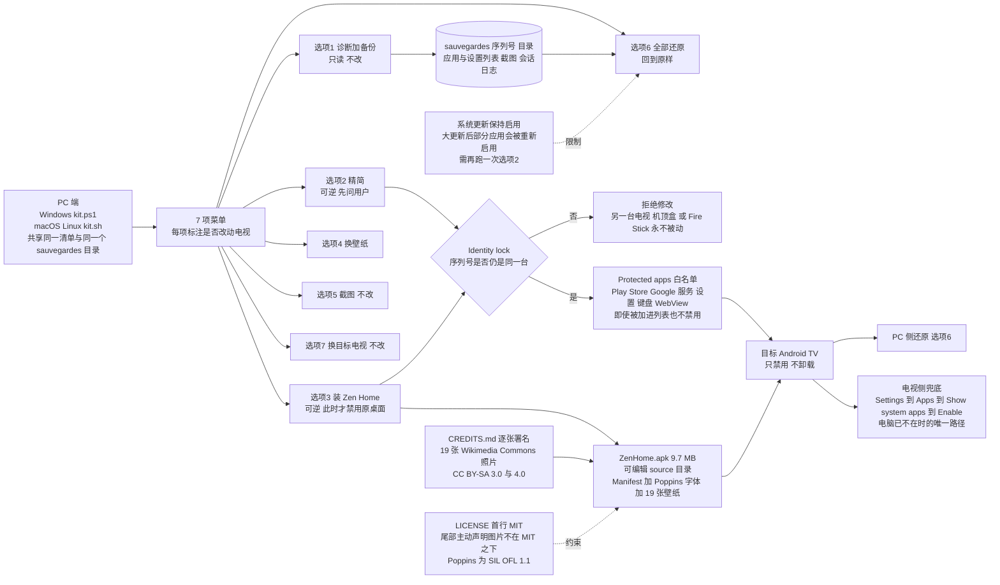

# xMazaki/unbloat-android-tv

## 一句话定位
一个 Android TV 精简套件 + 一个自制的 Apple TV 风格极简桌面「Zen Home」——**⭐ 而它真正值得记的地方是：它把「可逆」写成了三条机制，而不是一句承诺**。

## 它解决的问题
国产与欧美品牌 Android TV 的出厂系统普遍带广告、推荐位与遥测，而且**这些开关散落在系统设置、各 App 自己的设置、以及某些只能靠 adb 挂起（suspend）的组件里**。普通用户的困境是：不知道哪些能关、关错了怎么办、**以及——最要命的——不知道自己正在操作的是哪一台设备**（家里往往有电视、机顶盒、模拟器、游戏机在同一网段）。

unbloat 解决的是这三件事：**关哪些**、**怎么确认关对了**、**怎么确认没关错别的**。

## 为什么值得关注（2026-10-25）
**⭐ 因为它是本日两个 Android 项目里，把「可逆」这件事的工程含量做得最高的那个——而它的三条机制每一条都对应一个真实的事故类型，不是免责声明。**

**⭐⭐ 它的「可逆」首先是一张带「是否改动电视」列的菜单表：**

| 菜单项 | 做什么 | 是否改动电视 |
|---|---|---|
| **1. 诊断 + 备份** | 读 Android 版本、内存、CPU、Wi-Fi；备份应用与设置列表，带截图 | **No** |
| **2. 精简** | 关闭已知广告、遥测与无用服务（Google、TCL、Sony、Xiaomi…）；**对你可能用到的功能（Chromecast、Assistant…）先问你** | **Yes, reversible** |
| **3. Zen Home** | 装极简桌面：你的标题、4/6/8 应用布局、常用应用；**也可选禁用原桌面**（原桌面通常很吃资源） | **Yes, reversible** |
| **4. 我的照片** | 换成你自己的照片 | **Yes, reversible** |
| **5. 截图** | 截当前画面 | **No** |
| **6. 全部还原** | 重新启用所有被关的东西、放回原桌面与动画、卸载 Zen Home | **Back to original** |
| **7. 换一台电视** | 改目标电视 | **No** |

**并且明写：「Nothing is ever uninstalled, except Zen Home if you ask. Apps are only *disabled* and can be turned back on in one click.」**

**⭐⭐⭐ 而三条真正的工程设计是：**

**① Identity lock（设备身份锁）——本项目最值得学的一条：**

> The kit records your TV's serial number. **Before every action, it checks that the device at that address is the same one. Another TV, a box or a Fire Stick that gets that IP will never be modified.**

**这是对「adb 默认连第一台设备」这一真实误操作风险的具体防御——不是靠用户记得自己在改哪台电视，而是靠每次动作前重新核对。** 家用场景里 IP 被 DHCP 重新分配的情况非常常见，而这个防御的成本只是读一次序列号。

**② Protected apps（受保护应用）——白名单而非黑名单：**

> Play Store, Google services, settings, keyboard, WebView… **are never disabled, even if added to a list.**

**⭐ 注意后半句：「even if added to a list」——即使用户或脚本把 Play Store 加进「要关的」列表，受保护清单依然生效。这是一条「用户输入不能放大权限」的规则。**

**③ 单一桌面禁用边界：**

> **Option 2 never turns off the current home screen. Only option 3 can disable it, once Zen Home is installed.**

**⭐ 这一条把「一个操作会破坏另一个功能」的风险从「用户要注意」变成了「代码不许」。**

**⭐⭐⭐ 而它把「可逆」的失效条件也写了出来——这在本批里是罕见的：**

> Undo: option 6. If the PC isn't available anymore, on the TV: **Settings → Apps → See all apps → Show system apps →** pick the app → **Enable**.
> **TV system updates stay enabled. After a big update, some apps may be re-enabled: just run option 2 again. This happens often on Fire TV.**

**⭐ 只写「可还原」而不写「什么情况下会失效」的文档，在用户真正需要还原时是无效的。** 而「电脑可能已经不在了，只剩电视」这个场景被明确写进了还原路径。

**⭐⭐ 而它的素材许可处理是本批最细致的一份**（详见「关键技术亮点」第 6 条）。

## 热度来源判断
**热度来自一个具体且普遍的用户痛点 + 一个视觉上极易传播的成果。**

README 用两张 2019 年 TCL 电视的前后对比图（`docs/avant.jpg` / `docs/apres.jpg`）作为主视觉：**改之前是满屏推荐位的 Google TV 首页，改之后是「Zen Home」——一张风景照 + 时钟 + 你的应用。** **⭐ 这类「一张图就能看懂前后差别」的成果在社交传播上的效率远高于技术说明**，这大概是 174⭐ 在 4.5 小时内积累的主要机制。

**⭐ 但热度与成熟度严重脱节：** README 顶部即有醒目警示「**Projet personnel partagé tel quel, sans aucune garantie.** Je ne suis pas responsable des problèmes que son utilisation pourrait causer à votre TV, à vos appareils ou à vos données.」（个人项目，原样分享，无任何担保）。**subs 1、contributors API 返回 2 人、14 个 commit、无 release。**

**推断（不构成事实）**：8.0% 的 fork 比例对应「fork 去改机型清单与受保护应用表」——**这与 fork 一份 26 KB 的 Markdown（xss-audit，25.8%）不是同一量级的成本**（见「架构启发」）。

## 关键技术亮点
1. **⭐⭐⭐ Identity lock：每次动作前核对设备序列号。** 「Another TV, a box or a Fire Stick that gets that IP will never be modified.」
2. **⭐⭐⭐ Protected apps 的白名单语义带「用户输入不能放大权限」的规则。** Play Store、Google 服务、设置、键盘、WebView 永不禁用，**即使被加进列表**。
3. **⭐⭐ 单一桌面禁用边界。** 「Option 2 never turns off the current home screen. Only option 3 can disable it, once Zen Home is installed.」
4. **⭐⭐ 还原路径有电视侧兜底。** 「If the PC isn't available anymore, on the TV: Settings → Apps → See all apps → Show system apps → pick the app → Enable.」
5. **⭐⭐ 把「可逆」的失效条件写出来。** **TV 系统更新保持启用**；大版本更新后部分应用可能被重新启用，需再跑一次选项 2（「This happens often on Fire TV」）；**Philips 电视需等约十秒让改动落盘再关机**。
6. **⭐⭐⭐ 素材许可处理是本批最细致的一份。** 19 张照片全部来自 Wikimedia Commons「Featured pictures」，被裁剪为 16:9 并缩放到 1920×1080；`CREDITS.md` **逐张列出**文件名、地点、作者、许可（CC BY-SA 3.0 / 4.0）与 Commons 源链接；字体 Poppins 用 SIL OFL 1.1。**而 `LICENSE` 文件的尾部主动声明：**

   > **Note: bundled photos (ecran-accueil, assets/walls) are NOT under MIT; each keeps its own Creative Commons license, see CREDITS.md. Poppins font: SIL OFL 1.1.**

   **⭐ 即：根许可声明为 MIT，但 LICENSE 文件本身主动声明了「图片不在 MIT 之下」。** 这与本日报 10-24 记录的 HackiOS（NOASSERTION + APSL 2.0 且未说明自有代码条款）**性质不同**——**此处根 LICENSE 是 MIT 且明确排除了素材，缺的只是 GitHub 侧的自动识别（`spdx_id` 为 NOASSERTION），属可机读性缺陷而非法律实质问题。**
7. **⭐⭐ 两个平台脚本做完全相同的事，并共享同一个备份目录。** README：「The Windows (`scripts/kit.ps1`) and macOS/Linux (`scripts/kit.sh`) versions **do exactly the same thing and share the same lists and the same `sauvegardes/` folder: you can start on one computer and restore from another.**」**⭐ 这一条让「换电脑继续」成为可能，是跨平台工具少见的工程细节。**
8. **⭐ 语言自适应。** 「The kit speaks French if the system (Windows, macOS or Linux) is in French, otherwise English.」
9. **⭐ Zen Home 的可编辑性。** `ecran-accueil/source/` 里有可编辑的 `AndroidManifest.xml`（1,584 字节）、Poppins 三档字体（Light/Medium/Regular）与 19 张壁纸；标题可自定义（也可设为 `-` 显示为空），布局支持 4 / 6 / 8 应用，Dock 应用自动优先 Netflix / YouTube / Prime Video / Disney+ / myCANAL / Max / Apple TV。
10. **⭐ 启动器极简且跨平台。** `LANCER.sh` 只有两行：`cd "$(dirname "$0")" && exec bash scripts/kit.sh`；另有 `LANCER.bat`（144 字节）与 `LANCER.command`（123 字节）供 macOS 双击。
11. **⭐ 实测数据与前后截图。** 2019 年 TCL（Android 9、2 GB RAM）：**空闲 CPU 61% → 12%、可用内存 451 MB → 720 MB**。

## 架构师速览

| 决策问题 | 研究判断 | 证据边界 |
|---|---|---|
| 系统边界 | 五个可分离的部分：① **PC 侧控制脚本**（`scripts/kit.ps1` for Windows / `scripts/kit.sh` for macOS+Linux，**两者做完全相同的事并共享同一份清单与同一个 `sauvegardes/` 目录**）② **设备身份与清单**（序列号校验、受保护应用白名单、按渠道的广告分类表）③ **Zen Home 应用**（自建 APK + 可编辑 manifest 与素材）④ **备份目录**（`sauvegardes/<TV-serial-number>/`，含每次会话的日志与截图）⑤ **启动器**（`LANCER.bat` / `.command` / `.sh`）。**边界划在「脚本只做开关与包状态调整，不触碰应用数据」**——菜单里唯一涉及文件内容的是选项 4 的壁纸替换，而选项 1 明确是只读诊断 + 备份 | README 的菜单表与 Quick start、`git/trees/HEAD?recursive=1` 的目录清单与文件体积（`ZenHome.apk` 9,725,914 字节、`README.md` 23,026 字节、`README-en.md` 20,226 字节、`CREDITS.md` 4,596 字节、`LICENSE` 1,243 字节）；**⚠️ 核心脚本 `kit.sh` / `kit.ps1` 的具体实现本窗口未取，Identity lock 的比对逻辑待核验** |
| 主路径 | 用户在 PC 上双击启动器 → 输入电视 IP → 电视上确认「允许调试」→ 菜单选 1 诊断 + 备份（**不改**）→ 选 2 精简（**逐项告知要关哪些开关**，对 Chromecast / Assistant 等「你可能用到的」项**先问用户**）→ 选 3 装 Zen Home 并配置标题与布局（**此时才禁用原桌面**）→ 选 4 换壁纸 → 需要时选 5 截图 → 需要时选 6 全部还原 | README 的 Quick start 5 步、「What the kit does」表、README-en 的「Safety and undo」节；**⭐ 电视端与网络 adb 的协议细节（是否走网络 adb、如何处理授权弹窗）本窗口未取** |
| 关键权衡 | **禁用 vs 卸载**（选禁用，因为禁用可一键恢复，卸载不可）· **脚本驱动 vs GUI 驱动**（选脚本 + 菜单，**换来的是零依赖与可审计**）· **跨品牌清单 vs per-机型**（选跨品牌组件清单，代价是对新型号的覆盖可能滞后）· **只读探测 vs 写入修改**（选项 1 明确标为「不改」）· **⭐ 电脑在线 vs 仅电视可还原**（明确提供电视侧兜底路径，因为电脑可能不再可用）· **⭐ 用户输入 vs 受保护清单**（受保护清单**优先于**用户选择，即用户不能放大权限）· **⭐ 自带素材 vs 外链**（自带 19 张 CC 照片并逐张署名，**代价是 10 MB 的 APK 与版权复杂度**，收益是电视端不依赖网络）· **可编辑源码 vs 只给 APK**（两者都给：APK 供直接安装，source 供定制） | README 的菜单表、README-en 的 Quick start / What the kit does / Customising Zen Home / Safety and undo 四节、`CREDITS.md`、`LICENSE` 尾部；**未明示：是否有第三方复现、是否进入过任何 OEM 的合作或审核** |
| 最小 PoC | 1. **⭐ 先有一台可被牺牲的测试设备**（两者都改系统设置；unbloat 的实测只有 2019 年 TCL，**其他机型完全未验证**）→ 2. **跑选项 1 只做诊断 + 备份**，**确认 `sauvegardes/<序列号>/` 里确实生成了应用列表、设置与截图** → 3. **⭐⭐ 验证 Identity lock：故意让脚本指向另一台设备（或在备份后换掉电视上的应用），确认它在动手之前就拒绝** → 4. 跑选项 2 精简，**逐项确认它只关了广告与遥测，且 Chromecast / Assistant 这类被列为「你可能用到的」项确实先问了** → 5. 跑选项 3 装 Zen Home，**确认原桌面此时才被禁用** → 6. **⭐⭐ 跑选项 6 全部还原，确认真的回到原状**（**这是「可逆」的唯一证明**）→ 7. **⭐ 模拟「电脑不在了」：只在电视上按 README 给的路径（Settings → Apps → See all apps → Show system apps → 选应用 → Enable）恢复一个被关的应用** → 8. **验证系统更新保持启用**：在电视设置里确认系统更新未被关闭 | **第 3 步是 unbloat 的核心断言**（Identity lock 是它与 android-ad-cleaner 最大的结构性差异，也是最该验证的一条）· **第 6 步是「可逆」的唯一证据** · **第 7 步验证的是它对「可逆失效场景」的诚实度** · **第 1 步是硬前提** · 本 PoC **不覆盖** Windows 侧未签名脚本与 Philips 电视的特殊等待要求（README 明写「wait about ten seconds after slimming before turning the TV off」） |

## 架构启发
**⭐⭐ 最值得迁移的不是「电视上装了什么」，而是「用状态机式的边界来表达可逆性」这个思路。**

它的菜单表不是一串功能，而是一张**「操作 × 是否改动设备」的二维表**——**每一个可能被误解为破坏性的操作，都在表里被标注了它的可逆性与触发条件**。这比一句「本工具是可逆的」信息量大一个数量级。

**⭐⭐ 而 Identity lock 是本日报本日最值得抄的一条工程设计。** 它的本质是：**在每个破坏性动作之前，重新确认「我操作的对象还是我以为的那个」。** 这个模式可以用在任何「代理操作一个外部系统」的场景里——adb、SSH、云控制台、数据库、CI runner。而且它的成本极低（读一次序列号），**但它防住的是最难事后挽回的一类事故**（在错误的设备上执行了不可逆的批量操作）。

**⭐⭐ 第三点关于 fork 比例，它提供了本日的一条重要校准。** unbloat 的 fork/star 是 8.0%，而 xss-audit 是 25.8%、raven 是 2.4%。**这三个数字放在一起才说明问题：fork 比例既不度量质量，也不度量热度，它度量的是「fork 的单位成本」。** **改一份 26 KB 的 Markdown 是十分钟的事；fork 一份 15 KB 的套件清单是半小时；fork 一个 17.9 MB 的兼容层是几周。** **因此评估「有多少人在真的改造这个项目」时，必须先按改造单位成本分层。**

**⭐ 第四点关于素材许可：它的做法值得任何做混合许可项目的团队照抄**——**根 LICENSE 是 MIT，但在同一文件里主动声明「捆绑的图片不在 MIT 之下」并指向逐张署名的 CREDITS.md。** 这比只在 README 里写一句「部分素材另受许可」强得多，因为**它是机器可读的**（扫描器读 LICENSE 就能看到排除声明）。

## 架构图（MMD）

> 证据边界：此图只采用本档案已有可核验描述；标注「待核验」的节点不应视为项目实现事实。

## 定位判断
**「一键可逆的系统精简套件 + 一个可自己改的桌面」——它是一个产品形态完整、但覆盖面窄的个人项目。**

**⭐ 它的定位判断有一个关键事实：它不是一个通用的 Android 电视工具，而是一个「法国个人项目 + 自制桌面 + 自带素材」的组合。** 这决定了它的两处边界：**① 只在 2019 年 TCL（Android 9）上实测过；② 素材与品牌支持都是法语语境下的产物。**

**⭐ 但它在本批的真正稀缺之处是「安全边界的设计密度」。** 一个 10.6 MB 的仓库、一个 14 个 commit 的个人项目，却做出了三条本批最值得抄的机制（Identity lock、受保护清单的权限优先级、单一桌面禁用边界）。**⭐ 这印证了一条本日报反复记录的判断：工程质量的分布与项目规模无关，与作者是否把「事故形态」想清楚有关。**

**⭐ 而它的分发形态也说明了一件事：它选的是「打包整个目录 + 双击启动」而不是「安装到系统」。** 这让用户可以放在 U 盘里、在任何一台电脑上运行、且共享同一个备份目录——**对一个要动别人家电视的套件来说，「不安装、只运行」本身就是一种安全属性。**

## 风险 / 局限 / 泡沫点
- **⚠️ 这是法国个人项目**且 README 顶部即有醒目警示「**Projet personnel partagé tel quel, sans aucune garantie.**」——作者明确免责。
- **⚠️ 实测只有一台 2019 年的 TCL（Android 9、2 GB RAM）**，**其余机型完全未验证**——包括它自己声称支持的 Google / TCL / Sony / Xiaomi 各品牌。**推广位与广告组件在不同品牌与系统版本上位置不同，「已知广告清单」的覆盖率因此未知。**
- **⚠️ 系统更新后部分应用会被重新启用**——**即「可逆」不是永久保证**，这一点 README 自己写了。
- **⚠️ 精简本身会改变设备行为。** 关掉遥测/推荐可能影响某些厂商功能；README 也提醒 **Philips 电视需等约十秒让改动落盘再关机**。
- **⚠️ Windows 侧需手动运行未签名脚本**（Windows 需点「更多信息 → 仍要运行」），**macOS 侧未说明签名情况**。
- **⚠️ GitHub 侧 `license.spdx_id` 为 NOASSERTION**——**依赖 license 扫描器的工具会得到错误的默认答案**（尽管 LICENSE 文件本身清晰且主动排除了素材）。
- **⚠️ `scripts/kit.sh` 与 `kit.ps1` 的具体实现本窗口未取**，**Identity lock 的比对逻辑待核验**——**它的核心安全机制目前只有 README 的一句描述作为证据。**
- **⚠️ subs 1、contributors 2 人、14 commits、无 release**——**无版本锚点，使用者拿到的是「某个时刻的某一版」。**
- **⚠️ 素材是 CC BY-SA**：**署名要求与相同方式共享的要求会传染到分发物**（这是 CC BY-SA 的固有约束，README 通过 CREDITS.md 逐张署名来满足，但**下游再分发时的义务未被讨论**）。

## 与同类项目的关系
- **vs `rddmwmddr/android-ad-cleaner`（本日同期）：两者是同一条纪律线的两端。** unbloat 管**电视**、用**设备身份锁 + 受保护应用清单 + 单一桌面禁用边界**；android-ad-cleaner 管**手机**、用**10 条 agent 硬规则 + 工具层拒绝 + 不代用户点同意**。**⭐ 共同结构是：把「不可逆的操作」从执行方的可达范围里拿走，而不是靠提示词请求执行方克制。**
- **vs `Gathin23/cleanyourtv`（31,537⭐ ⑂3,662）：赛道同款但形态不同**——后者是面向多品牌的 adb 脚本集合，前者是一个带自研桌面的一体化套件。**⭐ 但两者都无法回避同一件事：「已知广告清单」在不同机型上的覆盖率是未知的。**
- **vs `pengchujin/aerial-tv`（4,352⭐）：做 Apple TV 风格 Android TV 桌面。** unbloat 的 Zen Home 是同一诉求的另一实现（自建 APK + 可编辑 source + 自带素材），**而 Aerial 走的是「装一个别人的桌面」路线**。unbloat 选择自建，代价是 10 MB 的 APK 与素材版权复杂度，收益是**可编辑**。
- **vs `humblemuzzu/dumbtv` / `Ansub/tv-detox` / `nthnclrk/CleanFrame`：同一赛道。** CleanFrame 的自我定位值得对照——「**A personal home screen for Samsung The Frame. A starting point to fork and adapt.**」**⭐ 这是一条直接印证「fork 比例 = 改造单位成本」的证据：明确邀请 fork 的项目，其 fork 比例（CleanFrame 95 ⑂ / 567⭐ ≈ 16.8%）显著高于同赛道未邀请改造的项目。**
- **vs `xMazaki/unbloat-android-tv` 的真正对手其实是「什么都不做」：** 用户最常见的路径是手动进设置关广告。unbloat 的价值在于**批量 + 可逆 + 跨平台一键**，**而它的护城河就是那三条安全机制。**

## 是否值得持续跟踪
**值得，且优先级在本日「可立即采用」类别中较高——它有可下载产物、macOS 侧免安装、且核心机制写得比大多数商业工具清楚。**

**⭐ 但它的采用门槛是设备与机型**：**没有一台可被牺牲的 Android TV，它就只是一个仓库。** 因此跟踪方式应是「它是否开始积累多机型的实测数据」，而不是 star 数。

**⭐ 而作为方法论样本，它的价值更高**：Identity lock、受保护清单的权限优先级、单一桌面禁用边界、还原路径的电视侧兜底、把「可逆的失效条件」写出来——**这五条可以原样搬到任何「代理操作他人设备」的工具上。**

## 后续观察点
1. **⭐⭐ 是否出现第二台设备的实测**（README 里的「Real example」目前只有一台 2019 年 TCL；**新增机型实测是它从个人项目走向可用工具的分水岭**）
2. **⭐ 「已知广告」清单是否按品牌分文件维护**（当前是跨品牌混合清单，而这决定了它的实际覆盖率）
3. **⭐ Identity lock 的实现是否被抽成可复用模块**（若能与 android-ad-cleaner 的 `-s <序列号>` 规则合并为一个通用方案，那将是本日报记录的最有价值的跨项目结论）
4. **是否发布 release / 是否提供 macOS 签名**（当前无 release，Windows 侧未签名）
5. **系统更新后被重新启用的应用清单**是否被记录下来（README 只给了 Fire TV 的现象，未给清单）
6. **素材的 CC BY-SA 义务在再分发场景下如何满足**（README 只处理了「自带」的署名，未讨论下游）
7. **GitHub 侧 `license.spdx_id` 为 NOASSERTION 的成因**（是否因 LICENSE 尾部附加段导致自动识别失败）
8. **是否支持更多遥控器/键盘导航方式**（Zen Home 的应用布局与焦点行为本窗口未核验）

## 最近动态（2026-10-26）

**2026-10-26：** ⭐ 174 → **248**（+42%），⑂ 14 → **20**，subs 1 → **3**，**oi 仍为 0**，`pushed_at` 2026-10-25T18:46:12Z（**距快照约 4 小时，仍在活跃提交**）。⚠️ **`license.spdx_id` 仍为 `NOASSERTION`**（LICENSE 首行仍为 MIT + 尾部素材排除声明）——**这是本日报已记录的 NOASSERTION 类的延续（第 6 天）**。⭐⭐⭐ **而本日报本日最值得记的一条是：249⭐ 与 0 个 issue 并存。** 即它**有注意力但还没有真实用户反馈**——与本日报同日记录的 `android-ad-cleaner`（728⭐ / 22 个具体故障 issue）形成鲜明对照。⭐⭐ **即在同一赛道、相邻两天、同一作者类型（个人开发者）的情况下，一个已经产生了真实用户反馈、一个还没有——这说明「赛道热度」不提供任何关于单个项目成熟度的信息。**

---
> 数据来源: GitHub API (2026-10-25) | Stars: 174 | Forks: 14 | Subscribers: 1 | License: NOASSERTION（LICENSE 文件为 MIT + 尾部素材排除声明） | 语言: Java | 创建: 2026-10-24T07:16:39Z | 14 commits | contributors 2 人 | 无 release | 仓库 10,907 KB
> 附：素材 19 张 Wikimedia Commons「Featured pictures」照片（CC BY-SA 3.0 / 4.0），字体 Poppins（SIL OFL 1.1），逐张署名见 `CREDITS.md`
