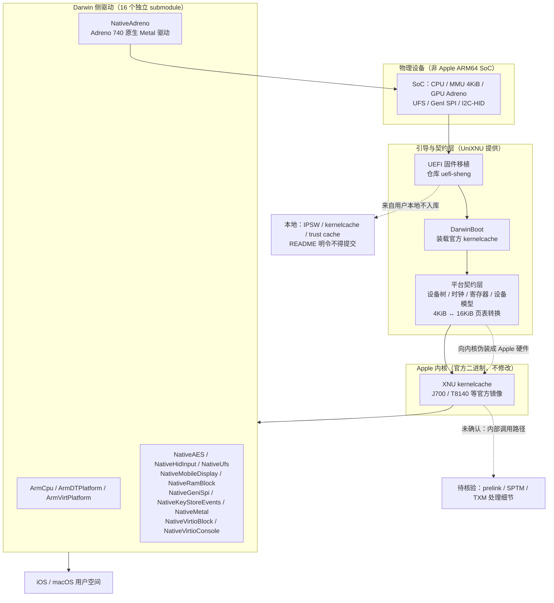

# UniXNU/UniXNU

## 一句话定位

一个独立项目，通过 UEFI 在非 Apple 的 ARM64 硬件上启动 Apple 的 iOS 与 macOS（XNU 内核），核心工作是补齐内核期望的 Apple 平台契约（设备树、驱动、4 KiB 页表补丁），并在 2026-10-22 宣布自研的原生 Adreno 740 Metal 驱动已在小米平板 6S Pro 上完全可用。

## 它解决的问题

Apple 的 XNU 内核不是为第三方 ARM64 SoC 设计的。它启动时期待一整套 Apple 私有平台契约：Apple 的设备节点、特定的 MMIO 寄存器布局、16 KiB 页表语义、以及 SPTM/TXM 安全监控调用。这些东西在 Qualcomm/MediaTek/瑞芯微 SoC 上一个都没有。

UniXNU 的做法是**不修改内核，而是补齐它看到的"硬件世界"**——构造出内核认得的那套假象。这与 Asahi Linux 的路线正好相反（Asahi 是重写 Linux 侧驱动去适配 Apple 硬件；UniXNU 是伪造 Apple 硬件去适配 Apple 内核）。README 的 news 段落记录了这一层的最新成果：原生 Metal 驱动已在小米平板 6S Pro（sheng）上完全工作，渲染服务器经 Adreno 740 合成系统 UI，被列入名单的进程各自获得独立的 Metal 设备。

## 为什么值得关注（2026-10-23）

**它的规模信号来自三处可核验的结构事实，而不是来自 star 数：**

1. **35 份设备文档**（`docs/devices/` 下的 amethyst / sheng / fajita / nuwa / pipa / piano / q2q / tb128fu / gta4l / … 共 35 个条目）。README 明确说明设备仓库用与主仓库相同的布局，其 modules 覆盖同名 modules，`package/` 成为构建树里的一个 kit——**这是一套已经被复用到至少 35 款设备的架构，不是单机型 hack**。
2. **16 个独立驱动的 submodule 组织**（`drivers/ArmCpu` `ArmDTPlatform` `ArmVirtPlatform` `DarwinBoot` `NativeAES` `NativeAdreno` `NativeGeniSpi` `NativeHidInput` `NativeKeyStoreEvents` `NativeMetal` `NativeMobileDisplay` `NativeRamBlock` `NativeUfs` `NativeVirtioBlock` `NativeVirtioConsole`）。**驱动不在主仓库里，各自独立公开、按需克隆**——这既是可复用性设计，也是一种责任边界划分。
3. **文档站在 docs/ 的一等位置**：`docs/concepts/{boot-chain,payload,prelink,security,userdata}.md`、`docs/drivers/{device-tree-matching,kexts,native-adreno}.md`、`docs/xnu/four-k-page-tables`、`docs/building.md`，配 `.github/workflows/{docs,macos}.yml` 两条工作流。文档文档站是 unixnu.com（VitePress，配置在 `docs/.vitepress/`）。

**README 里有一句对研究者很关键的自我约束**：不要把 Apple IPSW 文件、kernelcache、disk image、trust cache、Data seeds 或厂商固件放进本仓库，留在本地缓存或外部存储。这与 Macintosh 的 AGENTS.md 第一节是同一条规则的两个独立表述——**两个互不相识的项目在同一天各自把"不得提交 Apple 私有输入"写成了仓库级制度**。

## 热度来源判断

**热度主要来自"能让我的平板跑 iOS/macOS"这一具体愿望的直接满足，而非技术优雅度。** 750⭐ ⑂118 出现在创建后 3.5 天，fork/star 15.7% 显著高于本日其他三个项目（8.6% / 5.5% / 0.5%）。这个比例有明确的机制解释可核验：**fork 一个项目来尝试移植自己的机型，是这个项目的核心使用方式**——README 专设 `docs/porting/` 章节讲设备移植，35 份设备文档就是证据。

**必须说清的限制**：`subscribers_count = 3`（低于 star 数的 0.5%）、`open_issues_count = 6`、主仓库仅 **30 个 commit**、贡献者 API 返回 **6 人**。这说明它是一个**小团队、高完成度的作品**，而不是一个正在快速增长的开源生态。star 数在这里度量的是话题吸引力，不是社区规模。

## 关键技术亮点

1. **不 patch 内核，补齐平台契约**：README 的描述是「build driver, UEFI boot manager, module submodules and patches」——内核保持官方二进制，攻击面集中在"内核看到什么"。
2. **4 KiB 页表补丁作为独立概念**：`docs/xnu/four-k-page-tables` 与 README 的 Documentation 列表把它单列为一章，说明这是本项目的核心技术难点之一（XNU 用 16 KiB 页，多数 ARM64 SoC 的 MMU 只有 4 KiB 支持）。
3. **原生 Adreno 驱动而非虚拟化**：`docs/drivers/native-adreno.md` 记录 news 中的 Adreno 740 驱动——渲染服务器合成系统 UI，被列入名单的进程获得各自 Metal 设备。**这条路径与"软件渲染"或"GPU 透传"都不同**，是本项目最硬的一条声明。
4. **Linux 侧与 Darwin 侧的分离驱动**：`Native*`（Darwin kext/driver 对）与 `Arm*`/`DarwinBoot`（UEFI 与设备树侧）命名上的区分，让"哪一层跑在哪"从目录名就能读出。
5. **BSD-2-Clause-Patent 许可**：LICENSE 原文首行即 `Copyright (c) 2026, UniXNU contributors. All rights reserved.` + `SPDX-License-Identifier: BSD-2-Clause-Patent`。选专利授权而非 MIT，通常意味着作者考虑了潜在的专利主张——**在 Apple 硬件逆向领域这是一个有意义的信号**。

## 架构师速览

| 决策问题 | 研究判断 | 证据边界 |
|---|---|---|
| 系统边界 | **Apple 内核保持官方二进制不动**，系统边界划在"内核之下"：UEFI 引导链（`uefi-sheng` 等仓库）+ 一层平台契约提供者（设备树、时钟、寄存器、设备模型）+ 一层 Darwin 侧驱动（16 个 submodule）。数据面是内核对硬件的读写；控制面是构建系统按设备选择 modules 与 kit | 全部来自 README 的 Repositories 表（UniXNU = build driver + UEFI boot manager + module submodules + patches；UniXNU-sheng = 设备仓库；uefi-sheng = UEFI 固件移植）+ `.gitmodules` 的 16 条 URL + README 的 Documentation 目录清单；**「平台契约提供者」的具体实现形式（是 kext、是伪装固件、还是两者）README 未展开，`docs/concepts/{prelink,userdata,payload}.md` 存在但本窗口未取内容** |
| 主路径 | 设备上电 → UEFI 固件（移植版）→ `DarwinBoot` 把官方 kernelcache 载入 → 平台契约层向内核呈现它认识的设备与寄存器 → XNU 启动到 EL1 → `Native*` 驱动接管实际硬件（含 Adreno GPU 经自研 Metal 驱动）→ 用户空间 | 由 README 的 boot chain 文档结构 + `.gitmodules` 分层 + news 段落推出；**「官方 kernelcache 从哪来」README 明令不得入库，只能来自用户本地**，`docs/concepts/payload.md` 应有说明但本窗口未取 |
| 关键权衡 | **伪造 Apple 硬件 vs 重写 Linux 侧驱动**（UniXNU 走前者，与 Asahi 路线相反）· **保持官方内核 vs patch 内核**（保持官方意味着内核漏洞与兼容性完全继承）· **驱动独立仓库 vs 单一大仓库**（前者让移植者只需 clone 自己机型需要的部分，后者便于统一 CI）· **BSD-2-Clause-Patent vs 宽松许可**（含专利条款在逆向领域是保护，但会劝退一部分商业使用者）· **原生 GPU 驱动（工程量大）vs GPU 透传/虚拟 AGX**（README 提到 `gpu/agx*` 是"更早的虚拟 AGX 模型，保留作参考"——说明原生路线是后来的选择） | README 的 news 段（原生 Metal 驱动已工作）+ Documentation 清单（four-k-page-tables 单列）+ `.gitmodules` 的 16 个独立驱动 + LICENSE 首行的 SPDX 标识 + `docs/drivers/native-adreno.md` 存在；**「为什么从虚拟 AGX 转向原生驱动」README 未解释** |
| 最小 PoC | 1. 确认目标是 35 份 `docs/devices/*.md` 里**没有覆盖的机型**（这是最难的一步，也是本项目唯一的真实门槛）→ 2. 用 `docs/concepts/boot-chain.md` 确认启动链，在已支持的机型上先把整条链跑通作为对照 → 3. 按 `docs/drivers/device-tree-matching.md` 做设备树匹配 → 4. 按 `docs/porting/` 复制最接近的机型仓库作模板，其 modules 覆盖同名 modules → 5. **把官方 kernelcache 与固件留在本地不入库**（README 明确要求），只用 `.github/workflows/macos.yml` 跑构建 → 6. 只验证一件事：**能进内核并跑起来**，不要一上来碰 GPU | 顺序按依赖倒排；**第 1 步（机型是否已被覆盖）是决定 PoC 可行性的唯一变量，第 5 步是合规前提而非可选项**；**README 未给"最低要求"的机型门槛（内存、存储、特定 SoC），这一项本日报无法核验** |

> 证据边界：此图只采用本档案已核验描述（README 摘录、`.gitmodules` 16 条 URL、`docs/` 目录结构、news 段落）。虚线节点标为未确认路径，不得视为项目实现事实。

## 架构启发

**它最值得学的一条不是技术，是组织方式**：把 16 个驱动拆成独立公开仓库、把 35 个机型各做成一个仓库、主仓库只保留构建系统与文档。这套结构直接对应这个项目的真实使用模式——**大多数用户只需要自己机型的那一份，而不是全部**。相比之下，一个 200 MB 的单仓库即使 star 数相同，对移植者的实际可用性也低一个量级。

第二条启发是**「不 patch 上游，而是补齐契约」**这个取向。在大量依赖第三方内核的项目里（Asahi、部分 Android 移植），patch 内核是常态，结果是每次上游升级都要 rebase。UniXNU 选择保持官方 kernelcache，把所有改动压在平台层——**代价是继承内核的全部漏洞与不兼容，收益是内核升级时零冲突**。这是一个明确的、可被争论的权衡。

## 定位判断

**长尾单机型移植基础设施（观察型）。** 它既不是消费级产品（35 份设备文档对应的是 35 个细分机型，不是 35 亿用户），也不是通用工具（换一款 SoC 就是一次新移植）。它的正确定位是**为特定机型提供 iOS/macOS 运行能力的一组工程师级资产**，以及一份可复用的"平台契约"方法论。

与 Asahi Linux 的关系值得明确：Asahi 是**在 Linux 上重新实现 Apple 硬件的驱动**（M 系列 Mac 的 Linux 支持），UniXNU 是**在 Android/国产平板硬件上重新实现 Apple 软件的平台依赖**。两者方向正交，技术栈几乎不重叠。

## 风险 / 局限 / 泡沫点

1. **⚠️ GitHub `license.spdx_id` 为 `NOASSERTION`，而 LICENSE 文件首行明写 `SPDX-License-Identifier: BSD-2-Clause-Patent`**。以文件为准是可用的 BSD-2-Clause-Patent；但 GitHub 侧无法被自动识别为标准许可证，意味着依赖 license 扫描器的工具会把它当成非标准协议。**这是可核验的元数据与文件内容不一致**，与 10-22 记录的 ikow/php2shell-poc 那处性质相同但严重程度低得多（此处文件本身清晰无歧义）。
2. **没有任何 release**：`releases` API 返回空数组。分发路径是 clone + submodule + 自建，这符合该项目性质，但也意味着没有开箱即用的产物。
3. **⭐ star 数与社区规模严重不匹配**：750⭐ ⑂118 但 `subscribers_count` 仅 **3**、贡献者仅 **6 人**、主仓库 **30 个 commit**。**fork/star 15.7% 是本日四个项目中最高的，但这个比例反映的是"每个人 fork 去移植自己的机型"，而不是"社区在共同建设"**。
4. **原生 GPU 驱动的声明无法在本日报核验**：news 段落称 Adreno 740 驱动在小米平板 6S Pro 上完全工作，但**仓库中不含可运行的验证产物**（按其自身规则也不能含），也没有第三方复现记录。
5. **设备覆盖是查表式的，不是通用的**：用户拿到一个未被 `docs/devices/` 覆盖的机型，成本不是"装一下"而是"做一次移植"。README 没有给出"最低可移植门槛"（内存、存储、特定 SoC 特性要求）。
6. **法律与地区风险**：本项目的工作对象是 Apple 私有内核与固件。README 主动禁止提交私有输入是良好的合规姿态，但**这不构成对整体法律风险的评估**；中国大陆用户群（35 份设备文档里 sheng/fajita/nuwa/pipa/piano/q2q/gta4l 全是国产机型代号）意味着实际使用者集中在特定法域。

## 与同类项目的关系

- **vs Asahi Linux**：正交。Asahi 在 Linux 上支持 Apple Silicon；UniXNU 在非 Apple ARM64 上支持 Apple 内核。
- **vs Macintosh（本日另一个项目）**：**同日、同题、不同路径，且互相独立**。Macintosh 走 EL2 hypervisor + 造一台 Mac；UniXNU 走 UEFI + 伪造平台契约。两者都独立地在 AGENTS.md/README 里写下"不得提交 Apple 私有输入"。
- **vs Corellium / UTM / VMware Fusion 的免费层**：它们是商业产品的免费通道，有分发物有文档有用户支持；UniXNU 是没有分发物的工程资产。
- **vs 项目内更早的虚拟 AGX 模型**：README 提到 `gpu/agx*` 目录是"更早的虚拟 AGX 模型，保留作参考"——这是该项目自己的历史路径，原生驱动是后来的选择。

## 是否值得持续跟踪

**值得跟踪，但跟踪方式应是"设备覆盖表"而非"star 数"。** 理由与热度无关：它是本日四个项目里**唯一一个把难度直接写成可查询索引的项目**（35 份设备文档），这使得"这件事能不能做"从玄学变成了查表。

**7 天后判断标准**：若 `docs/devices/` 从 35 增长到 40+，说明有外部贡献者在持续做移植，社区在形成；若停在 35，则它是一个完成度很高但封闭的作品。**两个结果都不影响其方法论价值，但会影响"生态"这个说法。**

## 后续观察点

- 原生 Adreno 驱动是否会扩展到除 sheng/Adreno 740 之外的 GPU 型号（news 只声明了一个平台）
- 是否出现第一个由外部贡献者提交的 `docs/devices/*.md`（35 份设备文档目前看全是项目自己的）
- 是否会发布任何形式的预构建产物或设备镜像（当前 `releases` 为空）
- macOS 27 与 iOS 最新版本的内核变更如何被跟进——保持官方内核意味着每次 iOS 更新都要重做契约层

---
*首次记录：2026-10-23*
## 最近动态（2026-10-24）

**2026-10-24：** ⭐ 750 → **856**（+106），⑂ 118 → **148**（fork/star 15.7% → **17.3%**），subs 3 → **4**，oi 6 不变，`pushed_at` 2026-10-23T15:29:35Z。`license.spdx_id` 仍为 `NOASSERTION`（LICENSE 首行仍写 `SPDX-License-Identifier: BSD-2-Clause-Patent`），**这是 10-23 记录的两处元数据不一致之一，一周内未修复**。本日新增第三个同领域项目 oosexgang/hackios-xnu-kernel（1,064⭐），**而它选择了与 UniXNU 相反的技术路线（直接编译 Apple 开源 XNU 并打补丁）**——见 [2026-10-24 日报](../daily/2026-10-24.md)。**跟踪方式仍是「设备覆盖表」而非 star 数**：观察 `docs/devices/` 是否从 35 增长到 40+。
