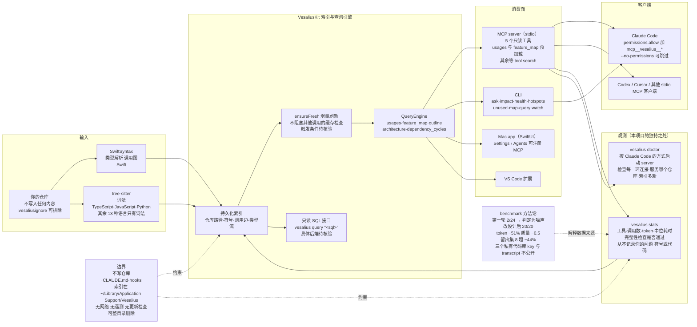

# haplollc/Vesalius

## 一句话定位

为 Claude Code 提供一张本地代码图——SwiftSyntax 解析出的调用图 + MCP server + CLI + Mac app + VS Code 扩展，让 agent 用一次带 file:line 的查询替代一串搜索与读文件。

## 它解决的问题

**当 agent 回答「谁调用了这个函数」「改名要改什么」「某个功能在哪实现」时，它的方式跟一个第一天来新同事一样**：搜名字、开文件、再搜、再开文件，逐步拼出答案。**每一步都花时间和 token，在真实代码库上会累积得很快。**

Vesalius 的思路是：**把仓库读一次，记下一切如何连接**——哪个文件用什么、谁调用什么、某个功能实际在哪——然后让 Claude Code 直接问它，通常一次调用就得到带精确 file:line 引用的答案。

**它还解决一个更少被讨论但更痛的问题：「agent 到底会不会调我的工具？」** MCP 生态里最常见的抱怨正是这个——工具装好了，agent 从来不用，而开发者不知道原因。Vesalius 用 `vesalius stats`（本地计数）与 `vesalius doctor`（连接诊断）把这件事变成可观测的。

## 为什么值得关注（2026-10-24）

**因为它的 benchmark 是本日报里唯一一个「作者先写下自己的失败」的。**

具体地说：**第一轮 24 次运行中，Claude 只在 2 次里调用了 Vesalius。作者据此判定那一轮 13% 的 token 差距「主要是 run-to-run 噪声」——并把这个失败、失败的原因、以及由此触发的重新设计全部写进 README。**

这在一个普遍只发布正面数字的领域里非常罕见。它的价值不在于「51% token 节省」这个数字，而在于**它演示了如何回答「这个工具到底有没有用」这个问题**：

1. 先做一个能证伪的对照实验；
2. 如果结果落在噪声里，就承认它是噪声；
3. 找出根因（不是 agent 笨，是 Claude Code 把 MCP 工具藏在 tool search 后面而几乎从不搜索）；
4. 改设计（按问题类型各配一个更锋利的工具 + 预加载最常被问的两个）；
5. 重做，得到 20/20；
6. **并且逐类列出自己没赢的地方**（功能在哪 −2.1 分、符号在哪 −1.7 分；4 题 token 反而更多）。

**这六个步骤本身比它的功能列表更有迁移价值。**

## 热度来源判断

**61⭐ / ⑂1 / subs 1 / 3 个 commit / contributors 1 人——尚无采用信号。**

热度来源是「Agent 工具 + 本地优先 + MCP」这个组合在 2026 年的关注度，加上 README 里那张 benchmark 图的传播力（**token 减 51%、20/20 全调用**这种数字很容易被截图转发）。

**但它还没有被采用的任何证据**：fork-star 1.6%（**本批最低**，且 fork 与它无关——它是一个需要 brew 安装的 macOS 应用）、subscribers 1、3 个 commit 全部集中在 2026-10-23 一天内。

**它的形态是「刚公开的快照」**，与 10-23 记录的 Macintosh（11 commits、5 小时内完成）同类：**阅读它的 README 快照不能反映它今天的真实能力与成熟度。**

## 关键技术亮点

1. **⭐ 五工具按问题类型分工，而不是一个大而全的 explore 工具。** `usages`（谁调用 X / 改名要改什么 / 含只有类型推导才能看见的使用点，**去掉同名 lookalike**，附完整性检查与 `change: rename|signature|remove` 的编辑清单与要跑的测试）/ `feature_map`（按角色分组的核心类型与函数，附决定性行、框架与 I/O 调用、配置与环境链接、调用点）/ `outline`（声明与签名、行范围、首句文档、按顺序的调用，**约为读整个文件 token 的一 fifth**）/ `architecture`（target 与产品类型、包、文件夹、依赖方向、环、跨 target 链接）/ `dependency_cycles`（范围内每个环，附每条边的 import 行与被导入名的使用位置，**以及扫描了什么，所以「没有其他环」不需要复查**）。
2. **⭐ 预加载策略是实测得出的，不是拍脑袋。** `usages` 与 `feature_map` 预加载（约 +900 token 上下文），其余三个等 Claude Code 的 tool search 按需加载。**这正是把 2/24 提到 20/20 的改动。**
3. **⭐ 完整性检查作为返回值的一部分。** `usages` 的输出形如 `complete: "ensureFresh" occurs 10×: 3 resolved to the target, 1 declaration, 2 strings, 4 non-source; 0 unresolved`——**它告诉 agent「我已经找过多少次、有没有没解析的」**，而不是给一个孤零零的列表。
4. **⭐ 本地计数让「agent 用没用」可观测。** `vesalius stats` 显示工具、调用数、token、每次答案的中位耗时、完整性检查是否通过；**它从不记录你的问题、符号或代码**（`VESALIUS_STATS=off` 或 `--reset` 可关闭/清空）。`vesalius doctor` 按 Claude Code 的方式启动 server 并检查每一环连接、它服务哪个仓库、索引有多新。
5. **类型感知的调用图。** Swift 走 SwiftSyntax 的类型解析（**包括通过类型流但从不点名符号的使用**——`via 172 │ return IndexLocation.allIndexed()…`），TypeScript / JavaScript / Python 走 tree-sitter。
6. **setup 只做三件事，且可完全回退。** 注册 `vesalius mcp`（Claude Code `--scope user`，检测到 `codex` 命令时也注册 Codex）、把 `mcp__vesalius__*` 加入 `~/.claude/settings.json` 的 permissions.allow、索引当前仓库。**它从不写你的仓库、CLAUDE.md 或 hooks**；`--dry-run` 先显示计划；`vesalius setup --undo` 完全回退。
7. **不止 MCP。** 同样的能力暴露为 CLI（`usages` / `feature-map` / `outline` / `architecture` / `dependency-cycles` / `ask` / `impact` / `health` / `diagnostics` / `hotspots` / `unused` / `map` / `query "<sql>"` 对索引做只读 SQL / `watch` / `doctor` / `stats`），外加一个 SwiftUI Mac app 与一个 VS Code 扩展。

## 架构师速览

| 决策问题 | 研究判断 | 证据边界 |
|---|---|---|
| 系统边界 | ① **索引与图引擎**（VesaliusKit：SwiftSyntax 解析出的调用图 + 类型推导流 + 持久化索引）② **MCP server**（stdio，暴露 5 个只读工具）③ **CLI**（`vesalius <command>` 全套，含 `--json`）④ **Mac app**（SwiftUI，Settings › Agents 可注册 MCP）⑤ **VS Code 扩展**。**边界划在「索引存放位置」**：**不写入用户的仓库、CLAUDE.md 或 hooks**，索引与使用计数在 `~/Library/Application Support/Vesalius`，**可整目录删除**；`.vesaliusignore` 提供仓库内排除 | README 的 What setup changes and nothing else 节、五个工具表、FAQ 的 How do I remove it 与 It answered about the wrong folder 节；**索引的存储格式与查询后端（README 提到 `vesalius query "<sql>"` 对索引做只读 SQL）本窗口未取具体实现，待核验** |
| 主路径 | `vesalius setup` 注册 MCP + 加一条权限规则 + 索引当前仓库 → Claude Code 提问 → tool search 命中（`usages`/`feature_map` 预加载，其余按需）→ **MCP server 查询本地索引 → 返回带 file:line 的答案 + 完整性检查** → Claude 用 grep/读文件做二次核对（**benchmark 中每题 2.65 次搜索/读/shell 调用，对比无 Vesalius 时的 7.2 次**）→ `vesalius stats` 记录本次调用（仓库路径、工具、答案大小与耗时、完整性检查是否通过） | README 的 Quick start 输出（含真实 `vesalius setup` 与 `vesalius stats` 输出）、The five tools 节、Is Claude using it? 节；**索引刷新时机（`ensureFresh` 的增量判定）与 `--no-refresh` 的失效条件未完全核验** |
| 关键权衡 | **预加载两个工具（+900 token 上下文）vs 全按需加载**（这是把 2/24 提到 20/20 的关键改动，代价是固定上下文成本）· **类型感知的调用图 vs 纯 tree-sitter 词法**（Swift 走类型解析准确，但**只有 4 种语言有调用图，其余 13 种只有词法**）· **本地索引 vs 服务端索引**（无网络、无遥测、无 `.codegraph/` 残留、无更新检查）· **只读工具 vs 可写工具**（所有工具只读，编辑仍交给 agent）· **私有 benchmark 数据 vs 完全可复现**（保留数据防泄漏，代价是无法精确复现）· **单平台 vs 跨平台**（只在 Apple silicon 上，放弃三大平台市场） | README 的 How it compares 表与 Where it helps 节、benchmark 的留出集说明；**「为什么放弃 Linux/Windows」README 未解释** |
| 最小 PoC | 1. **确认硬件门槛**：Apple silicon + macOS 15+（**这一步不成立则整个 PoC 不成立**）→ 2. `brew install haplollc/tap/vesalius` → 3. `vesalius setup`（**建议先 `--dry-run` 看它要改什么**）→ 4. **用 `vesalius doctor` 确认连接**（它按 Claude Code 的方式启动 server 并检查每一环）→ 5. 在你自己的仓库问一个问题，例如「谁调用 X，改名要改什么」→ 6. **故意问一个代码里不存在的符号，观察它是否返回「0 unresolved」并给出完整性检查**（**这一步验证它是否真的在解析而非猜测**）→ 7. **跑 `vesalius stats`，确认 Claude 确实调用了它**（**若调用数为 0，回到 Vesalius 的 FAQ：先按名要求一次「use vesalius to find who calls X」，因为预加载不等于会被调用**）→ 8. `vesalius setup --undo` 验证可完全回退 → 9. **在自己的代码上跑一次它自己的 benchmark harness**（`docs/benchmark/run_benchmark.py`）以获得对自己代码库的数字 | **第 6 步是唯一能证伪「它真的在解析」的步骤**（与 HackiOS 的 checks.md 同构）；**第 7 步是本项目的核心价值所在**——**没有 stats，agent 调没调根本不可见**；**第 9 步能给出比 README 更贴合自己代码库的数字** |

## 架构启发

**第一条启发：「agent 不会用我的工具」是一个可诊断的工程问题，而不是玄学。** Vesalius 的根因定位非常具体：**Claude Code 把 MCP 工具藏在 tool search 后面，而它几乎从不搜索。** 由此得出的解法不是「写更好的工具描述」，而是**改变工具的装载方式**（预加载最常被问的两个）+ **按问题类型拆分粒度**（让每个问题有一个「更锋利的」工具）。**这是一个可以直接迁移到任何 MCP 工具设计上的结论。**

**第二条启发：一个负结果比一个正结果信息量更大。** 「第一轮 24 次里只调用了 2 次，所以那一轮的数字是噪声」——**这句话是整个项目最有价值的部分**，因为它阻止读者把噪声读成效果。**它同时给出了第二天的行动依据。**

**第三条启发：把「我没赢的地方」做成表格，比只报平均数诚实得多。** 逐类质量表（功能在哪 −2.1、符号在哪 −1.7）+ 「20 题中 4 题 token 反而更多、11 题质量移动超过 1 分」——**这些数字让读者能自己判断「这个工具对我的场景是否有用」，而不是被迫接受一个平均值。**

**第四条启发：把「不可见」变成「可观测」，是 MCP 生态当前最缺的一环。** `vesalius stats` 记录工具、调用数、token、耗时、完整性检查是否通过，**但从不记录你的问题、符号或代码**——**这个边界设计让「可观测」不以「隐私泄漏」为代价**，而这正是它能安心在本地跑的前提。

## 架构图（MMD）

> 证据边界：此图只采用本档案已有可核验描述；「待核验」节点不应视为项目实现事实。

## 定位判断

**观察型工具（有真实技术含量，但尚未被采用）。**

在「给 agent 提供代码上下文」这个 2026 年的拥挤赛道上，它的定位由三个边界定义清楚：

1. **本地优先 + 只读。** 索引在自己机器上，不上传代码，**在仓库里不留任何东西**，无网络无遥测。这与 CodeGraph（默认开匿名遥测与更新检查）、graphify（可选的 LLM pass over docs）形成对比。**「Vesalius itself never uploads your code」是它最清晰的定位声明。**
2. **只覆盖少数语言的类型感知调用图。** Swift 是它自己写的语言，解析质量最好；TypeScript/JavaScript/Python 走 tree-sitter 词法；**其余 13 种语言只有词法**。**这比纯 tree-sitter 的工具更准，比全语言覆盖的工具更窄。**
3. **只在一个平台上。** macOS 15+ Apple silicon。这既是它的质量保证（性能与系统集成）也是它的天花板。

**它不是所有人的正确工具——而作者自己知道这一点并写了出来**（README 的 How it compares 表逐项列出它输给 CodeGraph / graphify / context-mode 的场景：Linux/Windows、纯词法语言、需要压缩命令输出的场景）。**这种自我定位的诚实度是它区别于同赛道项目的一个可观察特征。**

## 风险 / 局限 / 泡沫点

- **⚠️ 无根级 LICENSE 文件。** `?recursive=1` 全树查询确认仓库里只有 `VesaliusKit/Sources/CTreeSitter/LICENSE`、`CTreeSitter/LICENSE-ICU`、`CTreeSitterGrammars/LICENSES/tree-sitter-{javascript,python,typescript}.LICENSE` 与 `vscode-extension/LICENSE`——**全部是第三方许可**。GitHub 的 `license` 字段为 null。**按默认版权保留处理。这与本周记录的其他几例性质不同：不是「许可证识别失败」，而是「根本没有许可证声明」——这意味着默认无授权使用/修改/分发。**
- **⚠️ 本日新增发现的元数据不一致，累计第四类四例。**
- **⭐ 平台限制极硬。** 只支持 Apple silicon + macOS 15 或更高。**这排除了绝大多数 Linux/Windows 用户**，而后者是开发者的多数。
- **调用图的语言覆盖窄。** 4 种语言有调用图，其余 13 种只有词法——**而「谁调用了 X」这个问题在词法模式下必然有误报与漏报**（README 自己举的例子里 `usages` 要「去掉同名 lookalike」并给出完整性检查，正是为了应对这个）。
- **61⭐ 与 subs 1 说明尚无采用信号。** 3 个 commit 全部集中在 2026-10-23 一天内（05:05、21:06、21:13），**这是一个刚公开的快照**。
- **benchmark 无法精确复现。** 三个代码库是作者私有应用，**答案 key 与 run transcript 保持私有**（防泄漏进未来的工具设计与训练数据）。judge 指令与 harness 公开，但**外部读者拿不到同样的数据**，因此只能相信作者的数字。
- **benchmark 的样本量小且有方向性偏差。** 20 题、6 个代码库、每题一次运行一次评审；**12 题是它对着建的**（留出集只有 8 题）。作者自己说明了这点并给了留出集数字，这是诚实的，但**样本量决定了「−51%」这个数字的置信区间必然较宽**。
- **性能与索引规模的关系未知。** README 只给了「256 files in 3.6 s」这一个索引速度数字（在其自身仓库上）；**一个百万行级别的第三方代码库上的索引时间、内存占用与增量刷新延迟均未说明**。
- **「≈1/5 tokens」的 outline 优势来自其自身仓库的文档密度**，**未在第三方代码库上验证**。

## 与同类项目的关系

Vesalius 自己在 README 里做了完整对比，本档案照录并标注证据边界：

| 维度 | **Vesalius** | CodeGraph | graphify | context-mode |
|---|---|---|---|---|
| agent 拿到什么 | 按函数分组的 uses、改名编辑清单与要跑的测试、feature maps、outlines | 一个 `explore` 工具返回源码、调用路径与影响半径 | 对代码/文档/媒体的图查询（`query`/`path`/`explain`） | 沙箱 + 工具输出搜索，压缩后保留会话记忆 |
| 调用图 | **Swift（类型解析）、TypeScript、JavaScript、Python**；其余 13 种只有词法 | 30+ 语言（tree-sitter） | 约 40 语言（tree-sitter） | 无（索引输出而非代码） |
| 运行平台 | **macOS 15+ Apple silicon** | macOS/Linux/Windows | macOS/Linux/Windows | macOS/Linux/Windows |
| 在你仓库里留下什么 | **什么都不留** | `.codegraph/` 目录 | `graphify-out/` 目录 | 什么都不留 |
| setup 加了什么 | 一条 MCP 条目 + 一条权限规则 | 一条 MCP 条目 + 权限规则 + prompt hook + CLAUDE.md 块 | 一个 skill + CLAUDE.md 块 + always-on 模式的 hooks | 多数工具加 hooks + skills |
| 网络 | **无** | 匿名遥测（默认开）+ 更新检查 | 可选的 LLM pass over 文档与媒体 | 更新检查 |

**补充几条本日报的观察：**

- **vs 单纯的文件读取 / grep**：Vesalius 的增量在「跨文件的类型流」（`via 172 │ return IndexLocation.allIndexed()…` —— 通过类型流但从不点名符号的使用）与「完整性计数」（`occurs 38×: 28 resolved, 1 declaration, 2 comments, 7 non-source; 0 unresolved`）上，**这两项是 grep 与文件读取都给不出的**。
- **vs 纯 tree-sitter 方案（CodeGraph / graphify）**：**Swift 上 Vesalius 有类型解析因而更准，但覆盖面窄得多。** README 自己说「If you work on Linux or Windows, or mostly in languages Vesalius reads only lexically, CodeGraph or graphify will serve you better.」
- **vs context-mode / rtk**：**这些工具压缩的是命令与日志的输出，Vesalius 不碰这个领域**——README 明确说二者可以配对使用。**这是一个「互补」而非「竞争」的关系。**
- **vs semble / mrw**：semble 提供任意语言的快速语义代码搜索，mrw 批量处理 agent 的读与写——**README 把它们列为可搭配的补充**。
- **vs 自建 agent 索引方案**：Vesalius 的差异化在于它是**现成的、五个工具分工明确的、且有本地计数**的方案，而不是让用户自己搭。

## 是否值得持续跟踪

**值得，但理由不是它的功能，而是它的方法论样本价值。**

理由有两层：

1. **方法论层面（更持久）**：它是本日报唯一一个完整演示了「如何诚实评估一个 agent 工具是否有用」的项目——先做可证伪的对照、承认噪声、找根因、改设计、重做、**并逐类列出没赢的地方**。**这六个步骤可以迁移到任何 MCP 工具、任何 agent 集成的评估。**
2. **产品层面（有限）**：它有真实技术含量（类型感知的调用图、完整性检查、本地计数），但**平台限制极硬（仅 Apple silicon + macOS 15+）、语言覆盖窄（4 种）、且 61⭐ / 3 commits 说明尚未被验证过。**

**必须说清：今天没有人应该把它引入关键工作流。** 无 LICENSE（默认版权保留）这一条本身就足以让任何商业或合规敏感的使用停在门外。

具体观察点：
1. **是否补上根级 LICENSE**——**这是它从「不能用于任何受合规约束的场景」变成「可以」的唯一门槛。**
2. **是否有第二个贡献者**（当前 1 人、3 commits 集中于一天）。
3. **是否扩大语言覆盖或平台**（尤其 Linux 与 Windows）。
4. **`subscribers_count` 与 fork 数的变化**（当前 1 与 1）。
5. **benchmark 是否开放更多代码库或答案 key**（当前 6 个代码库中 3 个私有、key 与 transcript 不公开）。
6. **索引在大型第三方代码库上的性能数据**（当前只有其自身仓库的「256 files in 3.6 s」）。

## 后续观察点

- 是否发布根级 LICENSE 以及采用何种许可（MIT 与 Apache-2.0 在 AGPL/MIT 混合的 agent 工具生态里各有拥趸）。
- `docs/benchmark/results.json` 的后续版本是否新增代码库或题数（可核验的公开指标）。
- 是否新增 `vesalius stats` 的聚合视图（当前只有 per-repository 与 `--all`）。
- `vesalius ask`（自然语言排序文件/符号/行范围）与 `vesalius impact`（影响半径）在 README 中的描述最简略，**这两个工具的实际能力边界最值得追问**。
- 索引的存储后端与 `vesalius query` 的 SQL 方言（决定它能否被用户自己的工具消费）。
- 是否出现 fork-star 的实质性上升（当前 1.6%，若开始有人 fork，说明出现了「二次开发」这类新用法）。

---
> 数据来源: GitHub API (2026-10-24 CST 06:00 前后 / UTC 2026-10-23T22:13Z 快照) | Stars: 61 | Forks: 1 | Subscribers: 1 | Open Issues: 1 | License: null（仓库根目录无 LICENSE 文件）| 语言: Swift | 创建: 2026-10-22T05:01:30Z | 推: 2026-10-23T21:13:46Z | Commits: 3 | Contributors: 1 | Releases: 1 | Size: 7870 KB
