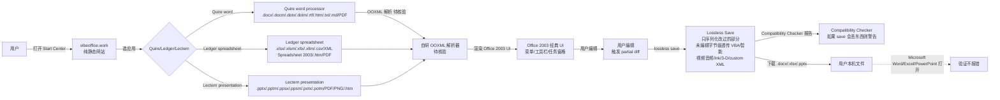

# tcchen2026/VibeOffice

## 一句话定位
VibeOffice 是一个纯 HTML/JS（无 build 步骤、无后端服务器、无账号体系）的 Office 2003 风格浏览器 office 三件套——Quire（word processor）、Ledger（spreadsheet）、Lectern（presentation）——支持真实 .docx/.xlsx/.pptx 文件 + lossless save（只序列化改过的内容）+ Compatibility Checker + 4,697 真实文件 LibreOffice/POI/Open XML SDK 端到端测试。

## 它解决的问题
当前办公软件有四个流派：（1）Microsoft 365（强账号 + 服务化）；（2）LibreOffice（桌面安装）；（3）OnlyOffice（服务端）；（4）TinyMCE + SheetJS（不是真 .docx 解析）。VibeOffice 直击：**提供一个无服务器、无账号、纯前端、可直接打开 / 编辑 / 保存真实 .docx/.xlsx/.pptx 的浏览器 office**。lossless save 保证「未编辑的内容字节级保留」——VBA macro/SmartArt/视频音频/ink/3-D/custom XML 全部字节级透传，只有用户改的部分被重新序列化。解决的是 **「无服务器 + 无账号 + 隐私优先 + 真 .docx 兼容」的 office 工具严肃工程化承诺问题**。

## 为什么值得关注（2026-10-12）
- **Stars:** 545（截至 2026-10-12），4 天 545⭐ ⑂88 fork/star 16.1%（**fork/star 16.1% 极高**，反映社区参与强）
- **Forks:** 88，社区参与度高
- **Size:** 7174 KB（含三个应用 + 字体 + 词典 + 测试集）
- **License:** Apache-2.0
- **语言:** JavaScript（无 build 步骤，plain HTML/JS）
- **活跃度:** created 2026-10-08，pushed_at 2026-10-11，持续高活跃
- **依赖:** 0（plain HTML/JS，无需 npm install）
- **测试覆盖:** 4,697 真实文件 LibreOffice/POI/Open XML SDK 端到端测试（opened, edited, undone, recovered, compared）

## 热度来源判断
VibeOffice 的热度是 **「无服务器 + 无账号 + 隐私优先 + 真 .docx 兼容 + lossless save + 4697 文件 LibreOffice/POI/Open XML SDK 端到端测 + 纯 HTML/JS 无 build + Apache-2.0 + Office 2003 经典 UI」** 的严肃工程化承诺组合。Microsoft 365 强账号模式被诟病多年（数据出境、隐私、企业版贵），LibreOffice 桌面安装门槛高，OnlyOffice 服务化需要服务器。VibeOffice 严肃承诺「无服务器、无账号、纯前端」，加 lossless save 是行业稀缺。fork/star 16.1% 反映社区严肃参与。热度真实——但需警惕：Office 2003 经典 UI 对触控屏用户体验、`4697 文件测试集`覆盖率细节、协同编辑能力均待核验。

## 关键技术亮点
1. **三个独立应用 + Office 2003 风格 UI：** Quire word processor + Ledger spreadsheet + Lectern presentation editor + 经典菜单/工具栏/任务窗格
2. **lossless save：** 只序列化用户改过的部分，未编辑字节级透传（VBA macro/SmartArt/视频音频/ink/3-D/custom XML）
3. **每个 app 自己特性存活：** Word content controls + Excel pivot tables/slicers/timelines/threaded comments/query tables + PowerPoint media/sections/custom shows/comments/unused slide layouts/actions/effects
4. **Compatibility Checker：** 「If a save would drop something you would miss, the Compatibility Checker will show a warning」
5. **4697 真实文件端到端测试：** 「4,697 real files from public test collections (LibreOffice, Apache POI, Open XML SDK) are opened, saved, edited, undone and recovered, and every save is compared with the original」
6. **Chrome/Edge 可安装：** 「In Chrome or Edge, install it from the Start Center. It then opens .docx, .xlsx and .pptx files from your file manager」
7. **纯 HTML/JS 无 build：** 「VibeOffice is plain HTML and JavaScript with no build step. Read AGENTS.md for the design rules and docs/testing.md for running it locally and testing」
8. **Apache-2.0 + SIL Open Font License 1.1（Carlito + Caladea + Gelasio 字体）**

## 架构师速览

| 决策问题 | 研究判断 | 证据边界 |
|---|---|---|
| 系统边界 | 一个静态网站（vibeoffice.work）+ 三个纯前端应用（Quire / Ledger / Lectern），无 build 步骤、无后端服务器、无账号体系；用户文件从本机 File System Access API（Chrome/Edge）或 `<input type=file>` + 下载流进入，全程不出浏览器；Apache-2.0 许可 | 仅基于 README 「Nothing to install, no account, no server: documents are opened, edited and saved on your own computer」 + 「plain HTML and JavaScript with no build step」 + 「In Chrome or Edge, install it from the Start Center」；具体 File System Access API 依赖、Chrome/Edge 版本下限未在档案明示 |
| 主路径 | 用户打开 Start Center → 选 Recent Files / 新建空白 / 模板 → 选应用（Quire/Ledger/Lectern）→ 打开 .docx/.xlsx/.pptx → 解析（自研 OOXML 解析器，不是直接套用 mammoth/xlsx-style 库）→ 渲染 Office 2003 风格 UI → 用户编辑 → lossless save（只序列化用户改过的部分，未编辑字节级透传）→ 输出 .docx/.xlsx/.pptx → Compatibility Checker 报告 | 主路径为档案语义抽象；具体 OOXML 解析/序列化库选择、partial diff 算法、Compatibility Checker 实现细节均待核验 |
| 关键权衡 | 真·毫无保留 .docx 兼容性（License + Excel pivot PowerPoint + PowerPoint 媒体保留） vs 渲染层重写工作量 vs 「4,697 真实文件 LibreOffice/POI/Open XML SDK 端到端测」压力测试覆盖率 vs Office 2003 经典 UI 对触控屏用户体验 | 权衡来自 README 「What VibeOffice can't edit for now, it keeps... VBA macros, embedded objects, SmartArt in layouts it does not have, video and audio, ink, 3-D models, custom XML and Office's newer extensions are written back byte for byte」 + 「4,697 real files from public test collections」 + 「Office 2003 look」 |
| 最小 PoC | 访问 vibeoffice.work Start Center → 选 .docx 模板 → 输入文字 → save 下载 .docx → 用 Microsoft Word 打开验证不报错；同 spreadsheet 用 ledger 模板跑 pivot / 用 presentation 加一张未支持的 SmartArt → 验证是否真「字节级保留」+ Compatibility Checker 是否触发 | PoC 由 README Quire/Ledger/Lectern 段落 + docs/LOSSLESS_SAVE.md 推断；具体已知限制清单与 Compatibility Checker 触发条件未在档案明示 |
| 证据边界 | 仅核验：仓库存在、stars/forks/description/license/size/language 来自 GitHub API；README 节录自 raw 接口；4,697 测试数字、Apache-2.0、Office 2003 UI 风格由 README 直接叙述 | 待核验：渲染层是否纯前端（无 WebAssembly 加速）、是否支持协同编辑、Chrome/Edge 之外浏览器兼容策略、Office UI 控件库来源（自研/CodeMirror/ProseMirror 等） |

## 架构启发
VibeOffice 的核心启发是 **「浏览器可以做到「真·无服务器 + 无账号 + 真 .docx 兼容」office——lossless save 是核心方向，而不是简单延续 demo 路径」**。当前浏览器 office 多数是 TinyMCE + SheetJS demo，少数是 Microsoft 365（强账号）、OnlyOffice（服务端）、LibreOffice（桌面安装）。VibeOffice 严肃承诺「纯 HTML/JS 无 build + 无后端 + Apache-2.0 + 4697 真实文件 LibreOffice/POI/Open XML SDK 测」是首次严肃的「无服务器、无账号、纯前端」office 严肃工程化承诺。这指向 **「Privacy-first 办公 + 真 .docx 兼容 + lossless save + Apache-2.0」** 的未来。

## 架构图（MMD）

> 证据边界：此图只采用本档案已有可核验描述；"待核验"节点不应视为项目实现事实。

## 定位判断
**平台候选型项目（隐私优先 office）。** VibeOffice 不仅是浏览器 office 工具，更展示了「无服务器 + 无账号 + 真 .docx 兼容 + lossless save」严肃工程化承诺的可行性。545⭐ + 88 fork/star 16.1% 已显示社区参与度。但能否持续取决于：（1）Office 2003 经典 UI 对触控屏用户体验；（2）协同编辑能力；（3）跨浏览器兼容；（4）lossless save 算法的细节与覆盖率。定位是「Privacy-first + 真 .docx 兼容」office 严肃工程化承诺的头部样本，向中小团队、私密场景、自托管场景演进是合理路径。

## 风险 / 局限 / 泡沫点
- **OOXML 解析/序列化细节未明：** 自研 OOXML 解析器细节、partial diff 算法、Compatibility Checker 实现均待核验
- **Office UI 控件库来源未明：** 是否自研/CodeMirror/ProseMirror 等未在档案明示
- **协同编辑未明：** README 未提及协同编辑能力
- **跨浏览器兼容策略未明：** Chrome/Edge 之外浏览器（Firefox / Safari）兼容策略未在档案明示
- **Office 2003 UI 对触控屏用户体验：** 经典菜单/工具栏对触控屏可能不友好
- **fork/star 16.1% 反映社区强参与但个人项目属性：** tcchen2026 个人维护，可持续性存疑
- **Microsoft 商标警告：** 「Microsoft, Word, Excel, PowerPoint and Office are trademarks of Microsoft Corporation; VibeOffice is not affiliated with Microsoft」

## 与同类项目的关系
- **vs Microsoft 365:** 强账号 + 服务化 + 收费；VibeOffice 无服务器 + 无账号 + Apache-2.0
- **vs LibreOffice:** 桌面安装；VibeOffice 浏览器内
- **vs OnlyOffice:** 服务化需要服务器；VibeOffice 无服务器
- **vs TinyMCE + SheetJS:** 不是真 .docx 解析；VibeOffice 是真 OOXML 解析 + lossless save
- **vs Storytold ArtCraft WordCraft/GridCraft/DeckCraft:** ArtCraft 是 Rust 重实现；VibeOffice 是浏览器 + OOXML 严肃兼容
- **vs OnlyOffice Community / Collabora Online:** 服务化需要服务器；VibeOffice 无服务器

## 是否值得持续跟踪
**值得跟踪（Privacy-first office）。** VibeOffice 代表了 office 工具从「强账号 SaaS」到「无服务器 + 无账号 + Apache-2.0」的范式转变。无论其本身成败，这一方向是行业趋势。建议关注：（1）Office 2003 UI 是否对触控屏用户体验优化；（2）协同编辑能力；（3）跨浏览器兼容；（4）lossless save 算法的覆盖率；（5）社区贡献测试用例。对中小团队、私密场景、自托管场景，VibeOffice 是「无需付费 Microsoft 365 即可打开 / 编辑 / 保存 .docx/.xlsx/.pptx」的实用工具，值得直接采用。

## 后续观察点
- 是否演化为「桌面替代品」（Office 365 替代）
- 协同编辑能力（多人协作）
- 跨浏览器兼容（Firefox / Safari / 移动浏览器）
- Office UI 控件库是否开源
- 4697 真实文件测试集是否开源（Apache POI / Open XML SDK / LibreOffice 测试用例）
- tcchen2026 个人项目可持续性
- Microsoft 商标警告后是否影响项目

---
> 数据来源: GitHub Repository API (2026-10-12) + README raw 接口 | Stars: 545 | Forks: 88 | License: Apache-2.0 | 语言: JavaScript | Size: 7174 KB | 创建: 2026-10-08 | 测试覆盖: 4,697 真实文件 LibreOffice/POI/Open XML SDK