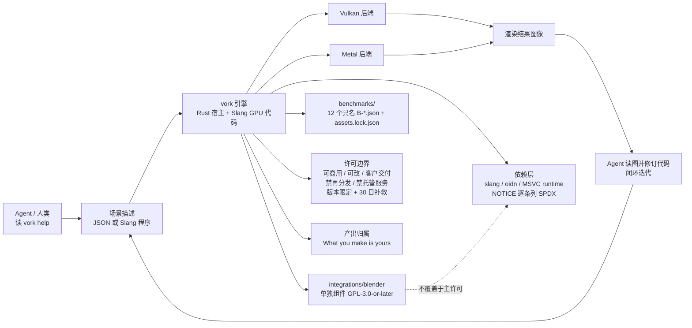

# voyager-so/vork

## 一句话定位

给 AI agent 用的无头 3D 与 VFX 引擎（Rust + Slang，Vulkan/Metal 渲染），没有编辑器可驱动，agent 直接写场景代码、渲染、看图、再改代码 —— **而它本日最值得记的不是能力，是它把「这不是开源」写在 LICENSE 的第一屏，并把「不能做成托管服务」写成可执行条款**，因此 GitHub 侧诚实地报出 `license.spdx_id = NOASSERTION`。

## 它解决的问题

创意工具的交互范式是「一个人操作控件」。但 agent 的能力边界是「写一段代码」—— 它不会拖时间轴，却可以在镜头中间写一段 shader。vork 的取舍是：不给编辑器，只给**几何体、光线查询、GPU 执行**，让场景程序自己定义材质、相机、光照传播、模拟与合成。

普通镜头只需要场景数据；需要非常规镜头时，才用到编程钩子。这把「agent 能写多少代码」从「能调多少参数」换成了「能调用多少原语」。

## 为什么值得关注（2026-11-07）

**⭐⭐⭐⭐ 它提供了本日报记录到的第一例「`NOASSERTION` 是正确答案而非缺陷」的许可设计。**

此前多日记录的 `NOASSERTION` 类问题都是同一类：`license.spdx_id` 读不出来，但 LICENSE 文件其实清晰可辨（MIT 首行、BSD-2-Clause-Patent 首行、APSL 2.0 首行），属**可机读性缺陷**。vork 反过来 —— 它主动选择了一份非标准许可，并且**在文件第一行就把这一点讲清楚**：

```
# vork Preview License
Copyright © 2026 Nullframe, Inc. All rights reserved except as granted below.

vork is source-available. It is free to use during the research preview,
including for commercial work. It is not open source.
```

**⭐⭐⭐⭐⭐ 而它的条款设计可以逐条拆开看**：

- **正面授权**：「use vork for any purpose, **including commercial work and use inside a company of any size**」「use your AI agents to operate vork for you」「modify vork for your own use」「share unmodified copies of vork with this license and all notices intact」。
- **禁止项**（原文三条）：不得 sell / rent / license / relicense / sublicense；**不得「offer vork or a modified version as a hosted or managed service in which other people submit scenes, code or jobs to be rendered」**；不得移除或改动许可与版权声明。
- **⭐⭐⭐⭐⭐ 边界的精确措辞（本日最值得抄的一句）**：「**Rendering for your own organization, and delivering the finished media to a client, is allowed and isn't a hosted service.**」—— 这句话把「交付成品给客户」和「提供平台给别人渲染」明确切成了两件事，**避免了「禁止 SaaS」条款常见的过度杀伤**。
- **⭐⭐⭐ 产出归属**：「**What you make is yours — We claim no rights in the scenes, code or media you create with vork.**」
- **⭐⭐ 版本边界**：「This license covers **this version of vork only**. Later versions may come under different terms, including paid terms. A change in later versions doesn't take away your rights under this license to the version you already have.」
- **⭐⭐⭐ 自动终止 + 补救窗口**：「If you break these terms, your rights under this license end automatically. **They come back if you fix the breach within 30 days of learning about the breach.**」
- **⭐⭐⭐⭐ 专利许可也写了**：「If your use of vork would otherwise infringe a patent we own or control, we license that patent to you… **This patent license ends if you bring a patent claim alleging that vork infringes a patent.**」

**⭐⭐⭐⭐⭐ 第三方依赖被结构化隔离，而非折叠进散文**：`NOTICE` 写明「Bundled tools keep their complete upstream notices in `slang/` and `oidn/`」「Windows packages ship Microsoft Visual C++ runtime DLLs in `oidn/bin`」「**Dependency licences apply independently of the project licence.**」并逐条列出 SPDX（如 `adler2 2.0.1 — SPDX: 0BSD OR MIT OR Apache-2.0`）；**而唯一的 copyleft 组件被单独点名排除**：

> The Blender bridge in `integrations/blender` is a separate component under **GPL-3.0-or-later**, and this license does not cover it.

**⭐⭐⭐⭐⭐⭐⭐ 而它对自身物理正确性的边界同样诚实**：黑洞示例写「It is a **numerical approximation, not an exact relativistic solver**」；流体示例写「It uses **published APIC/FLIP and surface-reconstruction methods**, with an authored initial impulse and limited secondary spray.」

**⭐⭐⭐⭐⭐⭐⭐⭐ 它给 agent 的入口是按 token 预算设计的**：

> The getting-started help is about **2,500 tokens**, including a complete first scene. The full help is about **19,400 tokens**. **Those are help-text counts, not a claim that every advanced API fits on one page.**

并直接给了一句可以粘给 agent 的指令：「Read `vork help`. Make a small scene, render a preview and inspect the image. Refine the camera and lighting before rendering at final quality.」

## 热度来源判断

**⭐⭐⭐ 真实需求驱动，但推广痕迹明显，本日报把它记为「观察型」而非「生产可用」。**

支持「真实」的证据：Organization `voyager-so` 建于 2026-09-15（5 个公开仓库、20 followers），**不是当天批量注册的账号**；`benchmarks/` 下有 12 个具名场景输入（`B-blocking.json` / `B-crowd.json` / `B-turntable.json` / `B-walking.json` 等）、`RESULTS.md` 与 `assets.lock.json`，**即基准是可复算的具名输入而不是笼统的跑分**；README 的每个示例都附完整出处与「Changes:」清单。

支持「推广」的证据：`docs/LINUX_DO_POST.md` 式的社区推广材料在同类项目中常见；`releases` 只有 1 个（v0.1.0，6 个 asset）。

**⭐⭐⭐⭐ 最强的反向信号是它的 fork 数**：**197⭐ 却只有 13 个 fork（6.6%）**。同一天那批 starter 模板仓库是 260–386 个 fork（60–91%）。**⭐⭐⭐⭐⭐ 即：它的 star 相对 fork 比例与真实项目一致，而与农场相反。**

**⚠️⭐⭐ 但有一个反证必须点名**：`ncommits` = **1**，而 `git/trees/HEAD?recursive=1` 统计到 **1,502 个 blob**。**⭐⭐ 这说明它是一次性导入的快照式发布**，因此 **commit 历史不能用于判断开发节奏** —— 一个 commit 不代表「只做了一次开发」，也不代表「持续开发」。

## 关键技术亮点

1. **⭐⭐⭐⭐⭐ Rust + Slang 双语言分层**：宿主与调度用 Rust（Slang 编译进 GPU），场景逻辑用 Slang compute program 表达（如百万只鸟的转向、APIC/FLIP 流体）。语言选择与「哪部分该跑在 GPU 上」直接对应。
2. **⭐⭐⭐⭐⭐ 面向 agent 的 token 预算化帮助**：`vork help` 的入门页 2,500 token（内含一个完整场景）、全文 19,400 token，并明确「Those are help-text counts, not a claim that every advanced API fits on one page」。**⭐⭐⭐⭐ 这是本日报见过的最明确的一次「按 agent 上下文预算设计文档」**。
3. **⭐⭐⭐⭐⭐ 许可与产出归属分离**：不限制商业使用与客户交付，只限制再分发与托管服务；创作物归创作者。
4. **⭐⭐⭐⭐ 第三方依赖清单可机读**：`NOTICE` 逐组件列 SPDX 与来源，`integrations/blender` 作为 GPL-3.0-or-later 单独摘出。
5. **⭐⭐⭐⭐ 具名可复算基准**：`benchmarks/` 下 12 个 `B-*.json` 场景输入 + `assets.lock.json`（资产锁定）+ `RESULTS.md`。
6. **⭐⭐⭐⭐ 示例级素材溯源**：每个示例附原作链接、作者、许可（如「based on \"Crow\" by Alexei Ostapenko, CC BY 4.0. Changes: sampled flight pose, reduced distant mesh, rescaled, articulated flight wings…」）与「No artist endorsement implied.」
7. **⭐⭐⭐ 双后端**：Vulkan 与 Metal，topics 含 `ray-tracing` / `gpu` / `metal` / `vulkan` / `slang`。
8. **⭐⭐ 交付形态**：`install.sh` / `install.ps1`、`dist/`、`packages/python`（Python SDK）、README 提到 Python 与 TypeScript 可直接写场景 JSON。

## 架构师速览

| 决策问题 | 研究判断 | 证据边界 |
|---|---|---|
| 系统边界 | 无头 3D/VFX 渲染引擎 + 给 agent 的场景编程接口 + 少量示例与基准；**没有编辑器、没有资产市场** | 依据 README 的功能描述与根树 24 项（含 `crates/` `libraries/` `packages/` `examples/` `benchmarks/` `integrations/` `vendor/`）；`crates/` 下 410 个 `Cargo.toml` 的实际模块划分本日报未逐个核对 |
| 主路径 | agent 读 `vork help` → 写场景 JSON 或 Slang 程序 → 提交渲染 → **读回图片** → 修改代码再渲染；普通镜头走场景数据，特殊镜头走编程钩子 | 主路径为 README 原文的语义抽象；渲染队列、并发模型、失败重试、资产管理流程未核验 |
| 关键权衡 | **① 商业可用 vs 开源生态**：免费（含商用）换取反馈与生态，同时排除「做成平台」这条路径；**② 单版本许可 vs 长期权利**：只覆盖当前版本，但明写后续版本变更不追夺既有权利；**③ 物理正确性 vs 可控性**：黑洞只做数值近似，液体只做有限二次飞溅 | ① ② ③ 均基于 LICENSE 条款组合的**本日报解读**，项目未如此陈述商业意图；`NOTICE` 与 `integrations/blender` 的隔离条款是**可核验事实** |
| 最小 PoC | 在本地跑一个 `examples/` 里现成的场景（如 `examples/cake/` 或 `examples/black-hole/`），读 `vork help` 的入门页，只做「改一个相机参数 → 重渲染 → 看图」一轮；**不引入自有素材**（避开许可与资产锁定问题） | PoC 范围由 README 的 token 预算说明与 `examples/` 结构推导；实际安装步骤（`install.sh`）本日报**未执行** |
| 证据边界 | **可核验**：LICENSE / NOTICE / README 原文、GitHub 元数据字段、目录结构。**推断**：条款组合的商业意图、许可设计的目标受众。**未核验**：`benchmarks/RESULTS.md` 的数值与方法、`crates/` 实现、示例渲染结果、1 个 commit 与 1,502 blobs 的导入过程 | `ncommits=1` 与 `blobs=1502` 的矛盾**只能记录为事实**，导入方式无法判定 |

## 架构启发

**⭐⭐⭐⭐⭐ 启发一：许可条款的第一屏比许可文件的末尾重要。**

vork 的做法是：**在文件最前面三行就把「这是 source-available，不是开源」讲完**，然后才给条款细节。大多数项目把这句话放在 README 或 LICENSE 结尾的「Disclaimer」小节 —— 结果是读者在引用、审计、二次分发时都会误以为它是开源。**vork 的做法让误读在结构上不可能发生。**

**⭐⭐⭐⭐⭐ 启发二：「禁止托管服务」这类条款必须有配套的精确例外，否则会被一刀切。**

「不得做成 SaaS」是一条很容易写坏也很有价值的条款 —— 它保住了商业模式。但写坏了就会误伤「替客户渲染并交付成品」这个正常商业模式。vork 的处理是显式写死这句：

> Rendering for your own organization, and delivering the finished media to a client, is allowed and isn't a hosted service.

**⭐⭐⭐⭐⭐⭐ 启发三：把「我不能保证什么」写进交付物的正面描述里。**

「numerical approximation, not an exact relativistic solver」这句话放在示例说明里，而不是藏在 FAQ。**⭐⭐⭐⭐ 这与本日报此前记录的 Zero-Breach-Toolkit「A clean result is never presented as proof that you are safe」是同一种思维** —— 把局限写在用户第一眼会看到的地方，而不是放在「Terms」里等人翻。

**⭐⭐⭐⭐ 启发四：按 agent 的上下文预算设计文档入口。**

2,500 token 入门 / 19,400 token 全文，并主动声明「这是帮助文本的 token 数，不是一页能装下所有 API 的承诺」。**⭐⭐⭐⭐ 这是把「文档」重构为「agent 可消费的接口」的一个可复制范式。**

**⭐⭐⭐ 启发五：`NOASSERTION` 有时是正确答案。**

过去多日记录的「`NOASSERTION` = 许可元数据缺陷」需要修正：**当项目刻意使用非标准许可时，`NOASSERTION` 是准确表达**。**⭐⭐⭐⭐ 代价是自动扫描器会误报 —— 但这恰恰说明工具需要区分「无法识别」与「作者刻意不选标准许可」两种情况**，而 vork 通过 LICENSE 首行的自我声明让人类可以做出这个区分。

## 架构图（MMD）

> 证据边界：此图只采用本档案已有可核验描述；「待核验」节点不应视为项目实现事实。



## 定位判断

**⭐⭐⭐⭐ 平台候选型项目（agent 原生的程序化视觉基础设施），但目前仍是研究预览。**

它的独特位置是：**agent 视觉工具的第三条路线**。第一条是视频生成模型（端到端、不需要写代码）；第二条是传统 DCC 软件的 agent 插件（人仍是操作者）；第三条是 vork 走的 —— **把渲染当成一个可被程序调用的函数，agent 写代码而不是操作界面**。

README 开头的三个例子（一百万只鸟、黑洞、被重新照明的实拍素材）正是这条路线的能力证明：从「生成图像」转向「**写一个渲染程序**」。

**⭐⭐⭐⭐⭐ 但定位必须带一个限定词：它是 source-available 的商业预览，不进入开源生态。** 这意味着：企业可以用它，但把它当依赖的项目在长期许可变更上有风险 —— 尽管条款已明确「后续版本变更不追夺既有版本的权利」。

## 风险 / 局限 / 泡沫点

- **⭐⭐⭐⭐⭐ 单一 commit 的一次性导入（最大的元数据疑点）**：`ncommits` = 1 而 blobs = 1,502。**⭐⭐ 这可能是「带完整历史 squash 成一个 commit」，也可能是「丢弃历史直接导入」，本日报无法判定。** 在判定之前，**任何基于 commit 历史的活跃度分析（包括本日报此前的判据）都不适用于该项目**。
- **⭐⭐⭐⭐⭐ 不是开源，且明确不是**：`license.spdx_id` = NOASSERTION，LICENSE 首行即「It is not open source.」。**⭐⭐ 这对依赖它构建的项目是一个实质风险：社区无法 fork、无法贡献、无法审计。**
- **⭐⭐⭐⭐ 托管服务被明文禁止**：任何「把 vork 做成 agent 渲染服务」的商业设想要么获得单独许可（联系 support@voyager.so），要么违约。**⭐⭐ 条款同时给了 30 日补救窗口，因此违约成本可控，但条款是明确的。**
- **⭐⭐⭐⭐ 物理正确性是近似的**：黑洞示例自述为数值近似而非相对论精确解；流体只做有限二次飞溅。**⭐⭐ 对 VFX 用途这通常可接受，但任何把它当作「物理正确的渲染器」引用的场合都会踩坑。**
- **⭐⭐⭐ 平台风险**：研究预览意味着 API、许可、特性都可能变；条款已缓解权利追夺，但**不缓解 API 破坏性变更**。
- **⭐⭐⭐⭐⭐ 社区信号极薄**：subs 4、forks 13、oi 0、contributors 1。**⭐⭐⭐⭐ 即基本没有外部用户反馈在仓库里留下痕迹。**
- **⭐⭐ 未在本日报核验**：渲染性能、示例的实际输出、基准数值、安装脚本行为。**这些是声明而非本日报的验证结论。**

## 与同类项目的关系

- **⭐⭐⭐⭐ vs 视频生成模型（Runway / Pika / Sora 类）**：生成模型给出像素、不给程序；vork 给出**可复算的渲染程序**。vork README 明确说「**No video model required**」与「Real footage + rendered 3D; **no generative video**」—— **即它刻意避开生成路线，走「程序化合成」路线**。两者可组合（生成素材 + 程序化合成），但定位不同。
- **⭐⭐⭐⭐ vs Blender 及其 agent 插件**：Blender 是带 GUI 的通用 3D 套件，vork 是无头引擎；**且 vork 把 Blender 桥接作为 GPL-3.0 单独组件排除在主许可外** —— 这在架构上是正确的隔离，但在生态上意味着 Blender 集成不是一等公民。
- **⭐⭐⭐⭐ vs Three.js / WebGPU 场景图**：面向浏览器的实时渲染，面向人写场景；vork 面向离线/批量的**影视级**渲染并以 GPU compute program 表达光传播与模拟。vork README 的「black hole」示例正是 WebGPU 场景图很难承担的路径。
- **⭐⭐⭐⭐ vs 同期的多款「AI 视频」开源项目**：那些通常用模型推理；vork 的路线里**没有模型推理**，只有 GPU 程序 —— 这使它的输出更可复算，也使它的能力上限更依赖 shader 编写能力。

## 是否值得持续跟踪

**值得跟踪，但跟踪方式与 star 无关。**

**⭐⭐⭐⭐⭐ 它值得跟踪的理由不是「197⭐」，而是它在本日报的四个样本里提供了唯一一份「许可边界被写进结构」的证据**，可以作为一个可复制范式长期观察 —— 尤其是：研究预览期是否真的按条款走了（条款允许后续版本转付费，需观察）。

**⭐⭐⭐⭐ 具体跟踪方式**：
1. **不跟踪 star**，跟踪 **releases 数、asset 数、NOTICE 的组件数变化**；
2. 跟踪 **`license.spdx_id` 是否仍为 NOASSERTION**（若转为标准许可，说明商业化阶段变化）；
3. 跟踪 **LICENSE 中「hosted or managed service」条款是否松动**（这是它未来商业模式的风向标）；
4. 跟踪 **`ncommits` 是否从 1 变成更多**（若从不增加，说明它只做版本发布不做公开开发）。

## 后续观察点

- **⭐⭐⭐⭐⭐ `ncommits` 是否开始增长**：1 → N 是「公开开发」的信号；长期停在 1 则说明只发版本不公开迭代。
- **⭐⭐⭐⭐⭐ 「hosted or managed service」条款在后续版本是否修改**：这是它商业化路径的直接指标。
- **⭐⭐⭐⭐ `integrations/blender` 是否被进一步隔离或整合**：若整合进主许可，则 copyleft 义务会污染整个项目。
- **⭐⭐⭐ `benchmarks/RESULTS.md` 是否被更新**：若基准结果不随版本更新，则基准更接近营销材料。
- **⭐⭐⭐ 示例的 `CREDITS` 是否持续维护**：素材溯源是这个项目最容易被模仿也最容易被放弃的纪律。
- **⭐⭐⭐⭐ `subscribers_count` 与 `forks` 是否开始同步增长**：13 fork / 4 subs 的比例若持续，说明关注者极少。

---
> 数据来源: GitHub REST API (2026-11-06T22:00Z 快照区间) | Stars: 197 | Forks: 13 | Subscribers: 4 | Open Issues: 0 | License: NOASSERTION (vork Preview License, 自述非开源) | 语言: Rust | 体积: 16,142 KB | Blobs: 1,502 | Commits: 1 | Contributors: 1 | Releases: 1 (v0.1.0, 6 assets) | 创建: 2026-11-05T22:37:07Z | Owner: Organization voyager-so (2026-09-15)
> 本档案未核验项：`benchmarks/RESULTS.md` 的数值与方法、`crates/` 实现、示例渲染输出、`install.sh` / `install.ps1` 行为、单 commit 与 1,502 blobs 的导入过程。
