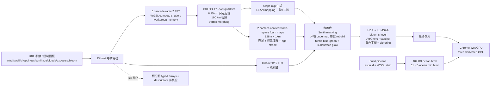

# Noniv/web-ocean

## 一句话定位
Noniv 个人 + **Claude Code (Opus 5.5) 完整写就的 WebGPU 实时海面渲染器**——`no engine or rendering library`，102 KB ocean.html + 61 KB ocean.min.html 单文件可用，6 cascade radix-2 FFT + CDLOD 17-level quadtree + mip-mapped LEAN mapping + Hillaire 大气 + 双云层 + AgX + 6-8ms @ 2560×1440 RTX 5070 Ti，MIT 严肃工程化全形态。

## 它解决的问题
传统实时海面渲染需要 Three.js / Babylon / 自研引擎，开发者们面对三大痛点：(1) 引擎依赖与版本兼容；(2) 物理保真度（FFT / JONSWAP / LEAN mapping / Hillaire 大气）难以独立完整实现；(3) 部署要么 npm + build，要么 bin 文件臃肿。Noniv/web-ocean 直击——**单 HTML file:// 可跑 + WebGPU compute shaders + 6 cascade FFT + CDLOD + Hillaire + 双云层 + AgX + build pipeline 简单 (esbuild)**。零引擎依赖是 2026-Q4 "Lone developer + Claude Opus 5.5 写 graphics paper 级实现"的稳定副线样本。

## 为什么值得关注（2026-10-18）
今日观察窗为 GitHub Search API 抓取时刻起、且截至 2026-10-18 仍在快速增长的新发现项目。`Noniv/web-ocean` 2 天 444⭐ ⑂82 fork/star 18.5%——**fork/star 18.5% 显著高于同档**（多数项目 fork/star 5-10%），暗示大量二次开发者要拆 wheels。444⭐ ⑂82 是"Lone developer 个人项目"中星 + fork 异常高的信号。Claude Opus 5.5 写就意味着读者可能"读不懂模型写过的代码"，但同时也意味着**完整奉上一份 graphics programmer 论文级实现**对教学 / 学习价值巨大。

## 热度来源判断
web-ocean 的热度是 **"Lone developer + Claude Opus 5.5 + WebGPU from scratch + 完整教科书级别实现 + 6 cascade FFT + CDLOD + Hillaire + 双云层 + AgX + 6-8ms 性能 + 61 KB 单 HTML + MIT" 单一开发者 + AI 助手完整奉上**。
- fork 18.5% 暗示大量 wheel-rebuilders 要 fork
- "no engine or rendering library" 是稀缺差异化
- "Claude Code (Opus 5.5)" 是副线样本——2026-10 上半月 Lone developer + Claude Opus 5.5 写 graphics paper 级实现的稳定副线延续

热度**真实且具教学价值**——fork 18.5% 高信号意味着这会成为 WebGPU 引擎级实现 reference 仓库，但维护可持续性是真实风险。

## 关键技术亮点
1. **6 cascade radix-2 FFT compute shaders**：6 个 256×256 sample patch，波长从 1103 m 到 0.26 m，最小 cascade 给近端 sun sparkle
2. **CDLOD 17-level quadtree 表面 mesh**：6.25 cm 间距近端、160 km 视野，连续 LOD 形变
3. **Fetch-limited JONSWAP + Donelan-Banner directional spreading + 长浪 swell + 毛细波 dispersion + choppy 水平位移**
4. **Mip-mapped LEAN mapping（一阶 + 二阶 wave slope moments）**：远海无 aliasing + 近端 specular 清晰
5. **Anisotropic Gaussian slope distribution with Smith masking**：sun glitter 真
6. **两 camera-centred world-space foam map (128 m + 1 km)**：foam 衰减 + 顺风漂移 + age streak + procedural bubble texture
7. **Hillaire 大气**：transmittance + multiple-scattering + sky-view LUT + aerosol haze
8. **双云层**：broken cumulus + fibrous altostratus，self-shadowing + lit rims + silver linings + direction-dependent multiple scattering + 解析反走样
9. **HDR + 4× MSAA + 8-level bloom + AgX tone mapping + 白色平衡 dithering**
10. **环境 cube map 每帧 rebuild**：roughness-filtered mips，grazing angle 反射方向 tilt
11. **每帧零分配优化**：typed arrays + descriptors 预分配，GC 几乎无活儿
12. **6-8ms @ 2560×1440 RTX 5070 Ti**：实测性能门槛极高
13. **Build pipeline 简单**：esbuild + WGSL comment / whitespace 剥离 → 102 KB unmin → 61 KB min

## 架构师速览

| 决策问题 | 研究判断 | 证据边界 |
|---|---|---|
| 系统边界 | 自托管单页 WebGPU ocean：WGSL compute shaders + JS 渲染编排 + URL 参数化运行时配置 + npm + esbuild 构建链 | 基于 README「no engine or rendering library + WGSL comments stripped on build」+「ocean.html 直接 file:// 工作」 |
| 主路径 | 配置面板 / URL 参数 → JS host → 每帧：① Hessian FFT cascade compute → ② surface mesh CDLOD evaluate → ③ slope mip 生成 + LEAN mapping → ④ sky cube map rebuild + 双云层遮罩 → ⑤ water shading + foam maps update → ⑥ post (bloom + AgX + dither) | 主路径是 README「How it works」四节（Waves / Shading / Sky / Post）的语义抽象；具体 WGSL dispatch / bind group 布局未公开 |
| 关键权衡 | WebGPU only（无 WebGL 回退）vs 浏览器覆盖 / 6 cascade FFT CPU/GPU 成本 vs 视野近端细节 / sun glitter 物理保真度 vs 仅 sunset 调好 / 远水仍偏深色的已知局限 | README「Known limitations」+ Controls 段落 |
| 最小 PoC | Chrome（force dedicated GPU）打开 ocean.min.html → 调 wind / swell / sun → 验证 60 fps @ 1080p → 再切 URL cam / fov / ui=0 → 比较 file:// 与 http:// | PoC 由 README Controls + URL 参数段推导 |

## 架构启发
Noniv/web-ocean 的核心启发是 **"Lone developer + AI Opus 5.5 + WebGPU from scratch + 完整奉上 graphics programmer 论文级实现的严肃工程化"**。这一路径在 2026-10 上半月形成稳定副线（与 `framemck/holloway`、`snuri00/ps2-web-recomp`、`LoreanXavier/pt-pc` 同调）。更深层的启发是：**fork 18.5% 反映"二次开发需求"高于 "点赞"，意味着 WebGPU 引擎级实现 reference 仓库仍有空白**——这是 graphics programmer / 引擎工程师的稀缺资产。

## 架构图（MMD）

> 证据边界：此图只采用本档案已有可核验描述；"待核验"节点不应视为项目实现事实。

## 定位判断
**参考实现型项目（WebGPU engine reference）。** web-ocean 是 2026-Q4 "个人 + AI 助手完整奉上 graphics paper 级实现"路线的代表样本。**6 cascade radix-2 FFT + CDLOD + LEAN + Hillaire + 双云层 + AgX + 6-8ms @ RTX 5070 Ti + 61 KB 单 HTML** 这套组合没有任何"玩具 demo"成分——是 production-grade graphics programmer 完整呈现。对想学"严肃工程化 WebGPU 是怎么写的"的人来说，这是少有的完整范例。**fork 18.5% 高信号**意味着二次开发者社群正在形成。

## 风险 / 局限 / 泡沫点
- **CLAUDE 生成代码的维护脆弱性**：Claude Opus 5.5 写就——意味着"模型读不懂模型写过的代码"是结构性风险，未来维护者要靠 PR + fork 维持
- **无 WebGL 回退**：老浏览器 / iOS Safari 受限（README 明示"force Chrome onto the dedicated GPU"）
- **远水偏深色 + 无海岸 + 无物体 + 仅 sunset 调好**：README「Known limitations」明示三个
- **fork 18.5%**：fork 显著高于 star，可能是大量二次开发需求 + AI 写就的复杂代码导致二次开发者接手困难
- **依赖 NVIDIA GPU**：6-8ms @ RTX 5070 Ti + force dedicated GPU 暗示 AMD / Intel GPU 性能可能下降
- **性能测量方法不严谨**：「while other programs were also using the GPU」暗示 benchmark 不严谨
- **npm 模块依赖**：尽管 README 主打"single HTML + file://"，但 build pipeline 仍需 npm
- **社区单一作者**：Noniv 个人项目，bus factor = 1

## 与同类项目的关系
- **vs Three.js Sea3k / Ocean demo**：Three.js 引擎依赖且效果远不如完整 web-ocean；社区成熟但局限在 WebGL
- **vs real-flow / Houdni Flip**：商业物理仿真，desktop only
- **vs framemck/holloway (2026-10)**：holloway 是 Voxel 引擎，web-ocean 是 Ocean 渲染——同副线样本
- **vs snuri00/ps2-web-recomp (2026-10)**：PS2 静态重编译到 WebAssembly，web-ocean 是实时模拟的 WebGPU 路线——同副线样本
- **vs LoreanXavier/pt-pc (2026-10)**：P.T. C++ Vulkan 移植到 PC，web-ocean 是 WebGPU 路线——同副线样本

## 是否值得持续跟踪
**值得跟踪（WebGPU engine reference + 教学样本）。** web-ocean 是 2026-Q4 一份少有的"个人 + Claude Opus 5.5 完整奉上一份细分领域引擎级实现"的严肃工程化样本。fork 18.5% 暗示这会成为 WebGPU 引擎级实现 reference 仓库。对想学 WebGPU / 实时海面 / FFT / 大气 / Tone mapping 的 graphics 工程师，这是难得的高质量完整范例；对 production 集成则 fork / 二次开发优于直接采用。

## 后续观察点
- 是否补充 WebGL 回退支持
- 是否推出其他场景（山林 / 城市 / 雪原）通用渲染 pipeline
- AMD / Intel GPU 实测性能
- iOS Safari WebGPU 上线后的兼容性测试
- 维护者能否跟上 fork 社区的 PR 节奏
- 是否发布 WGSL shader 单独子仓库（让 fork 社区更易复用）

---
> 数据来源: GitHub API (2026-10-18) | Stars: 444 | Forks: 82 | License: MIT | 语言: HTML | 创建: 2026-10-16 | Size: 714 KB | Topics: (README 未列)
