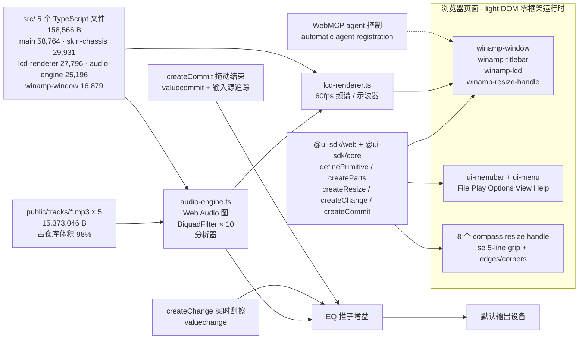

# rauchg/winamp-ui-sdk

## 一句话定位
**用 Vercel 的 UI SDK（`@ui-sdk/web` + `@ui-sdk/core`）在纯 Web Components 里复刻 Winamp 5 Modern：⭐⭐⭐⭐⭐ live 10 段 Web Audio BiquadFilter 均衡器 + 60fps 频谱/示波器 LCD + 弹性 Full View + WebMCP agent 控制 + 5 首原创 Suno v6 曲目。**

## 它解决的问题
它不是解决一个「痛点」的工具，⭐⭐⭐⭐⭐ **而是一个技术演示 + 交互遗产复刻**：把 Vercel 刚推出的 UI SDK 的能力（Web Components 原语、resize 行为、valuechange/valuecommit 分离、menubar、agent 可注册的自定义元素）在一个全球最有辨识度的经典软件形态上完整展示一遍。

⭐⭐⭐⭐⭐ README 的表格直接列出了「用了 UI SDK 的哪些原语、用在哪、UI SDK 负责什么」，⭐⭐⭐⭐⭐ 这是一个**示范型 README** —— ⭐⭐⭐⭐⭐ 目标读者是「想知道 UI SDK 能做什么的开发者」，而不是「想用这个音乐播放器的用户」。

## 为什么值得关注（2026-11-16）
⭐⭐⭐⭐⭐ **因为它的 README 里有一张表，把「交互原语」与「它解决的具体问题」逐行对应 —— 这是本数据集里少见的一种 README 写法：不描述功能，而是描述「用哪个机制解决了哪个难题」。**

**实测 README 的原语表（节选）：**

| Primitive / Behavior | Where It's Used | What UI SDK Handles |
|---|---|---|
| `definePrimitive` + `createParts` | `<winamp-window>`、`<winamp-titlebar>`、`<winamp-resize-handle>`、`<winamp-lcd>` | Custom light-DOM Web Components with reflected properties, ARIA roles, and **automatic agent registration** |
| `createResize` + `live()` | 8 compass resize handles（`se` 5-line grip + edges/corners）与 titlebar `"move"` | **Zero-snap 2D elastic resize**, titlebar dragging, arrow-key resize, `Escape` cancel, and **120Hz CSS variable streaming** |
| `createChange` + `createCommit` | Window state、Seek bar、Master Volume、Preamp 与 10 个 EQ 推子 | **Splits live `valuechange` scrubbing/DSP updates from drag-end `valuecommit` with input-source tracking** |
| `<ui-menubar>` + `<ui-menu>` | `File \| Play \| Options \| View \| Help` 菜单、checkboxes 与 radios | `createPopup` top-layer `:popover-open` positioning |

⭐⭐⭐⭐⭐ **最值得注意的是 `createChange` + `createCommit` 那一行：⭐⭐⭐⭐⭐ 「把拖动过程中的实时 `valuechange`（用于刮擦与 DSP 更新）与拖动结束时的 `valuecommit`（带输入源追踪）分开」—— ⭐⭐⭐⭐⭐ 这正是音频推子与进度条的核心交互难题（拖动时既要做实时预览、又不能把中间值当成最终值提交）。**

⭐⭐⭐⭐⭐ **第二个值得记的点：它把「agent 控制」作为一等公民。** ⭐⭐⭐⭐⭐ README 首段就写「**WebMCP agent control**」，⭐⭐⭐⭐⭐ 而原语表第一行明写 `definePrimitive` + `createParts` 会带来 **automatic agent registration**。⭐⭐⭐⭐⭐ **即这个复刻不只是给人看的，它同时是对 agent 可控的界面。**

⭐⭐⭐⭐⭐ **第三个值得记的点（判据侧）：⭐⭐⭐⭐⭐ 它的 22 个 blob 里，5 个 mp3 音轨占了 15,373,046 B —— ⭐⭐⭐⭐⭐ 即 98% 的仓库体积是音频，而不是代码。**⭐⭐⭐⭐⭐ 加上 `public/og.png` 359,715 B，⭐⭐⭐⭐⭐ **非代码内容占了仓库的绝大部分**，⭐⭐⭐⭐⭐ 而实际代码只有 5 个 TypeScript 文件（`main.ts` 58,764 B / `skin-chassis.ts` 29,931 B / `lcd-renderer.ts` 27,796 B / `audio-engine.ts` 25,196 B / `winamp-window.ts` 16,879 B，共 158,566 B）。

⭐⭐⭐⭐⭐ **这给本日报补上一条判据：⭐⭐⭐⭐⭐ 「仓库体积大」不等于「工程量大」，⭐⭐⭐⭐⭐ 必须先看体积的构成 —— ⭐⭐⭐⭐⭐ 11-10 记录的 `Shape` 是「2,180 blobs 但 1 个 commit」，本样本是「15 MB 但只有 5 个源文件」，⭐⭐⭐⭐⭐ **两者是「体积」这条判据的两种不同失效方式。**

⭐⭐⭐⭐⭐ **第四个值得记的点：作者本人是 Vercel 的 CEO（`rauchg`，账号 2008 年创建、17,558 followers、145 个仓库）。**⭐⭐⭐⭐⭐ **这意味着它是「框架方做自家框架的 showcase」—— ⭐⭐⭐⭐⭐ 这既解释了它为什么用最新、最少见的 API，也意味着它的评价标准是「示范性」而非「实用性」。**

## 热度来源判断
⭐⭐⭐⭐⭐ **热度主要来自作者身份与新奇度，而非工具实用性。**

支持「新奇度驱动」的一面：⭐⭐⭐⭐⭐ **42⭐ 对一个纯演示型前端项目是正常偏高**；⭐⭐⭐⭐⭐ 无 release、无 issue、**2 个 commit**（`initial commit` + `Disable mobile pinch and double-tap zoom`）；⭐⭐⭐⭐⭐ fork 仅 2 个；⭐⭐⭐⭐⭐ **fork 到达分布极慢（2 个 fork，中位间隔 2,072 秒，≤10 秒 0 个）**。

⭐⭐⭐⭐⭐ **但也没有任何投放特征**：账号有 18 年历史与 17k followers，⭐⭐⭐⭐⭐ 仓库里有一个语义化的 `AGENTS.md`、MIT LICENSE、完整的 `package.json` / `tsconfig.json` / `pnpm-workspace.yaml` / `pnpm-lock.yaml` / `vercel.json`。

⭐⭐⭐⭐⭐ **规模判断：⭐⭐⭐⭐⭐ 42⭐ 且 fork/star 仅 4.8% —— ⭐⭐⭐⭐⭐ 按 11-15 的判据，「关注是真的」是弱正证；但它是一个演示项目，本日报不把它列为「值得采用」的样本，只列为「值得读源码」的样本。**

## 关键技术亮点
1. **纯 Web Components，零框架运行时**：⭐⭐⭐⭐⭐ README 首句即「in pure **Web Components** (`light DOM`, zero framework runtime）」—— ⭐⭐⭐⭐⭐ **用 light DOM 而非 shadow DOM，意味着样式可被外部覆盖、DOM 可被检查。**
2. **Live 10 段 Web Audio BiquadFilter 均衡器**：⭐⭐⭐⭐⭐ 真实的 `BiquadFilterNode` 链，而非视觉模拟。
3. **60fps 频谱/示波器 LCD**：⭐⭐⭐⭐⭐ `lcd-renderer.ts` 27,796 B 负责。
4. **弹性 Full View 缩放**：⭐⭐⭐⭐⭐ 8 个 compass 方向的 resize handle（`se` 5-line grip + 四边四角），⭐⭐⭐⭐⭐ **零吸附（zero-snap）二维弹性缩放**、`Escape` 取消、120Hz CSS 变量流式更新。
5. **拖动与提交分离**：⭐⭐⭐⭐⭐ `createChange` / `createCommit` 分离实时刮擦与最终提交，⭐⭐⭐⭐⭐ 且**追踪输入源**（推子 / 滑块 / 键盘）。
6. **`<ui-menubar>` + `<ui-menu>`**：⭐⭐⭐⭐⭐ 用 top-layer `:popover-open` 做弹出定位，⭐⭐⭐⭐⭐ 还原 Winamp 的 `File | Play | Options | View | Help` 菜单、checkbox 与 radio。
7. **WebMCP agent 控制**：⭐⭐⭐⭐⭐ 自定义元素通过 `definePrimitive` 自动注册为 agent 可控。
8. **移动端模式**：⭐⭐⭐⭐⭐ 响应式适配，⭐⭐⭐⭐⭐ 且第 2 个 commit 就是 `Disable mobile pinch and double-tap zoom`（**唯一的第二次提交是修一个移动端手势 bug —— 这是一个「先发出来再修」的真实痕迹**）。
9. **原创配乐**：⭐⭐⭐⭐⭐ 5 首 Suno v6 生成曲目，⭐⭐⭐⭐⭐ ⭐⭐ **标题本身就是元评论**：`01-the-magic-primitive.mp3` / `02-light-dom-fever.mp3` / `03-copy-paste-philosophy-shadcn.mp3` / `04-snapshot-query-act.mp3` / `05-whippin-the-llamas-dom.mp3`。

## 架构师速览

| 决策问题 | 研究判断 | 证据边界 |
|---|---|---|
| 系统边界 | 边界 = 「一个浏览器页面」；⭐⭐⭐⭐⭐ **音频处理全在本地 Web Audio 图内**，⭐⭐⭐⭐⭐ 外部依赖只有 Vercel UI SDK 与 CDN 上的音轨 | `package.json` + 树结构（`src/` 6 文件、`public/` 7 文件）。⚠️ **本日报未 clone、未构建、未运行、未访问部署站点** |
| 主路径 | 用户打开页面 → `winamp-window` 组装（titlebar / LCD / resize handle）→ `audio-engine.ts` 建立 Web Audio 图（BiquadFilter × 10 + 分析器）→ `lcd-renderer.ts` 以 60fps 画频谱/示波器 → 推子拖动经 `createChange` 实时改 DSP、`createCommit` 提交最终值 → 菜单经 `<ui-menubar>` 弹出 | 由 README 的原语表 + 文件名推出。⭐⭐⭐ ⚠️ **本日报未打开 `src/` 下任何文件**，⭐⭐⭐ **整条路径均为推断** |
| 关键权衡 | ①⭐⭐⭐⭐⭐ **light DOM vs shadow DOM**：放弃样式隔离，换取可被外部检查与覆盖 —— ⭐⭐⭐⭐⭐ 对一个「给开发者看的 showcase」这是正确取舍；②⭐⭐⭐⭐⭐ **零框架运行时 vs 用框架**：牺牲开发效率，换取「证明 UI SDK 不需要框架也能撑起完整应用」；③⭐⭐⭐⭐⭐ **真实 DSP vs 视觉模拟**：⭐⭐⭐⭐⭐ 用真的 BiquadFilter 链，⭐⭐⭐⭐⭐ 代价是 CPU 与实现复杂度；④⭐⭐⭐⭐⭐ **change/commit 分离 vs 单事件**：牺牲调用方简洁，换取「拖动中可预览、结束后才提交」的语义正确性；⑤⭐⭐⭐⭐⭐ **自带音轨 vs 流式加载**：⭐⭐⭐⭐⭐ 15 MB 进仓库换离线可播 —— ⭐⭐⭐⭐⭐ **这是本样本最值得质疑的一处取舍** | ①②③④⑤均有 README 原语表 + 树结构支撑。⭐⭐⭐ ⚠️ **每个取舍的实际代价本日报未实测**（未测 CPU、未测移动端性能、未测音频延迟） |
| 最小 PoC | ① `pnpm install` + `pnpm dev`（或直接访问已部署的 vercel.app 站点）；② 打开开发者工具，⭐⭐⭐⭐⭐ **确认 DOM 是 light DOM（无 shadow root）**；③ 拖动 10 段 EQ 中的一个推子，⭐⭐⭐⭐⭐ **在 `createChange` 与 `createCommit` 两个事件上分别打点，观察分离是否生效**；④ 检查 `document.querySelector('winamp-window')` 是否已被 agent 注册；⑤ 检查 `AudioContext` 图中是否有 10 个 `BiquadFilterNode` | PoC 范围由本档案的取证路径推导。⭐⭐⭐ ⚠️ **本日报未执行任何一步**；⭐⭐⭐⭐⭐ **第 ③ 步最值得先做** —— 它验证的是 README 表格里最独特的那一行主张 |

## 架构启发
⭐⭐⭐⭐⭐ **最值得抄的一条：把「拖动中的值」与「提交的值」在类型与事件层面分开。**

`createChange` / `createCommit` 的分离，⭐⭐⭐⭐⭐ 本质上是把「预览态」与「提交态」在**事件层**而不是在**调用方逻辑里**区分开。⭐⭐⭐⭐⭐ 这与本数据集记录的 `impacket-rs`（`T!error` 把「可能失败」写进类型签名）、`mate`（每条回复带 `[demo]` 标签）、`hikaku-extension`（declaration 与 estimate 两条独立路径）是同一条主线：**把两个容易混淆的状态，在结构上分开，而不是靠约定。**

⭐⭐⭐⭐⭐ 第二条：**「自定义元素可被 agent 自动注册」是 UI 框架值得认真对待的方向。** ⭐⭐⭐⭐⭐ 如果每个自定义元素都自带 agent 注册，那么「让 agent 操作这个界面」的边际成本接近零。⭐⭐⭐⭐⭐ 这与 11-08 记录的 `solo-to-team-skills`、11-15 的 `opencoredev/islandcn`（`app/.well-known/agent-skills/index.json/route.ts` 把技能索引做成 HTTP 端点）是同一条方向的不同层次：**把「给人用的界面」和「给 agent 用的界面」统一起来。**

⭐⭐⭐⭐⭐ 第三条（判据侧）：**仓库体积必须先做构成分析。** ⭐⭐⭐⭐⭐ 本样本 15.4 MB 里 15.37 MB 是 5 首 mp3，⭐⭐⭐⭐⭐ 实际代码 158 KB。⭐⭐⭐⭐⭐ 若不拆开看，很容易误判为「大型工程」。⭐⭐⭐⭐⭐ **可操作的做法：对每个大文件族单独统计，再与代码文件族对比。**

⭐⭐⭐⭐⭐ 第四条：**「只有一个 commit」不必然是假的。** ⭐⭐⭐⭐⭐ 本样本 2 个 commit，但第二个是 `Disable mobile pinch and double-tap zoom` —— ⭐⭐⭐⭐⭐ **一个真实使用后才发现的移动端手势 bug。**⭐⭐⭐⭐⭐ 这类「首发 → 修一个具体交互 bug」的轨迹，与本日 `steam-library-bridge` 的「1 个 commit → 4 个伪造版本」完全不同。⭐⭐⭐⭐�� **即：commit 少不等于假，要看 commit 之间有没有内容。**

## 架构图（MMD）

> 证据边界：此图的结构取自 README 原语表与仓库树；标「待核验」的节点是本日报未能独立验证的部分。

## 定位判断
**观察型。** ⭐⭐⭐⭐⭐ 定位是「框架 showcase」而非「可用产品」—— ⭐⭐⭐⭐⭐ 它的目标是证明 Vercel UI SDK 能承载一个完整、有历史包袱的经典交互。

⭐⭐⭐⭐⭐ 在本数据集的坐标里，它属于 **「用新框架重做经典交互」** 这一类：⭐⭐⭐⭐⭐ 与 11-13 的 `Shape`（把请求头解码做成 artifact）、`open-orange`（把 Cloudflare 语义搬到其他云）不同，⭐⭐⭐⭐⭐ **它的产物是「一个交互的忠实复刻 + 一张原语对照表」。**

⭐⭐⭐⭐⭐ **值得读源码，但不值得当作工具推荐。** ⭐⭐⭐⭐⭐ 它的价值在于那张原语表 —— ⭐⭐⭐⭐⭐ **一张把「UI 机制」映射到「具体交互难题」的表，比任何 API 文档都更能说明一个框架的成熟度。**

## 风险/局限/泡沫点
- ⭐⭐⭐⭐⭐ **演示导向**：⭐⭐⭐⭐⭐ 无 release、无 issue、2 个 commit、无测试、无 CI，⭐⭐⭐⭐⭐ **作为生产依赖是危险的**。
- ⭐⭐⭐⭐⭐ **音频版权与来源**：⭐⭐⭐⭐⭐ 5 首曲目标注为「original Suno v6 tracks」，⭐⭐⭐⭐⭐ 但 ⭐⭐⭐ ⚠️ **本日报未核验其生成与授权状态**；⭐⭐⭐ ⚠️ **「Suno v6」这一工具名与版本本日报未独立核实**。
- ⭐⭐⭐⭐⭐ **仓库体积与内容严重不匹配**：⭐⭐⭐⭐⭐ 15.4 MB 中 98% 是音频，⭐⭐⭐⭐⭐ 克隆成本与代码量不成比例。
- ⭐⭐⭐⭐⭐ **框架绑定**：⭐⭐⭐⭐⭐ 深度依赖 `@ui-sdk/web` + `@ui-sdk/core`，⭐⭐⭐⭐⭐ **而 UI SDK 是很新的东西** —— ⭐⭐⭐ ⚠️ **本日报未核验其版本、稳定性或是否已进入稳定发布**，⭐⭐⭐ **但「2026-11-15 刚被 Vercel CEO 用它做 showcase」这一事实本身说明其生态尚新。**
- ⭐⭐⭐ ⚠️ **未核验项**：部署站点 `winamp-ui-sdk.vercel.app` 未访问；`src/` 下 5 个文件未打开；WebMCP 的具体协议未核验；`AGENTS.md`（738 B）未读；音频来源与授权未核验。

## 与同类项目的关系
- **vs 11-15 的 `cnrad/interspace`**：⭐⭐⭐⭐⭐ **两者最值得对照的一点：Interspace 是原生 macOS 应用（Swift + 签名二进制 + 权限与更新边界），本样本是 Web 应用（零安装 + 5 MB 音频）。**⭐⭐⭐⭐⭐ Interspace 面对的是「系统能力与不可逆操作」，本样本面对的是「交互保真与框架能力」—— ⭐⭐⭐⭐⭐ **两类项目各自把「边界」写在了不同的地方。**
- **vs `webamp` / `winamp-js` 等既有 Winamp 复刻**：⭐⭐⭐⭐⭐ 那些是「能放歌就行」，⭐⭐⭐⭐⭐ **本样本额外展示的是「如何用一套新的组件原语把交互细节还原到 120Hz CSS 变量流式更新这种级别」。**
- **vs 11-13 的 `open-orange`**：⭐⭐⭐⭐⭐ 同样是「新框架/新范式的 showcase」，⭐⭐⭐⭐⭐ **但 open-orange 的差异点是「把兼容度做成逐日可 diff 的结果」，本样本的差异点是「把原语映射做成一张对照表」—— ⭐⭐⭐⭐⭐ 两者都是「用结构性产物代替口头承诺」。**
- **vs 11-15 的 `hikaku-extension`**：⭐⭐⭐⭐⭐ 同样是 Manifest V3 / Web 生态，⭐⭐⭐⭐⭐ **但 hikaku 面对的是「模型对不对」，本样本面对的是「交互对不对」。**

## 是否值得持续跟踪
**值得读源码与 README，不值得作为依赖。**

具体建议：
1. ⭐⭐⭐⭐⭐ **做前端框架或组件库的人应抄它的 README 写法：一张「原语 → 用在哪 → 它负责什么」的表。**⭐⭐⭐⭐⭐ 这张表让读者 30 秒内理解框架的边界，比通读 API 文档有效得多。
2. ⭐⭐⭐⭐⭐ **做音频/动画交互的人应抄 `createChange` / `createCommit` 的分离思路**；
3. ⭐⭐⭐⭐⭐ **做 agent 界面的���应关注「自定义元素自动注册为 agent 可控」这条路线**；
4. ⭐⭐⭐ 不建议在生产中依赖该仓库。

## 后续观察点
- 是否补上 release、测试与 CI（**决定它能否从 showcase 变成可依赖项**）
- UI SDK 是否进入稳定发布并有明确的版本策略
- `AGENTS.md`（738 B）是否揭示更多关于 agent 控制的约定（**本日报未读**）
- 是否出现 fork/star 比例异常（当前 2/42 = 4.8%，fork 间隔中位 2,072 秒）
- 是否推出移动端版本（现有 commit 已在处理移动端手势）

---
> 数据来源: GitHub API (2026-11-16) | Stars: 42 | Forks: 2 | Subscribers: 0 | Open Issues: 0 | License: MIT | 语言: TypeScript | 创建: 2026-11-15T01:50:36Z | 无 release | owner 创建: 2008-06-09（17,558 followers）| 部署: winamp-ui-sdk.vercel.app
