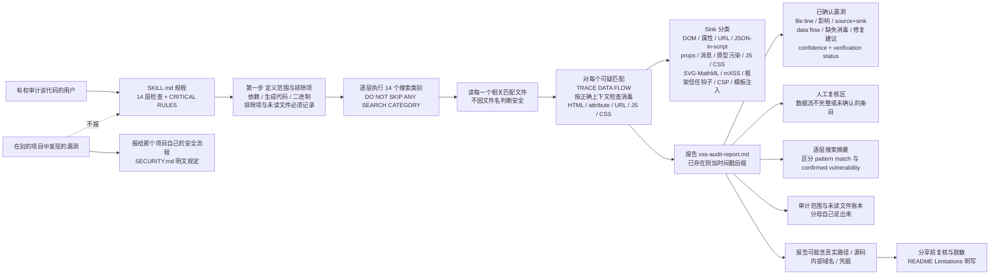

# songjianyang/xss-audit

## 一句话定位
一份 26 KB 的**静态 XSS 审计规程**（agent skill）——14 层检查覆盖 React/TypeScript/JavaScript 项目，**输出报告而不是修改代码**；**它的产物是文字，而它的质量控制方式恰好是它自己文档结构的一部分**。

## 它解决的问题
前端 XSS 审计的真实难点不是「搜不搜得到 `innerHTML`」，而是三件事：

1. **覆盖率不可证**——静态清单无法保证覆盖所有 XSS 变体（新浏览器 API、框架抽象、动态代码路径、构建期变换）
2. **假阳性与假阴性无法区分**——「搜到了」不等于「有漏洞」，而「没搜到」不等于「没漏洞」
3. **审计边界不可见**——读了哪些文件、跳过了什么、为什么跳过，读者通常看不到

xss-audit 针对这三件事各给了一个机制：**Reality check 段落声明清单本身的局限**、**14 层 sink 分类 + 数据流追踪要求**、**报告里的排除项与未读文件账本 + 单列的人工复核区**。

## 为什么值得关注（2026-10-25）
**因为它是本日唯一一个「产物是文字」的热门项目，而它的 fork 比例（25.8%）是本批最高的——这个数字恰好暴露了本日报连续五日观察到的分界线的一个新维度。**

**⭐ 先看它的物理形态，它小得出奇：** 仓库仅 **15 KB**、**仅 1 个 commit**、contributors API 返回 **1 人**、无 release、topics 为空数组。四个文件：`SKILL.md`（26,430 字节）+ `README.md`（5,894 字节）+ `SECURITY.md`（1,176 字节）+ `examples/sample-report.md`（3,454 字节）。**仓库里没有一个可执行文件。**

**⭐ 而它的 14 层检查覆盖的是真实的 sink 分类，不是简化清单：**

1. **DOM / HTML 注入**：`innerHTML`、`outerHTML`、`insertAdjacentHTML`、`document.write`、`DOMParser`、`setHTMLUnsafe`、`ShadowRoot.innerHTML`、`attachShadow`、React `dangerouslySetInnerHTML`
2. **属性与事件处理器**：动态 `on*`、`href`/`src`/`srcdoc`/`action`/`formaction`/`style`、转发攻击者可控值的 JSX props
3. **URL 与导航**：`window.open`、`location`、路由导航、协议白名单、**hostname 与 substring 校验错误**、解析器归一化、History API state
4. **配置与 JSON-in-script**：SSR bootstrap data、hydration state、JSON-LD、富文本配置、**`</script>` breakout**
5. **Props 展开与 gadget 组件**：不可信 props 转发给 anchor / iframe / URL 处理组件
6. **不受信来源与消息传递**：URL data、API 响应、cookies、storage、IndexedDB、referrer、`postMessage`、`BroadcastChannel`、`MessageChannel`，**含 origin、source、schema、target-origin 检查**
7. **原型污染链**：不安全的 merge / setter / 赋值路径影响安全敏感的 XSS gadget
8. **JS 执行**：`eval`、`new Function`、字符串 `setTimeout`、动态创建脚本、Blob/ObjectURL 执行、worker 脚本导入
9. **CSS 与样式注入**：`cssText`、`setProperty`、`insertRule`、CSS-in-JS 插值、外部 CSS URL
10. **SVG / MathML / XML**：命名空间感知的元素创建、`xlink:href`、动画事件、`foreignObject`、`annotation-xml`、命名空间混淆
11. **Markdown / sanitizer / mXSS**：渲染器、DOMPurify、sanitize-html、已解析版本、生效配置、**双重解析**、消毒后变换、**输出上下文不匹配**
12. **框架渲染与信任钩子**：Vue `v-html`、Angular 信任绕过、Svelte `{@html}`、Lit `unsafeHTML`、绕过框架保护的直接 DOM 写
13. **Trusted Types 与 CSP**：强制、违规、策略配置、防御纵深缺口，**且明确不把浏览器防御当作安全证明**
14. **框架绑定与模板注入**：KnockoutJS、WinJS、Alpine.js、AngularJS、Vue、Angular、Ember、Handlebars 中攻击者可控属性或模板源在消毒后仍存活的路径

**⭐⭐ 而它最有价值的三处，全部关于「边界」：**

**① 开篇就是一段自我限制：**

> **Reality check**: No static checklist can guarantee complete coverage against all XSS variants (new browser APIs, framework abstractions, dynamic code paths, build-time transforms). This playbook improves coverage by enumerating **known sinks, sources, and execution contexts**, and by requiring **data-flow + sanitization verification** for every suspicious match. Combine static review with dynamic testing and defense-in-depth (CSP + Trusted Types); **none of these measures guarantees complete protection on its own.**

**② 它的执行规则把失效模式显式列为「必须避免的错误」：**

> 1. **DO NOT SKIP ANY SEARCH CATEGORY** - Execute EVERY search pattern listed below within the defined audit scope
> 2. **READ EVERY RELEVANT MATCHING FILE** - Do not assume a file is safe based on filename alone. **Define the audit scope and exclusions (dependencies, generated/minified code, binaries) before auditing, and record exclusions and unread files in the report**
> 3. **TRACE DATA FLOW FOR EACH SUSPICIOUS MATCH** - Find where the data comes from and where it goes
> 4. **CHECK FOR SANITIZATION** - If you see a sink … you MUST verify if the input is validated/sanitized for the ***correct context*** (HTML/attribute/URL/JS/CSS)

**⭐ 规则 2 的后半句尤其值得注意：「把排除项与未读文件记进报告」——它要求的是一份「我检查了哪里、没检查哪里」的账本，而不是一份「我找到了多少问题」的清单。**

**③ 它点名了一个非常具体的 URL 校验陷阱：**

> **Hostname-only URL validation** - `new URL('javascript://trusted.com/%0aalert(1)').hostname` is `trusted.com`; when the URL reaches a navigation sink, **protocol validation is also required**

**这正是「只校验 hostname 就算安全」这个常见误解的反例**，而它把反例直接写进了执行规则，而不是放在脚注。

**⭐⭐⭐ 而整份文档最值得抄的一处，在 `examples/sample-report.md` 的第一行：**

> **Fictional example:** This report demonstrates formatting and classification only. **It is not the result of a real audit, and no reproduction steps were executed.**

**在一个「输出格式即卖点」的文档类项目里，唯一的示例被明确标注为虚构且未经执行——这直接对冲了这类项目最常见的失真方式：把示例当战绩。**

## 热度来源判断
**热度来自作者的资历背书 + fork 成本极低这两件事的叠加。**

作者自述：「Over the course of one year, I used it in my day-to-day audit workflow and refined it continuously based on what worked and what missed. That workflow helped me identify dozens of XSS vulnerabilities that were awarded bounties.」并列出 MSRC 安全研究排行榜 2025 Q3 #4、Q4 #7、2026 Q1 #6、Q2 #10 四个季度的连续 Top 10，附 leaderboard 与 X 主页链接（`x.com/SecBoxer`）。

**⚠️ 本日报未独立核验该榜单**（MSRC leaderboard 是外部页面，且榜单内容会随时间变化）。

**⭐ 推断（不构成事实）：25.8% 的 fork 比例对应的是「fork 去改写 14 层清单以适配自己的框架、语言或审计口径」——** 这是这类「知识资产」项目的典型 fork 动机。**它与需要重新实现代码的项目完全不是一回事**：改一段 26 KB 的 Markdown 几乎零成本，而 fork 一个 17.9 MB 的兼容层要接手整套实现。**这是本日报连续五日观察到的「可改造型 vs 不可改造型」分界线的一个推进版本——分的不再是「是否邀请你改造」，而是「改造的单位成本」。**

**⭐ 作者身份佐证（推断）**：作者账号 `songjianyang` 创建于 2015-05-27，仅 5 个公开仓库、35 followers，其中 `CVE-2026-47644`（2⭐，2026-10-15 创建）、`CVE-2021-26882`、`HEVD_EXPLOIT` **均为漏洞研究类**——**说明他是安全研究员而非产品作者**。

## 关键技术亮点
1. **⭐ 14 层覆盖的是真实 sink 分类**——含 mXSS、SVG/MathML 命名空间混淆、JSON-in-script 的 `</script>` 逃逸、原型污染链、CSS-in-JS 插值、框架信任钩子、模板注入，**不是「搜索 innerHTML」的简化清单**。
2. **⭐⭐ 开篇的 Reality check 把清单本身的局限说在前面**（「none of these measures guarantees complete protection on its own」）。
3. **⭐⭐ 执行规则把失效模式显式化**：不得跳过任何搜索类别、不得因文件名判断安全、必须逐个追数据流、必须按**正确上下文**（HTML/attribute/URL/JS/CSS）检查消毒。
4. **⭐⭐⭐ 点名了具体的 URL 校验反例**：`new URL('javascript://trusted.com/%0aalert(1)').hostname` 是 `trusted.com`——**只校验 hostname 是不够的**。
5. **⭐⭐⭐ 要求把「排除项与未读文件」记进报告**，并单列 manual-review 区——**一份「我检查了哪里、没检查哪里」的账本**。
6. **⭐⭐⭐ 示例报告第一行就写「Fictional example… no reproduction steps were executed」**——**在一个「输出格式即卖点」的品类里，唯一示例被明确标注为虚构且未经执行**。
7. **⭐ 报告格式把「未确认」独立成节**：每条 finding 要求记录 file:line、影响、source/sink/data flow/缺失的校验或消毒、漏洞代码与具体修复建议、**confidence 与 verification status**、以及 **reproduction notes that clearly distinguish theoretical steps from steps actually executed**；报告含「**a separate manual-review section for incomplete or unconfirmed data flows**」与「**a per-layer search summary that distinguishes pattern matches from confirmed vulnerabilities**」。
8. **⭐ `SECURITY.md` 把工具的输出流向也管起来**：「This repository contains an audit playbook and documentation rather than a runtime application」，并写明「**Vulnerabilities discovered in another project by using this skill should be reported to that project's maintainers through its own security process, not to this repository.**」——**本批唯一把「工具的输出会流向哪里」写进安全策略的项目**。
9. **⭐ README 的 Limitations 段主动列出两类风险**：静态分析的假阳假阴（「Review exclusions and verify findings before relying on them. **No coverage is guaranteed.**」）与**生成报告可能含敏感路径、源码、内部域名或凭据，分发前须复核与脱敏**。

## 架构师速览

| 决策问题 | 研究判断 | 证据边界 |
|---|---|---|
| 系统边界 | 严格地说它**没有运行时**——它是一份被 agent 加载的规程（SKILL.md）+ 两份说明文档（README.md、SECURITY.md）+ 一份格式示例（examples/sample-report.md）。**边界划在「规程」与「执行」之间**：规程定义要搜什么、怎么判、报告写什么；执行由承载它的 agent 完成，**本仓库不提供任何执行、验证或修复代码**。第二层边界是**输出流向**：审计在别的项目里发现的漏洞应报给那个项目，而不是这个仓库 | 仓库树（`git/trees/HEAD?recursive=1` 仅 7 个条目）、`SKILL.md` 的 frontmatter 与 CRITICAL EXECUTION RULES、`SECURITY.md` 的 Scope of Security Reports 节；**「agent 如何加载这份 skill」的安装方式 README 只给了「复制到 skills 目录」一句，未给具体适配说明** |
| 主路径 | 用户在 agent 中触发（`/xss-audit` 或 `/xss-audit src/`，或该 agent 的 `$` 语法）→ **agent 先定义审计范围与排除项**（依赖、生成/压缩代码、二进制）→ **逐层执行 14 层的每个搜索模式，一个都不能跳过** → **读每一个相关匹配文件，不因文件名判断安全** → 对每个可疑匹配**追数据流**并**按正确上下文检查消毒** → **把排除项与未读文件记进报告** → 输出 `xss-audit-report.md`（**若已存在则加时间戳后缀**）→ 报告按严重度分层 + 单列人工复核区 + 逐层搜索摘要 | `SKILL.md` 的 CRITICAL EXECUTION RULES 与 14 层小节、README 的 Usage 与 Output 节；**⚠️ 规则 6 明确「OUTPUT TO FILE ONLY」，因此它不产生交互式输出** |
| 关键权衡 | **静态清单 vs 动态验证**（选静态，**并在文档里明写静态的局限**，代价是无法覆盖运行时行为）· **模板化规程 vs 自由推理**（选前者，代价是可能诱导 agent 机械执行而不做判断——**它用规则 3「TRACE DATA FLOW」和规则 4「按正确上下文检查」来对冲**）· **输出报告 vs 修改代码**（选前者，**「WITHOUT modifying code」**，代价是不解决只定位）· **完整覆盖声明 vs 诚实边界声明**（选后者，README 首句即「**A search match is not a confirmed vulnerability.**」）· **⭐ 虚构示例 vs 真实示例**（**选虚构并自我否定**，代价是读者无法看到真实产出——**换来的是「示例即战绩」的失真被直接对冲**）· **⭐ 报告含敏感信息的风险 vs 不生成报告**（选生成，但 README 明确警告分发前须脱敏）· **14 层固定 vs 可扩展**（固定，**但它自己也承认「新浏览器 API」会让清单过时**） | `SKILL.md` 的 Reality check 与 CRITICAL EXECUTION RULES、README 的 Output 与 Limitations 节、`SECURITY.md`；**未明示：作者如何维护这份清单、是否有版本化机制、是否计划支持更多框架** |
| 最小 PoC | 1. 把 `SKILL.md` 复制到 agent 的 skills 目录 → 2. **⭐ 准备一个你有权审计的测试项目**（README 明确要求「Use this project only on code and systems that you own or have permission to assess」）→ 3. 对一个**故意含 XSS 的小样例**跑 `/xss-audit` → 4. **⭐ 检查报告的 Exclusion/Unread Files 段是否真的列出了排除项与未读文件**（**这一步验证的是规则 2 的后半句是否被执行，而不只是「报告模板里有没有这个字段」**）→ 5. **⭐ 检查它是否区分了 pattern match 与 confirmed vulnerability**（对照逐层搜索摘要与 finding 列表）→ 6. **⭐ 检查 manual-review 区是否真的收录了「数据流不完整」的条目** → 7. **故意造一个只校验 hostname 的 URL 注入（如 `javascript://trusted.com/%0aalert(1)`），看它是否按规则要求指出需要 protocol validation** → 8. **⭐ 造一个「文件名看起来像生成的」文件（如 `vendor.bundle.js`），确认它没有被静默跳过** → 9. **确认它没有修改任何代码**（规则要求 `WITHOUT modifying code`）→ 10. **⭐ 检查报告中是否出现你的真实路径、源码或内部域名，并据此决定是否脱敏后再分享** | **第 4 步与第 5 步是唯二能证伪其核心主张的步骤**（区分「模式匹配」与「确认漏洞」，以及「检查了哪里」与「没检查哪里」）· **第 7 步验证它点名的那条具体陷阱是否真的被执行** · **第 10 步是它自己提出的风险，本 PoC 必须覆盖** · 本 PoC **不覆盖**动态测试、渗透验证与任何真实漏洞的复现确认 |

## 架构启发
**这份规程最值得迁移的不是那 14 层，而是它对「清单类知识资产」的三处理方式。**

**⭐ 第一，把清单的局限写在第一段而不是最后。** 大多数清单类工具的 README 结构是「功能 → 用法 → 局限性」，局限性在最末尾，而读者往往只看前两段。**它把 Reality check 放在 `SKILL.md` 的开头，让 agent 在生成任何结论之前就读到「没有哪种静态清单能保证完整覆盖」。**

**⭐ 第二，把「失效模式」写成规则而不是愿望。** 「要仔细审查」不是规则，「DO NOT SKIP ANY SEARCH CATEGORY - Execute EVERY search pattern listed below」才是规则。**「Do not assume a file is safe based on filename alone」同理——它把一个常见的自动化捷径显式禁掉了。**

**⭐ 第三，把「我查了什么」和「我发现了什么」分开记录。** 排除项与未读文件进报告、单列 manual-review 区、逐层搜索摘要区分 pattern match 与 confirmed vulnerability——**这三条加起来，让一份审计报告的「分母」变得可见。** 这与本日报 10-24 记录的 HackiOS `docs/checks.md`（「**missing information reads as a missing problem**」「A denominator lies as quietly as a summand」）是同一条原则的两种表达：**分母必须自己说出来，否则它会被默认成「全部」。**

**⭐⭐ 而关于 fork 比例，它提供了本日最实用的一条读法。** 25.8% 的 fork 比例常常被读作「这个项目很受欢迎」，但对这一批项目，它更可能说明的是：**fork 的单位成本很低**。**改一段 26 KB 的 Markdown 是十分钟的事；给一个 653 个 commit 的兼容层加一个新 API 是几周的事。** 因此在评估「这个项目有多少人在真的改造」时，**fork/star 应当先按「改造单位成本」分层，再在同一层内比较。**

## 架构图（MMD）

> 证据边界：此图只采用本档案已有可核验描述；标注「待核验」的节点不应视为项目实现事实。

## 定位判断
**「审计规程」品类的一个样本，而不是「安全工具」。** 它的交付物是文字，执行由 agent 完成，验证由人完成——**因此它的正确使用方式是「拿它当一份检查清单的起点」，不是「拿它当一个能给出结论的扫描器」。**

**⭐ 而它在本批的真正稀缺之处不是「14 层」这个数字，而是三件别的项目没做的事：**

1. **把「搜到」与「确认有漏洞」分开记录**（per-layer 摘要 + manual-review 区）
2. **把「我查了哪里」写进报告**（排除项与未读文件）
3. **把唯一的示例标注为虚构**（在一个「示例即战绩」的品类里）

**⭐ 定位上最值得记的一点：它的作者身份（安全研究员）比它的 star 数更能说明它的定位。** 5 个仓库里有 3 个是 CVE 与利用研究——**他不是在卖工具，他是在把自己一年的工作流程公开出来**。**而「把工作流程公开」的产物其价值不取决于有多少人 star，取决于有多少人照着改了。**

## 风险 / 局限 / 泡沫点
- **⚠️ `subs 0` + 1 个 commit + 15 KB + contributors API 返回 1 人 = 一份被当作 skill 分发的静态文档，尚无社区共建。**
- **⚠️ 它声称的漏洞发现数与 MSRC 排行榜排名本日报无法核验**（附了 leaderboard 与 X 主页链接，但排行榜是外部页面）。
- **⚠️ 静态分析必然有假阳与假阴**——README 自己写了（「Static analysis can produce false positives and false negatives, especially for dynamic runtime behavior, build-time transforms, excluded code, and framework-specific execution timing. Review exclusions and verify findings before relying on them. **No coverage is guaranteed.**」）。**这意味着它给出的 finding 必须由人复核才能当作结论。**
- **⚠️ 报告可能包含敏感信息**——README 自己警告：「Generated reports may contain sensitive paths, source code, internal domains, or credentials. Review and sanitize them before sharing.」**在企业环境里这是一条实际的数据外泄路径。**
- **⚠️ 清单会过时。** 它自己在 Reality check 里点了「新浏览器 API」，但**没有任何版本化或更新机制**——**而浏览器与框架的演进速度远快于一个 1 个 commit 的仓库的维护速度。**
- **⚠️ 模板化规程有诱导 agent 机械执行的风险**——「不跳过任何搜索类别」保证了完整性，但也可能让 agent 报告大量低价值匹配。**它用规则 3 与规则 4 试图对冲，但没有提供判断质量的标准。**
- **⚠️ 25.8% 的 fork 比例不可读作「质量更高」**——**它对应的是「改一份 26 KB 的 Markdown 几乎零成本」**，与 fork 一个实现型项目完全不是同一件事。
- **⚠️ 无 release、无 topics、仓库仅 15 KB**——**这意味着它没有任何版本锚点**：使用者拿到的是「某个时刻的某一版清单」，且无法判断它是哪一版。

## 与同类项目的关系
- **vs PortSwigger / OWASP 静态检查清单：那些是规范与知识库，不是可执行规程。** xss-audit 的差异是**它被写成 agent 可以逐条执行的形式**（含明确的搜索类别与判定要求），**而不是给人读的参考文档**。
- **vs Semgrep / CodeQL 的 XSS 规则：那些是真正可执行的静态分析器**，能给出可复现的定位，但**只能覆盖规则作者想到的 sink**，且误报处理需要工程投入。**xss-audit 覆盖更宽（含框架信任钩子与模板注入），但精度更低。** **⭐ 两者的关系是互补而非替代——Semgrep 抓已知模式，xss-audit 抓「你没想到的模式」。**
- **vs `mirkobrombin/raven`（本批）：一个做「让 Windows 程序跑在 Linux 上」，一个做「让人类/agent 判断前端代码是否安全」**——**唯一的共同点是都在处理「一个已经存在的东西的兼容性」，且都在文档里明确列出「什么还不支持」。**
- **vs 同类 agent skill（如各种 `/review` 指令）：差别在于它有 14 层的**具体 sink 清单**与「按正确上下文检查消毒」的要求，而不只是「检查一下」。**
- **vs `rddmwmddr/android-ad-cleaner`（本批）：后者把「不做什么」写成给 agent 的 10 条硬规则**，**而它把「怎么查什么」写成 14 层清单——两者合起来才是完整的 agent 规程：一边是禁令，一边是检查表。**

## 是否值得持续跟踪
**值得，但作为「规程设计的样本」而非「安全工具」。**

**⭐ 理由**：它的核心价值不是「有多少人用它」，而是**「它示范了如何让一份知识资产在被 agent 消费时保持诚实」**——Reality check 放最前、失效模式写成规则、示例自我否定、输出分母自己说出来。**这四条方法可以直接抄进任何写给 agent 的文档，而与 XSS 无关。**

**⭐ 而它 25.8% 的 fork 比例是本日最值得进一步观察的信号之一**：如果 fork 之后真的出现了「适配 Angular 的版本」「支持 Svelte 的版本」「补充 CSP 审计层的版本」，那说明**「一份可 fork 的审计规程」是一种可持续的协作形态**；如果 fork 之后没有下文，那 25.8% 就只是「star 之外没别的事发生」。

## 后续观察点
1. **⭐ 是否出现第二个 commit**（即是否有人补上更新机制——**静态清单会随浏览器 API 与框架演进而腐化，这一点它自己也承认**）
2. **⭐ 是否有外部使用者发布用它做的真实审计报告**（**这是判断它是否真的被用的唯一信号**，也是检验「示例即战绩」的对冲是否奏效的最好办法）
3. **14 层是否扩展到它点名但未覆盖的 API**（如 Trusted Types 的实际落地路径、`import()` 与动态 import 的注入面）
4. **⭐ 是否有 fork 改造成支持其他框架/语言的版本**——**这正是 25.8% fork 比例最可能的去向**
5. **是否有人提交 issue 补充新的 sink 类别**（它有 issue 模板吗？本窗口未核验）
6. **作者是否会公开它声称的漏洞发现案例**（目前只有自述与一个外部榜单链接）
7. **是否出现版本化机制**（tag、CHANGELOG、或至少一个「清单版本 + 日期」标注）

## 最近动态（2026-10-26）

**2026-10-26：** ⭐⭐⭐ **194 → 393（+103%）**，⑂ 50 → **115**，subs 0 → 1，`pushed_at` 2026-10-24T11:32:14Z（**未变**）。⭐⭐⭐ **而本日报本日最干净的一个样本就在这里：`commits?per_page=10` 返回长度仍为 1**——唯一 commit 仍是 2026-10-24T11:32:14Z「✨ feat: Add initial XSS audit skill」，**此后 35 小时零提交，而 star 翻了一倍。** ⭐⭐⭐ **即：热度翻倍，代码一个字没动。**

⭐⭐⭐ 而 **fork/star 从 25.8% 升至 29.3%**（115/393）——⭐ 本日报的推断是：这最可能对应「**fork 下去改写那 14 层清单以适配自己的框架**」，**而不是质量提升**；这是本日报连续记录的「fork 比例不可横向比较」的又一实例（对照本日 `ZiChuanLan/agent-purge` 的 128.6%）。⭐⭐⭐ **而这条推断的证据基础是：它只有一个 commit，且那一个 commit 就是全部内容。** 仓库仍为 15 KB 的纯 Markdown（无代码文件）、contributors 1 人、无 release。

⭐⭐ **本档案 10-25 提的观察点「是否出现版本化机制（tag、CHANGELOG、或至少一个『清单版本 + 日期』标注）」本日仍然未满足**——**⭐ 而在 star 翻倍的同时仍无版本标注，这进一步说明其 star 与工程成熟度无关。**

---
> 数据来源: GitHub API (2026-10-25) | Stars: 192 | Forks: 50 | Subscribers: 0 | License: MIT | 语言: Markdown（仓库无代码文件） | 创建: 2026-10-24T11:32:36Z | 1 commit | contributors 1 人 | 仓库 15 KB
> 附：作者账号 `songjianyang` 创建于 2015-05-27，5 个公开仓库、35 followers；MSRC 排行榜排名未独立核验
