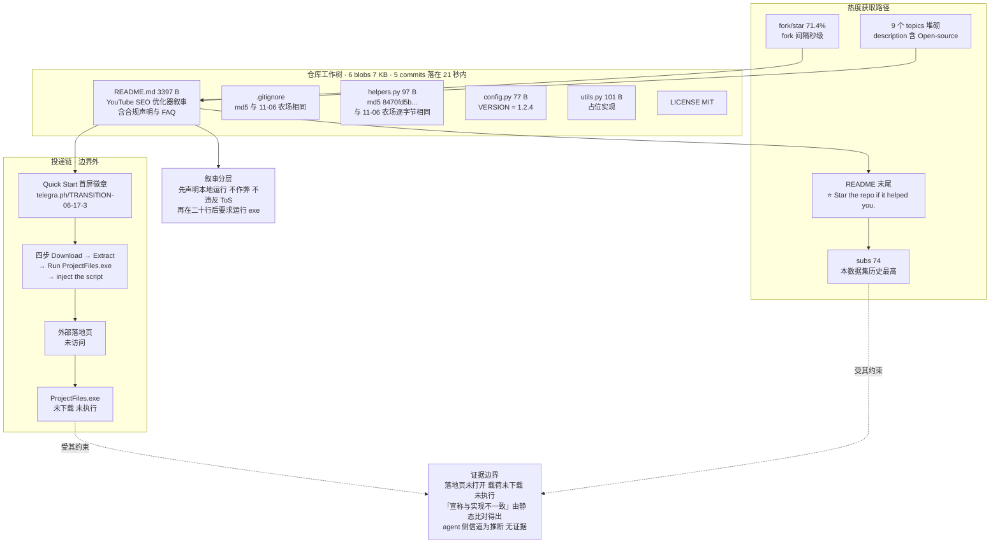

# BankerInterface/youtube-seo-optimizer

## 一句话定位
自称「开源的 YouTube SEO 优化器」的**投递壳仓库**：README 第一屏给出的是一个指向 `telegra.ph` 的「下载 Core_Update_Pack → 运行 ProjectFiles.exe」四步流程，而仓库里的「实现」只有 4 个共 280 字节的 Python 占位文件。

## 它解决的问题
**它不解决任何问题 —— 它制造问题。** 表面叙事是一个完整的产品故事：分析标题/描述/标签、检查章节与关键词、计算 SEO 分数、对比 CTR 竞品、批量导出 CSV，还附一张六行的功能表与一节 FAQ（「不需要 Google Cloud 项目吗？需要」、「保证首页排名吗？不保证」）。⭐⭐⭐⭐ **README 里的每一句「不会」都在为下一句的「但是请运行这个 exe」铺垫**：它先声明「All analysis runs locally on your machine.」（全部分析在你的机器本地运行），再在二十行之后要求用户下载一个压缩包并运行里面的 `ProjectFiles.exe`。

## 为什么值得关注（2026-11-12）

⭐⭐⭐⭐⭐ **因为它是本数据集至今记录到的「subscribers_count 最高」的仓库（74），而它同时是本数据集至今证据最完整的空壳。** 这一条把 11-08 日报得出的判据推到极限：**11-08 记录到两个 425⭐ 空壳靠 README 末尾的 `⭐ Star the repo if it helped you.` 把 subs 抬到 25 / 35；本仓库用同一个句式把 subs 抬到 74 —— 是 11-08 那两个空壳的 2.1 倍**，而它的 star 只有 119。

⭐⭐⭐⭐⭐ **且它与 11-06/11-07/11-08 记录的那批农场是同一套模板：`.gitignore` 的 md5 `e18f025c87b71b9fe481f53ac6e8235d` 与 `helpers.py` 的 md5 `8470fd5b911eacd63327be59d2562f16` 与 11-06 那四个仓库（`roblox-studio-mcp` / `roblox-performance-tool` / `crypto-portfolio-tracker` / `discord-quest-completer`）以及 11-07 的 `Steam-Idler` / `Minecraft-AFK-Bot`、11-08 的 `youtube-seo-optimizer` 同名仓库逐字节相同。** ⭐⭐⭐⭐ 即：**这是同一套投放基础设施在 2026-11-11 的第五次出现，且是第一次把它投放到了「工具/SEO」品类而非游戏外挂品类。**

⭐⭐⭐⭐⭐ **它的 fork 时间分布给出独立的机器判定**：抽样 40 个 fork，间隔中位数 **6.0 秒**，**39/40 个间隔 ≤10 秒**，全部落在 **4.0 分钟**内 —— 与 11-06 的 `roblox-studio-mcp`（5.0 s / 96.9%）、11-07 的 `Minecraft-AFK-Bot`（4.0 s / 98/99）同一量级，而与真人样本 `sheeridVerify`（74.0 s）、`ghostclick`（1555.0 s）、本日的 `impacket-rs`（8884.0 s）、`c6lang/c6`（18858.0 s）相差三到四个数量级。

⭐⭐⭐⭐⭐ **而最刺眼的是「宣称」与「实现」的落差被 README 自己放大**：README 的 `## 💻 Tech Stack & Architecture` 写「**Core:** Python 3.10+ / **API:** YouTube Data API v3 / **Auth:** OAuth 2.0 / **UI:** CLI / Web Dashboard」——而仓库里没有 API 调用代码、没有 OAuth 代码、没有 Web Dashboard，只有一个 77 字节的 `config.py`：

```python
"""Configuration for core."""

VERSION = "1.2.4"
DEBUG = True
MAX_ITEMS = 10
```

**`helpers.py` 的全部内容是一个字符串替换函数：**

```python
"""Small helper utilities."""


def format_name(name):
    return name.replace("_", "-").lower()
```

⭐⭐⭐⭐⭐ **`helpers.py` 的 md5 `8470fd5b...` 与本仓库 11-11 同日的另一家 `Nobleglusurvive/discord-quest-completer` 以及 11-06 那四家逐字节相同 —— 即 2026-11-11 这一天的两个仓库彼此之间也是同一套模板。**

## 热度来源判断
**纯投放，无真实需求驱动。** 判据是四条互相独立且全部成立的硬证据：
1. **模板血缘（跨日 + 同日双重复用）**：`.gitignore` 与 `helpers.py` 的 md5 与 11-06 起记录的农场集合逐字节相同；
2. **fork 到达时间**：40 个 fork 落在 4 分钟内、39/40 间隔 ≤10 秒（机器投放的典型形态）；
3. **代码占位**：`config.py` / `helpers.py` / `utils.py` 合计 275 字节，无一行业务逻辑；
4. **README 明写索取 star**（`⭐ Star the repo if it helped you.`）—— 即**「订阅」这个指标被明写成一条投放指令**，这正是 11-08 日报修正过的「判据被针对」现象，在本日以更高量级重演。

⭐⭐⭐⭐ **而本仓库比 11-08 那批更进一步：它把「开源」写进 description（「Open-source.」）、写进 topics（9 个）、写进 README 的 Tech Stack 与 MIT LICENSE，同时把真正的投递载荷放在第一屏 —— 即它把「开源可信度」本身当成了投放素材。** ⚠️ 本日报未执行其载荷，也未打开 `telegra.ph` 链接；此处只主张「README 宣称的实现与仓库内容不一致」这一可核验事实，不主张作者意图。

## 关键技术亮点
**本档案不设「技术亮点」一节 —— 因为该仓库没有可核验的技术实现。** 改为记录它作为**反例样本**所具备的、值得架构师观察的结构性特征：

1. **投放位：把载荷放在 Quick Start 而不是藏在末尾。** `## 🚀 Quick Start` 的第一段就是一个居中的徽章 `<a href="https://telegra.ph/TRANSITION-06-17-3">`，四个步骤是「Download Core_Update_Pack → Extract → Run ProjectFiles.exe → inject the script」。**「inject the script」这四个字出现在一个声称做 SEO 审计的工具的安装步骤里。**
2. **叙事分层：先写「本地运行/不作弊」，再写「请运行 exe」。** README 在 Quick Start 之前先声明「It does not use bots, does not generate fake views, and does not violate YouTube's Terms of Service.」——**用合规声明为随后的载荷背书**。
3. **元数据堆砌：9 个 topics（`content-creator` / `keyword-research` / `open-source` / `python` / `seo-optimizer` / `video-ranking` / `youtube-analytics` / `youtube-seo` / `youtube-tools`）与 description 的「Open-source」都指向同一个目的：让搜索与推荐把它当成一个正常的技术仓库。**
4. **秒级提交：5 个 commit 落在 21 秒内（13:00:19 → 13:00:40），标题是 `Initial commit` / `Add README.md` / `Add config.py` / `Add helpers.py` / `Add utils.py` —— 文件数与提交数一一对应，即仓库是「先造壳、再填占位」的批量生成产物。**
5. **⭐⭐⭐ 指标定向投放：README 末尾的 `⭐ Star the repo if it helped you.` 与本仓库 74 的 subs 之间的因果链，是 11-08 日报那套「判据被针对」论证在本日的可复现样本。**

## 架构师速览

| 决策问题 | 研究判断 | 证据边界 |
|---|---|---|
| 系统边界 | 仓库的「功能边界」是 README 叙事；实际的系统边界在 `telegra.ph` 落地页与 `ProjectFiles.exe` 二进制内，**不在本仓库内** | 仅基于仓库树清单（6 blobs）、README 原文、四个占位文件的逐字节内容；**落地页未打开、载荷未下载、未执行** |
| 主路径 | 用户 → README 的 Quick Start 徽章 → 外部落地页 → 下载 → 执行 → （推测）agent 侧信道；仓库内不存在等价主路径 | 徽章 URL 与四步文案直接取自 README；落地页内容未知，「agent 侧信道」为**推断，无证据** |
| 关键权衡 | 对投放者而言：真实实现成本 vs 复用模板成本 —— 复用已验证的 `.gitignore`/`helpers.py` 模板把成本降到 21 秒；代价是同模板的仓库会在 md5 维度上互相暴露 | 「21 秒完成」与两个 md5 为实测；「投放者以此降低成本」为**推断** |
| 最小 PoC | 若要核实「README 宣称的工具是否存在于仓库内」：比对 `config.py`/`helpers.py`/`utils.py` 与 README 的 Tech Stack 与 Features 表即可，**无需运行任何代码** | 本档案的全部「宣称与实现不一致」结论均由该静态比对得出；**未运行任何被投递代码** |

## 架构启发
⭐⭐⭐⭐⭐ **本日最值得架构师记的一条，不是任何技术亮点，而是一条防御性设计原则：「README 是一份不可信输入」。** 这个仓库的 README 在语法上完全正常、语气完全专业、甚至主动声明合规与「不保证排名」——**这些全都不可信，因为它们和「请运行 ProjectFiles.exe」出自同一份文件。** ⭐⭐⭐⭐ **因此，任何把 README 当作「项目说明书」来消费的下游系统（包括 AI agent 自动读 README 后安装依赖的流程）都在这个仓库上失效了。**

⭐⭐⭐⭐⭐ **第二个启发更具体：判据必须成对部署。** 11-08 已经确立了这个方法论，而本日提供了它的最强样本 —— **subscribers_count 是本数据集历史最高的 74，而它恰好是一个 7 KB、6 文件、21 秒建仓的投递壳。** 如果只用一个指标（无论 star、subs、fork 数还是 topics 数量），这个仓库都会排在前面；**只有把「代码是否存在」与「指标是否被指令污染」两个方向同时检查，才能把它筛出来。**

⭐⭐⭐⭐ **第三个启发是关于「跨日血缘」的成本收益**：**用两个文件的 md5（本例是 `.gitignore` + `helpers.py`）就足以把一个仓库与历史投放集合连起来**，成本是两次 `contents` API 调用。这比任何基于 star/fork 的启发式都便宜、都确定。**

## 架构图（MMD）

> 证据边界：此图只采用本档案已有可核验描述；标注「待核验」的节点不应视为项目实现事实。



## 定位判断
**反例样本（counter-example），刻意建档而非推荐。** 本档案的目的不是把它列进工具推荐，而是保存一份可复现的「宣称与实现不一致 + 指标被定向投放 + 跨日模板复用」三者同时成立的样本，供后续判据回归测试使用。**它的 119⭐ 与 74 subs 在本数据集的历史分布里都属高位，恰恰说明它是一个「高热度、高污染」的样本** —— 若只用热度排序，它会出现在任何榜单的前列。

## 风险 / 局限 / 泡沫点
- **⭐⭐⭐⭐⭐ 投递风险（最高优先级）：** README 第一屏要求用户下载并运行 `ProjectFiles.exe`。**本日报未下载、未运行，不对载荷行为作任何断言；但「一个声称本地运行的开源 SEO 工具，其安装步骤是下载并运行一个 exe」这一组合本身已足以要求审慎。**
- **⭐⭐⭐⭐ 指标污染：** 74 subs 与 119⭐ 同时被 README 里的索取指令抬高，用 subs 做「深度关注」判据在本仓库上失效。
- **⭐⭐⭐ 模板暴露：** 与 11-06 起的农场集合共享两个文件的 md5，**任何基于「看起来有内容」的初筛都会放过它**。
- **⭐⭐⭐ 占位代码的误导性：** `config.py` 的 `VERSION = "1.2.4"` 暗示这是一个成熟版本，**而仓库只有 5 个 commit** —— 版本号在这里是伪装而非事实。
- **⚠️ 本档案的证据边界：** 未打开 `telegra.ph` 落地页、未下载任何文件、未执行任何代码、未核实该域名在快照时刻的响应；**本档案只主张「README 宣称的实现与仓库内容不一致」与「指标被明写成投放指令」这两个可核验事实。**

## 与同类项目的关系
- **vs 同日 `Nobleglusurvive/discord-quest-completer`：** 同一套模板的两个投放实例（`.gitignore` / `helpers.py` md5 相同，README 均含 `telegra.ph` 与 `⭐ Star the repo if it helped you.`），**两者构成互为对照组 —— 一个打「SEO/工具」品类，一个打「游戏外挂」品类，而 GitHub 对两者的处置可见度相同。**
- **vs 11-06 的 `roblox-studio-mcp` / `roblox-performance-tool` / `crypto-portfolio-tracker` / `phaseboulderfetter/discord-quest-completer`：** 同模板的早期实例；**其中 `discord-quest-completer` 这个仓库名在 11-11 被另一个账号（`Nobleglusurvive`）重新使用 —— 见 `discord-quest-completer` 档案。**
- **vs 11-07 的 `Steam-Idler` / `Minecraft-AFK-Bot`：** 11-07 的两个 425⭐ 空壳是本模板的第四、第五次出现，本仓库是第六次（按日期）。
- **vs 11-08 记录的 `LumiVikinggard89137/ai--manus` 一簇（SEO 关键词投毒形态）：** 那一簇的 README 是给搜索引擎看的关键词堆；**本仓库的 README 是给人看的完整产品叙事** —— 两种「投毒」形态的对照。

## 是否值得持续跟踪
**不作为项目跟踪，但作为判据样本跟踪。** 建议关注：
1. **该模板的 md5（`.gitignore` = `e18f025c87b71b9fe481f53ac6e8235d`、`helpers.py` = `8470fd5b911eacd63327be59d2562f16`）是否继续出现在后续日期的候选集中** —— 若连续出现，说明投放基础设施在稳定运转，**「按 md5 去重」应进入常规采集流程**；
2. **`telegra.ph/TRANSITION-06-17-3` 这类落地页域名是否被复用**（本日报只记录了 URL 字符串，未访问）；
3. **`subscribers_count` 继续作为独立指标被观测** —— 本仓库 74 的 subs 是本数据集的新高，**若下一日出现 subs 过百的同类壳，则「subs 已完全不可用」的结论需要在日报里显式写明**。

## 后续观察点
- 该仓库在快照之后的 `pushed_at` 变化（快照时 `2026-11-11T13:00:41Z`，距建仓仅 24 秒）；
- 同一账号（`BankerInterface`）是否在其他日期投放同模板仓库；
- GitHub 对该仓库的后续处置（issue 关闭、仓库删除、star 回落）；
- 11-11 同日两家（`BankerInterface` 74 subs / `Nobleglusurvive` 64 subs）的 **subs 是否同步回落** —— 若是，则 subs 的「投放指令」解释进一步坐实；若是同步走高，则需要新的解释。

---
> 数据来源: GitHub REST API 快照（2026-11-12 CST，仓库创建于 2026-11-11T13:00:17Z）| Stars: 119 | Forks: 85 | Subscribers: 74 | License: MIT | 语言: Python | 创建: 2026-11-11T13:00:17Z | 体积: 7 KB / 6 blobs
> **证据边界：** 未访问 `telegra.ph`、未下载载荷、未执行任何代码；`stargazers` / `subscribers` 端点在本窗口未逐个取证（404），subs 取自 `repos/{owner}/{repo}` 的 `subscribers_count` 字段。
