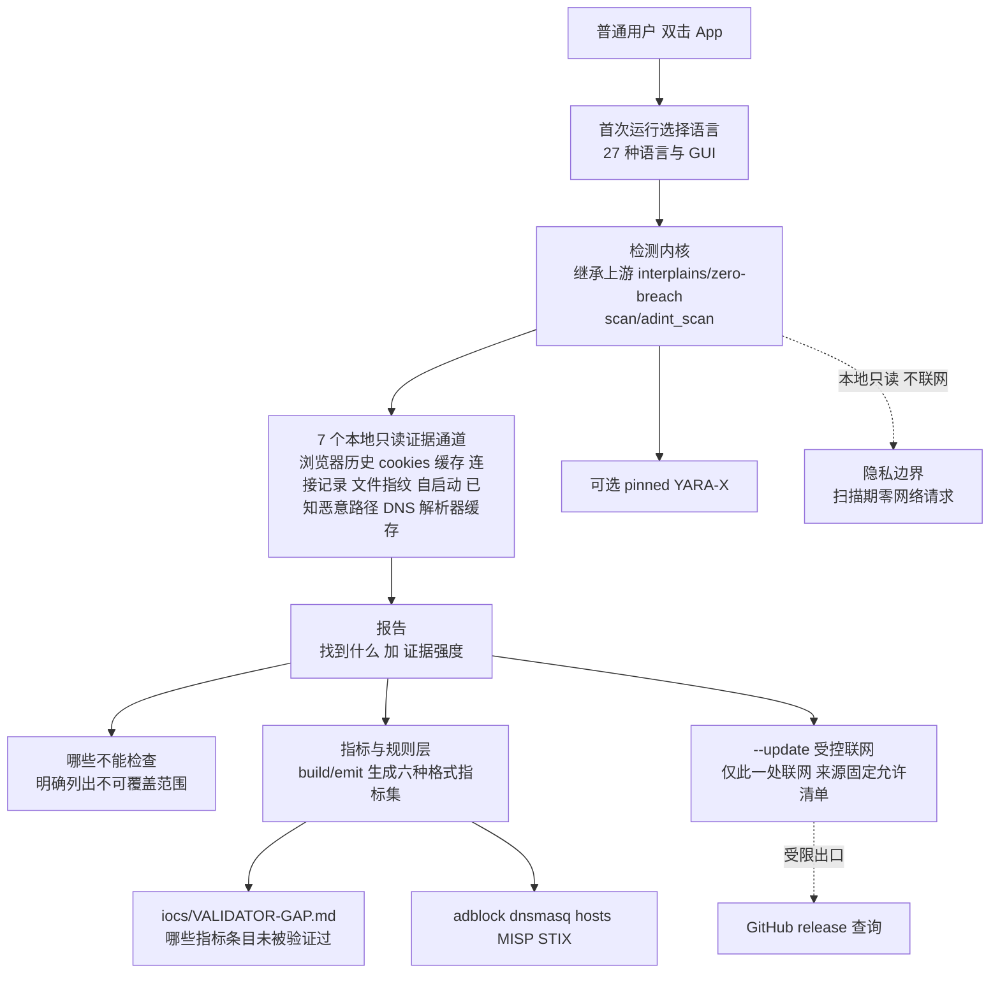

# interplains/Zero-Breach-Toolkit

> **⭐⭐⭐⭐⭐ 本档案的建档理由不同于其它项目**：它是一次**档案纠错**的产物。2026-10-30 日报把本仓库的数据写进了上游 `interplains/zero-breach` 的档案，并称二者是改名关系；2026-11-08 的持续跟踪核查发现这是错的，故本档案独立建立，把下游与上游分开。

## 一句话定位
面向**普通用户**的「双击即用」间谍软件痕迹检查工具：把上游 `interplains/zero-breach` 的研究级本地只读扫描器包装成 **Windows / Mac / Linux 的双击 App、27 种语言**，并把检查范围从电脑扩展到 **Android 手机与 iPhone 备份**。

## 它解决的问题

⭐⭐⭐⭐⭐ 上游 `zero-breach` 是一个**严肃的研究级工程**：本地只读、不联网、不需管理员、零依赖默认、Python 3.8–3.12、CI 覆盖三系统。⭐⭐⭐⭐⭐ 但它的分发方式是**从源码构建**（`build/bundle.py` + `python build/bundle.py`），面向的是愿意读代码的人。

⭐⭐⭐⭐⭐ **而「我的电脑是不是被装了间谍软件」这个问题，只有在答案足够低门槛时才有人会去问。** 一个需要 `git checkout` + `python build/bundle.py` 的工具，对真正需要它的人（担心被针对性攻击的记者、律师、活动人士、设备被政府监控的普通人）几乎没有可用性。

⭐⭐⭐⭐⭐ **Zero-Breach-Toolkit 做的正是这一层转换**：单文件安装包、图形界面、27 种语言（`locales/` 下 29 个 JSON，含 `zh.json` / `ar.json` / `fa.json` / `he.json` / `ku.json` / `sw.json` / `ta.json` / `te.json` / `tl.json` 等），**并把扫描范围扩到 Android 与 iPhone 备份**。

⭐⭐⭐⭐⭐ **而它保留（而非稀释）了上游最核心的那条纪律**：把「我的扫描器干净」与「你安全」明确切开。⭐⭐⭐⭐⭐ `PRIVACY.md` 的措辞仍然是克制的：

> - **A scan makes no intentional network requests and has no upload feature.** A guard refuses Python socket calls, and local-path checks refuse redirected files and Windows remote drives. It never resolves or visits indicator addresses. **These guards are not an operating-system network sandbox: POSIX network mounts and concurrent filesystem changes remain limitations. Use operating-system network isolation when strict offline execution is required.**
> - **`--update` uses the network only when you run it.** …… It sends no information about you or your computer beyond what any web download sends (your IP address reaches GitHub and CISA); **in particular it never sends the list of programs installed on your computer.** …… **it never does during a scan, and `--no-version-check` turns it off.**

## 为什么值得关注（2026-11-08）

⭐⭐⭐⭐⭐ **它最值得抄的是 `PRIVACY.md` 把「只在用户主动执行时才联网」这件事拆成了可核验的清单：**

- 扫描期间**没有**任何有意的网络请求，也没有上传功能；⭐⭐⭐⭐ 代码层有守卫（拒绝 Python socket 调用、拒绝被重定向的文件与 Windows 远程盘）；⭐⭐⭐⭐ **它绝不解析也不访问指标地址**；
- ⭐⭐⭐⭐⭐ **并且它主动划出了自己守卫的边界**：「These guards are not an operating-system network sandbox」——**即它没有把「我拦住了 socket」说成「我在沙箱里」**。⭐⭐⭐⭐⭐ **这与本日报连日记录的「把不能保证的写出来」是同一条纪律，而它出现在一份面向普通用户的隐私文档里，价值更高。**
- ⭐⭐⭐⭐⭐ **`--update` 的联网范围被逐项列出**：从固定允许清单下载指标列表（MVT 项目、Amnesty International、Echap、Citizen Lab，均在 `raw.githubusercontent.com`）、从 `www.cisa.gov` 下载 CISA 的在利用漏洞列表、对一小组常见程序从 CVE Program 仓库取对应记录，并向 `api.github.com` 查询最新 release 号（且仅此一次，`--no-version-check` 可关闭）。⭐⭐⭐⭐⭐ **最后这一条尤其值得记：连「检查一下有没有新版本」这种看似无害的行为，都被显式声明为「仅在你主动执行 `--update` 时发生，且只问 GitHub 一句『最新 release 号是多少』」。**

⭐⭐⭐⭐⭐ **而它的验证路径是本仓库已归档项目中最硬的一份**（下游独有的 `docs/VERIFYING.md`）：两条**互相独立**的验证 —— ① Ed25519 分离签名（附 `gpg --verify` 与 `sha256sum -c SHA256SUMS.txt`）与 ② **自行复现构建**（`git checkout v0.1.13 && python build/bundle.py && sha256sum dist/zero-breach-toolkit.py`，「**The build is deterministic, so a mismatch means something is wrong, not merely different**」）。

⭐⭐⭐⭐⭐ **并且它明写「Why there is no code signature」** —— 因为匿名运行拿不到代码签名证书（SignPath Foundation 等要求具名公开维护者），并明说「**This project does not have them, by choice. It claims no certificate, signing service or signed binary**」。⭐⭐⭐⭐⭐ **把「我没有的能力」写成一个小节，而不是留给用户去发现 —— 这在本日报记录的「反例样本」对照下尤其可贵：同期 85 个空壳仓库在 README 上堆砌伪造的 `Downloads-40K+` 徽章，而这个项目明说自己没有签名。**

⭐⭐⭐⭐⭐ **而它与上游的分工，正是本日报 2026-10-30 已记录过的那条结构（当时被记成了「改名」，今天被纠正为「上下游」）**：

| | 上游 `zero-breach` | 下游 `Zero-Breach-Toolkit` |
|---|---|---|
| ⭐ | 1,218 | **4,553** |
| subs | 13 | **44** |
| releases | 9（v0.1.0–v0.1.8） | **23（v0.1.0–v2.0.6）** |
| commits | 57 | 70 |
| 分发 | 从源码构建 | 双击 App，27 种语言 |
| 覆盖 | 电脑（Win/macOS/Linux） | 电脑 + Android + iPhone 备份 |

⭐⭐⭐⭐⭐ **「可被直接使用的那个仓库赢了 star 也赢了 subs，而真正的工程主体一直留在未发布的上游里」—— 这条 2026-10-30 的观察在今天被完整证实，而且它比当时记录的更清晰：上游 `pushed_at` 自 2026-10-20 起未动（19 天），下游在 10-27 至 11-05 期间密集发布 23 个 release。**

## 热度来源判断

4,553⭐ ⑂480（fork/star 10.5%）、**subs 44、oi 8**、70 commits、12,477 KB、Python、Apache-2.0、23 releases、contributors 3 人、User 账号（创建于 2018-05-30，仅 3 个公开仓库）。

⭐⭐⭐⭐⭐ **热度来源判断：真实需求 + 可核验的分发升级路径。**

- ⭐⭐⭐⭐⭐ **需求真实且严重**：Citizen Lab 2026-10 报告的 AdFection / Candiru 行动（Discover-Tech 用 Controlium 平台在广告渲染瞬间对设备做指纹并零点击投递 Candiru）是一个具体的、有公开记录的威胁模型，不是猜测。
- ⭐⭐⭐⭐ **subs 44 与 oi 8**：⭐⭐⭐⭐ **在 4,553⭐ 的体量下，44 个 subscriber 属于低比例（0.97%）**，与同期两个农场的 5.9% / 8.2% 差着一个量级。⭐⭐⭐⭐⭐ **且本日报已确认这个仓库的 README 不含索取 star 的语句** —— **因此这 44 个 subscriber 在修正后的判据下是可以当作真实深度关注信号的**，这是本日为数不多的「subs 可跨项目比较」的正例。
- ⭐⭐⭐⭐ **fork/star 10.5% 属真人区间**，且有明确来源：27 种语言的用户会 fork 去加自己语言的翻译（`locales/` 下有 `build/locales.py` 与逐语言 JSON，**这解释了为什么 fork 率不低**）。
- ⭐⭐⭐⭐⭐ **23 个 release（v0.1.0 于 2026-10-27 → v2.0.6 于 2026-11-05，10 天）** ⭐⭐⭐⭐ **是最强的分发升级证据**：⭐⭐⭐⭐⭐ **每个 release 携带 9–11 个 asset（多平台安装包），且 10 天内从 v0.1.x 迭代到 v2.0.x 并加了 27 种语言与 Android / iPhone 备份支持。** ⭐⭐⭐⭐ **这是「真实用户在用 → 反馈 → 发版」闭环的典型形态，与农场的一次性 commit 补录完全不同。**
- ⚠️ **但 subs 44 与 oi 8 的绝对值都偏低**，而 `pushed_at` 停在 2026-11-05（距快照 3 天）。⭐⭐ **对 4,553⭐ 而言，3 个贡献者与 8 个 open issue 是相当薄的社区面。**

## 关键技术亮点

1. **「扫描时零联网」被写成代码级守卫，而非声明**
   ⭐⭐⭐⭐⭐ `PRIVACY.md`：拒绝 Python socket 调用、拒绝被重定向的文件与 Windows 远程盘、绝不解析指标地址。⭐⭐⭐⭐⭐ **同时它划出守卫的边界**（不是 OS 级沙箱）—— **「我做了防护」与「我做了多少防护」被分成两句话。**

2. **`--update` 的联网范围被穷举，且与扫描严格分离**
   ⭐⭐⭐⭐⭐ 指标来源固定允许清单（MVT / Amnesty / Echap / Citizen Lab / CISA / CVE Program）+ 一次 release 号查询 + `--no-version-check` 开关。⭐⭐⭐⭐⭐ **并明写「never sends the list of programs installed on your computer」。**

3. **可复现的确定性构建 + 两条独立验证路径**
   ⭐⭐⭐⭐⭐ `docs/VERIFYING.md` 给出 Ed25519 分离签名（`gpg --verify` / `sha256sum -c SHA256SUMS.txt`）与自行复现构建（`python build/bundle.py` 后比对 sha256）。⭐⭐⭐⭐⭐⭐ **「The build is deterministic, so a mismatch means something is wrong, not merely different」** —— 这句话把「构建可复现」从营销语变成了可断言的性质。⭐⭐⭐⭐⭐ **而 `.github/workflows/verify-release.yml` 的存在说明这条路径被 CI 强制执行。**

4. **主动声明「我没有代码签名」**
   ⭐⭐⭐⭐⭐ `docs/CODE-SIGNING.md` 明写匿名运行拿不到签名证书，并声明「claims no certificate, signing service or signed binary」。⭐⭐⭐⭐⭐ **这是本日报记录到的、把「能力缺失」写成独立小节并给出原因的最完整案例之一。**

5. **扫描范围从电脑扩到 Android 与 iPhone 备份**
   ⭐⭐⭐⭐⭐ `docs/IPHONE.md`、`scan/tests/sweep_android.py`、`scan/tests/sweep_ios.py`、`scan/tests/data/ios_layouts.json`、`requirements-backups.txt`。⭐⭐⭐⭐⭐ **iOS 备份的解析是有真实难度的一环**（Manifest.db 体积、文件数上限），⭐⭐⭐⭐⭐ 而 2026-10-30 日报记录的 0.1.12 变更正是把 iPhone 备份上限提到 1 GiB/文件、1,000,000 manifest 行、8 GiB 总量。⭐⭐⭐⭐⭐ **上游有 `iocs/VALIDATOR-GAP.md` 明确记录 IOC 校验的缺口** —— 即「我的指标集本身有已知的验证缺口」被写成文件。

6. **多语言是被当作工程对待的**
   ⭐⭐⭐⭐ `build/locales.py` + `locales/` 下 29 个 JSON（含 `zh.json` / `ar.json` / `he.json` / `fa.json` / `ku.json` / `sw.json` / `ta.json` / `te.json` / `tl.json` / `te.json`）⭐⭐⭐⭐⭐ **29 个语言文件本身就构成一份「覆盖了哪些语言」的清单**，且 `build/locales.py` 意味着语言不是手工维护的散落文件。

7. **上游工程被完整继承而非重写**
   ⭐⭐⭐⭐⭐ `scan/` 目录（`adint-scan.py` + `adint_scan/` 包：`cli.py` / `context.py` / `iocs.py` / `localpaths.py` / `candiru_rules.py` / `modules/`）+ `build/`（`build.py` / `bundle.py` / `build_exe.py` / `emit_denylist.py` / `emit_misp.py` / `emit_stix.py` / `locales.py`）+ `dist/` 的六种指标格式输出（`adfection.adblock.txt` / `adfection.dnsmasq.conf` / `adfection.domains.txt` / `adfection.hosts.txt` / `adfection.misp.json` / `adfection.stix.json` / `adfection.withdrawals.stix.json`）。⭐⭐⭐⭐⭐ **它新增的是分发层与覆盖面，而不是重写核心检测逻辑。**

## 架构师速览

| 决策问题 | 研究判断 | 证据边界 |
|---|---|---|
| 系统边界 | **三层**：① 检测内核（继承上游 `scan/adint_scan/`，含 7 个本地证据通道 + 可选 pinned YARA-X）② 指标与规则层（`build/emit_*.py` 生成六种格式的指标集 + `iocs/VALIDATOR-GAP.md` 记录校验缺口）③ **分发与呈现层**（单文件 App、27 种语言、GUI、`--update` 的受控联网）——**第三层是本仓库相对上游的全部增量** | 依据树结构（299 文件）、`PRIVACY.md`、`docs/VERIFYING.md`、`docs/CODE-SIGNING.md`、`build/` 与 `locales/` 的文件清单；GUI 框架与打包工具链的具体实现未核验（`build/build_exe.py` 存在但未取其源码） |
| 主路径 | 用户下载单文件 App → 首次运行（可选择语言）→ 本地只读扫描（浏览器历史/cookies/缓存/连接记录/文件指纹/自启动/已知恶意路径/DNS 解析器缓存）→ 输出「找到什么 + 证据强度 + 哪些不能检查」→ 可选 `--update`（**仅此时联网**，来源固定允许清单）→ 可选导出指标集（adblock / dnsmasq / hosts / MISP / STIX） | 主路径为 README 与 `PRIVACY.md` 的语义抽象；**GUI 交互流程、扫描调度与报告渲染未逐行核验**；`docs/IPHONE.md` 与 Android 扫描的具体实现未核验 |
| 关键权衡 | **①「可复现构建」vs「签名分发」**（放弃代码签名以保持匿名可构建，代价是 SmartScreen 警告）**②「扫描时零联网」vs「指标会过期」**（靠显式的 `--update` 与固定允许清单解决，代价是需要用户主动更新）**③「普通用户可用」vs「能力面收敛」**（27 语言 + GUI 换来可及性）**④「上游维护内核 / 下游打包分发」**（避免分叉，但引入版本同步义务）**⑤「用进程内守卫冒充沙箱的风险」**（明确声明不是 OS 级沙箱，把决定权交回用户） | ①②③④⑤均有 README / `PRIVACY.md` / `docs/` 直接文本支持；**⑤的表述边界是本档案认为最值得学的一点**；④的实际版本同步机制未核验 |
| 最小 PoC | 只验三件事：(a) **断网后扫描能否完成**（这是「本地只读」的可核验形式，也是最容易被伪造的声明）；(b) **从干净 checkout 复现构建，sha256 是否与 release 一致**（`git checkout v0.1.13 && python build/bundle.py && sha256sum dist/zero-breach-toolkit.py`）；(c) **报告里「哪些不能检查」那一节是否真的非空**（若为空，则「States its limits」是话术） | PoC 三步直接取自 `docs/VERIFYING.md` 与 README 三条并列；本日报**未执行任何一步**；未在本机运行该工具 |
| 证据边界 | 全部结论基于 2026-11-08 CST 的 GitHub API 快照（`repos/` 元数据、`git/trees/HEAD?recursive=1` 的 299 文件清单、`releases` 23 条、`contributors` 3 人、`users/interplains`）与 `PRIVACY.md` / `SECURITY.md` 原文。⭐⭐⭐ **本日报未下载、未运行、未复现构建该工具的任何部分**；`docs/VERIFYING.md` 与 `docs/CODE-SIGNING.md` 的原文未逐字取回（其内容经 2026-10-30 日报的引用转述），⭐⭐⭐ **`iocs/VALIDATOR-GAP.md` 与 `scan/` 的实现未核验** | 无独立复现；oi 8 未逐条读取；本地化 JSON 的完整性未核验 |

## 架构启发

⭐⭐⭐⭐⭐ **启发一：「我没有的能力」应当有独立小节与原因。**

`docs/CODE-SIGNING.md` 的存在是本档案最想抄的一件事。⭐⭐⭐⭐⭐ 对照本日报同日的 85 个空壳仓库 —— 它们的 `CONTRIBUTING.md` 顶部挂着**伪造的 `Downloads-40K+` 与 `User Rating 4.8/5` 徽章**。⭐⭐⭐⭐⭐ **同一个生态里，一个项目明说自己没有代码签名证书并给出原因，另一个项目伪造自己被下载了 4 万次。** ⭐⭐⭐⭐⭐ **这两者的差别不是技术，是可信度的成本结构。**

⭐⭐⭐⭐⭐ **启发二：把「我的防护不是完整的」写进防护文档本身。**

「These guards are not an operating-system network sandbox; POSIX network mounts and concurrent filesystem changes remain limitations. Use operating-system network isolation when strict offline execution is required.」⭐⭐⭐⭐⭐ **这句话让一个普通用户有能力判断「在什么场景下我该关掉 Wi-Fi」—— 而这恰恰是最需要被告知的场景。** ⭐⭐⭐⭐⭐ **本日报本日记录的四个真项目都在做同类的事（phoneuse 写测试矩阵、satmux 写物理下界、ghostclick 学实测阈值、solo-to-team 写证据门槛），而这一条是它们当中最「面向非工程师」的一个版本。**

⭐⭐⭐⭐⭐ **启发三：把「唯一的联网行为」也写出来。**

`--update` 的来源清单、传输内容、以及「只问 GitHub 一次 release 号」——⭐⭐⭐⭐⭐ **一份真正可信的隐私文档不只说「我们不收集数据」，而要说「我们做的唯一一次网络请求是什么」。** ⭐⭐⭐⭐⭐ **这与 poki 的「sent: true 只意味着触摸被写入连接」是同一种精确度：把一个笼统承诺拆成可枚举的具体行为。**

⭐⭐⭐⭐⭐ **启发四：「上游做内核 / 下游做分发」是一个被低估的架构。**

⭐⭐⭐⭐⭐ **本仓库让本日报纠正了一个 10 天前的误判** —— 当时把上下游当成了「改名」。⭐⭐⭐⭐⭐ **而一旦看清是上下游，本日报 2026-10-30 就已经记下的那句观察就成立了**：「上游负责研究，下游负责可用，而 star 记在下游」。⭐⭐⭐⭐⭐ **这条结构在本仓库里是长期存在的**：上游 9 个 release 停在 10-20，下游 23 个 release 密集到 11-05，两边的 star 是 1,218 vs 4,553。⭐⭐⭐⭐⭐ **对做技术选型的人：上游是可审计的内核，下游是可用性；两者应当分别评估，而不是用下游的 star 去判断上游的质量。**

⭐⭐⭐⭐ **启发五：IOC 指标集自带「已知缺口」文件。**

`iocs/VALIDATOR-GAP.md` ⭐⭐⭐⭐⭐ **把自己的指标集里哪些条目没被验证过写成文件** —— 这与本日报反复记录的「把不确定写进产物」完全同源，只是这次的对象不是软件行为而是**数据资产**。

## 架构图（MMD）

> 证据边界：此图只采用本档案已有可核验描述；“待核验”节点不应视为项目实现事实。

## 定位判断

**工具型项目（面向最终用户的分发层；检测内核继承自上游）。**

⭐⭐⭐⭐ 它在生态里的位置很清晰：**它是那个「用户真的会去下载」的仓库**。⭐⭐⭐⭐⭐ 上游是可审计的工程但需要从源码构建，下游是双击 App 但不承诺可复现之外的深度。⭐⭐⭐⭐⭐ **它同时也是本仓库的一个方法论样本：它让本日报发现并纠正了一个持续了 10 天的档案错误。**

⭐⭐⭐⭐ **在商业间谍软件威胁的具体语境下，它的价值判断标准不该是 star，而应该是「一个担心被监控的人能否在不联网、不给管理员权限、不上传任何数据的前提下，得到一份说得清自己没查到什么的结果」** —— ⭐⭐⭐⭐⭐ **按这个标准，本仓库记录的它的设计是达标的；而「达标的判定依据」必须由使用者自己核对 `--update` 的联网范围与 `PRIVACY.md` 的边界声明。**

## 风险 / 局限 / 泡沫点

- ⚠️⚠️⚠️ **最大的结构风险是「star 记在下游、而审计发生在上游」**：⭐⭐⭐⭐ **一个想判断「这个工具是否可信」的读者，默认会去看 4,553⭐ 的那个仓库，而不是 1,218⭐ 的那个** —— 而检测逻辑、指标集与验证脚本的主体在上游。⭐⭐⭐⭐⭐ **这是本档案识别出的最需要被写在 README 首屏的结构性问题。**
- ⚠️⚠️⚠️ **没有代码签名**：⭐⭐⭐⭐ README 自己承认，并要求用户在 SmartScreen 警告时选择「More info → Run anyway」。⭐⭐⭐⭐⭐ **对一份处理「你的电脑可能被监控了」这个议题的工具来说，「先绕过 Windows 的安全警告再运行我」是一个内在张力** —— 作者给出的理由（匿名运行拿不到签名证书）成立，但张力不会被理由消除。
- ⚠️⚠️⚠️ **「进程内守卫」不是沙箱**：⭐⭐⭐⭐⭐ 它自己写明了（POSIX 网络挂载、并发文件系统变更仍是限制）。⭐⭐⭐⭐ **因此在真正的高威胁场景下，正确做法仍是 OS 级隔离 —— 而这一点要靠用户自己读 `PRIVACY.md` 才知道。**
- ⚠️⚠️ **IOC 会过期**：⭐⭐⭐⭐ 「Spyware of this grade is built to defeat exactly this kind of check, most of the evidence it leaves expires within weeks」⭐⭐⭐⭐⭐ **即：这个工具的能力上限由威胁模型本身决定，而它把这一点写在 README 里。** ⭐⭐⭐ **但 `dist/` 里的指标集仍是快照。**
- ⚠️⚠️ **指标集自带已知缺口**：`iocs/VALIDATOR-GAP.md` 记录了未验证条目 —— ⭐⭐⭐ **诚实，但也意味着「没报出来」并不等于「没有」。**
- ⚠️⚠️ **社区面极薄**：contributors 3 人、oi 8、owner 账号 3 个公开仓库。⭐⭐ **4,553⭐ 与 3 个贡献者的组合，说明这是一份高关注度但低协作度的项目。**
- ⚠️ **无 topics**（空数组）—— ⭐⭐ **在 GitHub 搜索里几乎不可发现**，这也解释了它的增长只能来自 README 内的分发与外部引用。
- ⚠️ **本日报未运行该工具**：⭐⭐⭐ **本档案全部结论来自仓库文本与元数据，工具的实际行为（是否真的不联网、构建是否真的可复现、报告是否真的列出「不能检查」的部分）本窗口一律未验证。**
- ⚠️ **合规面**：⭐⭐⭐ 在某些司法辖区，扫描本机可能涉及法律边界；⭐⭐⭐⭐ **本日报未查阅任何司法辖区的规定，此项列为待核验而非结论。**

## 与同类项目的关系

- **vs 上游 `interplains/zero-breach`（`projects/zero-breach.md`）**：⭐⭐⭐⭐⭐ **最重要的关系，且本日刚刚被纠正。** ⭐⭐⭐⭐⭐ **两者是各自独立创建的仓库（`id 1424399708` vs `id 1433297111`，均 `fork=False` / `parent=None`），不是改名关系。** ⭐⭐⭐⭐ **上游 = 检测内核与研究主体（1,218⭐ · 9 release · 19 天无 push）；下游 = 分发与覆盖面（4,553⭐ · 23 release · 10 天密集迭代）。** ⭐⭐⭐⭐⭐ **评估时应分别评估：审计上游，试用下游。**
- **vs `trailofbits/brotli-checker`（2026-10-26 建档）**：⭐⭐⭐⭐⭐ **两者是本仓库里「把扫描结论分级」的两种形态**：brotli-checker 用**四档退出码**（0 / 1 / 2 / 3）表达「命中 / 需复核 / 参数无效」并明写「**exit 0 does not establish that the running app is fixed**」；zero-breach 家族用**报告三段式**（找到什么 + 证据强度 + 哪些不能检查）表达同一件事。⭐⭐⭐⭐⭐ **一个面向命令行与 CI，一个面向普通用户 —— 但两者都拒绝把「没查出来」折叠成「没问题」。**
- **vs `assetnote/node2shell-scanner`（2026-10-26 建档）**：⭐⭐⭐⭐⭐ **同样是三态输出**（`vulnerable: true / false / null` + `INCONCLUSIVE`），但走的是**主动式**路线（黑盒探测）而 zero-breach 是**离线式**（读本机残留痕迹）。⭐⭐⭐⭐⭐ **「探针到达有效路由 / 响应类可区分 / 端点仍稳定」三条同时成立才判为 vulnerable —— 与 zero-breach 的「证据强度 + 哪些不能检查」是同一纪律的两条技术路线。**
- **vs 商业取证服务（Mandiant / CrowdStrike）**：⭐⭐⭐⭐⭐ **这是它存在的理由**：闭源 + 收费 + 通常需联网。⭐⭐⭐⭐ **zero-breach 家族提供的是一个免费、闭源为零、可离线运行、且**自证限制**的替代 —— 代价是检测深度与厂商的规则库不可同日而语。**
- **vs `MVT`（Amnesty International 的开源移动取证工具）**：⭐⭐⭐⭐⭐ **注意一个有趣的关系：Zero-Breach-Toolkit 的 `--update` 从 MVT 项目下载指标列表** —— 即它把 MVT 当作指标来源之一。⭐⭐⭐⭐⭐ **两个工具不是竞品而是「指标来源 ↔ 消费方」的关系。**
- **vs `lxe/phoneuse`（本日同批建档）**：⭐⭐⭐⭐⭐ **两者的纪律完全同源但面向不同人群**：phoneuse 在 README 第一屏写「Under heavy construction」并给出实测环境表；zero-breach 在 `PRIVACY.md` 写「These guards are not an operating-system network sandbox」并给出 OS 级隔离的建议。⭐⭐⭐⭐⭐ **两者都做了一件同一件事：把自己的防护边界摆在防护旁边。**

## 是否值得持续跟踪

**值得跟踪，且优先度高于多数同类项目。** ⭐⭐⭐⭐⭐

⭐⭐⭐⭐⭐ **理由一：它是本仓库的一个纠错产物。** ⭐⭐⭐⭐⭐ 2026-10-30 日报把它的数据写进了上游档案并称其为「改名」—— 这个错误在仓库里存在了 10 天，本日报的持续跟踪核查把它找了出来。⭐⭐⭐⭐⭐ **一个研究仓库如果只能发现新项目、不能纠正自己的错误，它的档案就会随时间积累噪声。**

⭐⭐⭐⭐⭐ **理由二：它在本仓库的「反 SaaS 自我定位 + 主动声明局限」这条线上是一个高质量样本**，且它的样本点与本日报本日记录的真项目一致（phoneuse / satmux / ghostclick / solo-to-team-skills）。

⭐⭐⭐⭐ **跟踪它应该盯的**：(a) 上游 `zero-breach` 的 19 天无 push 是否恢复（若上游长期停更，下游会 fork 上游，破坏「内核在上游」的结构）；(b) `docs/CODE-SIGNING.md` 是否出现签名（若出现，是可核验的能力提升）；(c) `iocs/VALIDATOR-GAP.md` 的缺口是否收敛；(d) oi 8 是否增长。

## 后续观察点

1. **⭐⭐⭐⭐⭐ 上游 `interplains/zero-breach` 的 `pushed_at` 仍停在 2026-10-20T14:26:41Z（19 天无提交）**：若继续不动，下游很可能需要内联上游代码，届时的 `NOTICE` 归属与许可边界需要重新核验。
2. **⭐⭐⭐⭐ 是否获得代码签名**：目前明写没有；一旦有，`docs/CODE-SIGNING.md` 应更新，且这是可核验的能力提升。
3. **⭐⭐⭐⭐ `iocs/VALIDATOR-GAP.md` 的缺口清单是否收敛**：指标集的质量直接决定扫描结果的覆盖面。
4. **⭐⭐⭐⭐ 27 种语言的完整性**：`locales/` 下 29 个 JSON 的实际翻译覆盖率与是否有占位符残留，本窗口未核验。
5. **⭐⭐⭐ `docs/VERIFYING.md` 与 `docs/CODE-SIGNING.md` 的原文**：本档案的相关描述经 2026-10-30 日报转述引用，**原文未逐字取回**，需要补齐。
6. **⭐⭐⭐ 是否出现 Android 与 iPhone 备份路径上的边界文档**：`docs/IPHONE.md` 的备份上限与 Manifest.db 处理策略值得单独核验。
7. **⭐⭐⭐⭐⭐ 本仓库结构性问题是否被修掉**：下游 README 是否应当显式指向「审计请看上游 `interplains/zero-breach`」—— **若上游作者自行补上这条，本档案的核心观察即完成闭环。**

---
*首次记录：2026-11-08*
