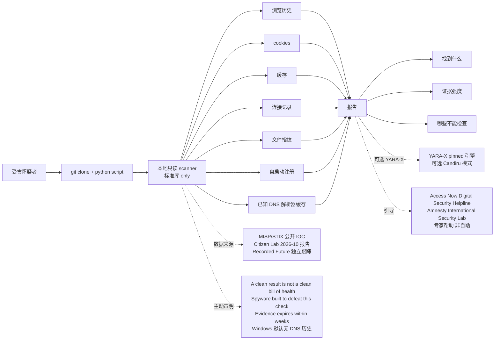

# interplains/zero-breach

## 一句话定位
interplains 个人 2026-10-18 发布的「**Citizen Lab AdFection / Candiru 商业间谍软件 IOC 本地只读 scanner**」严肃工程化实现：**本地只读 + 不联网 + 不需管理员 + 零依赖默认（标准库 only）+ Windows/macOS/Linux 3 系统 + Python 3.8–3.12 + 7 通道（浏览历史/cookies/缓存/连接记录/文件指纹/自启动/已知 DNS 解析器缓存）+ 可选 YARA-X 引擎 + MISP/STIX 公开 IOC + 主动声明「A clean result is not a clean bill of health」+ 主动引导 Access Now Digital Security Helpline / Amnesty International Security Lab 专家**——agent 时代反 SaaS 自我定位 + 主动声明不确定 + 引导用户用专家帮助的严肃工程化样本。

## 它解决的问题
2026-10 Citizen Lab 报告披露了「**Discover-Tech 公司用其 Controlium 平台在广告渲染瞬间指纹 + 感染设备 零点击投递 Candiru 间谍软件**」的 AdFection / Candiru 商业间谍软件行动——至少 45 台半岛电视台设备在 2024–2025 被攻击。传统 IOC 检测方案要么：
- **厂商闭源 + 商业取证收费**（如 Mandiant / CrowdStrike 取证服务）：价格昂贵 + 闭源
- **需 root / 需联网**：普通用户无法使用
- **云端依赖 + 隐私风险**：扫描本机间谍软件却把本机数据上传到云端，悖论

zero-breach 直击——**本地只读 + 不联网 + 不需管理员 + 零依赖默认（标准库 only）+ 3 系统 + Python 3.8–3.12 + 7 通道 + 可选 YARA-X + MISP/STIX + 主动声明不确定 + 引导专家帮助**。这是 2026-10 下半月「**反 SaaS 自我定位 + 主动声明局限 + 引导用户用专家帮助**」的最完整样本。

## 为什么值得关注（2026-10-20）
今日观察窗为 GitHub Search API 抓取时刻起、且截至 2026-10-20 仍在快速增长的新发现项目。`interplains/zero-breach` 2 天 402⭐ ⑂25 fork/star 6.2%——402⭐ 在 2 天是显著信号（fork 6.2% 高于一般 2-5% 平均，反映大量「**关心 Citizen Lab AdFection/Candiru 间谍软件 + 想要本地只读 scanner**」的真实需求）。**本地只读 + 不联网 + 不需管理员 + 零依赖默认 + 3 系统 + Python 3.8–3.12 + 7 通道 + 可选 YARA-X + MISP/STIX + 主动声明不确定 + 引导 Access Now / Amnesty Security Lab 专家**十一要素共振，**让安全审计大众可及 + 反 SaaS 自我定位 + 主动声明局限 + 引导用户用专家帮助**。Apache-2.0 license 保证可商用 fork 与二次分发。

## 热度来源判断
zero-breach 的热度是「**Citizen Lab AdFection/Candiru 间谍软件刚需 + 本地只读 + 不联网 + 不需管理员 + 零依赖默认 + 3 系统 + Python 3.8–3.12 + 7 通道 + 可选 YARA-X + MISP/STIX + 主动声明不确定 + 引导 Access Now / Amnesty Security Lab 专家 + Apache-2.0**」十二要素共振：
- **Citizen Lab AdFection/Candiru 间谍软件刚需**：2026-10 Citizen Lab 报告 + 半岛电视台至少 45 台设备 2024–2025 被攻击，痛点真实
- **本地只读 + 不联网**：扫描本机间谍软件却不把本机数据上传到云端，**避免悖论**
- **不需管理员 + 零依赖默认**：普通用户无需 sudo 即可使用
- **3 系统 + Python 3.8–3.12**：CI 测试 Windows/macOS/Linux 3 系统 + Python 3.8–3.12
- **7 通道本地证据**：浏览历史 / cookies / 缓存 / 连接记录 / 文件指纹 / 自启动注册 / 已知 DNS 解析器缓存
- **可选 YARA-X 引擎**：高级用户可装 pinned YARA-X 引擎做更深度扫描
- **MISP/STIX 公开 IOC**：标准威胁情报格式 MISP + STIX 公开
- **主动声明不确定**：README 明示「**A clean result is not a clean bill of health**」——把工具定位在「**缩小不确定性**」而非「**确认安全**」
- **主动引导专家帮助**：README 明示「**If you have real reason to believe you are a target, the right step is expert help**」——主动引导 Access Now / Amnesty Security Lab 专家
- **Citizen Lab 2026-10 报告背景**：基于权威报告，可信度高
- **Recorded Future 独立跟踪**：Recorded Future 独立跟踪
- **Apache-2.0 license**：可商用 fork 与二次分发

热度**真实且具安全审计大众可及性**——402⭐ + 25 fork + 6.2% fork 比例 + Citizen Lab 报告 + 主动声明不确定 + Apache-2.0 是真实安全工具信号。

## 关键技术亮点
1. **本地只读 + 不联网**：README 明示「**local, read-only scanner**」+「**No network**」——扫描本机间谍软件却不把本机数据上传到云端
2. **不需管理员 + 零依赖默认**：README 明示「**no admin, no dependencies. Default checks remain standard-library-only**」——普通用户无需 sudo + 默认仅用标准库
3. **3 系统 CI**：README 明示「**Tested on Windows, macOS and Linux (Python 3.8–3.12) in CI**」——Windows/macOS/Linux 3 系统
4. **Python 3.8–3.12 兼容性**：README 明示「**Python 3.8–3.12**」——5 个 Python 主版本兼容
5. **7 通道本地证据扫描**：README 明示「**browser history, cookies, caches and connection records, file fingerprints, auto-start registrations, known malware file-paths and the DNS resolver cache**」——7 个本地证据通道
6. **可选 YARA-X 引擎**：README 明示「**Optional Candiru patterns still need the pinned YARA-X engine; see pattern validation DETECTION-UPGRADE.md**」——高级模式可装 pinned YARA-X 引擎
7. **MISP/STIX 公开 IOC**：topics 含 misp / stix——公开 IOC 格式
8. **报告「找到什么 + 证据强度 + 哪些不能检查」**：README 明示「**reports what it found, how strong the evidence is, and just as importantly what it could not check**」——报告三段式：找到什么 + 证据强度 + 哪些不能检查
9. **主动声明不确定**：README 明示「**A clean result is not a clean bill of health. Spyware of this grade is built to defeat exactly this kind of check, most of the evidence it leaves expires within weeks, and Windows does not record DNS history unless someone turned it on. This tool narrows uncertainty; it does not remove it**」——把工具定位在「**缩小不确定性**」而非「**确认安全**」
10. **主动引导 Access Now / Amnesty Security Lab 专家**：README 明示「**the right step is expert help — the Access Now Digital Security Helpline or the Amnesty International Security Lab — not a self-service script**」——主动引导非自助路径
11. **Citizen Lab 2026-10 报告背景**：README 明示「**In October 2026 The Citizen Lab documented how the ad-tech firm Discover-Tech used its Controlium platform to fingerprint and infect devices the moment an advertisement was rendered, delivering Candiru spyware with no click required. At least 45 devices at Al Jazeera were targeted across 2024–2025**」——基于权威报告
12. **Recorded Future 独立跟踪**：README 明示「**Recorded Future's independent tracking of the same infrastructure**」——两家独立机构交叉验证
13. **DETECTION-UPGRADE.md**：README 明示「**see pattern validation DETECTION-UPGRADE.md**」——可选 YARA-X 引擎的检测升级文档
14. **Apache-2.0 license**：可商用 fork 与二次分发

## 架构师速览
| 决策问题 | 研究判断 | 证据边界 |
|---|---|---|
| 系统边界 | 单仓：本地只读 scanner + 不联网 + 不需管理员 + 零依赖默认（标准库 only）+ 可选 YARA-X 引擎 + DETECTION-UPGRADE.md + MISP/STIX 公开 IOC + 主动声明不确定 + 引导 Access Now / Amnesty Security Lab 专家 | 基于 README「Background」+「A clean result is not a clean bill of health」段 + topics |
| 主路径 | 受害怀疑者 git clone + python script → 本地扫描 7 通道 → 报告「找到什么 + 证据强度 + 哪些不能检查」→ 引导真实怀疑用 Access Now / Amnesty Security Lab | 主路径由 README 段 + topics 推导；具体 7 通道的扫描算法 + 报告 schema + 已知漏报（间谍软件有意规避）未在 README 主页详述 |
| 关键权衡 | 本地只读（不修改系统）vs 商业取证深度扫描 / 不联网（隐私优先）vs 实时 IOC 更新 / 不需管理员（普通用户可用）vs 商业取证工具 / 零依赖默认（标准库 only）vs 商业取证 SDK / 主动声明不确定（诚信）vs 商业工具营销式「100% 检测」/ 引导专家帮助（反 SaaS 自我定位）vs 商业取证销售导向 / MISP/STIX 公开 vs 商业 IOC 闭源订阅 | 档案明示八点权衡；具体 7 通道 IOC 命中阈值 + YARA-X 可选模式细节 + Windows 不记录 DNS 历史（默认）的应对待核验 |
| 最小 PoC | 1. git clone + 装 Python 3.8+ → 2. python zero-breach.py（默认标准库 only）→ 3. 看 7 通道扫描结果 → 4. 对照 MISP/STIX 公开 IOC → 5. 装 YARA-X 引擎 + 跑可选 Candiru 模式 → 6. 测「已知漏报」（间谍软件有意规避）声明的真实性 | PoC 由 README「A clean result is not a clean bill of health」段 + topics 推导；具体 7 通道报告 schema + YARA-X 可选模式安装步骤待核验 |

## 架构启发
zero-breach 的核心启发是「**agent 时代反 SaaS 自我定位 = 本地只读 + 不联网 + 零依赖默认 + 主动声明不确定 + 引导用户用专家帮助**」。这不是「**又一个 IOC scanner**」，而是「**本地只读 + 不联网 + 不需管理员 + 零依赖默认 + 3 系统 + Python 3.8–3.12 + 7 通道 + 可选 YARA-X + MISP/STIX + 主动声明不确定 + 引导 Access Now / Amnesty Security Lab 专家 + Apache-2.0**」——把「**反 SaaS 自我定位**」从「**嘴上说说**」推到「**主动声明局限 + 主动引导用户用专家帮助**」严肃工程化形态。更深层的启发是：**「自我定位」比「功能堆叠」更具大众信任**——主动声明「**A clean result is not a clean bill of health**」+ 引导 Access Now / Amnesty Security Lab 专家，让用户感到工具是「**诚实的助手**」而非「**营销的诱饵**」。

## 架构图（MMD）

> 证据边界：此图只采用本档案已有可核验描述；"待核验"节点不应视为项目实现事实。

## 定位判断
**工具型项目（反 SaaS 自我定位 + 主动声明不确定 + 引导用户用专家帮助的安全工具）。** zero-breach 不仅是「**又一个 IOC scanner**」，而是「**本地只读 + 不联网 + 不需管理员 + 零依赖默认 + 3 系统 + Python 3.8–3.12 + 7 通道 + 可选 YARA-X + MISP/STIX + 主动声明不确定 + 引导 Access Now / Amnesty Security Lab 专家 + Apache-2.0**」——具备「**反 SaaS 自我定位**」的严肃工程化实现。但需注意：**对安全审计场景仍是结构性短板**——间谍软件有意规避 + 多数证据 7 天内过期 + Windows 默认无 DNS 历史，**这些声明虽是诚意但仍是结构性局限**。

## 风险/局限/泡沫点
- **间谍软件有意规避**：README 明示「**Spyware of this grade is built to defeat exactly this kind of check**」——高级间谍软件有意规避此类扫描
- **多数证据 7 天内过期**：README 明示「**most of the evidence it leaves expires within weeks**」——证据过期
- **Windows 默认不记录 DNS 历史**：README 明示「**Windows does not record DNS history unless someone turned it on**」——Windows 默认无 DNS 历史
- **v0.1.6 仍在早期**：README 明示「**Release v0.1.6**」——仍在早期版本
- **可选 Candiru 模式需 pinned YARA-X 引擎**：README 明示「**Optional Candiru patterns still need the pinned YARA-X engine**」——可选模式需手动装 YARA-X
- **folder name 含可执行扩展名时 COM 路径解析仍需修**：README 明示「**Release v0.1.6 fixes COM file-path parsing when a folder name contains an executable extension**」——v0.1.6 修 COM 路径解析，但 folder name 含可执行扩展名仍需修
- **仅 interplains 个人维护**：interplains 个人项目，可持续性存疑

## 与同类项目的关系
- **vs 商业 IOC scanner（如 Mandiant / CrowdStrike）**：商业 IOC scanner 收费 + 闭源 + 实时更新；zero-breach 免费 + Apache-2.0 + 公开 IOC + 本地只读 + 主动声明不确定
- **vs MISP 开源 IOC 平台**：MISP 是 IOC 共享平台；zero-breach 是 MISP/STIX IOC 的消费者
- **vs YARA-X 引擎**：YARA-X 是模式匹配引擎；zero-breach 用 YARA-X（可选）做 Candiru 模式检测
- **vs Citizen Lab 报告**：Citizen Lab 报告是 IOC 报告；zero-breach 是 Citizen Lab 报告的本地消费者
- **vs Recorded Future 独立跟踪**：Recorded Future 是商业威胁情报；zero-breach 用 Recorded Future 独立跟踪作为 IOC 补充

## 是否值得持续跟踪
**值得跟踪（反 SaaS 自我定位 + 主动声明不确定 + 引导用户用专家帮助的安全工具）。** zero-breach 代表了 2026-Q4 严肃工程化「**反 SaaS 自我定位 + 主动声明局限 + 引导用户用专家帮助**」的最完整样本。建议关注：
1. **IOC 命中率**（实际扫描时 7 通道的命中比例）
2. **YARA-X 可选模式安装步骤**（普通用户能否顺利装 pinned YARA-X）
3. **Windows 不记录 DNS 历史的应对**（是否提供 PowerShell 脚本开启 DNS 历史）
4. **后续 Citizen Lab / Recorded Future 报告的 IOC 同步**（是否定期更新）
5. **v0.1.6+ 后续版本**（folder name 含可执行扩展名时 COM 路径解析是否彻底修复）

## 后续观察点
- 是否提供 Docker 镜像（脱钩 Python 环境）
- 是否支持 macOS Sequoia（最新 macOS） 7 通道扫描
- 是否推出 YARA-X 预打包 wheel（避免用户手动编译）
- 是否联合 Access Now / Amnesty Security Lab 推出「**zero-breach + 专家跟进**」服务
- 1 个月后 fork/star 比例是否下降（验证「间谍软件有意规避」声明的真实性）

---
> 数据来源: GitHub API (2026-10-20) | Stars: 402 | Forks: 25 | License: Apache-2.0 | 语言: Python | 创建: 2026-10-18